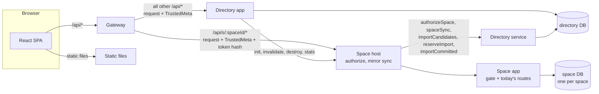
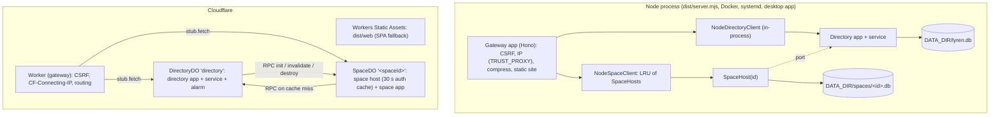

# Multi-user spaces, accounts and the Cloudflare runtime: design

Status: **binding design** for the implementation phases P1–P8 (§15). Written 2026-10-17; revised the same day
after three independent reviews (security, Cloudflare platform, compatibility). Appendix C lists every review
finding and what was done with it.

This document is the contract for the agents and engineers who implement multi-user spaces, invitations,
passkeys, per-space export/import with user remapping, and a second runtime on Cloudflare (Workers +
SQLite-backed Durable Objects, free tier). It extends SPEC.md; where the two disagree, this document wins
for the areas it covers, and the phase that changes a behaviour also updates SPEC.md (the list is in §15.10).
Each phase is done by someone who has only this document, the repository and the research files:

- `research/platform.md`: Cloudflare limits, Durable Object (DO) SQL behaviour measured in local workerd,
  mail options, wrangler, the Deploy button, tests with `@cloudflare/vitest-plugin`.
- `research/codebase.md`: how portable this codebase is, with counts and file:line references.
- `research/auth.md`: passkeys, password hashing cost, the SMTP client proof of concept, token rules, the
  directory schema draft, email normalization.

(The research files are not part of the repository; they are handed to each phase together with this
document, and the probe code sits next to them in `cf-platform/`, `cf-codemap/` and `cf-auth/`. Everything an
implementer needs is restated here. The probes are just evidence.)

Conventions: MUST / MUST NOT / SHOULD as in RFC 2119. Paths are relative to the repository root. **Node**
means every distribution that runs the server on Node.js: `npm start` / `dist/server.mjs`, Docker, the release
tarball on Ubuntu/systemd, the Windows single-file tray app and the Linux single binary. **CF** means the new
Cloudflare runtime. "Space app", "directory app" and "gateway" are defined in §2. Citations like
`server/src/app.ts:81` refer to the code as of this writing.

---------------------------------------------------------------------------------------------------------

## Contents

1. Goals, non-goals and traceability
2. Architecture
3. Data model: directory, spaces, migrations, the legacy upgrade
4. Identifiers
5. Accounts and authentication
6. Roles and permissions
7. API reference
8. Space export and import (archive v2) with user remapping
9. Node runtime
10. Cloudflare runtime and deployment plan
11. Free-tier budget and quotas
12. Web client
13. Security analysis
14. Testing strategy
15. Implementation plan
16. Decisions log
- Appendix A: user-visible changes for existing installs
- Appendix B: configuration variables
- Appendix C: review log

---------------------------------------------------------------------------------------------------------

## 1. Goals, non-goals and traceability

### 1.1 Goals

- **G1 Spaces.** A space holds projects (and everything under them: milestones, epics, tasks, tags, statuses,
  boards, comments, work logs, activity, settings). A user can belong to many spaces with a role in each.
- **G2 Accounts.** New accounts have a valid email address, verified when the instance can send mail.
  Users sign in with email (or a legacy username) and a password, or with a passkey.
- **G3 Signup control.** One instance setting turns open signup off. In `invite_only` mode an account can only
  be created by accepting an emailed invitation from an existing user.
- **G4 Data portability.** A space owner can download the whole space as one self-describing archive, and
  import it on another instance (or the same one), mapping the archive's users to accounts there.
- **G5 Cloudflare.** A public instance runs on the Cloudflare **free** plan: Workers, Workers Static Assets and
  SQLite-backed Durable Objects. It is deployed from this public repository with no secret, account id or
  personal domain committed, and anyone can deploy their own copy (a fork plus a manual GitHub workflow, or
  the Deploy to Cloudflare button).
- **G6 Self-hosting stays first-class.** Every existing distribution keeps working. Existing installs upgrade
  automatically and keep their data, links and sign-in. Nothing third-party is *required*: mail and
  Cloudflare are opt-in for the operator, and the browser still never loads anything from another origin.

### 1.2 Non-goals (not in this work)

Real-time collaboration (WebSockets, live cursors); cross-space search, boards or dashboards; task assignees
or @mentions; activity notifications by email; per-project permissions; SSO/OAuth/SAML; TOTP; CAPTCHA
(Turnstile is a possible later option, §13.14); billing; D1, KV, R2, Queues or other Cloudflare products;
anything that needs Workers Paid (it remains an upgrade path, §11.5); moving a project between spaces in place
(use export/import); sharing single projects or boards publicly; point-in-time undo of an import on Cloudflare
(deferred, §8.8); per-user write budgets across spaces (budgets are per space and per instance, §11.4).

### 1.3 Traceability: user requirements to design

| # | Requirement (user's words, condensed) | How it is met | Where |
|---|---|---|---|
| R1 | Deploy a public instance to Cloudflare; build features, IaC and a deployment plan, but don't deploy yet | Worker + DO runtime, `wrangler.jsonc`, a manual GitHub deploy workflow, a Deploy button, a step-by-step runbook | §10, §15 P3/P8 |
| R2 | The repo is public: no secrets in it | Secrets only as Wrangler secrets or GitHub secrets; per-deployer values as vars (dashboard / `--var`); placeholders such as `plan.example.com` in docs | §10.6, §10.8, §13.13 |
| R3 | The repo stays self-hostable | Node runtime kept for all distributions; mail optional; automatic upgrade; backup sets | §9, App. A |
| R4 | Spaces contain multiple projects | One SQLite database per space with today's domain schema | §3.3 |
| R5 | Users can access multiple spaces | `memberships` in the directory; space switcher | §3.2, §6, §12 |
| R6 | A space only the user can access, to which they can add others | Every new account gets a default space it owns; any owner/admin invites others | §5.8.4, §5.8.8 |
| R7 | Turn off signups; new accounts only when invited by an existing user via email | Instance setting `signupPolicy` = `open` / `invite_only` / `closed` | §5.3, §5.8.8 |
| R8 | A valid email address is needed to create an account | Normalized, syntax-checked email; verified by the emailed link when mail is configured | §5.2, §5.8 |
| R9 | Each space has an independent dataset; its owner can download the whole space | Per-space DB; owner-only `GET …/data/export` (gzip JSON archive v2) on both runtimes | §8.2 |
| R10 | Move from the hosted service to one's own deployment | Import an archive into a new space on any instance | §8.4 |
| R11 | Remap users on import | Analyze → mapping UI → commit; targets limited to users the importer can see, or "keep as former member" | §8.4–8.6 |
| R12 | Passkeys for login | `@simplewebauthn/server` 14.0.3 / `browser` 14.0.0; discoverable credentials, UV required | §5.6 |
| R13 | Hosted on Cloudflare, services at my discretion | Workers + Static Assets + SQLite DOs; mail through SMTP / an HTTPS API / CF Email (Paid) | §10 |
| R14 | Free tier at least to start | CPU-heavy work in DOs; one DO request per API call in the common case; conditional reads (304) and single-scan statistics against the rows-read quota; daily budgets, quotas and guards | §6.4.2, §11 |
| R15 | Anyone can deploy it, not only one live deployment | No deployer-specific config committed; fork + workflow or Deploy button; code defaults per runtime | §10.9, §10.10 |
| R16 | Unattended: no questions | Every open point is decided here; the reasons are in §16 | §16 |

---------------------------------------------------------------------------------------------------------

## 2. Architecture

### 2.1 Overview

Three logical HTTP applications, built from runtime-neutral TypeScript, plus a thin runtime layer per platform:

- **Gateway**: the only public entry. It refuses non-canonical API paths (§6.4.1), checks the CSRF header,
  pre-checks `Content-Length` against the body limits, works out the client IP and whether the request is
  HTTPS, routes requests, and for space requests extracts the session token from the cookie and hashes it. On
  CF it also refuses API requests for a host other than `PUBLIC_URL`'s (§10.2). It never touches a database.
  It talks to the other two only through the async interfaces in §2.3.
- **Directory app** (`createDirectoryApp`): accounts, sessions, passkeys, email tokens, invitations, spaces and
  memberships, instance settings, throttling, security events. It runs next to the **directory database**.
- **Space app** (`createSpaceApp`): today's domain routes, unchanged route bodies (§2.4), one app instance per
  **space database**. It never sees cookies. It receives a trusted identity from its **space host**
  (`space/host.ts`), which authorizes each request against the directory and syncs the users mirror. The space
  app's first middleware is the **gate** (§6.4): it looks up the rule of the route that actually matched (not a
  path pattern) and applies the role, re-auth, import-status, size, budget and conditional-read rules.



**Node** runs all of it in one process: the gateway is a Hono app served by `@hono/node-server`, and the
clients are in-process function calls. **CF** splits it across isolates: the Worker is the gateway, one
`DirectoryDO` (a singleton named `directory`) hosts the directory app and service, and one `SpaceDO` per space
(named by the space id) hosts the space host and app.



### 2.2 Request flows

**(a) Directory call on Node**, e.g. `POST /api/auth/login`:
1. Gateway: canonical-path check (§6.4.1; else 404); CSRF check (`X-Lyren-Request: 1` on non-GET/HEAD/OPTIONS,
   as `server/src/auth/middleware.ts:43` does today); `Content-Length` pre-check;
   `meta = { clientIp, secure, requestId, userAgent }` (clientIp by today's `TRUST_PROXY` rule,
   `server/src/auth/middleware.ts:55`).
2. `NodeDirectoryClient.serve(request, meta)` → `directoryApp.fetch(request, { meta })`.
3. Directory app: its own session middleware (it reads and sets the cookie), auth gate, `bodyLimit`, route.
4. Gateway: `compress()` (Node only) and returns the response.

**(b) Space call on Node**, e.g. `PATCH /api/s/7k2m…/tasks/12`:
1. Gateway: canonical path; CSRF; `Content-Length` pre-check; validate `spaceId` (§4.2; invalid → 404
   `not_found`); `{ token, source } = readSessionToken(Cookie, meta.secure)` (§5.4.1); no token → 401
   `unauthorized` (no space is opened). `meta.sessionTokenHash = sha256Hex(token)`, `meta.sessionCookie =
   source`; the request is rebuilt without the `Cookie` header.
2. `NodeSpaceClient.serve(spaceId, request, meta)`: get or open the `SpaceHost` (LRU, §9.3); a missing file → 404.
3. `SpaceHost.serve`: rewrite the path `/api/s/<id>/tasks/12` → `/api/tasks/12`;
   `directory.authorizeSpace({ tokenHash, spaceId, cookie: source, secure })` (in-process, no cache on Node) →
   401 / 404 / identity; mirror sync if the identity's `syncVersion` is ahead (§3.5); self-heal the actor's
   mirror row; `spaceApp.fetch(rewritten, { identity, fromCache, reauthorize, meta })`. Inside the space app, the gate
   (§6.4) finds the matched route's rule and applies it (role, re-auth, conditional read, …) before the handler.
4. Gateway: `compress()`, return.

**(c) Directory call on CF**: Worker: host check (§10.2); canonical path; CSRF; `Content-Length` pre-check;
`meta` (clientIp = `CF-Connecting-IP`, secure = `url.protocol === 'https:'`); delete any client-sent
`x-lyren-meta` header, then set it to `base64url(JSON(meta))`; `env.DIRECTORY.getByName('directory').fetch(request)`.
`DirectoryDO.fetch` decodes the meta and calls `directoryApp.fetch(request, { meta })`. The cookie travels to the
DO (the directory app owns it). One Worker request plus one DO request.

**(d) Space call on CF**: Worker: as (c), plus spaceId validation, token extraction (no cookie, or a value that
is not a 43-character base64url token → 401 at the Worker, no DO request), `meta.sessionTokenHash`, and the
`Cookie` header removed; `env.SPACES.getByName(spaceId).fetch(request)`. `SpaceDO.fetch`: an uninitialized
object (no `_meta` row, e.g. a made-up id) → 404 without any further call. Otherwise `SpaceHost.serve` as in
(b), except that `authorizeSpace` is answered from the in-memory **auth cache** (TTL `AUTH_CACHE_SECONDS`,
default 30 s; lost when the object is evicted after about 10 s idle), and only a miss costs an RPC to
`DirectoryDO`. Routes flagged `fresh` (§6.4) re-authorize through `reauthorize()`, bypassing the cache. Common
case: one Worker request plus one DO request; a cache miss adds one more DO request. A request whose token is
well-formed but unknown always misses (§11.4 counts this).

Errors that reach the Worker (a DO throwing, a platform limit) become `503 { error: { code: 'unavailable' } }`.
A daily-quota error raised inside a DO's SQL call is mapped by the DO's own error handler to the same 503 with
the daily-limit message (§11.3).

### 2.3 Interfaces (runtime-neutral; `server/src/core/ports.ts` unless noted)

**The one synchronous database interface** (`server/src/core/db.ts`; `server/src/db/index.ts` re-exports these
types so that the 21 `import type { Db } from '../db'` lines stay valid). Implementations: `NodeDb` (§9.4) and
`DoDb` (§10.4).

```ts
export type SqlValue = null | number | bigint | string | Uint8Array;
export type BindValue = SqlValue | boolean | undefined;      // booleans bind 0/1, undefined binds NULL
export type SqlParams = Record<string, BindValue> | readonly BindValue[];
export interface RunResult { changes: number; lastInsertRowid: number }
export interface Db {
  readonly kind: 'node' | 'durable-object';
  all<T = Record<string, unknown>>(sql: string, params?: SqlParams): T[];
  get<T = Record<string, unknown>>(sql: string, params?: SqlParams): T | undefined;
  run(sql: string, params?: SqlParams): RunResult;
  exec(sql: string): void;                 // DDL only; no parameters; may hold several statements
  tx<T>(fn: () => T): T;                   // nests (savepoint semantics); fn must be synchronous
  readonly inTransaction: boolean;
  /** Cumulative rows read/written as the platform bills them. DoDb only (sums cursor.rowsRead/rowsWritten);
   *  undefined on NodeDb. Used by the space write budget (§11.4) and the cost tests (§14.4). */
  readonly meter?: { rowsRead: number; rowsWritten: number };
}
```

The semantics are those of today's `Db` (SPEC §4): `:name` parameters with a plain object; a **missing** name
throws, extra keys are ignored; rows are plain snake_case objects; `tx` rolls back when `fn` throws and throws
`Db.tx() callback must be synchronous` when `fn` returns a Promise. `backupTo`, `filename`, `raw` and `close`
are not in the interface: they are Node-only (`NodeDb`). Code that needs them runs only in `runtime/node`.

**Async interfaces:**

```ts
/** Facts the gateway established. Trusted because only the gateway can build it. */
export interface TrustedMeta {
  clientIp: string;              // '' when unknown; rate-limit keys use limiterKey(clientIp)
  secure: boolean;               // the browser's request was HTTPS (cookie Secure flag and name, §5.4)
  requestId: string;             // random UUID, for logs
  userAgent: string | null;      // truncated to 300 characters
  sessionTokenHash: string | null; // space requests only: sha256 hex of the session cookie value
  sessionCookie: 'host' | 'plain' | null; // space requests only: which cookie name carried it (§5.4.1)
}

export type SpaceRole = 'owner' | 'admin' | 'member' | 'viewer';  // shared/src/roles.ts

export interface SpaceIdentity {
  userId: number;                // directory users.id = the id in the space's users mirror
  displayName: string;
  email: string | null;
  role: SpaceRole;
  instanceAdmin: boolean;
  sessionId: number;
  reauthAt: string;              // ISO time of the last credential proof in this session (§5.4.4)
  space: { id: string; name: string; status: 'importing' | 'active'; syncVersion: number };
}

export type SpaceAuthResult =
  | { ok: true; identity: SpaceIdentity; cacheUntil: number }    // cacheUntil: ms epoch, ≤ session expiry
  | { ok: false; reason: 'unauthenticated' }                     // no/expired session, disabled user → 401
  | { ok: false; reason: 'not_found' };                          // not a member, space deleted/provisioning → 404

export interface MirrorProfile { userId: number; displayName: string; email: string | null }
export interface SpaceSyncPayload {
  name: string;
  status: 'importing' | 'active';
  syncVersion: number;
  members: MirrorProfile[];                          // current members
  /** One entry for every id in mirrorUserIds that is not a current member (§3.5). */
  others: Array<{ userId: number; displayName: string } | { userId: number; deleted: true }>;
}

export type ImportReservation =
  | { ok: true; reservationId: string | null }       // null when no daily budget applies (Node default)
  | { ok: false; reason: 'rate_limited' | 'daily_budget'; retryAfterSec: number };

/** Gateway → directory, and space host → directory. */
export interface DirectoryClient {
  serve(request: Request, meta: TrustedMeta): Promise<Response>;
  authorizeSpace(input: { tokenHash: string; spaceId: string; cookie: 'host' | 'plain'; secure: boolean }): Promise<SpaceAuthResult>;
  /** Full mirror state for a space. mirrorUserIds = every account row of the mirror with deleted = 0. */
  spaceSync(input: { spaceId: string; mirrorUserIds: number[] }): Promise<SpaceSyncPayload | null>;
  /** Users an importer may map archive users to (§8.5). */
  importCandidates(input: { spaceId: string; userId: number; emailKeys: string[] }): Promise<ImportCandidateDTO[]>;
  /** Counts an analyze or commit on im:<userId>, and for a commit reserves rowWrites of the instance's daily
   *  import budget (§8.9). */
  reserveImport(input: { spaceId: string; userId: number; phase: 'analyze' | 'commit'; rowWrites: number }): Promise<ImportReservation>;
  /** Gives back a reservation whose commit did not write (failed or idempotent retry). */
  refundImport(input: { reservationId: string }): Promise<void>;
  /** A space host finished an import (both modes): an 'importing' space becomes 'active'; the mapped accounts
   *  are recorded in space_people (§3.5); sync_version is bumped. Idempotent. */
  importCommitted(input: { spaceId: string; userId: number; mode: 'new' | 'replace'; mappedUserIds: number[] }): Promise<void>;
}

/** The subset a space host needs (both runtimes implement it over DirectoryClient). */
export type SpaceDirectoryPort = Pick<DirectoryClient,
  'authorizeSpace' | 'spaceSync' | 'importCandidates' | 'reserveImport' | 'refundImport' | 'importCommitted'>;

/** Gateway → space host. */
export interface SpaceHostClient {
  serve(spaceId: string, request: Request, meta: TrustedMeta): Promise<Response>;
}

/** Directory → space storage. Trusted internal calls; no identity. */
export interface SpaceInit {
  spaceId: string;
  name: string;
  owner: MirrorProfile;
  syncVersion: number;
  sampleData: { today?: string } | null;
}
export interface SpaceAdminClient {
  init(init: SpaceInit): Promise<void>;            // create schema, defaults, owner mirror row; idempotent
  invalidate(spaceId: string): Promise<void>;      // drop the auth cache, force a sync on the next request
  destroy(spaceId: string): Promise<void>;         // delete all data; idempotent
  stats(spaceId: string): Promise<{ bytes: number; tasks: number } | null>;
}

/** server/src/mail/transport.ts */
export interface MailMessage { to: string; subject: string; text: string; html: string }
export interface MailTransport {
  readonly kind: 'log' | 'smtp' | 'resend' | 'cloudflare';
  readonly deliversMail: boolean;                  // false only for 'log'
  send(message: MailMessage): Promise<{ messageId?: string }>;
}

/** server/src/space/safety.ts: what a replace import can fall back to (§8.8). */
export type SafetyPoint = { kind: 'file'; path: string };          // Node: relative to the directory file's folder
export interface SpaceSafety { beforeReplace(): Promise<SafetyPoint | null> }   // CF: always null

/** server/src/core/runtime.ts */
export interface RuntimeInfo {
  kind: 'node' | 'cloudflare';
  capabilities: {
    backupDownload: boolean;   // GET /api/admin/backup (Node, unless ALLOW_ADMIN_BACKUP_DOWNLOAD=false)
    fileSnapshots: boolean;    // VACUUM INTO snapshots (Node)
  };
}
export interface Clock { now(): number }           // ms epoch; default { now: Date.now }
export type Defer = (task: Promise<unknown>) => void; // CF: ctx.waitUntil; Node: catch + log
```

`ImportCandidateDTO` is defined in §7.4. The directory app also gets `DirectoryDeps` (§2.5).

### 2.4 Module layout and what moves

New and changed folders under `server/src` (all TypeScript; "neutral" = no Node-only and no Cloudflare-only
imports, enforced by the bundle-purity tests in §14.6; `node:crypto` and `node:net` are allowed in neutral
code, since both work in workerd with `nodejs_compat`):

```
server/src/
  index.ts, sea.ts, cli.ts           Node entries and CLI (kept; cli.ts gains commands, §9.6)
  desktop/                           unchanged except serve.ts / main.ts wiring (§9.7)
  config.ts                          Node config from process.env (kept; parsing moves to core/config.ts)
  env.ts                             space-app Deps and AppEnv (changed, §2.5)
  core/          neutral   db.ts (Db interface; the old db/index.ts types), migrate.ts (portable runner),
                           fold.ts, ids.ts, crypto.ts (sha256Hex, randomToken, safeEqual), email.ts
                           (re-export of shared/src/email.ts), config.ts (AppConfig parsing from a string map),
                           net.ts (limiterKey, moved from auth/rateLimit.ts), ports.ts, runtime.ts, meta.ts
                           (encode/decode TrustedMeta), cookies.ts (session cookie name and attributes),
                           version.ts (APP_VERSION, §10.9)
  db/            neutral   index.ts (re-exports core/db types only: the 21 `import type { Db } from '../db'`
                           lines stay valid), seed.ts (ensureDefaults, createSampleData; pure)
                 Node      snapshots.ts (kept, DEFAULT_SNAPSHOT_KEEP moves to core/config.ts)
  http/          neutral   errors.ts, validate.ts (kept)
                 Node      static.ts (kept; imported only by runtime/node)
  routes/, services/  neutral  the space domain (stay where they are; route bodies unchanged except the
                           points listed in §2.4.1)
  space/         neutral   app.ts (createSpaceApp: the gate middleware, then today's mounts from
                           app.ts:96-110), schema.ts (SPACE migrations), context.ts (currentUser,
                           currentIdentity), host.ts (SpaceHost, AuthCache), gate.ts (rule table keyed by
                           matched route + the gate middleware, §6.4), writeState.ts (write generation and
                           daily write budget, §6.4.2), mirror.ts (users mirror + sync), safety.ts,
                           people.ts (placeholder reassignment and disown routes), archive/ (export.ts,
                           read.ts with the JSON value counter, analyze.ts, commit.ts, estimate.ts)
  directory/     neutral   app.ts, schema.ts, service.ts (DirectoryService: the RPC surface + maintenance),
                           middleware.ts, passwords.ts (from auth/; KDFs, hash queue, failure padding),
                           sessions.ts (from auth/), devices.ts (device cookies, §5.8.2), throttle.ts
                           (persisted limits; replaces auth/rateLimit.ts' classes), tokens.ts, users.ts,
                           spaces.ts, members.ts, invitations.ts, settings.ts, security.ts, recovery.ts
                           (§5.8.19), mailer.ts (templates + send policy),
                           routes/{auth,account,passkeys,spaces,members,invitations,admin}.ts
  gateway/       neutral   guards.ts (canonical path, host check, CSRF, Content-Length pre-check, path
                           routing, token extraction), app.ts (createGatewayApp, used by Node; the Worker
                           reuses guards.ts)
  mail/          neutral   transport.ts, log.ts, resend.ts, cloudflare.ts, message.ts (MIME builder),
                           templates.ts, smtp/client.ts (protocol core over an injected connector)
  passkeys/      neutral   webauthn.ts (fixed options around @simplewebauthn/server, RP config)
  runtime/node/  Node      nodeDb.ts (the current Db class + portability checks), stack.ts
                           (openNodeStack), directoryClient.ts, spaceStore.ts, spaceClient.ts, legacy.ts
                           (single-file upgrade), backupSet.ts, restore.ts, tar.ts, clientIp.ts
                           (getConnInfo, from auth/middleware.ts), smtpConnector.ts (node:net/tls),
                           maintenance.ts (hourly timer)
  runtime/cloudflare/  CF  worker.ts (entry), directoryDo.ts, spaceDo.ts, doDb.ts, clients.ts (DO-backed
                           clients), config.ts (env → AppConfig), env.ts (Env bindings), smtpConnector.ts
                           (cloudflare:sockets)
  auth/                    removed: context.ts → space/context.ts; middleware.ts → directory/middleware.ts
                           + core/cookies.ts + runtime/node/clientIp.ts; passwords.ts, sessions.ts,
                           users.ts → directory/; rateLimit.ts → core/net.ts (limiterKey) and
                           directory/throttle.ts; routes.ts → directory/routes/auth.ts and account.ts
  app.ts                   removed: replaced by space/app.ts, directory/app.ts, gateway/app.ts, runtime/node/stack.ts
```

`shared/src` gains `email.ts` (normalizeEmail), `ids.ts` (space-id format), `roles.ts` (ranks and permission
helpers), `archive.ts` (archive v2 schema), and additions to `schemas.ts`, `types.ts` and `constants.ts` (§7.4).
`shared/src/export.ts` keeps the v1 schema and exports its row schemas for reuse.

#### 2.4.1 The only edits inside space route bodies and services

1. `currentUser(c)` now returns a `SpaceActor { id: number; display_name: string }` built from the identity.
   The 23 call sites in `routes/` read only `.id` (`routes/bootstrap.ts:28` is rewritten anyway). The import
   moves from `../auth/context` to `../space/context`.
2. `lyren_lower(…)` at its 7 call sites (`services/tasks.ts:273`, `routes/search.ts:53,56,71,86`,
   `routes/tags.ts:20`, `routes/statuses.ts:32`) becomes fold columns and `json_each` token matching (§3.4).
   Every write of a folded column also writes the fold (§3.4).
3. `getSettings(db).weekStartsOn` (`services/tasks.ts:346`, `routes/search.ts:64`, `routes/dashboard.ts:111`)
   becomes the request's `weekStartsOn` parameter, defaulting to 1 (§3.6).
4. `routes/timeline.ts:55` `assertAuthor`: DELETE of a comment or work log is also allowed for admins and
   owners (§6.2). Editing stays author-only.
5. `routes/dashboard.ts:84` `worklogTotals` sums the acting user's work logs only. `GET /worklogs` gains an
   optional `userId` filter (§7.3).
6. `routes/data.ts` is rewritten for archive v2 (§8). `routes/bootstrap.ts` adds `space` and `people` and drops
   `desktop` (§7.3). `routes/settings.ts` serves the space settings only (§3.6).
7. `services/stats.ts` (project, milestone, epic, status and tag statistics) and the dashboard aggregation
   (`routes/dashboard.ts`) compute their numbers from **one** scan of `tasks` (`SELECT id, project_id,
   epic_id, status_id, archived_at, due_date, estimate FROM tasks WHERE <scope>`, the scope as today's
   `idScope`) plus, where tag counts are needed, one scan of `task_tags`, aggregated in JS with the status
   categories and the epics' `milestone_id` (both small tables, read once per request), instead of one grouped
   join per statistic. Today's queries read about 13 rows per task in a DO (§11.2). Results are identical;
   `services.stats.test.ts` and the dashboard tests keep their assertions.
8. Comments, work logs and activity rows written by an import carry provenance columns (§3.3, §8.6). Their
   mappers return `importedBy`/`importedAt`; nothing else reads them.

### 2.5 Dependency objects

```ts
// server/src/env.ts: what the space route factories receive (they destructure { db } / { db, config }).
export interface Deps {
  db: Db;
  config: SpaceAppConfig;          // bodyLimit, importBodyLimit, importMaxRowWrites, snapshotKeep, …
  space: {
    id: string;
    directory: SpaceDirectoryPort; // import candidates, reservations, committed
    safety: SpaceSafety;
    runtime: RuntimeInfo;
    /** Runs fn on a consistent view of the space across awaits (export, §8.3). Node: a second read
     *  connection inside BEGIN…COMMIT (WAL snapshot); in-memory DBs use the main connection. CF:
     *  ctx.blockConcurrencyWhile. */
    readSnapshot<T>(fn: (db: Db) => Promise<T>): Promise<T>;
    /** Write generation and daily write budget of this space (§6.4.2). */
    writeState: WriteState;
    /** Node: allows one import parse at a time per process (§8.4); CF: no-op (one object per space). */
    importGate: { run<T>(fn: () => Promise<T>): Promise<T> };
  };
}
export interface SpaceActor { id: number; display_name: string }
export interface AppEnv {
  Bindings: {
    identity: SpaceIdentity;
    fromCache: boolean;                              // identity came from the CF auth cache
    reauthorize: () => Promise<SpaceIdentity | null>; // fresh authorizeSpace, bypassing the cache (null → 401)
    meta: TrustedMeta;
  };
  Variables: { user: SpaceActor; rule: GateRule; importMode?: 'new' | 'replace' };
}

// server/src/directory/app.ts
export interface DirectoryDeps {
  db: Db;
  config: DirectoryConfig;         // §Appendix B: everything auth/mail/quota related
  spaces: SpaceAdminClient;
  mail: MailTransport;
  defer: Defer;
  clock: Clock;
  runtime: RuntimeInfo;
  /** Node only (openNodeStack provides it; this is what capabilities.backupDownload means): §9.5. */
  backup?: { create(): Promise<{ body: ReadableStream<Uint8Array>; size: number; filename: string }> };
  /** Node desktop app only, computed by the Node stack (the directory app never sees the Node Config). */
  desktop?: { app: DesktopAppDTO; data(): DesktopDataDTO };
  /** Origins that work from other devices, for copied links (§5.8.8, §9.7). */
  shareOrigins(): string[];
}
export interface DirectoryEnv {
  Bindings: { meta: TrustedMeta };
  Variables: { user: UserRow | null; session: SessionRow | null };
}
/** Builds the directory service (DirectoryClient's non-HTTP methods + maintenance) and its Hono app. */
export function createDirectoryApp(deps: DirectoryDeps): { app: Hono<DirectoryEnv>; service: DirectoryService };
// space/app.ts
export function createSpaceApp(deps: Deps): Hono<AppEnv>;
// space/host.ts
export function createSpaceHost(o: { deps: Deps; authCacheTtlMs: number }): SpaceHost;
export interface SpaceHost {
  serve(request: Request, meta: TrustedMeta): Promise<Response>;
  invalidate(): void;
  readonly activeRequests: number;
}
// space/writeState.ts
export interface WriteState {
  readonly gen: number;                            // bumped after every request that may have written (§6.4.2)
  bump(rowsWritten: number, o?: { budget: boolean }): void; // persists _meta.write_state (one row); budget:
                                                   // false for import commits (§6.4.2)
  budgetLeft(nowMs: number): number;               // SPACE_DAILY_ROW_WRITES minus today's rows; Infinity when 0
}
```

---------------------------------------------------------------------------------------------------------

## 3. Data model

### 3.1 Storage layout

| | Node | Cloudflare |
|---|---|---|
| Directory | `DB_PATH`, default `DATA_DIR/lyren.db` (the same file as today, so `DB_PATH`, the desktop instance lock `desktop/instance.ts:40` and the `desktop.json` naming `desktop/files.ts:37` stay valid) | `DirectoryDO` named `directory` (`env.DIRECTORY.getByName('directory')`) |
| Space `<id>` | `<spacesDir>/<id>.db`, where `spacesDir` = `dirname(DB_PATH)/spaces` when the directory file is named `lyren.db` (any case on Windows/macOS, the rule of `desktop/files.ts#isDefaultName`), else `dirname(DB_PATH)/<file name>.spaces` with the **full** file name (`work.db` → `work.db.spaces`, as `desktop/files.ts:43` names `work.db.desktop.json`). It is derived from `DB_PATH` alone, so a maintenance command started with the same `DB_PATH` always finds it. There is no separate variable. | `SpaceDO` named `<id>` (`env.SPACES.getByName(id)`) |
| Snapshots | `backups/` next to the directory file (pre-upgrade of the directory), `backups/spaces/<id>/` (pre-import and pre-upgrade of a space), §9.5 | none; the owner downloads an archive before a replace import (§8.8) |
| Tests | `':memory:'` for both (an in-memory SpaceStore) | the vitest-plugin's isolated DO storage |

Every database (both kinds, both runtimes) has a `_meta` table (§3.7) recording which kind it is, its schema
version, and, for spaces, the space id. On Node, new-format files also get `PRAGMA user_version = 100` after
migrating. That number means nothing to the new code; it makes builds from before this work refuse the file
with their existing message ("Database schema version 100 is newer than this build supports (1). Upgrade the
app.", `db/schema.ts:207-210`) instead of misreading it.

### 3.2 Directory schema (`server/src/directory/schema.ts`, migration 1)

Conventions as in `db/schema.ts`: AUTOINCREMENT ids, ISO-8601 UTC TEXT timestamps from `toISOString()`,
INTEGER 0/1 booleans, JSON as TEXT. **No BLOB columns** (binary values are base64url TEXT, so `node:sqlite`
`Uint8Array` and DO `ArrayBuffer` never differ). **No UDFs.** Every comparison key (`email_key`) is computed in
JS and stored.

```sql
CREATE TABLE _meta (
  key   TEXT PRIMARY KEY,
  value TEXT NOT NULL
) WITHOUT ROWID;

CREATE TABLE users (
  id                  INTEGER PRIMARY KEY AUTOINCREMENT,
  email               TEXT,                         -- as entered; domain IDNA→ASCII lower-cased (§5.2); NULL only for legacy accounts
  email_key           TEXT UNIQUE,                  -- lower(local) || '@' || ascii-domain
  email_verified_at   TEXT,                         -- NULL = not verified
  username            TEXT UNIQUE COLLATE NOCASE,   -- legacy sign-in name (pre-upgrade accounts); NULL for new accounts
  display_name        TEXT NOT NULL,
  password_hash       TEXT,                         -- self-describing (§5.5); NULL = passkey-only
  password_changed_at TEXT,
  webauthn_user_id    TEXT NOT NULL UNIQUE,         -- base64url of 32 random bytes: the WebAuthn user handle
  is_instance_admin   INTEGER NOT NULL DEFAULT 0 CHECK (is_instance_admin IN (0, 1)),
  status              TEXT NOT NULL DEFAULT 'active' CHECK (status IN ('active', 'disabled')),
  auth_epoch          INTEGER NOT NULL DEFAULT 0,   -- bumped by password reset/change and email change: older email tokens die
  preferences         TEXT NOT NULL DEFAULT '{}',   -- JSON UserPreferences (§3.6), validated on read
  notices_seen_at     TEXT,                         -- AuthStatusDTO.notices shows security notices newer than this (§5.8.11)
  created_at          TEXT NOT NULL,
  updated_at          TEXT NOT NULL,
  last_login_at       TEXT,
  CHECK ((email IS NULL) = (email_key IS NULL)),
  CHECK (email IS NOT NULL OR username IS NOT NULL)
);

CREATE TABLE sessions (
  id                  INTEGER PRIMARY KEY AUTOINCREMENT,
  token_hash          TEXT NOT NULL UNIQUE,         -- sha256(token) hex, as today
  user_id             INTEGER NOT NULL REFERENCES users(id) ON DELETE CASCADE,
  auth_method         TEXT NOT NULL CHECK (auth_method IN ('legacy', 'setup', 'password', 'passkey', 'signup', 'invite')),
  reauth_at           TEXT NOT NULL,                -- last credential proof in this session (§5.4.4)
  created_at          TEXT NOT NULL,
  last_seen_at        TEXT NOT NULL,
  expires_at          TEXT NOT NULL,                -- sliding (SESSION_TTL_DAYS)
  absolute_expires_at TEXT,                         -- hard cap (SESSION_MAX_DAYS); NULL = none
  user_agent          TEXT,
  ip                  TEXT
);
CREATE INDEX sessions_user ON sessions(user_id);
CREATE INDEX sessions_expires ON sessions(expires_at);

CREATE TABLE device_tokens (                        -- OWASP device cookies (§5.8.2): trusted browsers per account
  id           INTEGER PRIMARY KEY AUTOINCREMENT,
  user_id      INTEGER NOT NULL REFERENCES users(id) ON DELETE CASCADE,
  token_hash   TEXT NOT NULL UNIQUE,                -- sha256(token) hex
  created_at   TEXT NOT NULL,
  last_used_at TEXT NOT NULL,
  expires_at   TEXT NOT NULL                        -- created_at + 365 days
);
CREATE INDEX device_tokens_user ON device_tokens(user_id);

CREATE TABLE email_tokens (
  id          INTEGER PRIMARY KEY AUTOINCREMENT,
  token_hash  TEXT NOT NULL UNIQUE,                 -- sha256(token) hex; the raw token exists only in the link
  purpose     TEXT NOT NULL CHECK (purpose IN ('signup', 'verify_email', 'change_email', 'reset_password')),
  user_id     INTEGER REFERENCES users(id) ON DELETE CASCADE,
  email       TEXT NOT NULL,                        -- where the link was sent (the NEW address for change_email)
  email_key   TEXT NOT NULL,
  auth_epoch  INTEGER,                              -- users.auth_epoch when issued; must match on redeem (NULL for signup)
  issued_by   INTEGER REFERENCES users(id) ON DELETE SET NULL, -- admin-generated reset links (§5.8.11)
  created_at  TEXT NOT NULL,
  expires_at  TEXT NOT NULL,
  used_at     TEXT,
  request_ip  TEXT,
  CHECK ((purpose = 'signup') = (user_id IS NULL))
);
CREATE INDEX email_tokens_user ON email_tokens(user_id, purpose);
CREATE INDEX email_tokens_key ON email_tokens(email_key, purpose);
CREATE INDEX email_tokens_expires ON email_tokens(expires_at);

CREATE TABLE spaces (
  id           INTEGER PRIMARY KEY AUTOINCREMENT,   -- internal only, never in an API
  public_id    TEXT NOT NULL UNIQUE,                -- the space id (§4.2): URLs, DO name, file name
  name         TEXT NOT NULL,
  status       TEXT NOT NULL CHECK (status IN ('provisioning', 'importing', 'active')),
  sync_version INTEGER NOT NULL DEFAULT 1,          -- bumped on every change the space's mirror must learn (§3.5)
  created_by   INTEGER REFERENCES users(id) ON DELETE SET NULL,
  created_at   TEXT NOT NULL,
  updated_at   TEXT NOT NULL,
  deleted_at   TEXT,                                -- soft delete (§5.8.16)
  deleted_by   INTEGER REFERENCES users(id) ON DELETE SET NULL,
  purge_after  TEXT,                                -- deleted_at + SPACE_DELETE_GRACE_DAYS
  CHECK ((deleted_at IS NULL) = (purge_after IS NULL))
);
CREATE INDEX spaces_purge ON spaces(purge_after);
CREATE INDEX spaces_status ON spaces(status, created_at);

CREATE TABLE memberships (
  space_id   INTEGER NOT NULL REFERENCES spaces(id) ON DELETE CASCADE,
  user_id    INTEGER NOT NULL REFERENCES users(id) ON DELETE CASCADE,
  role       TEXT NOT NULL CHECK (role IN ('owner', 'admin', 'member', 'viewer')),
  added_by   INTEGER REFERENCES users(id) ON DELETE SET NULL,
  created_at TEXT NOT NULL,
  updated_at TEXT NOT NULL,
  PRIMARY KEY (space_id, user_id)
) WITHOUT ROWID;
CREATE INDEX memberships_user ON memberships(user_id);

CREATE TABLE space_people (                         -- every account a space's mirror may hold (§3.5): members past
  space_id   INTEGER NOT NULL REFERENCES spaces(id) ON DELETE CASCADE,  -- and present, and authors mapped by imports
  user_id    INTEGER NOT NULL REFERENCES users(id) ON DELETE CASCADE,
  PRIMARY KEY (space_id, user_id)
) WITHOUT ROWID;
CREATE INDEX space_people_user ON space_people(user_id);

CREATE TABLE invitations (
  id           INTEGER PRIMARY KEY AUTOINCREMENT,
  token_hash   TEXT NOT NULL UNIQUE,                -- sha256(token); rotated on resend
  space_id     INTEGER REFERENCES spaces(id) ON DELETE CASCADE,   -- NULL = instance invitation (account only)
  email        TEXT NOT NULL,
  email_key    TEXT NOT NULL,
  role         TEXT CHECK (role IN ('admin', 'member', 'viewer')), -- never 'owner'; NULL iff space_id IS NULL
  invited_by   INTEGER REFERENCES users(id) ON DELETE SET NULL,
  delivery     TEXT NOT NULL CHECK (delivery IN ('mail', 'link')), -- 'link' only with the log transport: shown to the inviter
  created_at   TEXT NOT NULL,
  expires_at   TEXT NOT NULL,
  last_sent_at TEXT NOT NULL,
  send_count   INTEGER NOT NULL DEFAULT 1,
  accepted_at  TEXT,
  accepted_by  INTEGER REFERENCES users(id) ON DELETE SET NULL,
  revoked_at   TEXT,                                -- also set on decline and on expiry replacement
  revoked_by   INTEGER REFERENCES users(id) ON DELETE SET NULL,
  CHECK ((space_id IS NULL) = (role IS NULL))
);
CREATE UNIQUE INDEX invitations_open ON invitations(COALESCE(space_id, 0), email_key)
  WHERE accepted_at IS NULL AND revoked_at IS NULL;
CREATE INDEX invitations_email ON invitations(email_key);
CREATE INDEX invitations_space ON invitations(space_id);

CREATE TABLE passkeys (
  id            INTEGER PRIMARY KEY AUTOINCREMENT,
  user_id       INTEGER NOT NULL REFERENCES users(id) ON DELETE CASCADE,
  credential_id TEXT NOT NULL UNIQUE,               -- base64url (registrationInfo.credential.id)
  public_key    TEXT NOT NULL,                      -- base64url COSE_Key
  algorithm     INTEGER NOT NULL CHECK (algorithm IN (-8, -7, -257)),
  sign_count    INTEGER NOT NULL DEFAULT 0,
  transports    TEXT NOT NULL DEFAULT '[]',         -- JSON array of AuthenticatorTransport
  device_type   TEXT NOT NULL CHECK (device_type IN ('singleDevice', 'multiDevice')),
  backed_up     INTEGER NOT NULL DEFAULT 0 CHECK (backed_up IN (0, 1)),
  aaguid        TEXT,
  rp_id         TEXT NOT NULL,                      -- RP ID at registration (detects domain moves)
  name          TEXT NOT NULL,
  created_at    TEXT NOT NULL,
  last_used_at  TEXT
);
CREATE INDEX passkeys_user ON passkeys(user_id);

CREATE TABLE webauthn_challenges (                  -- 'login' rows are written only when a signed login ceremony is
  id                  INTEGER PRIMARY KEY AUTOINCREMENT,  -- consumed (§5.6); every other purpose at options time
  ceremony_hash       TEXT NOT NULL UNIQUE,         -- sha256 hex of the ceremony id handed to the client
  challenge           TEXT NOT NULL,                -- base64url, from generate*Options()
  purpose             TEXT NOT NULL CHECK (purpose IN ('login', 'register', 'reauth', 'signup', 'invite', 'reset')),
  user_id             INTEGER REFERENCES users(id) ON DELETE CASCADE,          -- register, reauth, reset
  session_id          INTEGER REFERENCES sessions(id) ON DELETE CASCADE,       -- register, reauth
  email_token_id      INTEGER REFERENCES email_tokens(id) ON DELETE CASCADE,   -- signup, reset
  invitation_id       INTEGER REFERENCES invitations(id) ON DELETE CASCADE,    -- invite
  pending_user_handle TEXT,                         -- signup/invite: the future users.webauthn_user_id
  created_at          TEXT NOT NULL,
  expires_at          TEXT NOT NULL
);
CREATE INDEX webauthn_challenges_expires ON webauthn_challenges(expires_at);

CREATE TABLE auth_throttle (                        -- written on counted events only, some from their 3rd hit (§5.9)
  key           TEXT PRIMARY KEY,
  window_start  TEXT NOT NULL,
  count         INTEGER NOT NULL,
  blocked_until TEXT
) WITHOUT ROWID;

CREATE TABLE security_events (
  id          INTEGER PRIMARY KEY AUTOINCREMENT,
  user_id     INTEGER REFERENCES users(id) ON DELETE SET NULL,
  actor_id    INTEGER REFERENCES users(id) ON DELETE SET NULL,  -- who did it, when not the user (admins)
  type        TEXT NOT NULL,                        -- §5.11
  ip          TEXT,
  user_agent  TEXT,
  data        TEXT NOT NULL DEFAULT '{}',
  created_at  TEXT NOT NULL
);
CREATE INDEX security_events_user ON security_events(user_id, id);
CREATE INDEX security_events_created ON security_events(created_at);

CREATE TABLE instance_settings (                    -- admin-editable values (§5.3); JSON per key
  key   TEXT PRIMARY KEY,
  value TEXT NOT NULL
) WITHOUT ROWID;
```

`_meta` rows: `schema` = `'directory'`, `version`, `compatible_from` (§3.7), `created_at`, `app_version` (the
last version that migrated it). There is no `public_id` on users: archives refer to users by their numeric id
and email (§8.2), and the WebAuthn handle is separate on purpose (the spec forbids PII in the handle, and it
must never be reused).

### 3.3 Space schema (`server/src/space/schema.ts`, migration 1 = `SPACE_V1`)

Today's domain schema (`db/schema.ts:12-187`) **minus** `sessions`, **with** a users mirror instead of `users`,
fold columns, and `_meta`. Every table and column not listed as changed is exactly as in today's V1, so the
route and service SQL keeps working.

```sql
CREATE TABLE _meta (
  key   TEXT PRIMARY KEY,
  value TEXT NOT NULL
) WITHOUT ROWID;

-- Users mirror (§3.5). Rows are never deleted while referenced; FKs below keep pointing here.
CREATE TABLE users (
  id           INTEGER PRIMARY KEY,                 -- = directory users.id (> 0), or a placeholder (< 0)
  kind         TEXT NOT NULL DEFAULT 'account' CHECK (kind IN ('account', 'placeholder')),
  display_name TEXT NOT NULL,
  email        TEXT,                                -- accounts only; NULL after the account was deleted
  is_member    INTEGER NOT NULL DEFAULT 0 CHECK (is_member IN (0, 1)),
  deleted      INTEGER NOT NULL DEFAULT 0 CHECK (deleted IN (0, 1)),  -- the directory account no longer exists
  updated_at   TEXT NOT NULL,
  CHECK (id <> 0),
  CHECK ((kind = 'placeholder') = (id < 0)),
  CHECK (kind = 'account' OR (is_member = 0 AND email IS NULL))
);

CREATE TABLE settings (                             -- unchanged; keys: estimateUnit, defaultBoardId, _seeded (§3.6)
  key   TEXT PRIMARY KEY,
  value TEXT NOT NULL
);

CREATE TABLE projects (
  id               INTEGER PRIMARY KEY AUTOINCREMENT,
  key              TEXT NOT NULL UNIQUE COLLATE NOCASE,
  name             TEXT NOT NULL,
  name_fold        TEXT NOT NULL,                   -- NEW: fold(name)
  description      TEXT NOT NULL DEFAULT '',
  description_fold TEXT NOT NULL,                   -- NEW: fold(description)
  color            TEXT NOT NULL,
  status           TEXT NOT NULL DEFAULT 'active' CHECK (status IN ('active','on_hold','completed','archived')),
  position         INTEGER NOT NULL DEFAULT 0,
  task_counter     INTEGER NOT NULL DEFAULT 0,
  created_at       TEXT NOT NULL,
  updated_at       TEXT NOT NULL
);

CREATE TABLE milestones (
  id               INTEGER PRIMARY KEY AUTOINCREMENT,
  project_id       INTEGER NOT NULL REFERENCES projects(id) ON DELETE CASCADE,
  name             TEXT NOT NULL,
  name_fold        TEXT NOT NULL,                   -- NEW
  description      TEXT NOT NULL DEFAULT '',
  description_fold TEXT NOT NULL,                   -- NEW
  status           TEXT NOT NULL DEFAULT 'planned' CHECK (status IN ('planned','active','completed','cancelled')),
  start_date       TEXT,
  due_date         TEXT,
  position         INTEGER NOT NULL DEFAULT 0,
  completed_at     TEXT,
  created_at       TEXT NOT NULL,
  updated_at       TEXT NOT NULL
);
CREATE INDEX milestones_project ON milestones(project_id, position);

CREATE TABLE epics (
  id               INTEGER PRIMARY KEY AUTOINCREMENT,
  project_id       INTEGER NOT NULL REFERENCES projects(id) ON DELETE CASCADE,
  milestone_id     INTEGER REFERENCES milestones(id) ON DELETE SET NULL,
  name             TEXT NOT NULL,
  name_fold        TEXT NOT NULL,                   -- NEW
  description      TEXT NOT NULL DEFAULT '',
  description_fold TEXT NOT NULL,                   -- NEW
  color            TEXT NOT NULL,
  status           TEXT NOT NULL DEFAULT 'open' CHECK (status IN ('open','in_progress','done','cancelled')),
  start_date       TEXT,
  due_date         TEXT,
  position         INTEGER NOT NULL DEFAULT 0,
  completed_at     TEXT,
  created_at       TEXT NOT NULL,
  updated_at       TEXT NOT NULL
);
CREATE INDEX epics_project ON epics(project_id, position);
CREATE INDEX epics_milestone ON epics(milestone_id);

CREATE TABLE statuses (
  id         INTEGER PRIMARY KEY AUTOINCREMENT,
  name       TEXT NOT NULL UNIQUE COLLATE NOCASE,   -- kept: ASCII-insensitive guard, as before
  name_fold  TEXT NOT NULL,                         -- NEW: fold(name); uniqueness checked against it in JS
  category   TEXT NOT NULL CHECK (category IN ('backlog','unstarted','started','completed','cancelled')),
  color      TEXT NOT NULL,
  position   INTEGER NOT NULL DEFAULT 0,
  created_at TEXT NOT NULL,
  updated_at TEXT NOT NULL
);
CREATE INDEX statuses_name_fold ON statuses(name_fold);

CREATE TABLE tasks (
  id               INTEGER PRIMARY KEY AUTOINCREMENT,
  project_id       INTEGER NOT NULL REFERENCES projects(id) ON DELETE CASCADE,
  number           INTEGER NOT NULL,
  epic_id          INTEGER REFERENCES epics(id) ON DELETE SET NULL,
  status_id        INTEGER NOT NULL REFERENCES statuses(id) ON DELETE RESTRICT,
  title            TEXT NOT NULL,
  title_fold       TEXT NOT NULL,                   -- NEW
  description      TEXT NOT NULL DEFAULT '',
  description_fold TEXT NOT NULL,                   -- NEW
  priority         INTEGER NOT NULL DEFAULT 0 CHECK (priority BETWEEN 0 AND 4),
  start_date       TEXT,
  due_date         TEXT,
  estimate         REAL,
  rank             TEXT NOT NULL,
  completed_at     TEXT,
  archived_at      TEXT,
  created_by       INTEGER REFERENCES users(id) ON DELETE SET NULL,
  created_at       TEXT NOT NULL,
  updated_at       TEXT NOT NULL,
  UNIQUE (project_id, number)
);
CREATE INDEX tasks_epic ON tasks(epic_id);
CREATE INDEX tasks_status ON tasks(status_id);
CREATE INDEX tasks_due ON tasks(due_date);
CREATE INDEX tasks_rank ON tasks(rank);
CREATE INDEX tasks_archived ON tasks(archived_at);
CREATE INDEX tasks_updated ON tasks(updated_at);

CREATE TABLE tags (
  id         INTEGER PRIMARY KEY AUTOINCREMENT,
  name       TEXT NOT NULL UNIQUE COLLATE NOCASE,
  name_fold  TEXT NOT NULL,                         -- NEW
  color      TEXT NOT NULL,
  created_at TEXT NOT NULL,
  updated_at TEXT NOT NULL
);
CREATE INDEX tags_name_fold ON tags(name_fold);

-- task_tags, comments, work_logs, activity, boards: exactly as today's V1 (db/schema.ts:131-186),
-- including their indexes and their user FKs (comments.user_id, work_logs.user_id, activity.user_id
-- REFERENCES users(id) ON DELETE SET NULL), which now point at the mirror, with two NEW nullable columns
-- on comments, work_logs and activity (import provenance, §8.6; NULL for rows written in this space):
--   imported_by INTEGER REFERENCES users(id) ON DELETE SET NULL,   -- the importer, when the mapped author is someone else
--   imported_at TEXT
```

`_meta` rows for spaces: `schema` = `'space'`, `version`, `compatible_from`, `created_at`, `app_version`,
`space_id` (the space id, written by `init`; never derived from `ctx.id.name`, which is not guaranteed in
production), `space_name`, `sync_version` (the last directory `sync_version` applied, §3.5), `write_state`
(JSON `{ gen, day, rows }`: the write generation and today's billed row writes, §6.4.2), and after a new-space
import `imported_at` / `import_result` (§8.4).

Fold columns are `NOT NULL` without a default **on purpose**: an INSERT that forgets one fails in tests.

### 3.4 Fold columns, case-insensitive uniqueness and search

`server/src/core/fold.ts`:

```ts
/** The one case-folding function. Identical to shared/src/filter.ts (searchTokens uses toLowerCase). */
export const fold = (s: string): string => s.toLowerCase();
```

This replaces the `lyren_lower` UDF (`db/index.ts:78`), which DOs cannot register (no UDF API; built-in
`lower()` and `NOCASE` fold ASCII only). `fold(a + '\n' + b) === fold(a) + '\n' + fold(b)` for all strings,
because the only context-sensitive mapping in `toLowerCase` (final sigma) does not look across a newline (it is
neither cased nor case-ignorable). A unit test asserts this for Greek, German, Turkish and combining-mark
samples, so stored folds can be concatenated in SQL.

**Writes.** Every statement that writes `projects.name|description`, `milestones.name|description`,
`epics.name|description`, `tasks.title|description`, `tags.name` or `statuses.name` also writes the matching
`*_fold` with `fold(value)` computed in JS, in the same statement. The write sites as of today are in
`routes/{projects,milestones,epics,tags,statuses,data}.ts`, `services/{taskMutations,sampleData}.ts` and
`db/seed.ts` (`grep -n "INSERT INTO\|UPDATE" ` over those tables finds them, including the dynamic
`UPDATE … SET ${…}` builders). `server/test/helpers/folds.ts#assertFoldsConsistent(db)` checks
`fold(col) === col_fold` for every row of every folded table; the space test helper runs it after every test
(an `afterEach` in the shared setup), so a forgotten write fails the suite.

**Uniqueness.** `assertTagNameFree` and `assertStatusNameFree` (`routes/tags.ts:18`, `routes/statuses.ts:30`)
become `SELECT 1 FROM tags WHERE name_fold = :fold AND id IS NOT :exceptId` with `fold: fold(name)`. The
`UNIQUE COLLATE NOCASE` constraints stay as a second (ASCII) guard. Behaviour is unchanged from today on Node
(Unicode case-insensitive, "Ärger" vs "ärger" → 409) and now identical on CF.

**Search with one parameter per token list.** DOs allow at most 100 bound parameters per statement, and today a
200-character query can bind about 100 tokens twice (`routes/search.ts`, `services/tasks.ts:271-275`). Tokens
(already folded by `searchTokens`) are therefore passed as one JSON array:

```sql
-- every token occurs in the haystack                         (one parameter: :tokens = JSON.stringify(tokens))
NOT EXISTS (SELECT 1 FROM json_each(:tokens) tk WHERE instr(<haystack>, tk.value) = 0)
-- number of tokens that occur (ranking)
(SELECT COUNT(*) FROM json_each(:tokens) tk WHERE instr(<haystack>, tk.value) > 0)
```

| Table | haystack "all tokens" | haystack "hits" (ranking) | exact match |
|---|---|---|---|
| tasks | `t.title_fold \|\| char(10) \|\| t.description_fold \|\| char(10) \|\| lower(p.key \|\| '-' \|\| t.number)` | `t.title_fold \|\| char(10) \|\| lower(p.key \|\| '-' \|\| t.number)` | `lower(p.key \|\| '-' \|\| t.number) = :exactRef` |
| projects | `p.name_fold \|\| char(10) \|\| lower(p.key) \|\| char(10) \|\| p.description_fold` | `p.name_fold \|\| char(10) \|\| lower(p.key)` | `lower(p.key) = :exactKey` |
| milestones, epics | `name_fold \|\| char(10) \|\| description_fold` | `name_fold` | — |

`lower()` is exact for keys and refs, because project keys are ASCII (`shared/src/schemas.ts` `projectKeySchema`).
The semantics are those of today's queries. `buildTaskWhere`'s `filter.search` uses the same form. The
"server SQL matches `matchesTaskFilter`" cross-check tests (SPEC §7) keep passing unchanged.

### 3.5 The users mirror and its synchronization

Every space DB has a `users` table (above) with one row per directory account that is or was a member, or that
an import mapped authorship to, plus placeholder rows (negative ids) for "former members" an import kept by
name (§8.6). The 4 user-reading statements (`services/mappers.ts:33,37`, `routes/timeline.ts:262`,
`services/activity.ts:241`) and the four `REFERENCES users(id) ON DELETE SET NULL` FKs keep working unchanged,
and so does `assertAuthor`, since a placeholder id is negative and never equals a directory user id.

**Who can be in a mirror.** The directory's `space_people` table lists, per space, every account that space's
mirror may hold: a row is inserted (`INSERT OR IGNORE`) whenever a membership is created, and for every mapped
account when an import commits (`importCommitted.mappedUserIds`, both modes). Rows are removed only with the
space (purge) or the account (cascade, after the deletion transaction has used them, below). Removing a
membership keeps the row, because the mirror keeps the former member.

**Directory side.** `spaces.sync_version` is incremented (in the same transaction as the change) whenever the
space's mirror data or its identity data changes:

- a membership is added, removed or changes role (role is not in the mirror, but it is in cached identities);
- the space is renamed, changes status, or is soft-deleted or restored;
- an account changes display name or email, is disabled, or is deleted: for **every** space that lists it in
  `space_people` (members, former members and mapped authors alike): `UPDATE spaces SET sync_version =
  sync_version + 1 WHERE id IN (SELECT space_id FROM space_people WHERE user_id = :u)`, run before the
  account row is deleted.

After committing such a change, the directory calls `spaces.invalidate(spaceId)` for each affected space. For
security revocations (password change or reset, revoke-others, disable, deletion, a membership removal or a
demotion) the response waits for these calls (`Promise.allSettled`, at most 2 s in total), so on CF those
spaces drop their cached identities before the user sees the result. Other changes push best-effort through
`defer`. For a change that touches more than 20 spaces, only the first 20 are pushed; the rest catch up through
the version check (within `AUTH_CACHE_SECONDS` on CF, at once on Node, which has no cache). An `invalidate`
drops the host's auth cache and marks it "sync needed".

**Space side (pull).** `SpaceHost` keeps `applied = _meta.sync_version`. When an authorized identity carries
`space.syncVersion > applied`, or "sync needed" is set, the host calls
`directory.spaceSync({ spaceId, mirrorUserIds })`, where `mirrorUserIds` = the ids of **every** mirror row with
`kind = 'account' AND deleted = 0` (members included), and applies the payload in one transaction:

1. each `members[]` entry: upsert `(id, kind='account', display_name, email, is_member=1, deleted=0)`;
2. every other account row: `is_member = 0`;
3. each `others[]` entry (the directory answers one for every id in `mirrorUserIds` that is not a current
   member): update `display_name`, or for `{deleted: true}` (no such account any more) set `deleted = 1,
   email = NULL`;
4. `_meta.space_name = name`, `_meta.sync_version = syncVersion`; when any row changed, the write generation
   is bumped (§6.4.2).

Only rows whose values change are written (DO rows-written budget). `spaceSync` returns no email for
non-members (`others`): the space already holds what it was given when they were members or mapped.

**Self-heal.** Before every request the host compares the identity's `displayName`/`email` with the cached
mirror row of the actor and upserts it with `is_member = 1` when it differs or is missing. The actor's own row
is therefore correct even if a sync failed.

**Account deletion** removes PII from every mirror that holds it: the deletion bumps every space in
`space_people`, and the next sync of each answers `{ deleted: true }` for that id (`deleted = 1`, `email =
NULL`); the display name stays for attribution (shown with "(deleted account)", §12.9). Exports use the mirror
(§8.2), so the address leaves exports at the same moment. `mirror.test.ts` covers a deleted member, a deleted
former member and a deleted import-mapped non-member.

### 3.6 Settings classification

| Setting | Before | After | Stored in |
|---|---|---|---|
| `estimateUnit` | settings table | per space | space `settings` |
| `defaultBoardId` | settings table | per space (a board id of that space) | space `settings` |
| `_seeded` and other `_` keys | settings table | per space | space `settings` |
| `weekStartsOn` | settings table | **per user** (a calendar preference) | directory `users.preferences` |
| `homePage` (`dashboard` / `default_board`) | settings table | **per user**; `default_board` means the current space's default board | directory `users.preferences` |
| theme | localStorage | unchanged (per device) | browser |
| signup policy, password minimum, … | — | instance | directory `instance_settings` (§5.3) |

Shared types: `SpaceSettings = { estimateUnit; defaultBoardId }`, `UserPreferences = { weekStartsOn;
homePage }`, and `Settings = SpaceSettings & UserPreferences` stays as the web's merged view
(`useLookups().settings`, §12.5). `GET/PATCH /api/s/:id/settings` serve `SpaceSettings` only (unknown keys are
stripped, as the non-strict zod object already does). `PATCH /api/account/preferences` writes
`UserPreferences`. Server-side readers of `weekStartsOn` take it from the request: `POST tasks/query` already
accepts it; `GET dashboard` gains `?weekStartsOn=` (default 1); search does not need it (its filter has no due
presets), so it passes 1. The legacy upgrade copies the old `weekStartsOn` and `homePage` into the owner's
preferences (§3.8).

### 3.7 Portable migrations (`server/src/core/migrate.ts`)

```ts
export type Migration = { up: (db: Db) => void; compatibleFrom?: number };
export interface MigrationSet { schema: 'directory' | 'space'; migrations: ReadonlyArray<Migration> }
export interface MigrateHooks { beforeUpgrade?: (from: number, to: number) => void; now?: () => string; appVersion: string }
export function readSchemaState(db: Db): { schema: string | null; version: number; compatibleFrom: number; empty: boolean };
export function migrate(db: Db, set: MigrationSet, hooks: MigrateHooks): { from: number; to: number };
```

Rules (both runtimes run exactly this code):

1. State comes from `_meta`, never from `PRAGMA user_version` (not authorized in DOs). The database is
   `empty` when `sqlite_master` lists no table other than `_cf_*`, `__cf_kv`, `sqlite_*` and the local-only
   `__miniflare_do_name`.
2. `_meta.schema` must equal `set.schema`, else throw `This database is a <x> database, not a <y> database`.
3. Let `n = migrations.length`. If `version > n` and `compatibleFrom > n`, throw `Database schema version
   <version> is newer than this build supports (<n>). Upgrade the app.` If `version > n` and
   `compatibleFrom ≤ n`, run without migrating (a rolled-back build on an additive newer schema, §10.11).
4. If `0 < version < n`, call `hooks.beforeUpgrade(version, n)` once (Node: a VACUUM INTO snapshot, §9.5;
   CF: nothing).
5. Each pending migration `v+1` runs in its own `db.tx`: `up(db)`; then `PRAGMA foreign_key_check` must be
   empty, else throw `Migration <v+1> left <k> foreign key violation(s)` (it throws inside the transaction, so it
   rolls back. On a DO a violation left until the implicit commit would reset the object and drop unrelated
   writes, so the check is mandatory); then upsert `_meta` `version`, `compatible_from` (the migration's
   `compatibleFrom`, default `v+1`), `app_version`, and `created_at` when absent.
6. Migrations MUST NOT use `PRAGMA foreign_keys = OFF` (a no-op in DOs), `BEGIN`/`SAVEPOINT` SQL,
   `PRAGMA user_version`, `VACUUM`, `ATTACH`, UDFs, `DEFERRABLE INITIALLY DEFERRED` foreign keys (a violation
   deferred to the end of a DO invocation resets the object, while Node reports it at `COMMIT`; deferral goes
   only through `withDeferredForeignKeys`, rule 9), or a 12-step rebuild of a table that other tables
   reference: in a DO, `DROP TABLE` of a referenced parent fires its children's `ON DELETE` actions even with
   `defer_foreign_keys`, as research measured (children deleted, SET NULL columns nulled). Allowed: `CREATE
   TABLE/INDEX`, `ALTER TABLE … ADD|RENAME|DROP COLUMN`, data UPDATEs, and rebuilding leaf tables (no inbound
   FKs) inside one migration. A migration that truly needs to rebuild a parent rebuilds its children in the same
   migration (copy children out, drop children, rebuild parent, recreate children) and runs the FK check.
7. Multi-statement DDL goes through `db.exec(sql)` without trailing comments (a DO `exec` whose text ends in a
   comment throws "SQL code did not contain a statement"). DoDb strips trailing whitespace and comments.
8. Node only, after `migrate`: `PRAGMA user_version = 100` (§3.1).
9. `PRAGMA defer_foreign_keys = ON` is only ever set through `withDeferredForeignKeys(db, fn)`
   (`core/migrate.ts`), which runs inside a `db.tx`: pragma ON, `fn()`, `foreign_key_check` (throw on
   violations), pragma OFF, all before the transaction ends. In a DO the pragma is scoped to the whole
   invocation, not to `transactionSync` (research measured it still on after the transaction returned), so
   leaving it on would defer every later FK violation of that request to the implicit commit, which resets the
   object. The Db contract (§14.4) asserts that the pragma reads 0 after the helper returns, on both adapters.

**SQL rules for all neutral code** (they apply to routes, services, the directory and migrations alike, and
the `NodeDb` checks of §9.4 enforce the mechanical ones): no `LIKE`/`GLOB` on user input (DO patterns are
limited to 50 bytes; match with `instr()` on JS-folded columns instead, §3.4); at most 100 bound parameters
(pass lists as one `json_each` JSON parameter); drain every cursor; no UDFs. Also, because the two runtimes
would otherwise differ (both adapters refuse these, `core/db.ts`): one statement per `all`/`get`/`run` call
(node:sqlite runs only the first of several, a DO all of them; `exec` takes several, without parameters);
parameters are `:name` (ASCII) or `?`, never both, a `?` statement takes an array of exactly one value per
parameter, and no other form (`$name`, `@name`, `:1`, and `?NNN`, which node:sqlite 22 cannot bind); no
`ROLLBACK` as a conflict resolution (`INSERT OR ROLLBACK`, `ON CONFLICT ROLLBACK`, `RAISE(ROLLBACK, …)`: in a
DO it rolls back the implicit transaction of the whole invocation, earlier writes included; use `ABORT`); no
`last_insert_rowid()`, `changes()` or `total_changes()` (a DO's `setAlarm` and `kv.put` write rows of their own
and move them; use `RETURNING` or `run()`'s result); integers within ±(2^53 − 1) (node:sqlite throws when it
reads a larger one, a DO rounds it silently). DO limits a statement can break besides: 5 terms per compound
`SELECT`, expression depth 100, 100 columns, 127 function arguments, trigger depth 10, and the function allowlist
(no `sqlite_version()`, `json_pretty()`, `unistr()` …); NodeDb applies them on Node 24.15 and later (§9.4,
check 10).

The **space** migrations run: on Node when `NodeSpaceStore` opens a file; on CF in the `SpaceDO` constructor
under `ctx.blockConcurrencyWhile`, only when `_meta` exists (an uninitialized object stays empty, §10.3).
`init` (§2.3) runs them on an empty database. The **directory** migrations run when the Node stack opens or in
the `DirectoryDO` constructor. On CF a migration error never escapes the constructor (it would reset the
object on every request); the object answers 503 with the reason instead (§10.3).

### 3.8 The legacy single-file upgrade (Node only, `server/src/runtime/node/legacy.ts`)

**Who runs it.** Only `serve` (`cli.ts` `startServer`) and the desktop app, the latter only after it holds the
single-instance lock (`desktop/instance.ts`). Maintenance commands never upgrade. On a legacy file, `backup
<file>` writes today's single-file snapshot (`VACUUM INTO` with sessions stripped, `cli.ts:166-187`; `restore`
accepts it, §9.6) and prints "Note: this data has not been upgraded yet, so this is an old-format backup.
Lyren Plan upgrades the data the next time it starts." Every other command stops with "This data has not been
upgraded yet. Start Lyren Plan once with this version, then run the command again." (exit 1). The systemd
backup timer therefore keeps producing valid backups before the first start.

**Detection** (in `openNodeStack` for `serve` and the desktop app, after applying a pending restore, §9.6, and
before opening the directory): the file at `DB_PATH` exists, has no `_meta` table, has a `projects` table, and
`PRAGMA user_version` is `1` (today's `SCHEMA_VERSION`, `db/schema.ts:191`). A file with no `_meta` and
`user_version` > 1 can only come from a newer pre-split build that never existed, so refuse it with the "newer
than this build" message. An existing file with no tables at all is treated as a fresh directory.

**Exclusive use.** The legacy file stays the writable source of truth until the final rename, so the upgrade
must be its only user. It opens one connection `L` to it through `NodeDb.raw` (no migrations) and runs
`PRAGMA busy_timeout = 5000`, `PRAGMA locking_mode = EXCLUSIVE`, `BEGIN EXCLUSIVE`, `COMMIT`. In exclusive
locking mode the connection keeps its lock until it is closed, and no other connection can read or write the
file meanwhile (the compatibility review's probe: `BEGIN EXCLUSIVE` fails with "database is locked" while
another connection has the file open, and succeeds once it closes). On failure the upgrade stops before writing
anything: "Lyren Plan or another program still has <DB_PATH> open. Stop it and start Lyren Plan again." `L` is
the only connection to the legacy file for the whole upgrade. The new files are written through their own
connections, and rows are copied **through JS** in batches (no `ATTACH`, which the lock would block).

**Algorithm.** Every attempt rebuilds the new files from the legacy file under the lock, so a write made between
two attempts (by an old server that was still running, say) is never lost:

0. **Disk space.** `fs.statfsSync(dirname(DB_PATH))`: free space ≥ 2 × (the legacy file plus its `-wal`) +
   64 MiB, else stop with "Not enough free disk space to upgrade the database: about <n> MB are needed in
   <folder>."
1. **Lock** as above, then read the marker `SELECT value FROM settings WHERE key = '_upgrade_space_id'`.
2. **Snapshot (first attempt only).** If there is no marker: `VACUUM INTO
   <dir>/backups/lyren-v1-before-upgrade-<stamp>.db` through `L` (the existing pattern, `db/snapshots.ts:33`),
   pruned with the existing `before-upgrade` rule. Then generate a space id (§4.2) and write the marker through
   `L` in its own transaction (`INSERT INTO settings (key, value) VALUES ('_upgrade_space_id', '"<id>"')`). If the
   process dies between the snapshot and the marker, the next start takes another snapshot, which is harmless.
3. **Zero users.** If `SELECT COUNT(*) FROM users` is 0, the install was never set up: skip step 4 (there is
   no domain data a user could have made; ensureDefaults' seeds are dropped), and in step 5 create no space.
4. **Space file.** Delete `<spacesDir>/<id>.db`, `<id>.db.partial` and their `-wal`, `-shm` and `-journal`
   when present (an earlier attempt's files are always rebuilt, never reused). Create `<id>.db.partial` with
   `NodeDb` (mode 0600, folder 0700), `PRAGMA journal_mode = DELETE`, `migrate(SPACE)`. In one transaction on
   it, with rows read from `L` in batches of 500:
   - mirror rows `(id, 'account', display_name, NULL, 1, 0, :now)` for every legacy user;
   - `statuses, tags, projects, milestones, epics, tasks, task_tags, comments, work_logs, activity, boards`
     with explicit column lists and ids kept, computing every fold column in JS while copying (§3.4);
   - the space settings (`estimateUnit`, `defaultBoardId`, and every `_` key except `_upgrade_space_id`);
   - the `sqlite_sequence` rows of those tables;
   - `PRAGMA foreign_key_check` must be empty;
   - `_meta` (`space_id`, `space_name`, `sync_version` = 1, `write_state`, `legacy_source` = `'<legacy file
     name> v1 <stamp>'`).

   Close it and `fsync` it. It keeps the `.partial` name until step 7.
5. **New directory file** `<DB_PATH>.upgrade` (delete a leftover first), `journal_mode = DELETE`,
   `migrate(DIRECTORY)`, one transaction, rows copied from `L` through JS:
   - `users`: one INSERT per legacy user: same `id`, `username`, `display_name`, `password_hash`,
     `created_at`, `updated_at`; `email`/`email_key`/`email_verified_at` NULL; a new `webauthn_user_id`;
     `is_instance_admin` = 1 for the lowest id, else 0; `preferences` = `{ weekStartsOn, homePage }` from the
     legacy settings (owner only; validated with the shared schemas, invalid values dropped); `auth_epoch` 0;
   - `sessions`: every legacy session with `expires_at > :now`, as `(id, token_hash, user_id, 'legacy',
     reauth_at = created_at, created_at, last_seen_at, expires_at, absolute_expires_at = NULL, user_agent, ip)`
     (signed-in browsers stay signed in, §5.4.1);
   - `sqlite_sequence` rows for `users` and `sessions`;
   - unless step 3 applied: the `spaces` row (`public_id` = marker id, `name` = `"<owner display name>'s
     space"` cut to 80 characters, `status` 'active', `sync_version` 1, `created_by` owner), memberships
     (owner: `owner`; any other legacy user, possible only through manual edits: `member`), the matching
     `space_people` rows, and `instance_settings.legacySpaceId` = the marker id (old links use it, §12.2);
   - `instance_settings`: seeded from the environment (§5.3);
   - FK check, `_meta`. Close and `fsync`.
6. **Orphans.** `<id>.db` files in `spacesDir` (ids matching `SPACE_ID_RE`) that the new directory does not
   list, left by an earlier upgrade that was rolled back (§9.9), are moved to `backups/orphaned-<stamp>/`.
   Nothing is deleted.
7. **Swap.** Rename `<id>.db.partial` → `<id>.db` and `fsync` the spaces folder. Close `L` (in exclusive mode
   SQLite checkpoints the WAL into the legacy file and removes `-wal`). A leftover `-shm` is deleted: the lock
   that was just released proves it is stale. If `<DB_PATH>-wal` or `-journal` still exists, stop with
   "Another program has <DB_PATH> open; stop it and start Lyren Plan again" (the next attempt redoes steps 1–7).
   Otherwise rename `<DB_PATH>.upgrade` → `<DB_PATH>` at once (POSIX `rename(2)`; `MoveFileExW` with replace
   on Windows, retried for up to 10 s on `EPERM`, `EBUSY` and `EACCES`, which antivirus scanners and the search
   indexer cause) and `fsync` the folder (POSIX). Then open normally. The only unprotected moment is the few
   microseconds between closing `L` and the rename: another process would have to open the file in exactly
   that window (the desktop app cannot, because it holds the instance lock).
8. **Log** (console / desktop log): `Upgraded the database for multi-user spaces: your data is now in the space
   "<name>" (<spacesDir relative>/<id>.db). The old database was saved as backups/lyren-v1-before-upgrade-<stamp>.db.`

| Interrupted after | Next start |
|---|---|
| step 2 snapshot, before the marker | snapshots again, continues |
| inside steps 4–6 | deletes the leftovers and redoes steps 4–7 from the legacy file |
| the `.partial` rename in step 7, before the directory rename | legacy still detected; the space file is deleted and rebuilt (steps 4–7) |
| the directory rename | `DB_PATH` has `_meta` → no upgrade, normal open; `<DB_PATH>.upgrade` cannot remain (renamed) |

Tests in §14.3 (including a second open connection, which must make the upgrade stop before writing, and a
write made between two attempts, which must survive). P2 verifies the exclusive-mode behaviour on a WAL file
that an old build left with `-wal` and `-shm` after a crash, on Linux and on Windows.

---------------------------------------------------------------------------------------------------------

## 4. Identifiers

### 4.1 Users, sessions and other directory rows

- User ids are the directory's INTEGER AUTOINCREMENT ids. They appear in APIs (`UserDTO.id`, `UserRef.id`,
  `MemberDTO.userId`) and as the mirror ids in every space. Legacy users keep their ids, so `created_by` and
  author references in the migrated space stay valid.
- Placeholder "former member" ids exist only inside one space: negative integers, allocated as
  `MIN(COALESCE(MIN(id), 0), 0) - 1` over the mirror. They cannot collide with directory ids (which are positive), and they
  are never sent to the directory.
- Session, device, email and invitation tokens, and WebAuthn ceremony ids: 32 random bytes, base64url (43
  characters). Only `sha256(token)` hex is stored. The exception is the **login** ceremony id, which is
  signed instead of stored (§5.6): `base64url(payload) + '.' + base64url(HMAC-SHA256(ceremonyKey,
  payload))`, at most 200 characters. The WebAuthn user handle is 32 random bytes, stored base64url.
- Invitation, passkey and session ids are INTEGERs in URLs, always looked up together with their owner (space
  or user) in the same `WHERE`.

### 4.2 Space ids

- **Format:** 16 characters of lower-case Crockford base32, alphabet `0123456789abcdefghjkmnpqrstvwxyz` (no
  `i l o u`), encoding 80 random bits (10 bytes). Regex (`shared/src/ids.ts` `SPACE_ID_RE`):
  `^[0-9a-hjkmnp-tv-z]{16}$`. Lower case only, so the file names are safe on case-insensitive file systems.
  The ids are unguessable, which makes enumeration pointless, but authorization never depends on that.
- **Uniqueness:** generated in the directory, inserted under `UNIQUE(public_id)`, regenerated on conflict.
- **DO name:** the id itself (`env.SPACES.getByName(id)`). **File:** `<spacesDir>/<id>.db`.
- **URLs:** API `/api/s/<id>/…`; web `/s/<id>/…`.

### 4.3 URL forms

| Purpose | Form |
|---|---|
| Space data API | `/api/s/<spaceId>/<today's path without /api>`, e.g. `/api/s/7k2m9q4w8x1c3v5b/tasks/12` |
| Space management API | `/api/spaces`, `/api/spaces/<spaceId>/members/<userId>`, … (§7.2) |
| Web, inside a space | `/s/<spaceId>/dashboard`, `/s/<spaceId>/projects/3/board`, `/s/<spaceId>/tasks/WEB-12`, `?task=<id>` as today |
| Web, account / admin | `/settings/…`, `/admin/…`, `/spaces` |
| Emailed links | `${PUBLIC_URL}/invite#t=<token>`, `/signup/complete#t=`, `/reset#t=`, `/email/confirm#t=`; the token is in the **fragment** (never sent to a server, so not in logs or Referer, and safe from mail scanners that prefetch GET links); the SPA reads it, removes it with `history.replaceState`, and POSTs it |
| Legacy web paths | `/dashboard`, `/projects/…`, `/boards/…`, `/tasks/…`, `/activity`, `/worklog` → `/s/<the upgraded install's space, else the last space>/<same path>`; `/settings/preferences` → `/settings/preferences`; `/settings/{statuses,tags,data}` → `/s/<same choice>/settings/…` (§12.2) |

`TOKEN_FRAGMENT_PARAM = 't'` (`shared/src/constants.ts`), next to today's `SETUP_CODE_FRAGMENT_PARAM`.

---------------------------------------------------------------------------------------------------------

## 5. Accounts and authentication

All of this is the directory app (`server/src/directory/`). Password hashing and every other CPU-heavy step
runs there, which on CF means inside `DirectoryDO` and never in the Worker (10 ms CPU on Free). Handlers are
`async`, and their database work is synchronous `db.tx` blocks. A handler that awaits something outside the
database (`spaces.init`, mail, scrypt) MUST re-read any state it depends on after the await (on CF other
requests to the DO can run meanwhile).

### 5.1 Concepts

- **Account**: a `users` row. New accounts always have an `email`. Pre-upgrade accounts have a `username` and
  no email until they add one (§5.8.10). Login accepts either.
- **Verified email**: `email_verified_at` is set when the owner of the address proved it by following an
  emailed link (signup, verification, email change, or an invitation delivered by mail). On an instance whose
  mail transport is `log`, nothing can be verified. Rules that require a verified address apply only when
  `mail.deliversMail` is true. On a mail-less instance they fall back to "the address matches" (§5.8.8).
- **Instance admin**: `users.is_instance_admin = 1`: the first account, and whoever an admin promotes. It grants
  instance management (§5.8.18, §6.1) and **no membership** in any space. It is not a hard boundary against
  reading content: an admin can recover (and so take over) an account that has no verified email, and on Node
  can download every space in a backup set. §13.11 states exactly what admins can reach.
- **Status**: `active` or `disabled` (by an admin). A disabled account cannot sign in. Its sessions are deleted
  when it is disabled.
- **Default space**: every new account gets a space it owns, named `"<display name>'s space"` (cut to 80
  characters), created in the same request (§5.8.4). It is an ordinary space: it can be renamed, shared by
  inviting people, or deleted.

### 5.2 Email addresses (`shared/src/email.ts`, used by server and web)

`normalizeEmail(input): { ok: true; address: string; key: string } | { ok: false; reason: string }`, exactly
as validated on Node and workerd in research (`cf-auth/work/email-norm.mjs`):

1. trim, then NFC; reject control characters and any whitespace;
2. split at the **last** `@`; local part 1–64 characters of ASCII dot-atom
   (`/^[A-Za-z0-9!#$%&'*+\/=?^_`{|}~-]+(\.[A-Za-z0-9!#$%&'*+\/=?^_`{|}~-]+)*$/`); quoted local parts and
   non-ASCII local parts (SMTPUTF8) are rejected;
3. domain: reject a leading `[` (IP literals) and any of `% / \ ? # : @` or whitespace **before** parsing (the
   URL parser would percent-decode them); `ascii = new URL('http://' + domain + '/').hostname` (UTS #46 / IDNA,
   identical on Node, workerd and browsers); require it to be already lower-case and to match
   `^(?=.{1,253}$)([a-z0-9](?:[a-z0-9-]{0,61}[a-z0-9])?\.)+(xn--[a-z0-9-]{1,59}|[a-z]{2,63})$` (at least two
   labels, an alphabetic or `xn--` TLD: no `localhost`, no IP addresses);
4. `address = local + '@' + ascii` (≤ 254 characters): stored in `users.email` and used as the recipient;
   `key = local.toLowerCase() + '@' + ascii`: `users.email_key` (UNIQUE) and every comparison. `+tags` and Gmail
   dots are never removed.

The zod schema `emailSchema` = `z.string().max(320).transform(normalize).refine(ok)` yields `{ address, key }`.
Its error message is `Enter a valid email address`. A syntactically valid address is "valid" in the R8 sense.
Deliverability is proven only by verification.

### 5.3 Instance settings and the signup policy

`instance_settings` keys (JSON values), with the environment variable that **seeds** each one when the
directory is created (later changes are made in the admin UI or the CLI; after creation the environment no
longer overrides them):

| Key | Values | Seed variable | Default Node | Default CF |
|---|---|---|---|---|
| `signupPolicy` | `open` / `invite_only` / `closed` | `SIGNUP_POLICY` | `invite_only` | `invite_only` |
| `passwordMinLength` | 8–64 | `PASSWORD_MIN_LENGTH` | 8 | 12 |
| `setupCode` | 12 hex characters, CF only, removed once an account exists | — (generated, §5.8.1) | — | — |
| `ceremonyKey` | 32 random bytes, base64url; signs login ceremony ids (§5.6); never shown | — (generated at creation) | — | — |
| `legacySpaceId` | the space the legacy upgrade created (§3.8, §12.2), Node only | — | — | — |

Rules:

- `open` requires `mail.deliversMail`. Setting it with the `log` transport → 409 `mail_not_configured`. A seed
  of `open` with the `log` transport is stored as `invite_only`, with the startup warning `SIGNUP_POLICY=open
  needs a mail transport (MAIL_TRANSPORT); using invite_only`.
- Which paths can create an account under each policy (existing accounts can always accept invitations to
  spaces):

| Path | `open` | `invite_only` | `closed` |
|---|---|---|---|
| First-run setup (no account exists yet) | yes | yes | yes |
| Self-signup with email verification (§5.8.5) | yes | no: 403 `signup_disabled` | no: 403 `signup_disabled` |
| Accepting a space invitation from a space owner/admin (§5.8.8) | yes | yes | only when the inviter is an instance admin at acceptance time |
| Accepting an instance invitation (admin-only, no space) | yes | yes | yes |

- A policy change affects only *future* account creation. Pending invitations stay pending and are re-checked
  at acceptance against the policy at that moment.
- Other deployment-bound values (`PUBLIC_URL`, `WEBAUTHN_RP_ID`, mail settings and secrets, quotas, TTLs) are
  configuration, not instance settings (Appendix B). The admin overview shows them read-only.

### 5.4 Sessions

#### 5.4.1 Cookie

- Name: `__Host-lyren_session` when the cookie is `Secure`, otherwise `lyren_session` (constants
  `SESSION_COOKIE_SECURE` and `SESSION_COOKIE` in `shared/src/constants.ts`). The `__Host-` prefix stops a
  sibling subdomain from planting or shadowing the cookie (session fixation).
- Attributes: `HttpOnly; SameSite=Lax; Path=/`; `Secure` when `meta.secure`. On Node that is today's rule:
  `COOKIE_SECURE` auto/true/false and `X-Forwarded-Proto` with `TRUST_PROXY` (`auth/middleware.ts:74-81`). On CF
  it is `url.protocol === 'https:'` (true in production; `wrangler dev` on http://localhost is not secure). No
  `Domain`. `Max-Age` = `SESSION_TTL_DAYS × 86400`, capped by the time left until `absolute_expires_at`.
- **Setting** (`core/cookies.ts`), by the request's `meta.secure`:
  - secure request: set `__Host-lyren_session` (`Secure`, `Path=/`, no `Domain`) and expire `lyren_session`;
  - insecure request (the desktop app at 127.0.0.1, LAN installs, Docker on plain HTTP, `wrangler dev`): set
    `lyren_session` only and **never emit any `__Host-` cookie**, not even an expired one (Hono's
    `setCookie`/`deleteCookie` throw "__Host- Cookie must have Secure attributes" without `Secure`, which the
    compatibility review reproduced as a 500 on every login).
  - Logout and account deletion expire `lyren_session` always, and `__Host-lyren_session` only on secure
    requests.
- **Reading** (`core/cookies.ts#readSessionToken(cookieHeader, secure)` → `{ token, source: 'host' | 'plain' }
  | null`); values longer than 200 characters are ignored (as `auth/sessions.ts:59`):
  - insecure request: `lyren_session` only;
  - secure request on CF: `__Host-lyren_session` only (no session on CF was ever issued under the other name);
  - secure request on Node: `__Host-lyren_session`; if it is absent, `lyren_session` is accepted only when it
    resolves to a session with `auth_method = 'legacy'` (created before the upgrade). The directory app then
    re-issues it at once as `__Host-lyren_session` and expires `lyren_session`; for space requests
    `authorizeSpace` applies the same rule through `cookie: 'plain'` (§2.3). A planted unprefixed cookie can
    therefore no longer sign a browser into someone else's session on an HTTPS install.
- An upgraded HTTPS install moves to the `__Host-` name at the first `GET /api/auth/status` after the upgrade,
  and nobody is signed out: the legacy upgrade keeps unexpired sessions (§3.8, `auth_method = 'legacy'`).
- The test client (§14.3) reads cookies with `Headers#getSetCookie()` and keeps a jar per cookie name, because
  a secure response carries two `Set-Cookie` headers.

#### 5.4.2 Lifetime

- `expires_at` slides: `now + SESSION_TTL_DAYS` (default 30, max 400) at creation and at each **touch**, which
  happens at most hourly (as `auth/sessions.ts:26`) in the directory's session middleware **and** in
  `authorizeSpace`.
- The cookie is re-issued only by the directory app when it touches a session (as today,
  `auth/middleware.ts:23`). Space requests never set cookies. The SPA asks `GET /api/auth/status` at start and
  whenever it is stale (60 s), so an active browser's cookie keeps being renewed.
- `absolute_expires_at = created_at + SESSION_MAX_DAYS` when that is > 0 (default Node 0 = none, CF 90). A
  touch never moves `expires_at` past it.
- Expired sessions are purged by the hourly maintenance (§9.8, §10.3) and on lookup (as today).

#### 5.4.3 Creating and revoking

- A new session (with a new token) is created by: setup, password login, passkey login, signup completion,
  and accepting an invitation as a new account. If the request carried a valid session cookie, that session row
  is deleted (no pile-up, no fixation).
- `reauth_at = now` at creation for every `auth_method` except `legacy` (`created_at`).
- Revocation: logout (that session); `DELETE /api/account/sessions/:id`; revoke-others; password change (all
  other sessions); password reset or passkey recovery (all sessions); email change (none, but the old address
  is notified); disable (all); account deletion (cascade).
- **Propagation to spaces on CF:** a `SpaceDO` may keep accepting a revoked token for up to
  `AUTH_CACHE_SECONDS` (30 s). For revocations that are about security (password change or reset, revoke-others,
  disable, deletion, membership removal, demotion), the directory also pushes `spaces.invalidate` to the
  affected spaces (at most 20) and waits for those calls (at most 2 s, §3.5) before it answers, so the window
  ends before the user sees "done" for every space the push reached. A push that fails or times out leaves that
  space on the TTL. A plain logout does not push. Node has no cache, so revocation there is immediate.

#### 5.4.4 Re-authentication ("sudo" window)

`recent(session) = now − reauth_at < REAUTH_MINUTES` (default 10). It is refreshed by
`POST /api/account/reauth/password`, `POST /api/account/reauth/passkey`, and a correct `currentPassword` in
`POST /api/account/password`. These actions require it, and answer 403 `reauth_required` without it:

| Directory | Space (gate flag `reauth`, §6.4) |
|---|---|
| add passkey; remove passkey; set password without having one; remove password; change email; delete account; delete space; transfer ownership; promote to owner or demote an owner; invite with role `admin`, change anyone's role to `admin` (grants of durable access, so a stolen cookie alone cannot plant a second admin); every instance-admin write, creating instance invitations included (only reading lists is exempt) | `GET /data/export`; `POST /data/import/{analyze,commit}?mode=replace` |

`AuthStatusDTO.reauthUntil` (ISO or null) lets the client ask beforehand. Otherwise the client shows the
re-auth dialog on `reauth_required` and retries the action (§12.8).

### 5.5 Passwords (`server/src/directory/passwords.ts`)

- **Format** (self-describing, so old hashes keep verifying): `scrypt$<N>$<r>$<p>$<saltB64>$<hashB64>` (today's,
  `auth/passwords.ts`) and the new `pbkdf2-sha256$<iterations>$<saltB64>$<hashB64>` (32-byte key, 16-byte salt).
- **Target** for new hashes: `PASSWORD_KDF` = `scrypt` (default) or `pbkdf2`. scrypt uses N = 16384, r = 8,
  p = `PASSWORD_SCRYPT_P` (default **5 on Node**, the OWASP minimum for N = 2^14, about 70 ms; default **1 on
  CF**, about 15 ms, today's cost). pbkdf2 uses 100,000 iterations, the cap in workerd's KDF limit hooks.
- **Why CF defaults lower:** whether the Free plan's 10 ms CPU limit applies to Durable Objects is not settled in
  the documentation (research/platform.md §2; the DO limits page says 30 s per request, which is the working
  assumption). Today's cost already exceeds 10 ms on fast hardware, and the docs allow occasional overruns. The
  runbook measures the hash cost **before the first account exists** (§10.12 step 5). If it would fail with
  "exceeded resource limits", the operator sets `PASSWORD_KDF=pbkdf2` (about 8 ms) at that point. Changing the
  KDF later does not rescue existing accounts: their stored scrypt hash must still be verified at its own cost,
  so they need admin reset links (§5.8.11). And if a 10 ms limit really applied to DOs, ordinary space requests
  would fail too (measured locally at 2,000 tasks: dashboard 9 ms, an all-tasks query 30 ms, export 33–44 ms,
  import about 100 ms), so the whole Free CF runtime would be unviable, not only password logins. Passkeys avoid
  the question.
- **Verify** accepts scrypt with N ≤ 2^17, r ≤ 16, p ≤ 16 and N·r·p ≤ 2^20 (workerd's cap), and pbkdf2 with
  10,000–1,000,000 iterations. Anything else, a malformed string, or a thrown `RangeError` → false. NFKC
  normalization stays (switching to NFC would break existing hashes).
- **Rehash on success**: after any successful password check (login, re-auth, `currentPassword`), when the
  stored algorithm or parameters differ from the target, hash again with the target and store it, in the same
  request.
- **Dummy hash** for unknown identifiers and passwordless accounts: computed with the target parameters, once
  per process or isolate. Login always runs exactly one verification, as today (`auth/routes.ts:111`).
- **Equal failure latency.** Because stored hashes keep their old parameters until the next successful sign-in,
  a wrong password for an account with an old, cheaper hash would answer faster than an unknown address (about
  55 ms faster on Node after the p = 5 change). Every **failed** verification (wrong password, unknown
  identifier, account without a password) is therefore padded with a timer, which costs no CPU and on a DO does
  not block other requests, up to `failureFloorMs`: the measured cost of the most expensive parameter set in
  use, the target included. Each distinct parameter set (`scrypt$N$r$p`, `pbkdf2-sha256$i`) is measured once
  per process or isolate by hashing a constant; maintenance recomputes the set of prefixes in use hourly (one
  pass over `users.password_hash`). A successful sign-in is not padded (it reveals the account anyway). The
  test injects the clock and the sleep and asserts that a missing identifier and a legacy-hash account both
  wait until the same floor.
- **Hash queue.** At most `HASH_CONCURRENCY` = 4 password hashes or verifications are queued or running per
  process or `DirectoryDO`; one more → 503 `unavailable` "Too many sign-ins at the moment. Try again in a few
  seconds." with `Retry-After: 5`. scrypt runs synchronously inside the singleton directory object (research: ten
  concurrent hashes ran one after another, and a no-op request waited 151 ms behind them), so the queue bounds
  how long a login flood can stall every other directory call. The throttles of §5.9 run first, so ordinary
  users never meet it.
- **Policy**: length `passwordMinLength`–256 (`LIMITS.passwordMax`), checked when a password is *set* (setup,
  signup, invitation acceptance, change, reset, and the `reset-password` CLI, which reads the instance setting).
  Existing passwords are not re-checked. No composition rules. `passwordSchema` in shared keeps the absolute
  bounds 8–256; the instance minimum is enforced on the server (400 `validation_error`, path `password`, message
  `At least <n> characters`) and shown by the client from `instance.passwordMinLength`.

### 5.6 Passkeys (`server/src/passkeys/webauthn.ts`, `@simplewebauthn/server` 14.0.3)

- **Availability**: enabled when `PUBLIC_URL` is set, its scheme is `https` (or `http` with hostname
  `localhost`), and its hostname is not an IP literal. `rpID = WEBAUTHN_RP_ID || hostname(PUBLIC_URL)`.
  `WEBAUTHN_RP_ID` must equal that hostname or be a dot-suffix of it with at least two labels, and must not be
  `workers.dev` or `pages.dev` (public suffixes). A violation is a configuration error at startup (Node exit
  2; CF: the directory answers every request with 503 and the reason, §10.3). `expectedOrigin = origin(PUBLIC_URL)`.
  `rpName = INSTANCE_NAME`. RP ID and origin are **never** derived from `Host`, `X-Forwarded-Host` or the request
  URL. So the desktop app (127.0.0.1, no `PUBLIC_URL`) and LAN installs reached by IP stay password-only.
- The client shows passkey UI only when `instance.passkeys.enabled`, `window.isSecureContext`,
  `location.origin === instance.passkeys.origin`, and `browserSupportsWebAuthn()`.
- **Registration options** (`generateRegistrationOptions`): `rpName`, `rpID`, `userID` = the decoded
  `webauthn_user_id` (Uint8Array, 32 bytes, no PII), `userName` = email (or username), `userDisplayName`,
  `attestationType: 'none'`, `authenticatorSelection: { residentKey: 'required', userVerification: 'required' }`,
  `supportedAlgorithmIDs: [-8, -7, -257]` (explicit: Node 24's default would add ML-DSA-44, which workerd
  cannot verify), `excludeCredentials` = the user's passkeys with transports, `timeout: 60000`.
- **Registration verify** (`verifyRegistrationResponse`): `expectedChallenge`, `expectedOrigin`,
  `expectedRPID`, `requireUserVerification: true`, `supportedAlgorithmIDs: [-8, -7, -257]`. Store
  `credential.id`, `credential.publicKey` (base64url), `credential.counter`, `credential.transports`,
  `credentialDeviceType`, `credentialBackedUp`, `aaguid`, `rp_id`, and `algorithm` (COSE key label 3).
- **Authentication options**: `rpID`, `userVerification: 'required'`, `allowCredentials: []` for login
  (discoverable credentials), the user's credentials for re-auth; `timeout` 60000, or 300000 for conditional UI.
- **Ceremonies** (TTL 5 minutes, 10 for conditional login; every options call returns `{ ceremonyId, options }`):
  - **Login** (modal and conditional UI) is **signed, not stored**: the options call returns `ceremonyId =
    sign({ v: 1, purpose: 'login', challenge, exp })`, an HMAC-SHA256 under `instance_settings.ceremonyKey`
    (§4.1), and writes nothing, so anonymous options calls cost no database writes and cannot fill a table.
    The verify call checks the signature (constant time) and `exp`, then resolves the credential (below; an
    unknown credential answers `passkey_error` and writes nothing), then **consumes the ceremony before
    verifying**: `INSERT INTO webauthn_challenges (ceremony_hash, challenge, purpose, created_at, expires_at)
    VALUES (:h, :challenge, 'login', :now, :exp)`. A UNIQUE conflict means the ceremony was already used →
    `passkey_error`. Single use therefore holds for every attempt that reaches verification, as D9 requires;
    only the anonymous login ceremony carries its own signed state until then.
  - **Every other purpose** (register, reauth, signup, invite, reset) is bound to a session or a token and
    stores its row at options time. The verify call consumes it **before** verifying: `DELETE FROM
    webauthn_challenges WHERE ceremony_hash = :h AND purpose = :p AND expires_at > :now RETURNING *` (single
    use even when verification fails). The row's bindings must match the request: `user_id` and `session_id`
    for register and reauth, `email_token_id` for signup and reset, `invitation_id` for invite. At most 5
    unexpired rows per binding (the oldest is deleted when a sixth is created). There is no instance-wide cap,
    so anonymous traffic can never block registration or re-auth.
  - Maintenance purges expired rows of every purpose.
- **Login verify**: find the passkey by `response.id`. None → 400 `passkey_error` with details
  `[{ path: 'credential', message: 'unknown' }]`, so the client can signal the unknown credential (browser 14);
  the details only when the answer's user handle is an account's here (Appendix D 59).
  Then `response.response.userHandle` must equal the owner's `webauthn_user_id`, else `passkey_error`. Then
  consume the ceremony (above) and `verifyAuthenticationResponse({ …, credential: { id, publicKey, counter,
  transports }, requireUserVerification: true })`. If the library rejects a counter that did not increase:
  security event `passkey_counter_regression`, 400 `passkey_error`; a counter that stays 0 is accepted. On
  success, in one transaction: `sign_count`, `backed_up`, `last_used_at`, the user's `last_login_at`; then the
  session and the device cookie (§5.8.2).
- **Limits and safety**: at most 20 passkeys per user (409 `quota_exceeded`). The last credential cannot be
  removed (409 `last_credential`), and only **usable** passkeys count as credentials: passkeys are enabled here
  and the passkey's `rp_id` equals the current RP ID. So a user whose passkeys were orphaned by a domain move
  cannot remove their password, and the last usable passkey of an account without a password cannot be
  deleted. Removing the password has further conditions (§5.8.12). The UI nudges users whose passkeys are all
  single-device (`device_type`) and who have no password to add a second passkey.
- **Domain moves** orphan passkeys (they are bound to the RP ID). `PasskeyDTO.rpIdMatches = (rp_id === rpID)`
  marks them, and the runbook (§10.12) says to choose the final hostname before users register passkeys. When
  passkeys are disabled, or the RP ID differs from the one existing passkeys were registered for, while some
  accounts have no password, the startup log (on Cloudflare the hourly alarm's) and the admin overview warn: "<n>
  accounts can only sign in with passkeys that do not work on this address. Create reset links for them (Admin →
  Users), or run reset-password <email> on the server for each." (on Cloudflare: "…, or, for administrators'
  accounts, use the recovery token (RECOVERY_TOKEN)."; Appendix D 59), and Admin → Users lists them.

### 5.7 Tokens

| Token | Stored as | TTL | Bound to | Delivered |
|---|---|---|---|---|
| Session | `sessions.token_hash` | sliding `SESSION_TTL_DAYS`, plus `SESSION_MAX_DAYS` | user | cookie |
| Signup | `email_tokens` `signup` | 24 h | `email_key` | `${PUBLIC_URL}/signup/complete#t=` |
| Verify email | `verify_email` | 24 h | user, `email_key`, `auth_epoch` | `/email/confirm#t=` |
| Change email | `change_email` | 1 h | user, new `email_key`, `auth_epoch` | `/email/confirm#t=` (to the new address) |
| Reset password | `reset_password` | 30 min | user, `auth_epoch` | `/reset#t=` |
| Reset link from an admin | `reset_password`, `issued_by` set | 24 h | user, `auth_epoch` | shown to the admin |
| Invitation | `invitations.token_hash` | `INVITATION_TTL_DAYS` (7) | space, `email_key`, role | `/invite#t=` by mail, or shown to the inviter |
| WebAuthn ceremony id | `webauthn_challenges.ceremony_hash` | 5 / 10 min | purpose and its bindings | JSON response |
| Login ceremony id | signed (HMAC, `ceremonyKey`); a row only once consumed | 5 / 10 min | purpose `login` | JSON response |
| Device token | `device_tokens.token_hash` | 365 days | user | `__Host-lyren_device` / `lyren_device` cookie (§5.8.2) |
| Setup code | Node: memory (`config.setupToken`, generated lazily, §5.8.1); CF: `instance_settings.setupCode` | until the first account | — | server log |
| Recovery token | the `RECOVERY_TOKEN` secret, compared as the setup code | while set | — | set by the operator (§5.8.19) |

- All 32 random bytes, base64url; only `sha256` hex is stored; lookups are by hash, so no constant-time compare
  is needed. The setup code and the recovery token keep the sha256 + `timingSafeEqual` comparison
  (`auth/routes.ts:45-50`); the login ceremony signature is compared with `timingSafeEqual` too.
- **Redeem** atomically: `UPDATE email_tokens SET used_at = :now WHERE token_hash = :h AND purpose = :p AND
  used_at IS NULL AND expires_at > :now RETURNING *`. Then `auth_epoch` must equal the user's current
  `users.auth_epoch` (for user-bound purposes). **Inspect** endpoints read without consuming.
- Issuing a token of one purpose for a user (or, for `signup`, an `email_key`) marks older unused ones as used.
  Bumping `auth_epoch` (password set/reset, email change) invalidates every outstanding user token.
- Any invalid, expired, used or epoch-stale token → 400 `invalid_token` "This link is invalid or has expired."
  (one message for every cause), and one count on the `tk:<ip>` limit (§5.9).
- Every page that carries a token reads it from the fragment and removes it from the address bar
  (`history.replaceState`) before doing anything else, like `features/auth/setupLink.ts` does today.

### 5.8 Flows

Endpoints are listed with full request/response types in §7.2. "Deferred mail" means it is sent through
`defer` after the response is determined, so timing reveals nothing (§5.10.5).

#### 5.8.1 First-run setup (first admin)

1. `GET /api/auth/status` → `setupRequired: true` while no `users` row exists. `setupCodeRequired` is always
   true, except with the test-only flag `config.setupCodeDisabled === true`, which config parsing never sets
   from the environment. "No code yet" is **not** "no code required" (today's `setupCodeMatches` returns true
   for a null token, `auth/routes.ts:45-46`; that shortcut is removed): when setup is required and no code is
   set, the code is generated at that moment (step 6).
2. `POST /api/auth/setup` `SetupInput { email, displayName, password, setupCode?, createSampleData?, today? }`.
   **The username field is gone.** New installs sign in by email.
3. Checks, cheapest first (as today): an account exists → 409 `conflict` "Setup has already been completed";
   `li:<ip>` blocked → 429; wrong setup code → count `li:<ip>`, 403 `forbidden` "Invalid setup code"; password
   length against the seed minimum.
4. `hashPassword`; then `createAccount` (§5.8.4) with `isInstanceAdmin = true`, `emailVerified = false`,
   `authMethod = 'setup'`, default space with sample data when asked (the same `createSampleData` as today).
   The account-count check is repeated inside the transaction.
5. 201 `{ user }` plus the cookie. When `mail.deliversMail`, a deferred `verify_email` mail is sent.
6. Setup code source: **Node**: `SETUP_TOKEN` if set (a non-empty value; an empty string counts as unset),
   else 12 random hex characters held in memory, generated at start when no account exists **and** lazily by
   `ensureSetupCode()` whenever setup is required and no code is set. Each generation prints `  Setup code:
   <code>` (the release smoke test greps that line) and, in the desktop app, updates the setup link the app
   shows and writes to `desktop.json`, as at start today. **CF**: the `SETUP_TOKEN` secret if set (non-empty).
   Otherwise the first `GET /api/auth/status` with no account generates 12 hex characters, stores them in
   `instance_settings.setupCode`, and logs `[lyren] Setup code: <code>` (Workers Logs). They are logged again
   after every failed setup attempt, and deleted with the first account. Since the last account can never be
   deleted (§5.8.17), a running instance returns to setup only when its data is deleted; the lazy generation
   is defence in depth. A test creates an account in a running stack (no code in memory), removes the `users`
   row directly in the directory database, and checks that `POST /api/auth/setup` without a code answers 403
   and that a new code was printed.

#### 5.8.2 Password login

`POST /api/auth/login` `LoginInput { identifier, password }` (the legacy body `{ username, password }` is
accepted too, so an open tab from before the upgrade can still sign in):

1. Resolve the identifier (reads only): by `email_key` when it contains `@` and normalizes, else by `username`
   (`COLLATE NOCASE`). `acct` = the account id or none. The **account key** is `'a:' + id` for an existing
   account (so its email and its legacy username share one budget), else `'i:' + email_key` or `'i:' +
   identifier.toLowerCase()`. `trusted` = the request carries a valid device token of that account (below).
2. Checks, all reads, cheapest first, each → 429 with `Retry-After`: `lg` (instance-wide failures) when not
   `trusted`; `li:<ip>`; `ln:<net>`; `lid:<account key>` when not `trusted`; `lda:<id>` (daily failures of
   the account from untrusted clients) when not `trusted`. Trusted clients are still counted on `li` and `ln`
   (§5.9).
3. Record one failure on every applicable key **before** the slow check (as today: parallel requests cannot
   slip past), then wait for a slot in the hash queue (§5.5).
4. Verify against the stored hash, or against the dummy hash when there is no account or no password.
5. Failure → padded to the failure floor (§5.5) → 401 `unauthorized` "Incorrect email or password". For an
   existing account, security event `login_failed`, at most once per account per hour (a counter in its
   `data`). When `lda:<id>` reaches its limit for the first time in a day, a deferred `login_attempts` notice
   goes to the account's verified address.
6. Success: `status = 'disabled'` → 403 `account_disabled` (only ever after a correct password). Otherwise
   clear `lid:<account key>`, rehash if needed (§5.5), create the session (`password`), set `last_login_at`,
   issue or refresh the device token, event `login`, respond `{ user }` plus the cookies.

**Device cookies** (`directory/devices.ts`, OWASP "device cookies" against targeted lock-out). After any
successful sign-in (password or passkey) the response sets `__Host-lyren_device` (secure requests) or
`lyren_device` (insecure ones; the same naming rules as §5.4.1) with a random token, `HttpOnly; SameSite=Lax;
Path=/; Max-Age` 365 days, stored as `sha256` in `device_tokens` (at most 10 per account; the least recently
used one is replaced). A device token is valid for the account it was issued to while unexpired. It exempts its
browser from the per-account keys (`lid`, `lda`) and from the instance-wide ceiling `lg`, so a stranger who
knows someone's address can no longer keep that person's own browsers locked out. It grants nothing else: it is
not a session, and a password is still required. Password reset and account deletion delete all of the
account's device tokens, and a password change keeps only the current browser's (a stolen laptop then loses its
exemption). Device tokens are not part of backups (§9.5).

#### 5.8.3 Passkey login (modal and conditional UI)

1. `POST /api/auth/passkey/login/options` `{ conditional?: boolean }` → `{ ceremonyId, options }` (a signed
   ceremony, nothing stored, §5.6). Counts every call on `co:<ip>` and `co:<net>` (§5.9).
2. Browser: `startAuthentication({ optionsJSON })`. For conditional UI, `useBrowserAutofill: true` with
   `<input name="identifier" autocomplete="username webauthn">` (§12.7). A pending conditional request is
   aborted (`WebAuthnAbortService`) before a modal one starts.
3. `POST /api/auth/passkey/login` `{ ceremonyId, response }` → the checks in §5.6 → status check → session
   (`passkey`) and device token → `{ user }` plus the cookies. Failures count on `pk:<ip>` and `pk:<net>` and
   answer 400 `passkey_error` "This passkey could not be used to sign in." Passkey sign-in is not subject to
   `lg`, `lid` or `lda`.

#### 5.8.4 `createAccount` (shared by setup, signup and invitation acceptance)

Input: `{ email: {address, key}, emailVerified, displayName, password?: hash, passkey?: verified registration,
pendingUserHandle?, isInstanceAdmin, authMethod, invitation? }`. Steps:

1. Transaction A: `email_key` must be free (callers map a collision to their own response); insert the
   `users` row (`webauthn_user_id` = `pendingUserHandle` or 32 new random bytes; `email_verified_at` = now when
   `emailVerified`; `password_changed_at` = now when there is a password); insert the passkey when given;
   insert the default `spaces` row (`provisioning`) and the owner membership; when `invitation` is given:
   consume it and insert its membership, bumping that space's `sync_version`. Every membership inserted here
   also gets its `space_people` row (§3.5).
2. `await spaces.init({ spaceId, name, owner, syncVersion: 1, sampleData })`.
3. Transaction B: default space `status = 'active'`. If step 2 failed: delete the provisioning row and its
   membership instead (the account then has no default space; the UI offers "Create a space"), and log the
   error.
4. Create the session and the device token (§5.8.2); event `account_created` (with `authMethod`).

The default space counts towards `MAX_SPACES_PER_USER`. A new account always has room for it.

#### 5.8.5 Open signup

1. `POST /api/auth/signup` `{ email }`. Policy not `open` → 403 `signup_disabled` ("Sign-up is by invitation
   only." / "Sign-up is closed."; the same for every address). Invalid address → 400 `validation_error` (path
   `email`). Limits `mh`, `md`, `mi` → 429.
2. If the `email_key` has an account: deferred mail `signup_existing` (sign in or reset). Otherwise: issue a
   `signup` token and send deferred mail `signup_verify` with `/signup/complete#t=`.
3. Always 202 `{ ok: true }`.
4. The `/signup/complete` page: `POST /api/auth/signup/inspect` `{ token }` → `{ email }`.
5. With a password: `POST /api/auth/signup/complete` `{ token, displayName, password }` → consume the token;
   policy still `open` (else 403 `signup_disabled`); `email_key` still free (else 409 `conflict` "An account
   with this email already exists. Sign in instead."); `createAccount(emailVerified: true, authMethod:
   'signup')` → 201 `{ user }` plus the cookie.
6. With a passkey: `POST /api/auth/signup/passkey/options` `{ token, displayName }` (the token is inspected, not
   consumed; challenge `signup` bound to it, with a fresh `pending_user_handle`) → `{ ceremonyId, options }`;
   then `POST /api/auth/signup/passkey/complete` `{ token, ceremonyId, response, displayName, passkeyName? }` →
   consume the challenge, verify the registration, consume the token, `createAccount` with the passkey and no
   password → 201.

#### 5.8.6 Email verification

For accounts whose address is unverified: the first admin, invitees whose invitation was shown as a link, and
accounts that changed their address while mail was off.

- `POST /api/account/email/verify` (signed in; needs an email, unverified, and `mail.deliversMail`, else 409
  `mail_not_configured`; limits `mh`, `md`) → issue `verify_email`, send `verify_email` mail, 202.
- `POST /api/auth/email/confirm` `{ token }` (`session?`). The token purpose decides: `verify_email` (works
  signed out, so the link works on another device; it only confirms the account's own current address) →
  consume; epoch check; the user's current `email_key` must equal the token's → set `email_verified_at`, event
  `email_verified` → `{ ok: true, email, purpose: 'verify_email' }`. `change_email` needs the session of the
  account that asked for it: §5.8.10.

#### 5.8.7 Account creation and the signup policy: summary

See the table in §5.3. All three account-creating flows (setup, signup, invitation) go through `createAccount`
and therefore produce the same shape: account, default space, owner membership, session.

#### 5.8.8 Invitations

**Create.** `POST /api/spaces/:spaceId/invitations` `{ email, role }`. Needs admin or owner; `role: 'admin'`
needs owner **and the re-auth window** (§5.4.4); `owner` is never invitable (ownership is granted after joining,
§6.3).

1. The space is active and not deleted. The address normalizes.
2. When `mail.deliversMail`, the inviter's own address must be verified, else 403 `forbidden` "Verify your
   email address before inviting people" (the mail names the inviter by that verified address, §5.10.5).
3. The address belongs to a current member → 409 `conflict` "<address> is already a member" (members see each
   other's addresses anyway, §6.3).
4. An open invitation for `(space, email_key)`: still valid → 409 `conflict` "An invitation to this address is
   pending" (the UI offers Resend); expired → revoked first (`revoked_by` NULL).
5. Quotas: open invitations of the space < `MAX_OPEN_INVITATIONS_PER_SPACE` (50); members plus open invitations
   < `MAX_MEMBERS_PER_SPACE` (when > 0) → 409 `quota_exceeded`. `iv:<userId>` (`INVITATIONS_PER_DAY`, 20 a day;
   5 for accounts created less than 24 h ago) and, with mail, `ir:<email_key>` (3 invitation mails per address
   per day across the instance, re-invitations after a revoke included) → 429.
6. Delivery is **`mail`** whenever the transport delivers mail, and **`link`** only with the `log` transport.
   There is no fallback from one to the other.
   - `mail`: insert the row with a new token, then send `invitation` **synchronously** with a 10 s timeout (an
     invitation email has the same content whether or not the address has an account, so its timing reveals
     nothing). If sending fails, or a mail budget is used up (§5.10.5), the row is deleted again and the answer
     is 503 `unavailable` "The invitation email could not be sent. Try again later." The token never reaches the
     inviter.
   - `link`: insert the row; the response carries the link.
7. 201 `InvitationCreatedDTO { invitation, link }`. `link` is present only for `link` delivery. It is absolute,
   built from `shareOrigins()` (§2.5, §9.7: `PUBLIC_URL` when set, else the LAN addresses of a desktop app
   started with `--lan`; the UI offers a choice when there are several), or, when no such origin is known,
   `/invite#t=<token>`, which the client prefixes with `location.origin`; on a loopback origin it warns "This
   link works only on this computer. Set PUBLIC_URL, or start the app with --lan." The link is shown once, with
   a copy button and "Send this link to <address> yourself."

**Resend.** `POST /api/spaces/:spaceId/invitations/:invitationId/resend`: needs the right to create that
invitation (admin or owner; owner with re-auth when the role is `admin`). At most once per 10 minutes (else 429)
and at most 5 sends in total (else 409 `quota_exceeded` "Revoke it and invite again"); counts on `iv` and `ir`.
For `mail` delivery a new token is generated and sent first; only when the mail was accepted are `token_hash`,
`expires_at = now + TTL`, `last_sent_at` and `send_count + 1` written, so a failed resend (503 as above) leaves
the earlier link valid. For `link` delivery the token is rotated and the new link returned →
`InvitationCreatedDTO`.

**Revoke.** `DELETE /api/spaces/:spaceId/invitations/:invitationId` (the same right as resend) → `revoked_at`,
`revoked_by` → `{ ok: true }`. **List**: `GET /api/spaces/:spaceId/invitations` (admin or owner) → open ones,
including expired ones not yet replaced (`status: 'expired'`); never tokens or links.

**Lifecycle.** A user's open invitations are revoked (`revoked_by` NULL) when the user is disabled or deleted;
when they lose the role that let them invite (their invitations of that space when they drop below admin, their
`admin`-role invitations when they stop being an owner); and their instance invitations when they stop being an
instance admin.

**Inspect.** `POST /api/invitations/inspect` `{ token }` (public) → `InvitationPreviewDTO { kind, spaceName,
inviterName, inviterEmail, role, email, expiresAt, account, signedIn }`. Not open, expired or unknown → 400
`invalid_token`. `account` is `'exists' | 'new'` only when the invitation was delivered by mail (the token holder
then controls the invited address) or when the signed-in user's address equals the invited one. Otherwise it is
`'unknown'`, and the page offers both "Create an account" and "I already have an account" (§12.7).

**Accept as a new account.** `POST /api/invitations/accept` `{ token, displayName, password }` with no session
(with a session, see the next paragraph):

1. The invitation is open and unexpired, and the space (for space invitations) is active.
2. The inviter is still an active account, and still has the right to send this invitation: for a space
   invitation, role ≥ admin in the space (owner when the role is admin); for an instance invitation, an active
   instance admin. Else 400 `invalid_token`.
3. Policy: under `closed`, a space invitation's inviter must currently be an instance admin, else 403
   `signup_disabled`.
4. The `email_key` has no account, else 409 `conflict` "An account with this email exists. Sign in to accept."
   (With mail delivery only the address's owner holds the token; on mail-less instances this is the accepted
   residual of §13.6.)
5. The member quota still holds, else 409 `quota_exceeded`.
6. `createAccount(emailVerified: delivery === 'mail', authMethod: 'invite', invitation)`: consumption happens
   inside transaction A with `UPDATE invitations SET accepted_at = :now, accepted_by = :uid WHERE id = :id AND
   accepted_at IS NULL AND revoked_at IS NULL AND expires_at > :now`, and 0 changes → 400 `invalid_token`.
7. 201 `{ user, spaceId }` plus the cookie (`spaceId` null for an instance invitation).

The passkey variant is `POST /api/invitations/accept/passkey/options` `{ token, displayName }` →
`{ ceremonyId, options }` (challenge `invite` bound to the invitation, with a pending user handle), then
`POST /api/invitations/accept/passkey` `{ token, ceremonyId, response, displayName, passkeyName? }`.

**Accept with an existing account.** `POST /api/invitations/accept` `{ token }` with a session:

- The session user's `email_key` must equal the invitation's, else 403 `forbidden` "This invitation was sent
  to <address>. Sign in with that account to accept it." When `mail.deliversMail` and the user's address is
  unverified → 403 `forbidden` "Verify your email address first" (the page offers to send the verification).
- Checks 1, 2 and 5 as above. Already a member → the higher of the two roles is kept.
- Consume; upsert the membership and `space_people`; bump `sync_version`; push `invalidate`; event
  `member_added` → `{ ok: true, spaceId }`.
- An **instance** invitation accepted by an existing account → 409 `conflict` "You already have an account."

**Pending invitations in the app** (only when `mail.deliversMail` and the user's address is verified; otherwise
the list is empty): `GET /api/invitations` → `PendingInvitationDTO[]` for the user's `email_key`.
`POST /api/invitations/:invitationId/accept` accepts as above without a token.
`POST /api/invitations/:invitationId/decline` → `revoked_at`, `revoked_by` = the user.

**Instance invitations.** `POST /api/admin/invitations` `{ email }` (instance admin, re-auth), `GET` and
`DELETE …/:id`: the same mechanics with `space_id = NULL, role = NULL`. They are the only account-creating path
under `closed` besides space invitations sent by instance admins.

Maintenance deletes accepted, revoked or expired invitation rows 30 days after they were closed.

#### 5.8.9 Forgot and reset password

1. `POST /api/auth/password/forgot` `{ email }` (public). Limits `mh`, `md`, `mi` → 429. If the transport
   delivers mail (or the development flag `MAIL_LOG_BODIES=1` is set, §5.10.2) and an **active** account has
   that `email_key`: issue `reset_password` (30 min) and send deferred mail `password_reset` (`/reset#t=`).
   Otherwise nothing: with the `log` transport **no token is minted at all**, so an anonymous request can never
   put a live reset link into a log. Always 202 `{ ok: true }`. The UI hides the "Forgot password?" link when
   `instance.mail` is false and says "Ask an administrator of this instance for a reset link" instead (§5.8.11;
   operators locked out of their own instance use §5.8.19).
2. `POST /api/auth/password/reset/inspect` `{ token }` → `{ email, hasPassword, canUsePasskey }`.
3. `POST /api/auth/password/reset` `{ token, password }` → consume; epoch check; set `password_hash`,
   `password_changed_at`; `auth_epoch + 1`; delete **all** the user's sessions and device tokens; clear
   `lid:a:<id>` and `lda:<id>`; event `password_reset`; deferred mail `password_changed`; push `invalidate` to
   the user's spaces (awaited, §3.5) → `{ ok: true }`. There is no automatic sign-in (OWASP): the page shows
   the sign-in form with the address filled in.
4. Passkey recovery (for passkey-only accounts, or by choice): `POST /api/auth/password/reset/passkey/options`
   `{ token }` (challenge `reset` bound to the token and the user) → `{ ceremonyId, options }`;
   `POST /api/auth/password/reset/passkey` `{ token, ceremonyId, response, name? }` → verify the registration;
   consume the token; insert the passkey; remove the password unless the account would then have no way back in
   (§5.8.12; Appendix D 59); `auth_epoch + 1`; delete all sessions and device tokens; event `passkey_added`
   (`via: 'reset'`); deferred mail `passkey_added` → `{ ok: true, passwordRemoved, passwordKept }`.

#### 5.8.10 Email change (also how legacy accounts add an email)

1. `POST /api/account/email` `{ email }` (re-auth). The same address as now → 400 `validation_error`.
2. With `mail.deliversMail`: if another account has that `email_key`, send deferred mail `email_change_taken`
   to the new address; otherwise issue `change_email` (1 h) and send deferred mail `email_change_confirm` to the
   **new** address. The mail names the requesting account ("for the Lyren Plan account <display name>, <current
   email or username>") and says to ignore it when the reader did not ask for it. Limits `mh`, `md` on the new
   address. Both cases → 202 `{ ok: true, pending: true }`.
3. Without mail (self-host): taken → 409 `conflict` "That email address is used by another account" (accepted
   on mail-less instances, §13.6). Free → update now: `email`, `email_key`, `email_verified_at = NULL`,
   `auth_epoch + 1`, bump `sync_version` of the spaces in `space_people` → 200 `{ ok: true, pending: false, email }`.
4. Confirm: `POST /api/auth/email/confirm` `{ token }` with purpose `change_email` **requires a session of the
   account that requested the change** (`session.user_id = token.user_id`). Without a session → 401
   `unauthorized` and nothing is consumed: the page (§12.7) shows "Sign in as <display name> to confirm this
   address" and posts the token again after signing in. With another account's session → 403 `forbidden` "This
   link belongs to another account", nothing consumed. Otherwise: consume; epoch check; the key is still free
   (else 409); set `email`, `email_key`, `email_verified_at = now`; `auth_epoch + 1` (old reset links die); event
   `email_changed`; deferred mail `email_changed_notice` to the **old** address (when there was one); bump
   `sync_version` of the spaces in `space_people` and push `invalidate` (up to 20) → `{ ok: true, email,
   purpose: 'change_email' }`. Binding the confirmation to the requester stops someone from attaching a
   victim's address to their own account by getting the victim to click the link (and then collecting the
   victim's pending invitations).

#### 5.8.11 Password reset by an admin (recovery without mail)

`POST /api/admin/users/:userId/reset-link` (instance admin, re-auth; at most 10 per admin per day, key
`ar:<adminId>`):

- The target is another **instance admin** → 403 `forbidden` "Reset links for administrators can only be
  created with the command line or the recovery token" (§9.6, §5.8.19). One admin cannot silently take over
  another.
- The transport delivers mail and the target has a **verified** address → a normal `password_reset` token
  (30 min) is mailed to the target, and the admin receives no link: `{ sent: true }`. The admin can help the
  user, but cannot sign in as them.
- Otherwise (no verified address, or a mail-less instance) → `reset_password` with a TTL of 24 h and
  `issued_by` = the admin → `{ sent: false, link, expiresAt }`, the link built like an invitation link
  (§5.8.8 step 7).

Event `admin_reset_link` (`user_id` = the target, `actor_id` = the admin, `data.delivery`). With mail, a
deferred `password_reset_by_admin` notice goes to the user. Whatever the delivery, the target sees at their next
sign-in "An administrator (<name>) created a password reset link for your account on <date>": `AuthStatusDTO
.notices` lists the account's security events of types `admin_reset_link` and `recovery_used` newer than
`users.notices_seen_at`, and `POST /api/account/notices/seen` sets it. On Node the `reset-password` CLI stays
available (§9.6).

#### 5.8.12 Password: set, change, remove

- `POST /api/account/password` `{ currentPassword?, newPassword }`. If the account has a password,
  `currentPassword` is required and verified (failures count on `li` and `lid`; success refreshes `reauth_at`).
  If it has none, the re-auth window is required instead. Then: hash; `password_changed_at`; `auth_epoch + 1`;
  delete the other sessions and every device token except the current browser's; event `password_changed`;
  deferred mail `password_changed`; push `invalidate` (awaited) → `{ ok: true }`.
- `DELETE /api/account/password` (re-auth) needs, else 409 `last_credential` with the reason:
  1. at least one **usable** passkey (§5.6); and
  2. a way back in if every passkey is lost: a verified address on an instance whose transport delivers mail;
     or, for an account that is not an instance admin, another active instance admin (who can create a reset
     link, §5.8.11); or the Node runtime (the CLI). On CF the last active instance admin of a mail-less
     instance can never remove their password ("You are the only administrator and this instance cannot send
     mail: keep your password").

  Then → NULL; `auth_epoch + 1`; event `password_removed` → `{ ok: true }`.

#### 5.8.13 Passkeys: add, rename, remove

- `GET /api/account/passkeys` → `PasskeyDTO[]`.
- `POST /api/account/passkeys/options` (re-auth; fewer than 20 passkeys) → `{ ceremonyId, options }` (challenge
  `register` bound to the user and session).
- `POST /api/account/passkeys` `{ ceremonyId, response, name? }` → 201 `PasskeyDTO`. The default name is
  "Passkey <n>" (the client proposes one from the browser and OS). Event `passkey_added`; deferred mail
  `passkey_added`.
- `PATCH /api/account/passkeys/:passkeyId` `{ name }` → `PasskeyDTO`.
- `DELETE /api/account/passkeys/:passkeyId` (re-auth; last-credential rule with usable passkeys, §5.6) →
  `{ ok: true, acceptedCredentialIds, userHandle }`, which the client passes to the WebAuthn signal API when
  available. Event `passkey_removed`.

#### 5.8.14 Re-authentication

- `POST /api/account/reauth/password` `{ password }` (limits `li`, `lid`) → `reauth_at = now` →
  `{ ok: true, reauthUntil }`.
- `POST /api/account/reauth/passkey/options` → `{ ceremonyId, options }` (`allowCredentials` = the user's
  passkeys); `POST /api/account/reauth/passkey` `{ ceremonyId, response }` (the credential must belong to the
  user) → `{ ok: true, reauthUntil }`.
- Space routes that need re-auth are flagged `fresh` (§6.4), so on CF they always see the new `reauth_at`.

#### 5.8.15 Logout and sessions

- `POST /api/auth/logout` (public) → delete the session of the cookie (if any), expire the session cookie
  (both names on secure requests, only `lyren_session` on insecure ones, §5.4.1) → `{ ok: true }`. The device
  cookie stays (it is not a session).
- `GET /api/account/sessions` → `SessionDTO[]` (today's fields plus `authMethod`).
- `DELETE /api/account/sessions/:sessionId` → `{ ok: true }`; the current session also expires the cookie.
- `POST /api/account/sessions/revoke-others` → `{ ok: true, revoked }`; push `invalidate` to the user's spaces.

#### 5.8.16 Spaces: create, rename, delete, restore, purge

- **Create** `POST /api/spaces` `{ name, createSampleData?, today?, forImport? }` (any account): owned spaces
  that are not purged (soft-deleted ones within their grace period count, since they still use storage) <
  `MAX_SPACES_PER_USER` (when > 0), else 409 `quota_exceeded`; `sc:<userId>` < `SPACES_CREATED_PER_DAY` (when
  > 0), else 429, so create-and-delete loops cannot escape the quota. Transaction (`provisioning` row, owner
  membership, `space_people`) → `await spaces.init` → status `forImport ? 'importing' : 'active'` → 201
  `SpaceSummaryDTO`. If init fails: compensate (delete the row) → 503 `unavailable`.
- **Rename** `PATCH /api/spaces/:spaceId` `{ name }` (owner) → bump `sync_version`, push `invalidate` →
  `SpaceSummaryDTO`.
- **Delete** `DELETE /api/spaces/:spaceId` `{ confirmName }` (owner, re-auth; `confirmName.trim()` must equal
  the name, else 400 `validation_error`) → `deleted_at`, `deleted_by`, `purge_after = now +
  SPACE_DELETE_GRACE_DAYS` (default 7). Memberships and invitations stay until the purge, but `authorizeSpace`
  answers `not_found` for a deleted space. Bump, push → `{ ok: true, purgeAfter }`. With a grace of 0 the
  purge happens in the same request. An `importing` space is deleted without re-auth or confirmation and purged
  at once (§8.4).
- **Recently deleted** `GET /api/spaces/deleted` → `DeletedSpaceDTO[]`: spaces the user owned that are deleted
  and not yet purged. **Restore** `POST /api/spaces/:spaceId/restore` (an owner of record; quota re-checked) →
  `deleted_at = NULL`, bump, push → `SpaceSummaryDTO`. Instance admins can restore any space
  (`POST /api/admin/spaces/:spaceId/restore`).
- **Purge** (maintenance, hourly): spaces with `purge_after ≤ now` → `await spaces.destroy(id)`, then delete the
  row (cascading memberships and invitations). `provisioning` rows older than 1 h and `importing` rows older
  than 24 h are purged the same way.

#### 5.8.17 Account deletion

`DELETE /api/account` `{ confirm }` (re-auth; `confirm` = the account's email, or its username when it has no
email):

1. Every space where the user is the **only** owner and other members exist → 409 `last_owner`, with details
   `[{ path: 'spaces.<spaceId>', message: '<space name>' }]` ("Transfer ownership or delete these spaces first").
2. The user is the last active instance admin → 409 `last_admin`, whether or not other accounts exist: "Make
   another account an administrator first", or, when this is the only account, "This is the only account. To
   reset the instance, delete its data." The last account can therefore never be deleted through the app, and
   a running instance never falls back to first-run setup (§5.8.1).
3. Transaction: soft-delete the spaces where the user is the only member; revoke open invitations the user
   sent; bump `sync_version` of every space in `space_people` for the user (§3.5); delete the `users` row
   (sessions, device tokens, passkeys, tokens, memberships, `space_people` and challenges cascade;
   `security_events.user_id` becomes NULL); insert event `account_deleted` (`data: { userId }`).
4. Push `invalidate` to the affected spaces (awaited, §3.5); expire the session and device cookies (§5.4.1
   naming rules) → `{ ok: true }`.

#### 5.8.18 Instance administration

Endpoints in §7.2 (`/api/admin/*`). Rules: instance admins get **no implicit membership** (no membership is
created, and space routes check membership only; what admins can still reach is listed in §13.11). An admin
cannot disable, demote or delete their own account through the admin API. The last active instance admin cannot
be demoted, disabled or deleted (409 `last_admin`). Every change is a security event with `actor_id`. Re-auth is
required for every write, creating instance invitations included. Disabling a user deletes their sessions and
device tokens, revokes their open invitations, and pushes `invalidate` to their spaces (awaited). Demoting an
admin revokes the instance invitations they sent. Deleting a user follows §5.8.17, with the admin as actor.
The overview lists the last 20 admin events (actor, type, target, time) to every admin, backup downloads
included (§9.5), so admins see each other's actions.

#### 5.8.19 Operator recovery (`directory/recovery.ts`)

For an operator who cannot sign in at all, for example the only admin of a CF instance without mail who lost
their password, or every admin's passkeys orphaned by a domain move. On Node the CLI covers this
(`reset-password`, `promote-admin`, §9.6); this path exists mainly for CF, where there is no CLI, and works on
both runtimes.

- The optional secret `RECOVERY_TOKEN` (unset by default; an empty value counts as unset; at least 32
  characters, else a configuration error). While it is unset, the endpoint answers 404.
- `POST /api/auth/recover` `{ token, identifier }` (public; `li:<ip>` and `ln:<net>` limits; the token compared
  with sha256 + `timingSafeEqual`, as the setup code). A wrong token counts on both keys → 403 `forbidden`. A
  correct token and an unknown identifier → 404 `not_found`. Otherwise: a `reset_password` token with a TTL of
  24 h (`issued_by` NULL) → `{ link, expiresAt }`; when no active instance admin exists, the account also
  becomes one. Event `recovery_used` (shown to the account as a notice, §5.8.11, and to all admins); mail
  notice to the account when mail works.
- The runbook (§10.12, "Locked out") is: `npx wrangler secret put RECOVERY_TOKEN`, open `/recover` (a small
  page with the two fields), follow the link, then `npx wrangler secret delete RECOVERY_TOKEN`. The admin
  overview warns while the secret is set.

### 5.9 Rate limits (`server/src/directory/throttle.ts`)

Counters live in `auth_throttle`, so they survive restarts and DO hibernation. On Node this is new: a restart no
longer clears a lock-out, and `reset-password` clears it instead (§9.6). Successful logins delete their
per-account rows.

Rows written are the scarcest Free resource (100,000 a day for the whole account, index entries and deletes
included), and most keys below are fed by anonymous requests that can rotate addresses. Policies therefore have
two storage classes:

- **exact**: every hit writes the row. For keys that count an action which writes anyway (mail, invitations,
  imports, space creation) and must not be exceeded.
- **buffered**: hits are counted in memory (an LRU of 10,000 keys per process or `DirectoryDO`), and the row is
  written at the 3rd hit, at every 10th hit after that, and whenever a `block`-mode key starts a block (a
  `progressive` key's short delays live in memory and are written with the count). A check reads the larger of
  the memory count and the row. Losing the memory (a restart, or the object's eviction after about 10 s idle)
  gives an attacker at most 9 extra attempts per key; an object under a flood is never idle, so in practice the
  loss happens only between bursts. In exchange, a one-off anonymous request writes no row.

```ts
type ThrottleMode = 'block' | 'progressive';
interface ThrottlePolicy { name: string; limit: number; windowMs: number; mode: ThrottleMode; storage: 'exact' | 'buffered' }
interface ThrottleState { blocked: boolean; retryAfterMs: number }
class Throttle {
  constructor(db: Db, clock: Clock);
  check(key: string, policy: ThrottlePolicy): ThrottleState;   // read only
  hit(key: string, policy: ThrottlePolicy): ThrottleState;     // count one event; returns the new state
  clear(key: string): void;
  purge(nowMs: number): number;                                // rows whose window and block are over
}
```

`<ip>` is `limiterKey(meta.clientIp)` (IPv6 grouped by /64, IPv4-mapped addresses unmapped; moved unchanged to
`core/net.ts`). `<net>` is the new coarse `netKey(meta.clientIp)` (IPv6 /48, IPv4 /24, also in `core/net.ts`),
for clients that rotate addresses inside one allocation. An empty client IP (local `wrangler dev`) is the key
`-`.

| Key | Counts | Limit | Mode, storage and effect |
|---|---|---|---|
| `lg` | failed password logins, instance-wide | 100 / 15 min | block, buffered: password sign-in from browsers without a device token for the account → 429 until the window ends; passkeys and trusted browsers are unaffected |
| `li:<ip>` | failed password logins, failed setup codes and recovery tokens, failed `currentPassword` and re-auth passwords | 10 / 15 min | block, buffered → 429 |
| `ln:<net>` | the same, per coarse network | 50 / 15 min | block, buffered → 429 |
| `lid:<account key>` (§5.8.2: `a:<userId>` or `i:<identifier>`) | failed password logins for one account, or for one identifier that matches no account | 20 / 15 min free | progressive, buffered: each further failure sets `blocked_until = now + min(250 ms · 2^(n−20), 10 s)`; attempts before it → 429 `Retry-After` (today's GuessThrottle, now per account, answering 429 instead of sleeping). Browsers with the account's device token are exempt |
| `lda:<userId>` | failed password logins for one account from browsers without its device token | 100 / 24 h | block, buffered: those browsers only; a deferred `login_attempts` notice at the first block of the day |
| `pk:<ip>`, `pk:<net>` | failed passkey assertions | 30 / 150 per 15 min | block, buffered |
| `co:<ip>`, `co:<net>` | WebAuthn options requests | 60 / 300 per 15 min | block, buffered |
| `mh:<email_key>` | signup, forgot, verification and email-change requests for that address | 3 / 1 h | block, exact → 429 (applies the same to addresses with and without accounts) |
| `md:<email_key>` | same | 10 / 24 h | block, exact |
| `mi:<ip>` | same, per client | 10 / 1 h | block, buffered |
| `tk:<ip>` | invalid token inspections and redemptions | 20 / 15 min | block, buffered |
| `iv:<userId>` | invitation creates and resends | `INVITATIONS_PER_DAY` (20; 5 for accounts younger than 24 h) / 24 h | block, exact |
| `ir:<email_key>` | invitation mails to one address, instance-wide | 3 / 24 h | block, exact → 429 for the inviter |
| `ar:<adminId>` | admin reset links | 10 / 24 h | block, exact |
| `sc:<userId>` | spaces created | `SPACES_CREATED_PER_DAY` / 24 h (0 = no limit) | block, exact |
| `im:<userId>` | import analyze and commit calls (through `reserveImport`, §8.4) | 10 / 1 h | block, exact |
| `mr:<email_key>` | messages to one address, every template except the security notices (§5.10.5) | 5 / 24 h | exact; over it the message is dropped |
| `ma:<YYYY-MM-DD>` | messages caused by anonymous requests (signup, forgot) | 40% of `MAIL_DAILY_CAP` | exact; over it the message is dropped |
| `mail:<YYYY-MM-DD>` | messages handed to a transport (UTC day) | `MAIL_DAILY_CAP` (200) | exact; over the cap the message is not sent |
| `import:<YYYY-MM-DD>` | estimated import row writes, instance-wide | `IMPORT_DAILY_ROW_WRITES` (0 = no limit) | exact; `reserveImport` refuses (§8.9) |

429 responses carry `Retry-After` (seconds) and `{ error: { code: 'rate_limited', message: 'Too many attempts,
try again later' } }`. With these limits a distributed password flood is capped at about 9,600 failed attempts
a day for the whole instance (`lg`), which costs a few thousand rows written (buffered keys, at most one
`login_failed` event per account per hour); floods beyond that are the job of the zone rate-limiting rule
(§10.11).

### 5.10 Mail

#### 5.10.1 Configuration

`MAIL_TRANSPORT` = `log` (default) | `smtp` | `resend` | `cloudflare`. Every transport except `log` needs
`MAIL_FROM` (an address that normalizes) and `PUBLIC_URL` (links). A missing value is a configuration error at
startup. Optional: `MAIL_FROM_NAME` (default `INSTANCE_NAME`, default "Lyren Plan"), `MAIL_REPLY_TO`,
`MAIL_DAILY_CAP` (200), `MAIL_LOG_BODIES` (development only, §5.10.2). SMTP: `SMTP_HOST`, `SMTP_PORT`
(default 465 for `tls`, 587 for `starttls`), `SMTP_SECURITY` = `tls` (implicit TLS, default) | `starttls`,
`SMTP_USER`, `SMTP_PASS` (**secret**), `SMTP_EHLO_NAME` (default the hostname of `PUBLIC_URL`). Resend:
`RESEND_API_KEY` (**secret**). Cloudflare: a `send_email` binding named `EMAIL`, which the deployer adds on
Workers Paid (§10.6, Appendix D 68).

#### 5.10.2 Drivers

- **log** (`mail/log.ts`, `deliversMail: false`): prints `[lyren] Mail not sent (MAIL_TRANSPORT=log):
  <template> to an address at <recipient domain> (suppressed)`, on stdout on Node (and the desktop log file)
  and with `console.log` (Workers Logs) on CF. It never prints the message, so no live link reaches a log, and
  the token flows that only make sense with mail (forgot password, signup, verification, email change) do not
  even mint a token while it is active (§5.8.9). Self-hosts without mail use invitation links shown to the
  inviter and admin reset links instead. **Development flag** `MAIL_LOG_BODIES=1`: the driver prints the whole
  text part (links included) and those flows mint tokens again, so they can be tried locally (`npm run dev:cf`,
  `npm run dev`). With the flag set and `PUBLIC_URL` an `https` origin whose host is not `localhost`, the
  startup log and the admin overview warn "MAIL_LOG_BODIES is on: sign-in links are written to the logs".
- **smtp** (`mail/smtp/client.ts` over a connector): our own client (§5.10.4). Node connector `node:net` /
  `node:tls` (`runtime/node/smtpConnector.ts`); CF connector `cloudflare:sockets` `connect()` with
  `secureTransport: 'on' | 'starttls'` and `startTls()` (`runtime/cloudflare/smtpConnector.ts`). Port 25 is
  blocked on Workers. Whether outbound TCP works on the Free plan is unverified (runbook step 10 tests it; Resend
  is the fallback).
- **resend** (`mail/resend.ts`): `POST https://api.resend.com/emails`, `Authorization: Bearer <key>`, JSON
  `{ from, to: [to], subject, text, html }`, 10 s timeout. A non-2xx answer → `MailError(status, body)`. Works
  wherever `fetch` does. Its free tier is 100 messages a day and needs the deployer's sending domain.
- **cloudflare** (`mail/cloudflare.ts`): `env.EMAIL.send({ from, to, subject, text, html })`. Workers Paid only,
  and the sender domain must be on Cloudflare. The driver throws a configuration error when the binding is
  missing.

#### 5.10.3 Message format (`mail/message.ts`)

`multipart/alternative`: `text/plain` first (with the full link), then simple `text/html` with inline styles
only; both parts UTF-8, base64, CRLF-normalized. Headers: `From: "<MAIL_FROM_NAME>" <MAIL_FROM>`, `To`, `Subject`
(RFC 2047 encoded-word when non-ASCII), `Date` (RFC 5322), `Message-ID: <random@MAIL_FROM domain>`,
`MIME-Version: 1.0`, `Auto-Submitted: auto-generated`, and `Reply-To` when configured. Every header value is
rejected if it contains CR or LF and is capped at 998 octets. Addresses must pass `normalizeEmail`. No images,
remote resources, tracking or `List-Unsubscribe`. Tokens appear only in the link, never in the subject. The
SMTP driver dot-stuffs. The HTTP drivers get `{ subject, text, html }` and build no MIME themselves.

**User-chosen text in mail** (display names, space names; the operator's SPF/DKIM vouch for every message, so
the mail must not become a phishing relay): subjects never contain user text. In the body, names pass through
`mailSafeName(value, fallback)`: cut to 60 characters, HTML-escaped, and replaced by the neutral fallback ("a
member of <INSTANCE_NAME>", "a space") when they contain anything URL- or address-like (`://`, `www.`, `@`, or a
dot between two letters, as in `paypal.example`). They appear in a quoted block together with the sender's
verified address and the line "Names are chosen by the person who sent this invitation."

#### 5.10.4 SMTP client (`mail/smtp/client.ts`)

```ts
export interface SmtpSocket {
  read(): Promise<Uint8Array | null>;            // null = closed
  write(data: Uint8Array): Promise<void>;
  startTls(servername: string): Promise<SmtpSocket>;
  close(): Promise<void>;
}
export interface SmtpConnector {
  connect(o: { host: string; port: number; implicitTls: boolean; timeoutMs: number }): Promise<SmtpSocket>;
}
export function createSmtpTransport(config: SmtpConfig, connector: SmtpConnector, from: MailFrom): MailTransport;
```

Protocol: read the 220 greeting; `EHLO <name>`; parse multi-line `250-` replies. `starttls`: `STARTTLS` must be
advertised, else fail with "The SMTP server does not offer STARTTLS; refusing to send credentials in clear
text"; after the upgrade, `EHLO` again. TLS always verifies the certificate against `SMTP_HOST`. `AUTH PLAIN`
(or `AUTH LOGIN` when only that is offered) happens only when `SMTP_USER` is set and only over TLS. Then
`MAIL FROM:<…>`, `RCPT TO:<…>`, `DATA`, the dot-stuffed message, `.`, `QUIT`. Timeouts: 15 s per reply, 60 s
in total. Errors carry the reply code and never the password. Tested against a fake server on both runtimes
(§14.2), following the research proof of concept (`cf-auth/work/mini-smtp*.mjs`). Not to be used: worker-mailer
1.2.1 (verified Bcc leak, header injection, clear-text AUTH) and nodemailer (DNS problems on Workers, 62 KB).

#### 5.10.5 Templates and sending policy (`directory/mailer.ts`)

| Template | To | Subject (example) | Link |
|---|---|---|---|
| `signup_verify` | new address | Confirm your email for Lyren Plan | `/signup/complete#t=` |
| `signup_existing` | address with an account | You already have a Lyren Plan account | `/login`, `/forgot` |
| `verify_email` | the user's address | Confirm your email address | `/email/confirm#t=` |
| `invitation` | invitee | You're invited to a space on <INSTANCE_NAME> (fixed; no user text) | `/invite#t=` |
| `password_reset` | the user | Reset your Lyren Plan password | `/reset#t=` |
| `password_reset_by_admin` | the user | An administrator created a password reset link for you | — |
| `password_changed` | the user | Your password was changed | `/forgot` |
| `email_change_confirm` | the new address | Confirm your new email address | `/email/confirm#t=` |
| `email_change_taken` | the new address | Someone tried to use this address on Lyren Plan | — |
| `email_changed_notice` | the old address | Your Lyren Plan email address was changed | — |
| `passkey_added` | the user | A passkey was added to your account | — |
| `login_attempts` | the user | Repeated failed sign-ins to your account | `/settings/security` |
| `recovery_used` | the user | Your account was recovered with the recovery token | — |

The **security notices** are `password_reset_by_admin`, `password_changed`, `email_changed_notice`,
`passkey_added`, `login_attempts` and `recovery_used`. `password_changed` (after a change or a reset) also lists
the memberships and invitations this account granted in the last 7 days (space, person, role), with a link to
review them, because a stolen session can be used to grant someone durable access.

Sending: invitations are synchronous (§5.8.8). Everything else is deferred through `defer` (CF:
`ctx.waitUntil` inside the DO; Node: a promise whose errors are logged), so response time never depends on
whether an account exists. Before a message is handed to a transport, the budgets are checked and counted
(§5.9): `mail:<day>` for every message; `ma:<day>` (40% of the cap) for messages caused by anonymous requests
(`signup_verify`, `signup_existing`, `password_reset` from forgot), so anonymous traffic can never use up the
budget that invitations, verifications and notices need; and `mr:<email_key>` (5 a day) for every template
except the security notices, so one address cannot be flooded. A message over a budget is dropped with a log
line and a `mail_failed` event (`reason: 'cap'`); for a synchronous invitation the inviter gets the 503 of
§5.8.8. Transport errors are logged, recorded as `mail_failed` events, and never reach the client of a deferred
flow. `POST /api/admin/mail/test` (instance admin) sends a test message to the admin's own address
synchronously and returns the transport's result or error text, so mail can be tested from the UI.

### 5.11 Security events

`type` values: `account_created`, `login`, `login_failed` (at most one per account per hour, with a count),
`passkey_login`, `password_changed`, `password_reset`, `password_removed`, `passkey_added`, `passkey_removed`,
`passkey_counter_regression`, `email_change_requested`, `email_changed`, `email_verified`, `sessions_revoked`,
`account_deleted`, `invitation_accepted`, `member_added`, `member_role_changed` (both recorded for the account
that granted them, with the space, the person and the role), `recovery_used`, `mail_failed`,
`admin_user_disabled`, `admin_user_enabled`, `admin_granted`, `admin_revoked`, `admin_reset_link`,
`admin_user_deleted`, `admin_space_deleted`, `admin_space_restored`, `admin_settings_changed`,
`admin_backup_downloaded`. Each records `ip` and `user_agent` from `meta`. They are kept 90 days (maintenance).
`GET /api/account/security-events?before=<id>` shows a user their own events (pages of 50). The admin user
detail shows a user's last 50.

---------------------------------------------------------------------------------------------------------

## 6. Roles and permissions

### 6.1 Roles

Per space: `owner` > `admin` > `member` > `viewer`, with ranks 3, 2, 1, 0 (`shared/src/roles.ts`
`ROLE_RANK`). A space may have several owners. Instance admin is a separate flag on the account. It grants the
instance actions in §5.8.18, and in a space it gives only the role the admin holds there.

- **viewer**: reads everything in the space; changes nothing (no comments or work logs either); can leave.
- **member**: viewer, plus creating and editing content: projects (not deleting them), milestones, epics,
  tasks, boards, tags (create, rename, recolor), comments and work logs (editing and deleting their own).
- **admin**: member, plus deleting projects; statuses; deleting and merging tags; space settings; deleting
  anyone's comments and work logs; reassigning placeholder authorship; inviting members and viewers; changing
  roles between member and viewer; removing members and viewers.
- **owner**: everything, including inviting admins, managing admins and owners, renaming, exporting,
  importing (replace), deleting and restoring the space, and transferring ownership.

### 6.2 Permission matrix

✓ = allowed, — = refused (403 `forbidden`), R = also needs the re-auth window (§5.4.4).

| Action | viewer | member | admin | owner | instance admin who is not a member |
|---|---|---|---|---|---|
| Read anything in the space (every GET, `POST tasks/query`, search, dashboard, activity, worklog report) | ✓ | ✓ | ✓ | ✓ | — (404) |
| Create/edit projects, milestones, epics, tasks, boards; reorder; bulk edit; duplicate | — | ✓ | ✓ | ✓ | — |
| Delete milestones, epics, tasks, boards; bulk delete | — | ✓ | ✓ | ✓ | — |
| Delete a project | — | — | ✓ | ✓ | — |
| Create tags (also inline), rename/recolor tags | — | ✓ | ✓ | ✓ | — |
| Delete or merge tags | — | — | ✓ | ✓ | — |
| Create, edit, reorder or delete statuses | — | — | ✓ | ✓ | — |
| Change space settings (estimate unit, default board) | — | — | ✓ | ✓ | — |
| Add a comment or work log | — | ✓ | ✓ | ✓ | — |
| Edit own comment or work log | — | ✓ | ✓ | ✓ | — |
| Delete own comment or work log | — | ✓ | ✓ | ✓ | — |
| Delete someone else's comment or work log | — | — | ✓ | ✓ | — |
| Edit someone else's comment or work log | — | — | — | — | — |
| Reassign a placeholder's or former member's authorship to a member | — | — | ✓ | ✓ | — |
| Disown imported entries attributed to oneself (§8.6) | ✓ | ✓ | ✓ | ✓ | — |
| See the member list (names, emails, roles) | ✓ | ✓ | ✓ | ✓ | — |
| Invite as member or viewer; list invitations; resend/revoke member and viewer invitations | — | — | ✓ | ✓ | — |
| Invite as admin; resend/revoke admin invitations | — | — | — | ✓ R (resend/revoke: no R) | — |
| Change a member's or viewer's role between member and viewer | — | — | ✓ | ✓ | — |
| Make someone admin | — | — | — | ✓ R | — |
| Demote an admin | — | — | — | ✓ | — |
| Make someone owner, or demote another owner | — | — | — | ✓ R | — |
| Remove a member or viewer | — | — | ✓ | ✓ | — |
| Remove an admin or another owner | — | — | — | ✓ | — |
| Leave the space | ✓ | ✓ | ✓ | ✓ unless the last owner | — |
| Rename the space | — | — | — | ✓ | — |
| Export the space | — | — | — | ✓ R | — |
| Import replacing the space | — | — | — | ✓ R | — |
| Delete the space, or restore it within the grace period | — | — | — | ✓ R (restore: no R) | ✓ R (admin API) |
| Transfer ownership | — | — | — | ✓ R | — |
| See the space in the admin list (name, owners, size, status; no content) | — | — | — | — | ✓ |
| Instance settings, users, instance invitations, backup download | — | — | — | — | ✓ R (except reading lists) |

### 6.3 Membership rules (directory)

- Nobody changes their **own** role through `PATCH …/members/:userId` (403). Use leave or transfer.
- An admin may only act on members and viewers, and only set `member` or `viewer`. An owner may act on anyone
  but themselves.
- **At least one owner** always: any change that would leave the space without an owner (leaving, account
  deletion, admin deletion of the user) → 409 `last_owner`. Owners may demote other owners, since the acting
  owner remains one.
- **Transfer** `POST /api/spaces/:spaceId/transfer` `{ userId, demoteSelfTo? }` (owner, re-auth): the target
  must be a member and becomes `owner`. With `demoteSelfTo` (`admin` | `member` | `viewer`), the caller then
  takes that role in the same transaction.
- **Remove and leave** delete the membership only. The person's mirror row stays (`is_member = 0`), so their
  comments and work logs keep their name, shown as a former member, and stay read-only for everyone. Admins can
  still delete those rows, or reassign them (§7.3 people).
- A **disabled** account stays a member (listed as disabled) but cannot sign in, and its open invitations are
  revoked (§5.8.8).
- Every membership change bumps the space's `sync_version` and pushes `invalidate` (§3.5; awaited for removals
  and demotions). Grants (`member_added`, `member_role_changed`) are security events of the granting account.
- Member emails are visible to every member of the space. Invitations go by email, and an owner's export
  contains the mirror's addresses anyway (§8.2). The member list UI says so.

### 6.4 The gate (`server/src/space/gate.ts`)

The gate is the **first middleware of `createSpaceApp`** (`app.use('/api/*', gate)`), so it runs after Hono has
routed the request. It never matches path patterns itself: it takes the route that will actually handle the
request, so a percent-encoded path, a `HEAD` request or any other spelling is judged by the rule of the route
that runs. (The first draft matched regexes against the raw path in front of Hono. Hono routes on the
percent-decoded path, so `GET /data/%65xport` missed the owner-only rule and still reached the export handler;
the security review reproduced this and similar bypasses for deletes, statuses, settings and replace imports.)

```ts
export interface GateRule {
  need: SpaceRole;
  write: boolean;                    // may change data: refused when the space is full or over its daily write
                                     // budget (unless allowWhenFull); bumps the write generation (§6.4.2)
  conditional?: boolean;             // a read that may be answered 304 (§6.4.2)
  fresh?: boolean;                   // re-authorize, bypassing the CF auth cache (current role and reauth_at)
  reauth?: 'always' | 'replace';     // needs the re-auth window; 'replace' = only when ?mode=replace
  importing?: 'allowed';             // default: refused while the space is 'importing'
  allowWhenFull?: boolean;           // deletes, bulk delete, import analyze (§11.4)
}
/** One entry per mounted route, keyed `${method} ${routePath}`, with the full path Hono reports. */
export const GATE_RULES: Readonly<Record<string, GateRule>>;
const view = (need: SpaceRole = 'viewer'): GateRule => ({ need, write: false, conditional: true });
const edit = (need: SpaceRole = 'member'): GateRule => ({ need, write: true });
```

**Finding the rule.** `matchedRoutes(c)` (from `hono/route`, available in the pinned Hono 4.13.9) lists the
routes matched for this request. The last entry whose `method` is not `ALL` (that is, not a `use` middleware)
is the handler that will run, and `` `${route.method} ${route.path}` `` (for example `DELETE
/api/projects/:id`) is the key. For a `HEAD` request Hono runs the `GET` handler, so the `GET` rule applies.
No matched handler → `next()` (Hono's 404). A matched handler without an entry → 500 `internal` and the log line
`[lyren] No gate rule for <key>`: the gate fails closed and never falls back to a default.

**The table.** Every mounted route has an explicit entry, almost all written as `view()` (every `GET`) or
`edit()` (every other method). The entries that differ:

| Key | Rule |
|---|---|
| `GET /api/data/export` | `{ need: 'owner', write: false, fresh: true, reauth: 'always' }` (no 304: always a fresh download) |
| `POST /api/data/import/analyze` | `{ need: 'owner', write: false, fresh: true, reauth: 'replace', importing: 'allowed', allowWhenFull: true }` |
| `POST /api/data/import/commit` | `{ need: 'owner', write: true, fresh: true, reauth: 'replace', importing: 'allowed' }` |
| `POST /api/tasks/query` | `view()` (a read sent as POST) |
| `DELETE /api/projects/:id` | `edit('admin')` with `allowWhenFull` |
| every write route under `/api/statuses` | `edit('admin')` (`DELETE` with `allowWhenFull`) |
| `DELETE /api/tags/:id` | `edit('admin')` with `allowWhenFull` |
| `POST /api/tags/:id/merge`, `PATCH /api/settings`, `POST /api/people/:personId/reassign` | `edit('admin')` |
| `POST /api/people/me/disown` | `edit('viewer')` (anyone may disown rows attributed to themselves) |
| every other `DELETE`, and `POST /api/tasks/bulk-delete` | `edit()` with `allowWhenFull` |

**Order of checks** (a refusal answers before the handler runs):

1. Find the rule (above); `c.set('rule', rule)`.
2. Import mode: for the two import routes, `?mode=` is parsed once here (`importModeQuery`: `new` | `replace`,
   required, else 400) and stored as `c.var.importMode`. The handlers read only that value, so the gate and the
   route can never disagree about the mode.
3. Space status: while the space is `importing`, only rules with `importing: 'allowed'` pass, else 409
   `space_unavailable` "This space is still being imported." `mode=new` needs `importing`; on an `active` space
   it answers 409 `conflict` "This space has already been imported" (a client whose commit response was lost then
   reloads the space list and opens the space; see also the idempotent retry in §8.4). `mode=replace` needs
   `active`.
4. Fresh: when `rule.fresh` and the identity came from the CF auth cache, `identity = await c.env.reauthorize()`
   (null → 401).
5. Role: `rank(identity.role) < rank(rule.need)` → 403 `forbidden` with "You have view-only access to this
   space." (a viewer writing), "Only admins and owners can do this.", or "Only owners can do this."
6. Re-auth: `reauth: 'always'`, or `'replace'` with `importMode === 'replace'`, needs `recent(identity.reauthAt)`
   (§5.4.4), else 403 `reauth_required`.
7. Size and budget, for `write` rules without `allowWhenFull` (§11.4): over `SPACE_MAX_BYTES` → 409
   `quota_exceeded` "This space is full. Delete something to make room."; today's write budget used up → 429
   `rate_limited` "This space has reached today's write limit on this instance. It resets at 00:00 UTC." (not
   checked for the import commit, which has its own budget, §6.4.2).
8. Conditional read, for `conditional` rules (§6.4.2): a matching `If-None-Match` answers 304 here.
9. `await next()` (the route), then, for `write` rules, `writeState.bump(rowsWrittenDuringRequest)` (with
   `budget: false` for the import commit). The Hono request caches the body, so step 8 can hash a `POST
   /api/tasks/query` body and the route can still parse it.

`HEAD /api/data/export` passes the gate under the `GET` rule (owner, re-auth) and then answers with headers only,
without building an archive, as `/api/admin/backup` already does for `HEAD` (`routes/data.ts:562-567`).

`server/test/gate.test.ts` enumerates `app.routes` of a space app (every method and path except `ALL`
middleware), asserts that each has an entry, and compares each entry with the expected rule (a table in the
test, so a new route cannot slip in unnoticed). For every route it also sends, as a viewer and as a member, the
plain path, a variant with one path letter percent-encoded, and for `GET` routes a `HEAD`; every variant must get
the same decision as the plain request.

#### 6.4.1 Canonical API paths (both gateways)

Before anything else, the Node gateway and the Worker (`gateway/guards.ts#isCanonicalApiPath`) answer 404
`not_found` for an `/api/*` request whose raw path (before any decoding) contains `%`, `\`, `//`, a `.` or `..`
segment, or ends in `/`. No API route needs any of them (space path parameters are integers or ASCII task refs,
and search terms travel in the query string, which this check ignores). The gate does not depend on this check;
it is defence in depth that keeps logs and rate-limit keys simple.

#### 6.4.2 Write generation and conditional reads (`space/writeState.ts`)

Rows read are the first Free limit a busy space reaches (§11.2): the web refetches bootstrap, boards and the
dashboard whenever a window regains focus and after every edit, and most of those refetches return what the
client already has. The space host is the only writer of its database, so it knows exactly when anything could
have changed:

- **Write generation.** `_meta.write_state = { gen, day, rows }` is loaded when the space opens and kept in
  memory. After every request whose rule has `write: true` (whatever its status), and after a mirror sync or
  self-heal that changed rows, `gen` is incremented and `write_state` written back (one row). On CF this happens
  in the same invocation as the request's own writes, so it commits with them. On Node it is a separate
  autocommit right after the route; Node therefore also bumps `gen` once whenever it opens a space file, so a
  crash between a write and its bump cannot leave stale 304s behind. The bump comes after all of the request's
  writes, so a read that ran while a write was waiting sees either the old generation (and is refetched later)
  or the new one together with the new data.
- **ETag.** A 200 response of a `conditional` route carries `ETag: "<gen>.<actor id>.<role rank>.<k>"`, where `k`
  is the first 12 hex characters of sha256 over the method, the rewritten path, the sorted query (with `today`
  resolved to the server's UTC date when it is absent) and, for `POST /api/tasks/query`, the body. A request
  whose `If-None-Match` equals the ETag the route would produce is answered `304` with that ETag and no body,
  before the route runs. Responses keep `Cache-Control: no-store`: neither the browser's HTTP cache nor
  Cloudflare stores anything.
- **Client.** `web/src/api/client.ts` keeps, in memory only, the last body and ETag per space read (method +
  URL + body; an LRU of 200 entries and at most 20 MB of JSON text), sends `If-None-Match`, and on 304 resolves
  with the stored body. It calls `fetch` with `cache: 'no-store'`, so the browser hands the 304 through. The
  memory is dropped with the rest of the user's data (`forgetUserData`) and when a space is left or lost, and a
  read in flight at that moment stores nothing (Appendix D 51).
- **Cost.** A 304 reads no rows while the object is warm (generation in memory, auth cache hit) and one row
  (`_meta`) after an eviction. A focus refetch of an unchanged space costs one Worker request and one or two DO
  requests, and nothing else.
- **Daily write budget.** `rows` counts today's billed row writes of this space (DoDb's `meter.rowsWritten`
  before and after each request; `day` is the UTC date, and a new day starts again from 0). When
  `SPACE_DAILY_ROW_WRITES` > 0 and `rows` has reached it, write requests are refused (step 7) until 00:00 UTC.
  An import commit has its own instance-wide budget (§8.9): it is not refused by this check, and its rows are
  not added to `rows`, so a fresh import does not leave its space read-only for the rest of the day. NodeDb has
  no meter, so the budget is off on Node, where it defaults to 0 anyway.

### 6.5 Authorship checks inside the space app

`assertAuthor(row, actor, what, { allowModerator })` (`routes/timeline.ts`): edit → `row.user_id === actor.id`;
delete → that, or `allowModerator && rank(identity.role) ≥ admin`. Rows of a deleted account (`user_id` NULL
after an old `SET NULL`, or a mirror row with `deleted = 1`) and placeholder rows are never editable. Imported
rows (`imported_by` set) attributed to the actor are editable like their own, carry the label "Imported by
<importer> on <date>" (§12.9), and can be disowned (§8.6).

---------------------------------------------------------------------------------------------------------

## 7. API reference

### 7.1 Conventions

- JSON bodies; `X-Lyren-Request: 1` on every non-GET/HEAD/OPTIONS request (the gateway rejects without it, 403
  `forbidden`); session by cookie. Status codes as in SPEC §4 (200; 201 for creates; 202 for "accepted, check
  your mail"; deletes return `{ ok: true }`). Errors: `{ error: { code, message, details? } }`.
- **Auth** column: `public` = no session needed; `session` = signed in; `session?` = works with or without one;
  `admin` = instance admin. **Role** = the minimum space role. **R** = re-auth window.
- Body limits (checked by the gateway via `Content-Length`, then enforced by the app's `bodyLimit`): public
  directory endpoints 64 KiB (`AUTH_BODY_LIMIT`); space import endpoints `IMPORT_BODY_LIMIT`; everything else
  `BODY_LIMIT` (2 MiB).
- Paging: `?cursor=<opaque>&limit=` → `Page<T> = { items: T[]; nextCursor: string | null }`.
- All `/api/*` responses carry `Cache-Control: no-store` and the security headers (§13.12); on CF, secure
  responses also carry `Strict-Transport-Security: max-age=31536000` (§10.7).
- Non-canonical paths (§6.4.1) → 404. On CF with `PUBLIC_URL` set, a request for another host → 421
  `{ error: { code: 'wrong_host', message, details: [{ path: 'publicUrl', message: '<PUBLIC_URL>' }] } }`
  (§10.2); the SPA then moves to `PUBLIC_URL`.
- Space reads support `ETag` / `If-None-Match` → 304 (§6.4.2).

### 7.2 Gateway and directory endpoints

| Method | Path | Auth | Rule | Request | Response |
|---|---|---|---|---|---|
| GET | `/api/health` | public | answered by the gateway / Worker | – | `{ ok, version }` |
| GET | `/api/auth/status` | session? | | – | `AuthStatusDTO` |
| POST | `/api/auth/setup` | public | no account exists | `SetupInput` | 201 `{ user: UserDTO }` + cookie |
| POST | `/api/auth/login` | public | | `LoginInput` | `{ user }` + cookie |
| POST | `/api/auth/logout` | public | | – | `{ ok }` |
| POST | `/api/auth/passkey/login/options` | public | passkeys enabled | `PasskeyLoginOptionsInput` | `CeremonyDTO` |
| POST | `/api/auth/passkey/login` | public | | `CeremonyResponseInput` | `{ user }` + cookie |
| POST | `/api/auth/signup` | public | policy `open` | `SignupInput` | 202 `{ ok }` |
| POST | `/api/auth/signup/inspect` | public | | `TokenInput` | `{ email }` |
| POST | `/api/auth/signup/complete` | public | | `SignupCompleteInput` | 201 `{ user }` + cookie |
| POST | `/api/auth/signup/passkey/options` | public | | `SignupPasskeyOptionsInput` | `CeremonyDTO` |
| POST | `/api/auth/signup/passkey/complete` | public | | `SignupPasskeyCompleteInput` | 201 `{ user }` + cookie |
| POST | `/api/auth/password/forgot` | public | | `ForgotPasswordInput` | 202 `{ ok }` |
| POST | `/api/auth/password/reset/inspect` | public | | `TokenInput` | `{ email, hasPassword, canUsePasskey }` |
| POST | `/api/auth/password/reset` | public | | `ResetPasswordInput` | `{ ok }` |
| POST | `/api/auth/password/reset/passkey/options` | public | | `TokenInput` | `CeremonyDTO` |
| POST | `/api/auth/password/reset/passkey` | public | | `ResetPasskeyInput` | `{ ok }` |
| POST | `/api/auth/email/confirm` | session? | `change_email` needs the requester's session (§5.8.10) | `TokenInput` | `{ ok, email, purpose }` |
| POST | `/api/auth/recover` | public | `RECOVERY_TOKEN` set (else 404) | `RecoverInput` | `{ link, expiresAt }` |
| GET / PATCH | `/api/account` | session | | – / `UpdateAccountInput` | `UserDTO` |
| PATCH | `/api/account/preferences` | session | | `PreferencesUpdateInput` | `UserPreferences` |
| POST | `/api/account/email` | session | R | `EmailChangeInput` | 202 `{ ok, pending: true }` or 200 `{ ok, pending: false, email }` |
| POST | `/api/account/email/verify` | session | mail | – | 202 `{ ok }` |
| POST | `/api/account/password` | session | current password, or R | `ChangePasswordInput` | `{ ok }` |
| DELETE | `/api/account/password` | session | R, a usable passkey and a way back in (§5.8.12) | – | `{ ok }` |
| POST | `/api/account/reauth/password` | session | | `ReauthPasswordInput` | `{ ok, reauthUntil }` |
| POST | `/api/account/reauth/passkey/options` | session | | – | `CeremonyDTO` |
| POST | `/api/account/reauth/passkey` | session | | `CeremonyResponseInput` | `{ ok, reauthUntil }` |
| GET | `/api/account/passkeys` | session | | – | `PasskeyDTO[]` |
| POST | `/api/account/passkeys/options` | session | R | – | `CeremonyDTO` |
| POST | `/api/account/passkeys` | session | | `PasskeyRegisterInput` | 201 `PasskeyDTO` |
| PATCH | `/api/account/passkeys/:passkeyId` | session | own | `PasskeyRenameInput` | `PasskeyDTO` |
| DELETE | `/api/account/passkeys/:passkeyId` | session | own, R | – | `{ ok, acceptedCredentialIds, userHandle }` |
| GET | `/api/account/sessions` | session | | – | `SessionDTO[]` |
| DELETE | `/api/account/sessions/:sessionId` | session | own | – | `{ ok }` |
| POST | `/api/account/sessions/revoke-others` | session | | – | `{ ok, revoked }` |
| GET | `/api/account/security-events` | session | | `?before=` | `SecurityEventDTO[]` (50) |
| POST | `/api/account/notices/seen` | session | | – | `{ ok }` |
| DELETE | `/api/account` | session | R | `AccountDeleteInput` | `{ ok }` |
| GET | `/api/spaces` | session | | – | `SpaceSummaryDTO[]` |
| POST | `/api/spaces` | session | quota | `SpaceCreateInput` | 201 `SpaceSummaryDTO` |
| GET | `/api/spaces/deleted` | session | | – | `DeletedSpaceDTO[]` |
| GET | `/api/spaces/:spaceId` | session | viewer | – | `SpaceDetailDTO` |
| PATCH | `/api/spaces/:spaceId` | session | owner | `SpaceUpdateInput` | `SpaceSummaryDTO` |
| DELETE | `/api/spaces/:spaceId` | session | owner, R | `SpaceDeleteInput` | `{ ok, purgeAfter }` |
| POST | `/api/spaces/:spaceId/restore` | session | owner of record | – | `SpaceSummaryDTO` |
| GET | `/api/spaces/:spaceId/members` | session | viewer | – | `MemberDTO[]` |
| PATCH | `/api/spaces/:spaceId/members/:userId` | session | admin/owner (§6.3); R to admin, and to or from owner | `MemberRoleInput` | `MemberDTO` |
| DELETE | `/api/spaces/:spaceId/members/:userId` | session | admin/owner (§6.3) | – | `{ ok }` |
| POST | `/api/spaces/:spaceId/leave` | session | viewer | – | `{ ok }` |
| POST | `/api/spaces/:spaceId/transfer` | session | owner, R | `TransferInput` | `{ ok }` |
| GET | `/api/spaces/:spaceId/invitations` | session | admin | – | `InvitationDTO[]` |
| POST | `/api/spaces/:spaceId/invitations` | session | admin (owner and R for role admin) | `InvitationCreateInput` | 201 `InvitationCreatedDTO`; 503 when the mail could not be sent |
| POST | `/api/spaces/:spaceId/invitations/:invitationId/resend` | session | admin (owner for role admin) | – | `InvitationCreatedDTO` |
| DELETE | `/api/spaces/:spaceId/invitations/:invitationId` | session | admin (owner for role admin) | – | `{ ok }` |
| POST | `/api/invitations/inspect` | public | | `TokenInput` | `InvitationPreviewDTO` |
| POST | `/api/invitations/accept` | session? | | `InvitationAcceptInput` | 201 `{ user, spaceId }` + cookie (new account) / `{ ok, spaceId }` |
| POST | `/api/invitations/accept/passkey/options` | public | | `InvitationPasskeyOptionsInput` | `CeremonyDTO` |
| POST | `/api/invitations/accept/passkey` | public | | `InvitationPasskeyAcceptInput` | 201 `{ user, spaceId }` + cookie |
| GET | `/api/invitations` | session | mail, verified | – | `PendingInvitationDTO[]` |
| POST | `/api/invitations/:invitationId/accept` | session | mail, verified | – | `{ ok, spaceId }` |
| POST | `/api/invitations/:invitationId/decline` | session | mail, verified | – | `{ ok }` |
| GET | `/api/admin/overview` | admin | | – | `AdminOverviewDTO` |
| PATCH | `/api/admin/settings` | admin | R | `AdminSettingsInput` | `InstanceInfoDTO` |
| GET | `/api/admin/users` | admin | | `AdminUsersQuery` | `Page<AdminUserDTO>` |
| GET | `/api/admin/users/:userId` | admin | | – | `AdminUserDetailDTO` |
| PATCH | `/api/admin/users/:userId` | admin | R, not self | `AdminUserUpdateInput` | `AdminUserDTO` |
| DELETE | `/api/admin/users/:userId` | admin | R, not self | – | `{ ok }` |
| POST | `/api/admin/users/:userId/reset-link` | admin | R; not for another admin | – | `{ sent: true }` or `{ sent: false, link, expiresAt }` (§5.8.11) |
| GET / POST | `/api/admin/invitations` | admin | POST: R | – / `AdminInvitationInput` | `InvitationDTO[]` / 201 `InvitationCreatedDTO` |
| DELETE | `/api/admin/invitations/:invitationId` | admin | R | – | `{ ok }` |
| GET | `/api/admin/spaces` | admin | | `?cursor&limit&q` | `Page<AdminSpaceDTO>` |
| DELETE | `/api/admin/spaces/:spaceId` | admin | R | – | `{ ok, purgeAfter }` |
| POST | `/api/admin/spaces/:spaceId/restore` | admin | R | – | `AdminSpaceDTO` |
| POST | `/api/admin/mail/test` | admin | | – | `{ ok, messageId? }` or 502 `{ error: { code: 'unavailable', message } }` |
| GET | `/api/admin/backup` | admin | R, `capabilities.backupDownload` | – | `application/x-tar` stream (§9.5); `HEAD` → headers only |

Removed directory paths: `/api/auth/me` (→ `/api/account`), `/api/auth/password` (→ `/api/account/password`),
`/api/auth/sessions…` (→ `/api/account/sessions…`). The web is updated in the same phase (P2), so no aliases.

### 7.3 Space endpoints (`/api/s/:spaceId/…`)

Every endpoint in SPEC §7 except `/api/health`, `/api/auth/*`, `/api/data/import` and `/api/data/backup` moves
under `/api/s/:spaceId` with the **same method, path tail, input and output**. For example `POST /api/tasks` →
`POST /api/s/:spaceId/tasks`, and `GET /api/projects/:id/milestones` → `GET /api/s/:spaceId/projects/:id/milestones`.
The role each needs comes from the gate (§6.4). Changed and new endpoints:

| Method | Path (after `/api/s/:spaceId`) | Role | Request | Response | Change |
|---|---|---|---|---|---|
| GET | `/bootstrap?today=` | viewer | – | `BootstrapDTO` | adds `space`, `people`; `user` is a `UserRef`; `settings` is `SpaceSettings`; no `desktop` (moved to `AuthStatusDTO.desktopData`) |
| GET / PATCH | `/settings` | viewer / admin | – / `SpaceSettingsUpdateInput` | `SpaceSettings` | per-user keys moved to `/api/account/preferences` |
| GET | `/dashboard?today=&weekStartsOn=` | viewer | – | `DashboardDTO` | `weekStartsOn` from the query (default 1); `worklog` totals are the acting user's |
| GET | `/worklogs?from&to&projectId&today&userId` | viewer | `WorklogReportQuery` | `WorklogReportDTO` | optional `userId` filter |
| DELETE | `/comments/:id`, `/worklogs/:id` | member | – | `{ ok }` | admins and owners may delete others' rows |
| GET | `/data/export` | owner, R | – | `application/gzip` archive v2 (§8.2) | was `ExportDTO` v1 JSON |
| POST | `/data/import/analyze?mode=new\|replace` | owner (R for replace) | multipart `file` | `ImportAnalysisDTO` | new |
| POST | `/data/import/commit?mode=new\|replace` | owner (R for replace) | multipart `file`, `mapping` (JSON `ImportMappingInput`) | `ImportResultDTO` | replaces `POST /api/data/import` |
| POST | `/people/:personId/reassign` | admin | `PeopleReassignInput` | `{ ok, counts: { tasks, comments, worklogs, activity } }` | new (§8.6) |
| POST | `/people/me/disown` | viewer | – | `{ ok, counts: { comments, worklogs, activity } }` | new: imported rows attributed to the actor go to a placeholder (§8.6) |

Every read in this table and in SPEC §7 except the export answers `If-None-Match` with 304 when nothing changed
(§6.4.2).

**Temporary compatibility shim (P2 and P3 only):** the Node gateway also maps today's unprefixed space paths
(`/api/bootstrap`, `/api/projects…`, …) to the session user's first space, so the old web client keeps working
until P4 replaces it. P4 deletes the shim (§15). The Worker has no shim, so the browser click-through on CF
belongs to P4.

### 7.4 Shared types and schemas

New and changed DTOs (`shared/src/types.ts`; `SpaceRole` and the helpers in `shared/src/roles.ts`):

```ts
export type SpaceRole = 'owner' | 'admin' | 'member' | 'viewer';
export type InvitableRole = Exclude<SpaceRole, 'owner'>;
export type SignupPolicy = 'open' | 'invite_only' | 'closed';
export type AuthMethod = 'legacy' | 'setup' | 'password' | 'passkey' | 'signup' | 'invite';

export interface UserDTO {              // CHANGED (was { id, username, displayName, createdAt })
  id: number; email: string | null; emailVerified: boolean; username: string | null;
  displayName: string; createdAt: string; isInstanceAdmin: boolean; hasPassword: boolean; passkeyCount: number;
}
export interface UserPreferences { weekStartsOn: WeekStart; homePage: 'dashboard' | 'default_board' }
export interface SpaceSettings { estimateUnit: EstimateUnit; defaultBoardId: number | null }
// Settings (schemas.ts) stays = SpaceSettings & UserPreferences, the client's merged view.

export interface InstanceInfoDTO {
  name: string;
  runtime: 'node' | 'cloudflare';
  signupPolicy: SignupPolicy;
  mail: boolean;                                     // a transport that delivers mail
  passkeys: { enabled: boolean; origin: string | null; rpId: string | null };
  passwordMinLength: number;
  features: { backupDownload: boolean; recovery: boolean };   // recovery: RECOVERY_TOKEN is set (§5.8.19)
  shareOrigins: string[];                            // origins for copied links (§5.8.8); [] = only this origin
  limits: { importMaxBytes: number; importMaxRowWrites: number | null; importDailyRowWrites: number | null;
            maxSpacesPerUser: number | null; maxMembersPerSpace: number | null };
}
export interface NoticeDTO { id: number; type: 'admin_reset_link' | 'recovery_used'; actorName: string | null; createdAt: string }
export interface AuthStatusDTO {                     // CHANGED
  setupRequired: boolean; setupCodeRequired: boolean; user: UserDTO | null; version: string;
  instance: InstanceInfoDTO;                         // NEW
  spaces: SpaceSummaryDTO[];                         // NEW ([] when signed out)
  preferences: UserPreferences | null;               // NEW
  reauthUntil: string | null;                        // NEW
  notices: NoticeDTO[];                              // NEW: unseen security notices (§5.8.11)
  legacySpaceId: string | null;                      // NEW: the upgraded install's space, when the user is a member (§12.2)
  desktop?: DesktopAppDTO;                           // unchanged (desktop app only, public)
  desktopData?: DesktopDataDTO;                      // MOVED from BootstrapDTO; desktop app, instance admins only
}
export interface SpaceSummaryDTO { id: string; name: string; role: SpaceRole; status: 'importing' | 'active'; memberCount: number; createdAt: string }
export interface SpaceDetailDTO extends SpaceSummaryDTO { owners: UserRef[] }
export interface DeletedSpaceDTO { id: string; name: string; deletedAt: string; purgeAfter: string }
export interface MemberDTO { userId: number; displayName: string; email: string | null; role: SpaceRole; status: 'active' | 'disabled'; joinedAt: string; isYou: boolean }
export interface InvitationDTO {
  id: number; email: string; role: InvitableRole | null; invitedBy: UserRef | null;
  createdAt: string; expiresAt: string; lastSentAt: string; sendCount: number;
  delivery: 'mail' | 'link'; status: 'pending' | 'expired';
}
export interface InvitationCreatedDTO { invitation: InvitationDTO; link: string | null }   // link: 'link' delivery only
export interface InvitationPreviewDTO {
  kind: 'space' | 'instance'; spaceName: string | null; inviterName: string | null; inviterEmail: string | null;
  role: InvitableRole | null; email: string; expiresAt: string;
  account: 'exists' | 'new' | 'unknown';             // 'unknown' unless mail-delivered or the signed-in user matches (§5.8.8)
  signedIn: { email: string | null; matches: boolean } | null;
}
export interface PendingInvitationDTO { id: number; spaceName: string; inviterName: string | null; role: InvitableRole; expiresAt: string }
export interface PasskeyDTO { id: number; name: string; createdAt: string; lastUsedAt: string | null; deviceType: 'singleDevice' | 'multiDevice'; backedUp: boolean; rpIdMatches: boolean }
export interface SessionDTO { /* existing fields */ authMethod: AuthMethod }
export interface SecurityEventDTO { id: number; type: string; ip: string | null; userAgent: string | null; createdAt: string; data: Record<string, unknown> }
export interface CeremonyDTO { ceremonyId: string; options: Record<string, unknown> }  // WebAuthn *OptionsJSON
export interface Page<T> { items: T[]; nextCursor: string | null }
export interface AdminOverviewDTO {
  instance: InstanceInfoDTO;
  counts: { users: number; spaces: number; sessions: number };
  config: { publicUrl: string | null; mailTransport: string; mailFrom: string | null; sessionTtlDays: number;
            sessionMaxDays: number; reauthMinutes: number; invitationTtlDays: number; spaceDeleteGraceDays: number;
            passwordKdf: string };
  warnings: string[];                                // e.g. "PUBLIC_URL is not set: passkeys and email links are off"
  recentAdminEvents: SecurityEventDTO[];             // the last 20 admin actions of any admin (§5.8.18)
}
export interface AdminUserDTO {
  id: number; email: string | null; username: string | null; displayName: string; emailVerified: boolean;
  isInstanceAdmin: boolean; status: 'active' | 'disabled'; hasPassword: boolean; passkeys: number;
  spaces: number; createdAt: string; lastLoginAt: string | null;
}
export interface AdminUserDetailDTO extends AdminUserDTO { memberships: Array<{ space: { id: string; name: string }; role: SpaceRole }>; events: SecurityEventDTO[] }
export interface AdminSpaceDTO { id: string; name: string; status: 'provisioning' | 'importing' | 'active'; owners: UserRef[]; memberCount: number; createdAt: string; deletedAt: string | null; purgeAfter: string | null; bytes: number | null }

// Space side
export interface SpaceInfoDTO { id: string; name: string; role: SpaceRole }
export interface PersonDTO { id: number; displayName: string; kind: 'account' | 'placeholder'; isMember: boolean; deleted: boolean }
export interface BootstrapDTO {                      // CHANGED
  user: UserRef; space: SpaceInfoDTO; people: PersonDTO[]; settings: SpaceSettings; version: string;
  statuses: StatusDTO[]; tags: TagDTO[]; projects: ProjectDTO[]; milestones: MilestoneDTO[]; epics: EpicDTO[]; boards: BoardDTO[];
}
// Import (§8)
export type ImportTarget = { kind: 'user'; userId: number } | { kind: 'placeholder' };
export interface ImportCounts { statuses: number; tags: number; projects: number; milestones: number; epics: number; tasks: number; comments: number; worklogs: number; activity: number; boards: number }
export interface ArchiveUserDTO { archiveId: number; displayName: string; email: string | null; kind: 'account' | 'placeholder'; references: { tasks: number; comments: number; worklogs: number; activity: number } }
export interface ImportCandidateDTO { userId: number; displayName: string; email: string | null; isYou: boolean }
export interface ImportAnalysisDTO {
  mode: 'new' | 'replace';
  format: 'lyren-plan-export/1' | 'lyren-plan-space/2';
  exportedAt: string; appVersion: string; spaceName: string | null;
  counts: ImportCounts;
  users: ArchiveUserDTO[];                           // referenced users only; [] for v1
  candidates: ImportCandidateDTO[];
  suggestions: Array<{ archiveId: number; target: ImportTarget }>;
  estimate: { rowWrites: number; rowWritesWithoutActivity: number; limit: number | null; dailyLeft: number | null };
}
export interface ImportResultDTO { ok: true; counts: ImportCounts; safety: SafetyPointDTO | null; nonMemberAuthors: ImportCandidateDTO[] }  // mapped targets that are not members (offer to invite)
export type SafetyPointDTO = { kind: 'file'; path: string; restoreCommand: string };   // Node only (§8.8)
// CommentDTO, WorklogDTO and ActivityDTO gain importedBy: UserRef | null and importedAt: string | null (§8.6).
```

Zod input schemas (`shared/src/schemas.ts`; type `XInput = z.input<typeof xInput>`; all objects non-strict, as
today):

| Schema | Fields |
|---|---|
| `emailSchema` | string ≤ 320 → `normalizeEmail` → `{ address, key }` |
| `setupInput` (changed) | `email`, `displayName`, `password` (`passwordSchema`), `setupCode?`, `createSampleData?`, `today?` |
| `loginInput` (changed) | `identifier` (trimmed, 1–320) **or** legacy `username`; `password` (1–256) |
| `passkeyLoginOptionsInput` | `conditional?: boolean` |
| `ceremonyResponseInput` | `ceremonyId` (43 chars base64url), `response` (`z.looseObject({ id: string ≤ 1024, rawId: string, type: 'public-key', response: looseObject })`; checked in depth by the library) |
| `signupInput`, `forgotPasswordInput`, `adminInvitationInput`, `emailChangeInput` | `email` |
| `tokenInput` | `token` (20–200 chars) |
| `recoverInput` | `token` (≤ 200), `identifier` (1–320) |
| `signupCompleteInput` | `token`, `displayName`, `password` |
| `signupPasskeyOptionsInput`, `invitationPasskeyOptionsInput` | `token`, `displayName` |
| `signupPasskeyCompleteInput`, `invitationPasskeyAcceptInput` | `token`, `ceremonyId`, `response`, `displayName`, `passkeyName?` |
| `resetPasswordInput` | `token`, `password` |
| `resetPasskeyInput` | `token`, `ceremonyId`, `response`, `name?` |
| `updateAccountInput` (replaces `updateMeInput`) | `displayName` |
| `preferencesUpdateInput` | `weekStartsOn?`, `homePage?` |
| `changePasswordInput` (changed) | `currentPassword?`, `newPassword` |
| `reauthPasswordInput` | `password` |
| `passkeyRegisterInput` | `ceremonyId`, `response`, `name?` (1–64) |
| `passkeyRenameInput` | `name` (1–64) |
| `accountDeleteInput` | `confirm` (≤ 320) |
| `spaceCreateInput` | `name` (1–80, trimmed), `createSampleData?`, `today?`, `forImport?` |
| `spaceUpdateInput` | `name` |
| `spaceDeleteInput` | `confirmName` |
| `memberRoleInput` | `role: SpaceRole` |
| `transferInput` | `userId`, `demoteSelfTo?: 'admin' \| 'member' \| 'viewer'` |
| `invitationCreateInput` | `email`, `role: InvitableRole` |
| `invitationAcceptInput` | `token?`, `displayName?`, `password?` (new account: all three; existing account: `token` only, or none via `/:id/accept`) |
| `adminSettingsInput` | `signupPolicy?`, `passwordMinLength?` (8–64) |
| `adminUserUpdateInput` | `status?: 'active' \| 'disabled'`, `isInstanceAdmin?: boolean` |
| `adminUsersQuery` | `q?` (≤ 100; matched with `instr()` against `email_key`, `lower(username)` and `lower(display_name)` with `q.toLowerCase()`, never `LIKE` (§3.7); ASCII folding, identical on both runtimes; the admin spaces list's `?q` works the same way on `lower(name)`), `cursor?`, `limit?` (1–100, default 50) |
| `spaceSettingsUpdateInput` (replaces `settingsUpdateInput`) | `estimateUnit?`, `defaultBoardId?` |
| `peopleReassignInput` | `toUserId` (positive int) |
| `importModeQuery` | `mode: 'new' \| 'replace'` |
| `importMappingInput` | `mapping: Array<{ archiveId: int ≠ 0, \|archiveId\| ≤ 2^40; target: ImportTarget }>` (≤ 10,000), `skipActivity?: boolean` (§8.9) |
| `dashboardQuery` (changed) | `today?`, `weekStartsOn?` |
| `worklogReportQuery` (changed) | existing + `userId?` (positive int) |

`LIMITS` additions (`shared/src/constants.ts`): `spaceNameMax: 80`, `emailMax: 254`, `identifierMax: 320`,
`passkeyNameMax: 64`, `passkeysPerUser: 20`. `usernameMin` and `usernameMax` stay for legacy logins.
`shared/src/roles.ts`: `ROLE_RANK`, `atLeast(role, need)`, `canInviteRole(actor, role)`,
`canChangeRole(actor, targetCurrent, targetNew, isSelf)`, `canRemove(actor, target, isSelf)`, and
`spacePermissions(role)` → `{ write, deleteProjects, manageStructure, moderate, invite, inviteAdmins,
manageMembers, manageOwners, export, importReplace, deleteSpace, rename }`. The server's checks and the web's
show/hide logic use the same functions.

### 7.5 Error codes

`ApiErrorBody['error']['code']` (`shared/src/types.ts`) gains the new codes:

| Code | HTTP | Meaning |
|---|---|---|
| `validation_error`, `bad_request`, `unauthorized`, `forbidden`, `not_found`, `conflict`, `rate_limited`, `payload_too_large`, `internal` | 400/400/401/403/404/409/429/413/500 | as today |
| `reauth_required` | 403 | needs the re-auth window (§5.4.4) |
| `account_disabled` | 403 | correct credentials, but an admin disabled the account |
| `signup_disabled` | 403 | the signup policy forbids this path |
| `invalid_token` | 400 | a link token or invitation is unknown, used, expired or no longer valid |
| `passkey_error` | 400 | a WebAuthn ceremony failed (details may say `credential: unknown`) |
| `mail_not_configured` | 409 | needs a transport that delivers mail |
| `quota_exceeded` | 409 | an instance quota (spaces, members, invitations, import size, passkeys) |
| `last_owner` | 409 | would leave a space without an owner |
| `last_admin` | 409 | would leave the instance without an active admin |
| `last_credential` | 409 | would leave the account without a usable password or passkey, or without a way back in |
| `space_unavailable` | 409 | the space is being imported |
| `wrong_host` | 421 | CF: the request was for a host other than `PUBLIC_URL`'s (§10.2) |
| `unavailable` | 503 | a runtime dependency failed (a DO, a platform limit, the daily quota, the hash queue, a mail that could not be sent, mail test) |

`http/errors.ts` gains `reauthRequired()`, `quotaExceeded(msg)`, `invalidToken()`, `unavailable(msg)` and so on.
`handleError` keeps its SQLite constraint mapping. On CF it additionally maps a DO storage error with
`SQLITE_FULL` to 409 `quota_exceeded` "This space has reached its storage limit", and a daily-quota error
raised by `sql.exec` (`isDailyQuotaError(e)`, matching the platform's "exceeded" quota messages; the raw text is
always logged, and runbook step 12 records the real text) to 503 `unavailable` "This Lyren Plan instance has
reached its daily usage limit. It resets at 00:00 UTC."

---------------------------------------------------------------------------------------------------------

## 8. Space export and import (archive v2) with user remapping

### 8.1 Principles

- The **archive** is the portable form of one space, the same on both runtimes, and the only way data moves
  between instances. It is versioned and self-describing JSON, gzip-compressed.
- **Export** is an owner action with re-auth; it streams a consistent snapshot.
- **Import** either creates a **new** space owned by the importer (the normal way to move an instance), or
  **replaces** an existing space's content (owner, re-auth, the semantics of today's import).
- Users are remapped through **analyze → mapping UI → commit**. Mapping targets are limited to accounts the
  importer can already see, or a placeholder "former member" that keeps only the name. The import never reveals
  whether an arbitrary email address has an account.
- v1 files (`lyren-plan-export`, version 1, from today's `/api/data/export`) remain importable. Every
  reference then maps to the importer, as today.

### 8.2 Archive format, version 2 (`shared/src/archive.ts`)

```jsonc
{
  "format": "lyren-plan-space",            // v1: "lyren-plan-export"
  "formatVersion": 2,
  "exportedAt": "2026-10-17T12:00:00.000Z",
  "appVersion": "1.1.0",
  "space": { "id": "7k2m9q4w8x1c3v5b", "name": "Team space", "exportedBy": 3 },   // NEW
  "users": [                                                                         // NEW
    { "id": 3,  "kind": "account",     "displayName": "Alice", "email": "alice@example.com" },
    { "id": 9,  "kind": "account",     "displayName": "Bob",   "email": null },       // deleted account
    { "id": -1, "kind": "placeholder", "displayName": "Carol", "email": null }
  ],
  "settings": { "estimateUnit": "points", "defaultBoardId": 1 },  // v1 had all four Settings keys
  "statuses": [], "tags": [], "projects": [], "milestones": [], "epics": [],
  "tasks": [], "comments": [], "worklogs": [], "activity": [], "boards": []
}
```

- **Rows** have exactly the v1 shapes (`ExportDTO`, `shared/src/types.ts`; schema `shared/src/export.ts`),
  with original ids, in id order (statuses and boards in their v1 order). The difference is in the user
  references `tasks[].createdBy`, `comments[].authorId`, `worklogs[].authorId` and `activity[].actorId`:
  `null` or an id in `users[]`, positive for accounts, negative for placeholders. `comments[]`, `worklogs[]` and
  `activity[]` rows may also carry `importedBy` (a user reference) and `importedAt`, the provenance of rows that
  an earlier import attributed to someone other than the importer (§8.6); a v2 import keeps them, mapping
  `importedBy` like every other user reference.
- **`users`** lists every mirror row that a row references (`importedBy` included), plus the exporter. `email`
  is the mirror's address for live accounts (`deleted = 0`) and `null` otherwise. Placeholders never have an email. Nothing secret
  is exported: no password hashes, passkeys, sessions or tokens. Fold columns, `_meta` and `_`-settings are
  left out (they are derived or internal).
- **`settings`** contains only `SpaceSettings`. A v2 reader ignores unknown keys.
- **Schema** `spaceArchiveSchema`: the v1 row schemas (`export.ts` exports them as `exportRowSchemas`,
  parameterized by the user-reference schema) with
  `userRef = z.number().int().min(-IMPORT_INT_MAX).max(IMPORT_INT_MAX).refine(v => v !== 0)`; `users` at most
  10,000 rows (`id` as userRef; `kind`; `displayName` 1–200; `email` string ≤ 320 or null, normalized on use,
  and an invalid one is treated as null); `space.name` 1–200; `space.exportedBy` userRef or null. The row caps
  are v1's (1,000,000 per table, 5,000,000 for activity, `IMPORT_INT_MAX` = 2^40 for ids and positions).
- **File**: `lyren-space-<slug>-<YYYY-MM-DD>.json.gz`. `<slug>` is the name lower-cased, with runs of
  characters outside `[a-z0-9]` replaced by `-`, trimmed, at most 40 characters, `space` when empty. The date
  is the server's UTC date (as today's `lyren-export-<date>.json`). `Content-Type: application/gzip`,
  `Content-Disposition: attachment`. Import also accepts uncompressed `.json` (v1 or v2), detected by the gzip
  magic bytes `1f 8b`.

### 8.3 Export (`space/archive/export.ts`, route `GET /api/s/:spaceId/data/export`)

```ts
export function* archivePieces(db: Db, info: { spaceId: string; name: string; exportedBy: number; appVersion: string }): Generator<string>;
export async function exportArchive(deps: Deps, info: …): Promise<Uint8Array[]>;   // gzip chunks
```

`archivePieces` yields the JSON text in a fixed key order, reading each table in keyset pages of 1,000 rows
(`WHERE id > :after ORDER BY id LIMIT 1000`), so no single statement or cursor is large, and every cursor is
drained. `exportArchive` runs inside `deps.space.readSnapshot` (consistent across awaits, §2.5): it writes each
piece through `new CompressionStream('gzip')` (available on Node ≥ 18 and workerd) and collects the
**compressed** chunks. The route returns `new Response(new Blob(chunks).stream())` with the headers above. Peak
memory is the compressed archive plus one page. Node's gateway `compress()` skips this route (§9.1).

### 8.4 Import protocol

**Into a new space** (moving to another instance):

1. `POST /api/spaces` `{ name, forImport: true }` → the space is created with status `importing`; the importer
   is its only member (owner). The space quota and `sc:<userId>` apply (§5.8.16).
2. `POST /api/s/:spaceId/data/import/analyze?mode=new` with multipart field `file` →
   `directory.reserveImport({ phase: 'analyze', rowWrites: 0 })` (counts `im:<userId>`, 10 an hour; refused →
   429) → read the file (below) → `ImportAnalysisDTO`. Stateless: nothing is stored.
3. The web shows the mapping step (§12.10).
4. `POST /api/s/:spaceId/data/import/commit?mode=new` with multipart `file` (the same file again) and `mapping`
   (JSON `ImportMappingInput`) → read and validate → `estimateRowWrites` (§8.9); over `IMPORT_MAX_ROW_WRITES` →
   409 `quota_exceeded` → `reserveImport({ phase: 'commit', rowWrites: estimate })`, which counts `im` and
   reserves that many rows of the instance's daily import budget (refused → 429 "This instance has reached
   today's import limit. It resets at 00:00 UTC.") → the whole write runs in **one** `db.tx` (§8.6) →
   `_meta.imported_at` and `_meta.import_result` (the JSON result) → `await directory.importCommitted({ spaceId,
   userId, mode: 'new', mappedUserIds })` (status `active`, the mapped accounts added to `space_people`,
   `sync_version + 1`) → `ImportResultDTO`. When the transaction fails, the reservation is given back
   (`refundImport`).
5. **Idempotent retry:** a commit with `mode=new` on a space whose `_meta.imported_at` is set does not write
   again. It refunds its reservation, repeats `importCommitted` and returns the stored result, which covers a
   failed directory call after the space's transaction committed.
6. **Abandoning:** an `importing` space can be deleted by its owner without re-auth or typed confirmation
   (`DELETE /api/spaces/:id` `{ confirmName: '' }` is accepted for `importing` spaces) and is purged at once.
   Maintenance purges `importing` spaces older than 24 h.

**Replacing an existing space** (owner, re-auth, space `active`): `analyze?mode=replace` → mapping UI (plus
today's typed `REPLACE` confirmation and a "Download an export of the current data first" button, which on CF,
where there is no safety point, must be used before "Replace" enables, §8.8) → `commit?mode=replace` → the same
estimate and reservation → `safety.beforeReplace()` (§8.8) → the same transaction → `importCommitted({ mode:
'replace', mappedUserIds })` (memberships are unchanged; the mapped accounts are added to `space_people` so
their later profile changes and deletions reach this mirror, §3.5) → `ImportResultDTO` with `safety`.

**Why the file is uploaded twice:** keeping analyze stateless means no staging storage, no cleanup, and no
staging rows written on the DO (rows-written budget). Commit re-validates everything anyway.

**Request handling** (`space/archive/read.ts`), inside `deps.space.importGate.run` (Node: one import parse at a
time per process, because a parse can need hundreds of MB; a second analyze or commit anywhere on the server
meanwhile → 503 `unavailable` "Another import is running. Try again in a minute."; CF: each space is its own
object):

1. `c.req.formData()` (the body is already capped by `IMPORT_BODY_LIMIT`). `file` must be a `File`.
2. When its first two bytes are `1f 8b`, it is piped through `DecompressionStream('gzip')`; the decompressed
   bytes are counted and the read aborts past `IMPORT_BODY_LIMIT` (413 `payload_too_large` "The archive is
   larger than <n> MB unpacked").
3. `TextDecoder` (fatal).
4. **Count the JSON values before parsing.** One pass over the text with a small state machine (inside or
   outside a string, escapes) counts `{`, `[` and `,` outside strings; above `IMPORT_MAX_JSON_VALUES` → 413
   `payload_too_large` "The archive has more entries than this instance accepts." `JSON.parse` memory grows
   with the number of values, not with bytes: in the security review's probe 16 KB of gzip holding `[{},{},…]`
   (16 MiB unpacked) grew the V8 heap by 357 MiB, enough to kill a Workers isolate or a shared Node server.
5. `JSON.parse` (400 "The file is not valid JSON").
6. Format dispatch: `lyren-plan-export`/1 → v1 schema; `lyren-plan-space`/2 → v2 schema; anything else → 400
   with today's messages (`routes/data.ts:210-219`, with "Only versions 1 and 2 are supported").

### 8.5 Candidates and suggestions

`directory.importCandidates({ spaceId, userId, emailKeys })` (`emailKeys` = the normalized addresses of the
referenced archive users) returns the importer and every **active** account that shares at least one
non-deleted, active space with the importer (any role), deduplicated and sorted by display name, at most 1,000.
Each is `{ userId, displayName, email, isYou }`. This is exactly the set the importer can already see in member
lists (§6.3). Nobody else is ever matched or revealed.

**Instance admins** already see every account (`/api/admin/users`), so for an importer who is an instance admin
the candidates are **all active accounts**: every account whose `email_key` is in `emailKeys`, then the rest by
display name, at most 1,000 in total (the mapping UI's select has a filter box). This is the common case when
moving to a fresh self-hosted instance: the admin first creates the accounts (instance invitations), and the
import then maps the archive's users to them by email without any manual reassignment.

Suggestions, for each **referenced** archive user (unreferenced users are not listed):

1. the archive email's `key` equals a candidate's `email_key` → that candidate;
2. else, exactly one archive user is referenced → the importer;
3. else, the archive user is `space.exportedBy` → the importer;
4. else, kind `placeholder` or no match → `{ kind: 'placeholder' }`.

v1 archives have no `users`. The analysis returns `users: []` and the commit maps everything to the importer.

### 8.6 Remapping and writing (`space/archive/commit.ts`)

Mapping validation (400 `validation_error`, path `mapping`, listing problems): every referenced archive user
appears exactly once (extra entries are ignored); a `user` target must be in the candidate set **recomputed at
commit time**; v1 ignores the mapping.

The write is today's `replaceAll` (`routes/data.ts:393-539`), generalized, in one `db.tx`:

1. `DELETE` every domain table (today's order) and non-`_` settings. The new space's seeded defaults
   (statuses, the "All tasks" board) go too.
2. Mirror: delete rows that are not current members (`is_member = 0`) and every placeholder (nothing references
   them after step 1). Then, for every distinct `user` target U: upsert `(U, 'account', displayName, email,
   is_member = U is a current member ? 1 : 0)` from the candidate data. For every archive user mapped to
   `placeholder`: a new row `(P, 'placeholder', displayName || 'Former member', NULL, 0)`, with P allocated
   descending from `MIN(COALESCE(MIN(id), 0), 0) - 1`.
3. `userMap: Map<archiveId, spaceUserId>`. v2: references go through `userMap`, and `null` stays `null`. v1: a
   non-null `createdBy`/`actorId` → the importer, and comment and work-log authors → the importer even when
   null (today's rule, `routes/data.ts:400-403`).
4. Insert statuses, tags, projects, milestones, epics, tasks (+ task_tags), comments, work logs, activity
   (unless `skipActivity`, §8.9) and boards with original ids, **computing fold columns**. Task ranks are
   assigned while inserting: the archive's tasks sorted by (exported rank, id) get `generateNKeysBetween(null,
   null, n)` in that order, which is exactly what today's separate `renormalizeRanks(db)` pass
   (`routes/data.ts:467`, `services/rank.ts:38`) produced, without rewriting every task (and its rank index) a
   second time. Comments, work logs and activity whose mapped author is not the importer get `imported_by` =
   the importer and `imported_at` = now (a v2 archive's existing provenance is kept). Then today's other
   fix-ups: `task_counter`, `completedAt` consistency, lenient board configs with project boards forced to
   their project, `defaultBoardId` validity, settings, and the `sqlite_sequence` heal above `IMPORT_INT_MAX`.
5. `PRAGMA foreign_key_check` must be empty (else 400, as today). On a DO this check inside the transaction
   is what prevents an object reset at the implicit commit.
6. Result counts; `nonMemberAuthors` = the `user` targets that are not members (the UI offers to invite them);
   `mappedUserIds` (every `user` target) for `importCommitted`.

**People reassignment afterwards** `POST /api/s/:spaceId/people/:personId/reassign` `{ toUserId }` (admin):
`personId` is a placeholder or a non-member account row; `toUserId` must be a current member's row (`is_member =
1`). In one transaction: `UPDATE tasks SET created_by`, `comments.user_id`, `work_logs.user_id` and
`activity.user_id` from the person to the target; moved comments, work logs and activity rows get `imported_by`
= the acting admin and `imported_at` = now when they had no provenance yet, so the label shows who attributed
them; a placeholder row is deleted afterwards. No activity is recorded (an indirect change, SPEC §5.8). Returns
the counts.

**Disowning** `POST /api/s/:spaceId/people/me/disown` (any member, viewers included): every comment, work log and
activity row that has `imported_by` set and is attributed to the actor is moved to one new placeholder named
"Unknown (imported)", in one transaction. This is how someone undoes an attribution they did not write. Returns
the counts.

### 8.7 Validation and integrity

All of today's checks (SPEC §5.10, `routes/data.ts:239-353`) apply to both versions. v2 adds: `users[].id`
unique; `kind` consistent with the sign of the id; every user reference in rows present in `users` (problems
listed with paths such as `tasks.12.createdBy`); `space.exportedBy` in `users` or null. The first 50 problems
are listed, as today. Rows are checked one at a time (`parseBounded`), stopping after the first 50 problems, never
the whole archive at once (Appendix D 44).

### 8.8 Safety points before a replace

- **Node** (`capabilities.fileSnapshots`): `VACUUM INTO backups/spaces/<id>/pre-import-<stamp>[-n].db` (today's
  `writeSafetySnapshot`, `routes/data.ts:363-371`, moved per space), then pruning to `SNAPSHOT_KEEP` of that
  kind in that folder → `{ kind: 'file', path: 'backups/spaces/<id>/pre-import-….db', restoreCommand }`
  (the path relative to the directory file's folder, like today's `backupFile`). `restoreCommand` is the exact
  command that undoes the import, for the result screen and the README: `restore
  "backups/spaces/<id>/pre-import-<stamp>.db"`, then a restart (`restore` accepts a single space database, §9.6).
  A failed snapshot aborts the import (500) before anything changes.
- **CF**: `null`. The UI requires the owner to download an archive of the current data before "Replace" enables
  (§12.10); that archive is the way back.
- **Not in this work: point-in-time undo on CF.** The DO storage API can restore an object to a bookmark, but
  that rewinds every change anyone made afterwards, it cannot be tested locally, and the user did not ask for it.
  It may come later, limited to "nothing was written since the import" (the write generation of §6.4.2 makes
  that check cheap).

### 8.9 Limits per runtime

| | Node | CF |
|---|---|---|
| `IMPORT_BODY_LIMIT`: upload size **and** decompressed JSON size | 50 MiB (today's default) | 4 MiB (about twice the largest archive the write limit lets through: a 1.8 MB archive of 2,000 tasks needed about 40,000 row writes) |
| `IMPORT_MAX_JSON_VALUES`: objects, arrays and list items before parsing (§8.4) | 4,000,000 (about 260 MiB of parsed heap at worst) | 300,000 (about 20 MiB) |
| `IMPORT_MAX_ROW_WRITES`: estimated rows written per import (0 = no limit) | 0 | 50,000 |
| `IMPORT_DAILY_ROW_WRITES`: estimated import rows written per UTC day, instance-wide (0 = no limit) | 0 | 60,000 (60% of the Free daily write quota, so imports can never take the rest of the instance down) |
| Rows per table | v1 caps | v1 caps (in practice bounded by the rows above) |

`estimateRowWrites(counts, existingCounts)` (`space/archive/estimate.ts`) = Σ over tables of (rows inserted +
rows deleted) × w(table), where w = 1 + the number of indexes on the table (including `UNIQUE` auto-indexes),
plus one `sqlite_sequence` write per sequenced table, plus the fix-ups (one `task_counter` write per project,
the settings rows). Ranks are written once, during the insert (§8.6), so there is no second pass to count. The
weights are a constant table that `server/test/importEstimate.test.ts` checks against `PRAGMA index_list` of
the space schema, and a workers test imports fixture archives (new and replace, with and without activity)
and asserts that the measured `meter.rowsWritten` is within ±10% of the estimate. (The platform review measured
40,183 writes for a 2,000-task archive with today's pipeline. About 6,000 of them came from the rank
renormalization pass, which the first draft's formula left out, and the first draft's limit of 20,000 writes per
import would have refused that archive.)

Over the per-import limit, analyze reports `estimate` and commit answers 409 `quota_exceeded` "This import needs
about <n> row writes; this instance allows <m> per import." Analyze also reports
`rowWritesWithoutActivity`: activity history is about a fifth of an import's writes, and the mapping step offers
"Import without the activity history" (`skipActivity`) when that brings the import under the limit. Over the
daily budget, commit answers 429 until 00:00 UTC (§8.4); analyze reports `dailyLeft` so the UI can say so in
advance.

---------------------------------------------------------------------------------------------------------

## 9. Node runtime

### 9.1 Composition (`server/src/runtime/node/stack.ts`)

```ts
export interface NodeStackOptions {
  mode: 'serve' | 'maintenance';  // 'serve': the server and the desktop app (after its instance lock)
  web?: StaticSource | null; desktop?: DesktopDeps; mail?: MailTransport; clock?: Clock;
  lanUrls?: string[];             // desktop --lan: the LAN origins its banner shows (shareOrigins, §9.7)
}
export interface NodeStack {
  app: Hono;                    // the gateway; cli.ts serve() and desktop createAdaptorServer() run app.fetch
  directoryDb: NodeDb;
  directory: DirectoryService;
  spaces: NodeSpaceStore;
  firstRun: boolean;            // no account exists (the setup code is shown)
  maintenance(): Promise<void>; // hourly (§9.8)
  close(): void;                // closes every database (WAL checkpoint, -wal/-shm removed)
}
export function openNodeStack(config: Config, options?: NodeStackOptions): NodeStack;
```

`openNodeStack`: (0) the owner check (§9.2); (1) `mode: 'serve'` only: apply a pending restore (§9.6) and then
the legacy upgrade if needed (§3.8), both after proving exclusive use of the data; `mode: 'maintenance'`: when
`.restore-pending/READY` exists or `DB_PATH` is a legacy file, stop with the messages of §9.6 and §3.8 (the
`backup` command handles the legacy case itself); (2) open the directory (`NodeDb`, `migrate(DIRECTORY)` with the
`beforeUpgrade` snapshot hook, `user_version = 100`); seed `instance_settings` (§5.3); purge expired sessions;
remove stale backup temps; if there is no account, prepare the setup code (`SETUP_TOKEN`, else generated and
printed; `ensureSetupCode()` repeats this lazily, §5.8.1) (today's `prepareDatabase`, `cli.ts:295-302`, minus
`ensureDefaults`, which is now per space); (3) build the mail transport (with the Node SMTP connector); (4)
`DirectoryService` and the directory app, with the `backup` port (§9.5), the precomputed desktop DTOs and
`shareOrigins` (`PUBLIC_URL`, else `lanUrls`); (5) `NodeSpaceStore` and `NodeSpaceClient`; (6) the gateway app
with the Node extras: `logger()` when `LOG_REQUESTS`, `compress()` on `/api/*` except `/api/admin/backup` and
`/api/s/*/data/export`, and the static site (`deps.web ?? config.webDir`, as `app.ts:113-114`). The gateway
uses the existing `clientIp`/`isSecureRequest` rules (`TRUST_PROXY`, `COOKIE_SECURE`) to build `TrustedMeta`.

`cli.ts` `startServer` and `desktop/serve.ts` call `openNodeStack` instead of `openDbOrExit` + `prepareDatabase`
+ `createApp`. Startup failures keep their plain messages (`startupErrors.ts`): directory and space files use
the same `dbOpenFailureMessage`, with the file's path.

### 9.2 Files and permissions

`DATA_DIR` (0700) holds `lyren.db` (directory; plus `-wal`/`-shm`), `spaces/` (0700) with `<id>.db` (0600)
files, `backups/` (0700) with `backups/spaces/<id>/` subfolders, transient `.backup-<16 hex>/` and
`.restore-pending/`, and for the desktop app `desktop.json` and `logs/`. `process.umask(0o077)` and the 0700
directory creation stay as today (`index.ts:12`, `db/index.ts:68`).

**Owner check.** Today a mistaken root run of a maintenance command changes `lyren.db` in place and keeps its
owner. Now commands also create and replace files (the restore, backup temps, the spaces of an upgrade), which
would end up owned by root with mode 0600, and the service would then fail with "unable to open database file".
So before touching any file, `openNodeStack` and every CLI command check: when `process.getuid?.() === 0` and
the data folder (the folder of `DB_PATH`) belongs to another uid, stop with "Run this as the owner of <folder>,
for example: sudo -u <name> …" (exit 1; `<name>` from `/etc/passwd` when it can be read, else `#<uid>`).
Windows has no uids, so the check does not apply there. `cli.test.ts` covers it with an injected uid.

### 9.3 Opening and caching space databases (`runtime/node/spaceStore.ts`)

```ts
export class NodeSpaceStore implements SpaceAdminClient {
  constructor(o: { dir: string | ':memory:'; backupsDir: string; directory: SpaceDirectoryPort; config: SpaceAppConfig;
                   maxOpen: number /* SPACES_OPEN_MAX, 32 */; idleMs: number /* 10 min */; snapshotKeep: number });
  host(spaceId: string): SpaceHost | null;  // cached, or opened (migrate + checks); null when there is no file
  init(init: SpaceInit): Promise<void>;
  invalidate(spaceId: string): Promise<void>;
  destroy(spaceId: string): Promise<void>;
  stats(spaceId: string): Promise<{ bytes: number; tasks: number } | null>;
  closeIdle(nowMs: number): void;
  closeAll(): void;
  list(): string[];                         // ids of <id>.db files (SPACE_ID_RE), for the CLI
}
```

- **Open**: `NodeDb(<dir>/<id>.db)` (WAL, `synchronous=NORMAL`, `foreign_keys=ON`, `busy_timeout`, as
  `db/index.ts:70-74`) → `migrate(SPACE, { beforeUpgrade: snapshot to backups/spaces/<id>/space-v<from>-before-upgrade-<stamp>.db })`
  → `user_version = 100` → `_meta.space_id` must equal `<id>` (else refuse with "<file> belongs to another
  space") → bump the write generation once (§6.4.2) → `createSpaceHost({ authCacheTtlMs: 0, … })`.
- **LRU** of at most `SPACES_OPEN_MAX` open hosts; the least recently used is closed (after its in-flight
  requests: hosts count active requests and close when they drop to 0). Idle hosts close after 10 minutes.
- Every host gets the same process-wide `importGate` (a semaphore of one, §8.4) and its own `writeState`.
- **init**: create the file (0600) if missing, migrate, and in one transaction: the owner's mirror row
  (`is_member = 1`), `ensureDefaults` (today's statuses, settings and "All tasks" board), `_meta` `space_id`,
  `space_name`, `sync_version`. Sample data follows in its own transaction (a failure is logged, as today,
  `auth/routes.ts:88-94`).
- **destroy**: close the host, then delete `<id>.db`, `-wal`, `-shm` (ENOENT ignored). Closing first matters on
  Windows, where an open SQLite file cannot be deleted.
- `':memory:'`: a `Map<id, NodeDb(':memory:')>`; used by tests.

### 9.4 `NodeDb` (`runtime/node/nodeDb.ts`)

Today's `Db` class (`db/index.ts:57-181`), implementing the `Db` interface (§2.3), plus the Node-only
`filename`, `raw`, `backupTo(file)` and `close()`. `lyren_lower` is removed. New: **portability checks**, on when
`process.env.VITEST` is set or `LYREN_DB_STRICT=1`, which throw for SQL that a Durable Object would reject or
run differently:

1. more than 100 distinct parameters in one statement;
2. statement text over 100,000 bytes (also in the `?N` form DoDb sends);
3. `exec()` or a statement containing `BEGIN`, `COMMIT`, `END`, `ROLLBACK`, `SAVEPOINT`, `RELEASE`, `VACUUM`,
   `ATTACH`, `DETACH` or `lyren_lower(` (as a token outside literals; a trigger's `BEGIN … END` body is part of its
   `CREATE TRIGGER`), and `ROLLBACK` as a conflict resolution (§3.7, SQL rules);
4. a `PRAGMA` outside the DO allowlist (`table_info`, `table_xinfo`, `table_list`, `index_list`, `index_info`,
   `index_xinfo`, `foreign_key_list`, `foreign_key_check`, `quick_check`, `optimize`, `foreign_keys`,
   `defer_foreign_keys`, `case_sensitive_like`, `ignore_check_constraints`, `legacy_alter_table`,
   `recursive_triggers`, `reverse_unordered_selects`), and setting `PRAGMA foreign_keys` (a no-op in a DO;
   reading it is allowed);
5. a bound value that is an object (other than `Uint8Array`), or a `bigint` outside the safe integer range;
6. `LIKE` or `GLOB` whose pattern is a bound parameter or an expression (`||`, a function call), or a literal over
   50 bytes; only literal patterns are allowed, because a DO limits patterns to 50 bytes and the length of a bound
   pattern cannot be checked here (§3.7);
7. `PRAGMA defer_foreign_keys` outside `withDeferredForeignKeys` (§3.7 rule 9), and `DEFERRABLE INITIALLY
   DEFERRED` foreign keys (§3.7 rule 6);
8. `last_insert_rowid()`, `changes()` and `total_changes()` (§3.7, SQL rules);
9. `CREATE TEMP`/`TEMPORARY` and names starting with `_cf_` (a DO's own tables);
10. on Node 24.15 and later (feature-detected; engines allow 22.13, where checks 1-9 still apply), while checked
   SQL runs: the DO's own `sqlite3_limit` values (workerd's `setupSecurity`: compound SELECT 5, expression depth
   100, columns 100, function arguments 127, LIKE pattern 50 bytes, variables 100, trigger depth 10, SQL length
   100,000) through `raw.limits`, and its authorizer through `raw.setAuthorizer` (workerd's function allowlist plus
   `lyren_lower` until P2; no temporary objects, transaction statements, `ATTACH` or virtual tables other than
   FTS5 and R*Tree). `raw`, `tx()`'s own `BEGIN`/`SAVEPOINT` and `backupTo` keep Node's limits.

Checks 3, 4 (setting `foreign_keys`), 7 and 8 are also enforced by DoDb (`durableObjectHazard` in `core/db.ts`):
a DO accepts that SQL but then loses or resets the invocation's writes. Both adapters always apply the statement
and parameter rules of §3.7 (one statement per call, parameter forms and shapes, no parameters in `exec`).

Node-only maintenance code (`backupTo`, the legacy upgrade's locking and copying, `user_version`,
`journal_mode`, `locking_mode`, `wal_checkpoint`, `secure_delete`, and today's `db/schema.ts` runner, which P1
moves onto `raw` for `user_version` and `foreign_keys`) goes through `nodeDb.raw`, which the checks do not see.
The checks are what make the fast Node test suite catch DO incompatibilities. The DoDb contract tests (§14.4)
cover the rest.

### 9.5 Snapshots and backup sets

| Kind (`db/snapshots.ts`) | Written when | File | Pattern |
|---|---|---|---|
| `before-upgrade` (existing) | the legacy upgrade (§3.8) | `backups/lyren-v1-before-upgrade-<stamp>.db` | unchanged |
| `directory-before-upgrade` (new) | directory migration from version ≥ 1 | `backups/directory-v<N>-before-upgrade-<stamp>.db` | `^directory-v([1-9]\d{0,5})-before-upgrade-<STAMP>\.db$` |
| `space-before-upgrade` (new) | space migration from version ≥ 1 | `backups/spaces/<id>/space-v<N>-before-upgrade-<stamp>.db` | `^space-v([1-9]\d{0,5})-before-upgrade-<STAMP>\.db$` |
| `pre-import` (existing, moved) | replace import | `backups/spaces/<id>/pre-import-<stamp>[-<n>].db` | unchanged |

`backups/` is `dirname(DB_PATH)/backups`. Retention keeps `SNAPSHOT_KEEP` per kind **per folder**, with today's
conservative rules.

**Backup set** (`runtime/node/backupSet.ts`): an uncompressed ustar file:

```
lyren-backup.json      manifest (first entry)
directory.db           VACUUM INTO snapshot of the directory, with sessions, device_tokens,
                       webauthn_challenges, email_tokens, auth_throttle and open invitations deleted
                       (bearer tokens that a restore must not bring back; secure_delete on, journal_mode DELETE)
spaces/                directory entry
spaces/<id>.db         VACUUM INTO snapshot of each space in the directory (active, importing, and
                       soft-deleted spaces within their grace period)
```

```jsonc
// lyren-backup.json
{ "format": "lyren-plan-backup", "formatVersion": 1, "createdAt": "…", "appVersion": "1.1.0",
  "directory": { "file": "directory.db", "schemaVersion": 1 },
  "spaces": [ { "id": "7k2m9q4w8x1c3v5b", "name": "Team space", "file": "spaces/7k2m9q4w8x1c3v5b.db",
                "schemaVersion": 1, "bytes": 1234567 } ] }
```

Writing: refuse an existing target; snapshots go to `DATA_DIR/.backup-<16 hex>/` (0700); the tar is written to
`<target>.partial` and renamed; the temp folder is always removed. Entries have mode 0600 (0700 for the
folder), uid/gid 0, mtime = `createdAt`, and type `0` or `5` only; names are always under 100 bytes. A file of
8 GiB or more is refused ("copy the files while Lyren Plan is stopped instead"). Snapshots are consistent per
file. The set is not atomic across files (a membership change between two snapshots is possible and harmless).
A space the directory lists whose file is missing makes the backup **fail** (exit 1, "The data of space <id>
(<name>) is missing: <path>") instead of silently writing an incomplete set. `removeStaleBackupTemps`
(`cli.ts:277`) also removes `.backup-<16 hex>/` folders and `.backup-<16 hex>.tar` files. The reader (for
`restore`) checks header checksums, accepts only the names above (no absolute paths, `..`, links or other
types), and checks the SQLite header and `_meta` (schema and versions, §9.6) of each database.

`GET /api/admin/backup` (instance admin, re-auth; `DirectoryDeps.backup`, §2.5) writes a set to
`DATA_DIR/.backup-<hex>.tar` and streams it with today's open-then-unlink technique (`routes/data.ts:561-592`):
`Content-Type: application/x-tar`, attachment `lyren-backup-<YYYY-MM-DD>.tar`; `HEAD` → headers only. It
replaces today's `/api/data/backup`. A backup set holds every space and every password hash, so each download is
an `admin_backup_downloaded` event shown to all admins (§5.8.18), and `ALLOW_ADMIN_BACKUP_DOWNLOAD=false` turns
the download off (multi-user servers whose operator backs up with the CLI; `capabilities.backupDownload` is then
false).

### 9.6 CLI (`server/src/cli.ts`; the desktop app reuses the maintenance commands)

```
node dist/server.mjs [serve]                    Start the server
node dist/server.mjs backup <file>              Write a backup set (.tar) of the directory and every space;
                                                safe while the server runs; no sessions or sign-in tokens
node dist/server.mjs restore <file|->           Restore a backup set (.tar), one space's database (.db) or an
                                                old single-file backup (.db) when the server next starts;
                                                "-" reads the file from standard input
node dist/server.mjs reset-password <email-or-username>
node dist/server.mjs promote-admin <email-or-username>
node dist/server.mjs policy [open|invite_only|closed]   Show or set who can create accounts
node dist/server.mjs spaces                     List spaces (id, name, status, owners, size)
node dist/server.mjs help
```

Every command runs the owner check (§9.2) first. Every maintenance command (all but `serve`) refuses while a
restore is waiting: "A restore is waiting: restart Lyren Plan to complete it, or delete <DATA_DIR>/.restore-pending
to cancel it." (exit 1). For `backup` this makes the nightly timer fail visibly instead of backing up data that
is about to be replaced. On a not-yet-upgraded legacy file, `backup` writes an old-format backup and the other
commands refuse (§3.8).

- `backup`: as today (`cli.ts:166-187`), but writes a backup set. A target ending in `.db` still works and
  prints "Note: the backup is a .tar backup set; name it .tar" (existing cron jobs and the release smoke test,
  `scripts/ci/smoke-node.sh:137`, keep working).
- `restore <file|->` **stages** the restore; the next `serve` applies it:
  1. Detect the type: ustar magic at offset 257 → backup set (validated as in §9.5). A SQLite file with
     `_meta.schema = 'space'` → **one space's database** (for example a `pre-import-…` or `space-v<N>-before-upgrade-…`
     snapshot, §8.8): its `_meta.space_id` must be a space the current directory lists and has not purged, else
     refused ("This space no longer exists here"). A SQLite file with a `projects` table and no `_meta` → an old
     single-file backup. A new-format directory file alone → refused ("This is only the directory of a backup;
     restore the .tar backup set"). Anything else → refused. `-` reads standard input into a temporary file
     first, so `sudo cat ~admin/lyren-backup.tar | sudo -u lyren … restore -` works when the service user
     cannot read the admin's home folder.
  2. Versions: a database whose `_meta.version` is greater than this build's migration count while its
     `compatible_from` is too, or a legacy file whose `user_version` is greater than 1, is refused ("This backup
     was made by a newer version of Lyren Plan. Install that version, or a newer one, to restore it.") before
     anything is staged, so a restart can never move the current data out and then refuse what came in.
  3. Extract into `DATA_DIR/.restore-pending/` (`directory.db` and `spaces/…`; or `spaces/<id>.db` alone; or
     `legacy.db`), fsync, and write `READY` last (it holds the manifest, the kind and the staging time).
  4. Print what happens next, by audience: server, "Restart Lyren Plan to complete the restore (systemctl
     restart lyren-plan, or docker restart lyren-plan). The current data will be moved to
     backups/before-restore-<stamp>/."; desktop, "Quit Lyren Plan and start it again to complete the restore."
     The command works whether or not the server is running: a running server keeps using the current data
     until it restarts, and nothing else touches the staged files meanwhile.
  5. **Apply**, only in `openNodeStack` with `mode: 'serve'`, before anything is opened, and only after proving
     that nothing else uses the data: the desktop app after taking its instance lock; the server by opening
     `DB_PATH` with `locking_mode = EXCLUSIVE` and `BEGIN EXCLUSIVE` (§3.8; on failure: "Lyren Plan is still
     running with this data folder. Stop it, then start it again to complete the restore.", exit 1), then
     closing that connection. When `READY` exists, note the phase in `.restore-pending/PHASE`; `moving-out`:
     move what will be replaced into `backups/before-restore-<stamp>/` (for a set: `DB_PATH` with any
     `-wal`/`-shm`, and the spaces folder; for one space: that space's `<id>.db` with its `-wal`/`-shm`);
     `moving-in`: move the staged files into place (a legacy `legacy.db` becomes `DB_PATH`, after which the
     legacy upgrade runs); then delete `.restore-pending/`. Each move skips what is already done, so an
     interrupted apply finishes at the next start. Renames retry on Windows as in §3.8 step 7.
     `before-restore-*` folders are never pruned automatically. A single space restored this way has an older
     `_meta.sync_version`, so its mirror resyncs at its first request; its members are whatever the directory
     says now.
  - Manual restore without the command (documented in README and `docs/ubuntu-server.md`): stop the server;
    move `lyren.db*` and `spaces/` away; extract **as the service user**, `sudo -u lyren tar -xf <set>.tar -C
    /var/lib/lyren-plan/.restore-tmp` (or `tar --no-same-owner -xf …` followed by `chown -R lyren:lyren`), because
    a root `tar -x` would create root-owned files the service cannot open; move `directory.db` to `lyren.db` and
    `spaces` into place; start.
- `reset-password <email-or-username>`: lookup by `email_key` (contains `@`) or username; when not found, list
  up to 20 identifiers and "…and N more". The password rule is the instance's `passwordMinLength`–256. One
  transaction: hash (target KDF), `password_changed_at`, `auth_epoch + 1`, delete the user's sessions and device
  tokens, delete the user's `lid:a:`, `lid:i:` and `lda:` rows and every `li:*`, `ln:*` and `lg` row.
  `lockoutAdvice` (`cli.ts:195`) becomes "Any lock-out from failed sign-ins has been cleared." Everything else as
  today (piped password, UTF-8 checks, desktop `noRandomPassword`). It also works for instance admins (the
  admin API refuses that, §5.8.11).
- `promote-admin <user>`: sets `is_instance_admin = 1` (the recovery path when no admin can sign in); prints
  the result.
- `policy [value]`: prints or sets `instance_settings.signupPolicy` (refuses `open` without a transport that
  delivers mail).
- `spaces`: one line per space: id, status, name, owners' emails or usernames, file size.
- `help` lists the new commands and the new variables (Appendix B), grouped, with "See README → Configuration".

### 9.7 Desktop app (`server/src/desktop/`)

- `serve.ts:290-296` uses `openNodeStack(config, { mode: 'serve', web, desktop, lanUrls })`, **after** it holds
  the single-instance lock (so a pending restore and the legacy upgrade only ever run in the one app instance);
  `serve.ts:387` counts users in `stack.directoryDb` (same SQL). The single-instance name (`instance.ts:40`),
  `desktop.json` and the log file are still derived from `DB_PATH` (the directory file), so nothing changes for
  a second start or `stop`. `lanUrls` are the LAN origins `serve.ts:383/436` already computes for the banner when
  started with `--lan`; they become `shareOrigins` (§2.5), so invitation and reset links copied in the app work
  on other devices instead of pointing at 127.0.0.1.
- A setup code generated lazily (§5.8.1) is shown and written to `desktop.json` as at start.
- `desktop/main.ts`: the maintenance commands `restore`, `promote-admin`, `policy`, `spaces` are added next
  to `backup` and `reset-password`, with the same `MaintenanceContext` handling (unattended runs, message boxes).
- Defaults: no `PUBLIC_URL`, so passkeys are off (the app is opened at `http://127.0.0.1:<port>`, an IP origin
  where WebAuthn cannot work), mail `log`, policy `invite_only`. On the LAN (`--lan`), others join through
  invitation links that the owner copies.
- The log file (`desktop/log.ts`, which users attach to bug reports) redacts link tokens as it redacts the setup
  code today: `#t=<token>` is written as `#t=[not in the log]`. The console still shows the full line.
- In-app guidance (`SelfHostingNotes`, `DesktopNotes`): the data folder holds `lyren.db`, `spaces\` and
  `backups\`; scheduled backups write `lyren-<date>.tar`; restore is `"<exe>" restore "<file>"` followed by
  starting the app again; `reset-password` takes the email address (or the old username).
- `DesktopDataDTO` is unchanged and is delivered in `AuthStatusDTO.desktopData` (instance admins only). The
  Node stack computes it (it needs the Node `Config`) and hands the directory app a `desktop.data()` function
  (§2.5).
- The SEA bundle (`scripts/package.mjs`) must contain nothing from `runtime/cloudflare/` (§14.6). The web's
  `_headers` file (§10.7) is not embedded (`scripts/lib/sea-assets.mjs` skips it), and `http/static.ts` never
  serves it.

### 9.8 Maintenance (`runtime/node/maintenance.ts`)

The hourly timer (today `cli.ts:338` and the desktop's equivalent) calls `stack.maintenance()`:
`directory.maintenance(now)` (expired sessions, device tokens and challenges, email tokens older than a day past
expiry, throttle rows, security events older than 90 days, invitations closed more than 30 days ago, the space
purge and stale `provisioning`/`importing` spaces, §5.8.16, and the set of password-hash parameters in use for
the failure floor, §5.5), each task in its own `try`/`catch` as on CF (§10.3), then `spaces.closeIdle(now)`.

### 9.9 Docker, systemd, release tarball and CI

- **Docker**: `Dockerfile` unchanged (`/data` now also holds `spaces/` and `backups/`). `docker-compose.yml`
  gains commented examples for `PUBLIC_URL`, `MAIL_TRANSPORT`, `MAIL_FROM`, `SMTP_*` and a note to put
  `SMTP_PASS` in an `env_file` that is not committed. The healthcheck is unchanged.
- **systemd** (`docs/ubuntu-server.md`): the backup unit writes `lyren-$(date +%%F-%%H%%M%%S).tar` and prunes
  `\( -name 'lyren-*.tar' -o -name 'lyren-*.db' \)`; the restore section uses `sudo -u lyren … restore <file>`
  (or `restore -` from standard input, for a file only root can read) and then `systemctl restart lyren-plan`,
  plus the manual tar procedure run as the service user (§9.6); `reset-password` takes an email; the
  upgrade/rollback section explains that the first start of this version upgrades the data, that older builds
  then refuse it, and how to roll back: stop the service, install the old build, move `lyren.db*` and `spaces/`
  into a folder under `backups/`, copy `backups/lyren-v1-before-upgrade-<stamp>.db` to `lyren.db` **as the
  service user**, start (the 1.0 CLI has no `restore` command, so this is done by hand). Upgrading again later
  starts from that file; the earlier upgrade's space file is moved to `backups/orphaned-<stamp>/` (§3.8 step 6).
  The settings section adds `PUBLIC_URL` and mail, with secrets in an `EnvironmentFile=` drop-in
  (`/etc/lyren-plan/secrets.env`, root-owned, 0600), and says that maintenance commands must run as the service
  user (they now refuse to run as root, §9.2). The service's `RestrictAddressFamilies=AF_INET AF_INET6 AF_UNIX`
  already allows outbound SMTP, and the backup unit's `PrivateNetwork=yes` stays.
- **Release tarball** (`scripts/pack-node.mjs`): unchanged contents (`server.mjs` and `web/`; `web/_headers` is
  harmless).
- **release.yml**: unchanged steps. `npm run check` now includes the workers test project; workerd comes from
  the optional dependency `@cloudflare/workerd-linux-64`, which `npm ci --ignore-scripts` installs (verified in
  research). `scripts/ci/smoke-node.sh` writes `backup.tar` and checks that `tar -tf` lists
  `lyren-backup.json` and `directory.db`. `smoke-node.sh` and `smoke-windows.ps1` also start the new build on a
  v1 database created by the previous release (the job downloads the previous release's asset from the
  repository's GitHub releases with `gh release download`, runs it once to set up an account and some data,
  and stops it; without a previous release the step is skipped with a notice), and check the upgrade log line,
  `spaces/<id>.db`, a sign-in with the old credentials, and that the previous release refuses the upgraded file.

---------------------------------------------------------------------------------------------------------

## 10. Cloudflare runtime and deployment plan

### 10.1 Services used

| Service | Use | Free plan |
|---|---|---|
| Workers | the gateway (`runtime/cloudflare/worker.ts`) | 100,000 requests/day, 10 ms CPU/request |
| Workers Static Assets | `dist/web`, SPA fallback | free and unlimited for asset requests |
| Durable Objects, SQLite storage | `DirectoryDO` (one) and `SpaceDO` (one per space) | 100,000 requests/day, 5 M rows read, 100,000 rows written, 13,000 GB-s, 5 GB stored (1 GB per object) |
| DO alarms | hourly directory maintenance (instead of Cron Triggers) | count as DO requests and writes |
| Workers Logs (observability) | setup code, mail log lines (template and recipient domain only), errors | 200,000 events/day, 3 days (0.5 GB/day, 7 days from 2026-12-01) |
| TCP sockets / `fetch` | SMTP or Resend mail | sockets on Free unverified (runbook step 10) |

Not used: D1, KV, R2, Queues, Cron Triggers, the Rate Limiting binding (per location, approximate, availability on
Free unknown), Turnstile (§13.14), Email Service (Workers Paid; supported by the `cloudflare` driver once the
deployer adds the binding).

### 10.2 Worker entry (`server/src/runtime/cloudflare/worker.ts`)

```ts
export { DirectoryDO } from './directoryDo';
export { SpaceDO } from './spaceDo';
export default { fetch: handleRequest } satisfies ExportedHandler<Env>;
```

`handleRequest(request, env, ctx)` uses only `gateway/guards.ts` (no database code runs in the Worker):

1. A path outside `/api/` (which `run_worker_first` should prevent) → `env.ASSETS.fetch(request)`.
2. **Host check**: when `PUBLIC_URL` is set and `url.host` differs from its host → 421 `wrong_host` with
   `PUBLIC_URL` in the details (§7.1), no DO call. The SPA, served from any host by the assets, gets this answer
   to its first `GET /api/auth/status` and moves to `PUBLIC_URL` (same path), so a second origin such as the
   `*.workers.dev` name of a custom-domain deployment cannot be used to bypass zone rules or to register
   passkeys that never work.
3. `GET /api/health` → `{ ok: true, version }`, with no DO call.
4. Canonical path (§6.4.1) → else 404. CSRF: a non-GET/HEAD/OPTIONS request without `X-Lyren-Request: 1` → 403.
5. `Content-Length` larger than the path's limit (§7.1) → 413. Bodies without `Content-Length` pass on to the DO,
   whose `bodyLimit` enforces the limit.
6. `meta = { clientIp: request.headers.get('CF-Connecting-IP') ?? '', secure: url.protocol === 'https:',
   requestId: crypto.randomUUID(), userAgent: (request.headers.get('user-agent') ?? '').slice(0, 300) || null,
   sessionTokenHash: null, sessionCookie: null }`.
7. Copy the headers and delete any incoming `x-lyren-meta`.
8. `/api/s/:spaceId/*`: an id that fails `SPACE_ID_RE` → 404; no session cookie, or one that is not a
   43-character base64url value (§5.4.1 naming: only `__Host-lyren_session` on secure requests) → 401
   (`unauthorized`, no DO request); `meta.sessionTokenHash = sha256Hex(token)`, `meta.sessionCookie`; delete
   `Cookie`; set `x-lyren-meta`; `return env.SPACES.getByName(spaceId).fetch(new Request(request, { headers }))`.
9. Everything else under `/api/`: set `x-lyren-meta`; `return env.DIRECTORY.getByName('directory').fetch(…)`
   (the cookie stays).
10. An exception from `stub.fetch` (overloaded object, platform limit) → 503 `unavailable` "Lyren Plan is
    temporarily unavailable. Try again in a minute." Cloudflare's own 1027 (daily request limit) and 429 answers
    come before the Worker runs, and the client maps them (§12.11).
11. On secure requests every response gets `Strict-Transport-Security: max-age=31536000` (no
    `includeSubDomains`: the deployer's other hosts are not ours to decide).

**Why `stub.fetch` with a header rather than RPC for the public path:** a `Request` and a streamed `Response` pass
through `fetch` unchanged (multipart uploads and gzip downloads included), and the probes verified that pattern.
The header is trustworthy because Durable Objects are reachable only through this Worker's bindings, and the
Worker always overwrites it. Directory↔space calls use **RPC methods** with plain arguments (§10.3).

### 10.3 Durable Object classes

**`DirectoryDO`** (`runtime/cloudflare/directoryDo.ts`), a singleton named `directory`:

```ts
export class DirectoryDO extends DurableObject<Env> {
  private unavailable: { message: string } | null = null;
  constructor(ctx: DurableObjectState, env: Env) {
    super(ctx, env);
    ctx.blockConcurrencyWhile(async () => {
      try {
        this.db = new DoDb(ctx.storage);
        migrate(this.db, DIRECTORY_MIGRATIONS, { appVersion: APP_VERSION });
        ({ app: this.app, service: this.service } = createDirectoryApp({ db: this.db, config: cfConfig(env),
          spaces: new DoSpaceAdminClient(env), mail: createCfMailTransport(env), defer: (p) => ctx.waitUntil(p),
          clock: { now: Date.now }, runtime: CF_RUNTIME, shareOrigins: () => publicOrigins(env) }));
        if ((await ctx.storage.getAlarm()) === null) await ctx.storage.setAlarm(Date.now() + 60_000);
      } catch (e) {
        this.unavailable = { message: unavailableMessage(e) };   // logged once; never rethrown
        console.error('[lyren] Directory unavailable:', e);
      }
    });
  }
  fetch(request: Request): Promise<Response>;                 // unavailable ? 503 : decodeMeta(x-lyren-meta) → app.fetch(request, { meta })
  // RPC, called by SpaceDO (plain JSON-safe arguments and results; each throws when unavailable):
  authorizeSpace(input: { tokenHash: string; spaceId: string; cookie: 'host' | 'plain'; secure: boolean }): Promise<SpaceAuthResult>;
  spaceSync(input: { spaceId: string; mirrorUserIds: number[] }): Promise<SpaceSyncPayload | null>;
  importCandidates(input: { spaceId: string; userId: number; emailKeys: string[] }): Promise<ImportCandidateDTO[]>;
  reserveImport(input: { spaceId: string; userId: number; phase: 'analyze' | 'commit'; rowWrites: number }): Promise<ImportReservation>;
  refundImport(input: { reservationId: string }): Promise<void>;
  importCommitted(input: { spaceId: string; userId: number; mode: 'new' | 'replace'; mappedUserIds: number[] }): Promise<void>;
  async alarm(): Promise<void>;                               // below
}
```

**Errors in the constructor** never escape it: a constructor that throws resets the object, and the next request
runs it again, over and over, with the user seeing only a generic 503. Configuration errors (Appendix B) and
migration errors alike are caught, stored and logged once, and `fetch` answers 503 `unavailable` with a plain
reason: for a configuration error "Configuration error: <reason>"; for "Database schema version <n> is newer than
this build" (typically after `wrangler rollback` past a migration that is not backward compatible, §10.11) "This
data was upgraded by a newer version of Lyren Plan. Deploy that version again."; otherwise "The database could
not be opened: <message>".

**Alarm.** `alarm()` first sets the next alarm (`now + 1 h`), then runs each maintenance task (§9.8) in its own
`try`/`catch`, so one failing task (a `spaces.destroy` RPC, say) neither stops the others nor the schedule. Purges
are capped at 20 `destroy` calls per run; the rest wait for the next hour.

**`SpaceDO`** (`runtime/cloudflare/spaceDo.ts`), one per space, named by the space id:

```ts
export class SpaceDO extends DurableObject<Env> {
  constructor(ctx, env) {
    super(ctx, env);
    ctx.blockConcurrencyWhile(async () => {
      try {
        this.db = new DoDb(ctx.storage);
        if (readSchemaState(this.db).empty) return;           // uninitialized: never create tables here
        migrate(this.db, SPACE_MIGRATIONS, { appVersion: APP_VERSION });
        this.host = this.buildHost();                         // SpaceHost with authCacheTtlMs = AUTH_CACHE_SECONDS·1000
      } catch (e) {
        this.unavailable = { message: unavailableMessage(e) };   // as in DirectoryDO
      }
    });
  }
  fetch(request: Request): Promise<Response>;                 // unavailable ? 503 : host ? host.serve(request, decodeMeta(…)) : 404 not_found
  // RPC, called by DirectoryDO:
  init(init: SpaceInit): Promise<void>;                       // migrate an empty DB + seed (§9.3 init); idempotent
  invalidate(): Promise<void>;                                // host.invalidate()
  destroy(): Promise<void>;                                   // await ctx.storage.deleteAll(); this.host = null
  stats(): Promise<{ bytes: number; tasks: number } | null>;  // ctx.storage.sql.databaseSize, COUNT(*) FROM tasks
}
```

The host's directory port is `env.DIRECTORY.getByName('directory')` (the RPC methods above).
`readSnapshot(fn)` = `ctx.blockConcurrencyWhile(() => fn(db))`. `importGate.run` runs `fn` directly (one object
per space). `SpaceDO` sets no alarms. `deleteAll()` also deletes alarms (compatibility date ≥ 2026-02-24). After
`destroy`, the instance answers 404 until it is evicted and comes back empty.

`DoSpaceAdminClient` and `DoDirectoryClient` (`runtime/cloudflare/clients.ts`) wrap the stubs. An RPC exception
becomes a thrown `Error`, which the caller treats like any other failure (for example a failed `init`
compensates, §5.8.4).

### 10.4 `DoDb` (`runtime/cloudflare/doDb.ts`)

Implements `Db` (§2.3) over `ctx.storage.sql`, based on the probe adapter that ran the unmodified app
(`cf-codemap/probe-src/doDb.ts`), but strict (no compatibility rewrites):

1. **Parameters**: `:name` is rewritten to `?N` by first appearance, skipping literals and comments (the same
   scanner as `NodeDb`). DO numbering by first appearance was verified to match. The rewrite is cached per SQL
   text. Values are passed positionally to `sql.exec(text, …values)`. A missing name → `SQL parameter :x
   missing`. Positional arrays (bare `?` only) pass through. More than 100 distinct parameters → an error before
   `exec`. The statement and parameter rules of §3.7 (one statement per call; `:name` or `?`, not mixed; exactly
   one value per `?`) and `durableObjectHazard` (§9.4) are checked before anything is sent.
2. **Values**: `true`/`false` → 1/0 (a DO would store the text `'true'`); `undefined` → NULL; a `bigint` in the
   safe range → number (on NodeDb too), otherwise a `RangeError`; any object other than `Uint8Array` →
   `TypeError` (a DO would silently store `'[object Object]'`); a lone surrogate in a string → U+FFFD on both
   adapters (a DO would store invalid UTF-8). Numbers bind as REAL on both runtimes, so new
   SQL must not concatenate numeric parameters into text.
3. **Results**: every cursor is drained at once (`.toArray()`). An undrained `INSERT … RETURNING` cursor makes
   the next `transactionSync` fail with an opaque internal error, and a half-read cursor blocks `DROP TABLE`.
   `ArrayBuffer` values become `Uint8Array`, and rows get a null prototype, as on Node. `get` returns the first row
   (and is billed for every row the statement yields: a lookup that can match many says `LIMIT 1`).
4. **`run`**: `exec` and drain, then `sql.exec('SELECT changes() AS c, last_insert_rowid() AS id').one()`
   (`rowsWritten` counts index entries, so it is not usable).
5. **`exec(sql)`**: refuses parameters, `durableObjectHazard` (§9.4: `BEGIN`, `COMMIT`, `END`, `ROLLBACK`,
   `SAVEPOINT`, `RELEASE`, `VACUUM`, `ATTACH`, `DETACH`, conflict `ROLLBACK`, deferred keys, …), `PRAGMA
   user_version` and `PRAGMA journal_mode` with a clear error before running anything; then runs and drains each
   statement in its own `sql.exec` call, without the comments around it (so each is metered; a trigger's body is
   part of its `CREATE TRIGGER`).
6. **`tx(fn)`**: `depth++`; `ctx.storage.transactionSync(() => { const r = fn(); if (r instanceof Promise) throw
   new Error('Db.tx() callback must be synchronous'); return r; })`; `depth--` in `finally`. The refused promise
   gets a rejection handler first (`refuseAsync`; on Node an unhandled rejection ends the process), and `migrate`
   refuses an async `up()` the same way. `transactionSync`
   nests with savepoint semantics (verified 3 levels), rolls back on throw, and rethrows the same error.
7. `inTransaction` = `depth > 0`. `kind = 'durable-object'`.
8. **`meter`**: after draining each cursor, its `rowsRead` and `rowsWritten` are added to cumulative counters
   (`changes()` queries excluded), also when the cursor fails part way. A statement that throws in `sql.exec`
   itself (a write that breaks a constraint) returns no cursor and is not metered. The write budget (§6.4.2) and
   the cost tests (§14.4) read them.
9. **Quota errors**: an exception from `sql.exec` that `isDailyQuotaError` recognizes (§7.5) is rethrown as a
   `DailyQuotaError`, which `handleError` maps to 503 with the daily-limit message instead of 500.

Behaviours to remember (all verified in local workerd): `PRAGMA foreign_keys` is always on (OFF is a no-op);
a deferred FK violation left at the implicit commit **resets the object** and drops that invocation's other
writes (so every migration and import runs `foreign_key_check` inside its transaction); `PRAGMA
defer_foreign_keys` stays on after the `transactionSync` that set it returns (hence `withDeferredForeignKeys`,
§3.7 rule 9); writes outside `transactionSync` persist even if the call then throws (the same as Node
autocommit), and all of an invocation's writes commit together at its end; `lower()` and `NOCASE` fold ASCII
only (hence §3.4); there is no `VACUUM`, `ATTACH`, temp tables or UDFs; statements are at most 100 KB; at most
100 bound parameters; expression depth at most 100; at most 5 terms in a compound `SELECT`
(`SQLITE_LIMIT_COMPOUND_SELECT`; research/platform.md §3 said 500); LIKE patterns at most 50 bytes (hence the
rule against `LIKE` on user input, §3.7); integers beyond 2^53 are rounded when read; a conflict `ROLLBACK`
rolls back the whole invocation, and later statements fail.

### 10.5 Auth cache, invalidation and the identity hand-off (`space/host.ts`)

```ts
class AuthCache {
  constructor(ttlMs: number, max = 1000);
  /** Single flight: concurrent lookups of one token share one authorizeSpace call. */
  lookup(tokenHash: string, nowMs: number, load: () => Promise<SpaceAuthResult>): Promise<{ result: SpaceAuthResult; fromCache: boolean }>;
  /** Clears every entry and every in-flight lookup, and increments `gen`. */
  clear(): void;
}
```

- `ttlMs = AUTH_CACHE_SECONDS · 1000` on CF (default 30 s; 0 disables), 0 on Node. LRU of 1,000 entries per
  space object. An `ok` result is kept until `min(now + ttl, cacheUntil)`, `unauthenticated` for 60 s,
  `not_found` never.
- **Single flight.** A `Map<tokenHash, Promise>` of lookups in progress: when a browser refetches several
  queries at once (window focus), they wait for one `authorizeSpace` RPC instead of sending one each.
- **No stale fills.** `clear()` increments a generation counter. A lookup records the generation when it starts
  and stores its result only if the generation is unchanged when the RPC returns, so an answer the directory gave
  before a demotion or revocation can never be cached after the push that announced it.
- Routes flagged `fresh` (export and import) re-authorize through `reauthorize()` (§6.4), so their role and
  `reauth_at` are current.
- `invalidate()` (RPC from the directory) clears the cache and sets "sync needed". The directory pushes it on
  every membership, role, space-status, rename, profile, disable, deletion and security-revocation change, and
  waits for it on the security-relevant ones (§3.5, §5.4.3).
- **Eviction.** An object that has been idle for about 10 s can be evicted, which drops the cache. Human-paced
  use therefore often misses (§11.2 counts two DO requests for a call after an idle gap).
- **Documented lag:** a plain logout, or a single revoked session, can keep working against a space for up to
  `AUTH_CACHE_SECONDS` on CF (`README` security notes and `docs/cloudflare.md` say so), as can any revocation
  whose push failed.
- **Identity hand-off:** the identity reaches the space app only as `app.fetch(request, { identity, fromCache,
  reauthorize, meta })`, in-memory bindings. The space app never reads identity from headers or cookies. The
  `Cookie` header is removed by the gateway / Worker before the space host sees the request.

### 10.6 Mail, client IP, compression and static assets on CF

- **Mail drivers**: `log` (Workers Logs), `smtp` over `cloudflare:sockets` (`SMTP_SECURITY=tls` on 465
  preferred; `starttls` on 587; port 25 is blocked), `resend` (`fetch`), `cloudflare` (needs a `send_email`
  binding the deployer adds to *their* config on Workers Paid: `"send_email": [{ "name": "EMAIL" }]`; it is not
  in the committed `wrangler.jsonc`, because Email Sending is Paid-only and the binding names the deployer's
  domain setup; each deploy adds it, Appendix D 68). Deferred mail runs in `ctx.waitUntil` of `DirectoryDO`.
- **Client IP**: `CF-Connecting-IP` only (`X-Forwarded-For` can carry client-supplied entries). `TRUST_PROXY`
  does not apply. In `wrangler dev` the header may be missing and the IP is `''`.
- **Compression**: `hono/compress` is never used on CF (local workerd gzipped twice); Cloudflare compresses
  responses itself.
- **Static assets**: `assets.directory = ./dist/web`, `not_found_handling = single-page-application` (unknown
  paths, including every SPA route and the emailed `/invite`, `/reset`, … links, get `index.html` with 200),
  `run_worker_first = ["/api/*"]`. Unlike Node, which answers 404 for a missing file with an extension
  (`http/static.ts:238-245`), CF also answers a missing `/assets/*.js` chunk with `index.html` and 200 (the
  platform review reproduced this). Two consequences, both handled in the web client: the service worker
  (`web/public/sw.js`, `cacheFirst`) stores an `/assets/*` response only when its `Content-Type` is not
  `text/html`, and treats an HTML answer as a failed load (so the chunk-error handling,
  `web/src/app/chunkErrors.ts`, reloads once as for a deploy that removed old chunks); and `_headers` gives
  `/assets/*` no long-lived `immutable` caching (§10.7), so the browser's HTTP cache cannot keep an HTML page
  under a chunk's URL for a year. A web test covers the service worker's predicate.

### 10.7 Security headers for static assets (`web/public/_headers`)

Static asset requests never reach the Worker, so the CSP that `secureHeaders` adds on Node (`app.ts:48-70`) is
supplied by a `_headers` file, which Vite copies into `dist/web`:

```
/*
  Content-Security-Policy: default-src 'self'; script-src 'self'; style-src 'self' 'unsafe-inline'; img-src 'self' data: blob:; font-src 'self' data:; connect-src 'self'; manifest-src 'self'; worker-src 'self'; object-src 'none'; base-uri 'self'; form-action 'self'; frame-ancestors 'none'
  X-Frame-Options: DENY
  X-Content-Type-Options: nosniff
  Referrer-Policy: same-origin
  Cross-Origin-Opener-Policy: same-origin
  Cross-Origin-Resource-Policy: same-origin
  Strict-Transport-Security: max-age=31536000
```

There is no `/assets/*` caching rule: Workers Static Assets send `ETag`s, and revalidating an asset is a free
static request. (Hashed file names already make updates safe.) Browsers ignore `Strict-Transport-Security` on
plain-HTTP responses, so the rule is harmless under `wrangler dev`; on Node, HSTS stays the reverse proxy's
decision, as today (`app.ts:50`). A test (`server/test/headers.test.ts`) asserts that this CSP equals the one
`secureHeaders` produces on Node, so the two cannot drift. `/api/*` responses from the DOs get `secureHeaders`
from the directory and space apps, as on Node, plus HSTS from the Worker (§10.2).

### 10.8 `wrangler.jsonc` (repository root), secrets and variables

```jsonc
{
  "$schema": "node_modules/wrangler/config-schema.json",
  // Lyren Plan on Cloudflare: see docs/cloudflare.md. Nothing here belongs to one deployment. Change
  // the Worker name with --name, and set per-deployer values as variables (dashboard, or --var at
  // deploy time) and secrets (wrangler secret put). keep_vars stops a deploy from dropping
  // variables set in the dashboard.
  "name": "lyren-plan",
  "main": "server/src/runtime/cloudflare/worker.ts",
  "tsconfig": "./tsconfig.worker.json",
  "compatibility_date": "2026-10-01",
  "compatibility_flags": ["nodejs_compat"],
  "build": { "command": "node scripts/cf/build-web.mjs", "watch_dir": "web/src" },
  "assets": {
    "directory": "./dist/web",
    "binding": "ASSETS",
    "not_found_handling": "single-page-application",
    "run_worker_first": ["/api/*"]
  },
  "durable_objects": {
    "bindings": [
      { "name": "DIRECTORY", "class_name": "DirectoryDO" },
      { "name": "SPACES", "class_name": "SpaceDO" }
    ]
  },
  // Append-only. Never edit or remove a tag that has been deployed.
  "migrations": [{ "tag": "v1", "new_sqlite_classes": ["DirectoryDO", "SpaceDO"] }],
  // On for the first deployment. With a custom domain, turn it off (docs/cloudflare.md, §10.11).
  "workers_dev": true,
  "preview_urls": false,
  "keep_vars": true,
  "observability": { "enabled": true },
  "upload_source_maps": true,
  "send_metrics": false
}
```

- **No** `account_id`, `routes`, custom domains, `vars` or secrets in the file. The Worker gets its code
  defaults (Appendix B, CF column). A deployer overrides them as variables in the dashboard (kept across deploys
  by `keep_vars`), with `--var NAME:value` (the GitHub workflow does this, §10.10), or locally in `.dev.vars`.
- `compatibility_date` must not be later than the date of the workerd bundled by the pinned wrangler (2026-10-01
  for wrangler 4.147.0). Raise both together.
- The legacy `migrations` array with `new_sqlite_classes` is the conservative form (the declarative `exports`
  map works locally, but with the Deploy button it is unverified).
- The `tsconfig` field gives Wrangler's bundler the `@shared/*` path. If a Wrangler version ignores it, use
  `"alias": { "@shared": "./shared/src" }` (P3 verifies which works).
- `scripts/cf/build-web.mjs` runs `npm run build:web`, except when `LYREN_PREBUILT=1` and
  `dist/web/index.html` exists, in which case it does nothing. The deploy workflow sets it, so no Vite code runs
  in the step that holds the Cloudflare token (§10.10); everyone else gets a normal build.
- **Secrets** (set with `npx wrangler secret put <NAME>`, the dashboard, or the workflow, §10.10):
  `SETUP_TOKEN`, `SMTP_PASS`, `RESEND_API_KEY`, `RECOVERY_TOKEN` (only while needed, §5.8.19). **Variables**:
  everything else in Appendix B. On both runtimes an **empty** value of any variable or secret counts as
  unset (the Deploy button and the dashboard make empty values easy to create).
- `.dev.vars.example` (committed; read by the Deploy button for its prompts, so it lists only `SETUP_TOKEN`
  as an active line):

```
# Copy this file to .dev.vars for `npm run dev:cf` (.dev.vars is git-ignored). On Cloudflare, set secrets
# with `npx wrangler secret put <NAME>` or in the dashboard. Every other setting: docs/cloudflare.md.

# First-run setup code: whoever knows it can create the first (admin) account. Choose a long random
# value. Leave it empty to have a code generated and written to the Worker's logs.
SETUP_TOKEN=

# Break-glass recovery when no administrator can sign in (docs/cloudflare.md, "Locked out"). Leave it
# unset. Set it only while you need it, then delete it again.
# RECOVERY_TOKEN=

# Local development only: write whole emails, sign-in links included, to the console.
# MAIL_LOG_BODIES=1
```

- `package.json` gains `"cloudflare": { "bindings": { "SETUP_TOKEN": { "description": "First-run setup code for
  the first admin account. Choose a long random value, or leave it empty and find the generated code in the
  Worker's logs." } } }`, plus the scripts `"dev:cf": "wrangler dev --ip 127.0.0.1 --port 8787"`,
  `"deploy:cf": "wrangler deploy"` and `"check:cf": "wrangler deploy --dry-run --outdir dist/worker"`.
- `.gitignore` gains `.wrangler/`, `.dev.vars`, `.dev.vars.*` with the exception `!.dev.vars.example`,
  `wrangler.local.jsonc` and `wrangler.deploy.jsonc`.

### 10.9 Build, typecheck, local development and tests

- **Bundle**: Wrangler bundles `server/src/runtime/cloudflare/worker.ts` itself (esbuild with `nodejs_compat`
  resolution), so `wrangler deploy` and the Deploy button need no extra step. `build.command` builds the web
  client first. The version comes from `server/src/core/version.ts`
  (`typeof __APP_VERSION__ !== 'undefined' ? __APP_VERSION__ : pkg.version`, with `import pkg from
  '../../../package.json'`), which replaces `config.ts:12-13` for neutral code: neutral code must not import
  `config.ts`, which reads `process.env` and imports `node:path`.
- **Bundle purity** (§14.6): the Worker graph contains no `node:sqlite`, `node:fs`, `node:child_process`,
  `@hono/node-server`, `runtime/node/` or `desktop/`. The Node and SEA graphs contain nothing from
  `runtime/cloudflare/`, and no `cloudflare:` import.
- **Typecheck**: `tsconfig.worker.json` (extends base; `types: ["@cloudflare/workers-types", "node"]`; includes
  `shared/src`, `server/src` except `runtime/node`, `desktop`, `index.ts`, `sea.ts`, `cli.ts`, `config.ts`, and
  `server/test-workers`). `npm run typecheck` adds `tsc -p tsconfig.worker.json`. `tsconfig.server.json` excludes
  `server/src/runtime/cloudflare` and `server/test-workers`. If the Workers and Node type packages clash on
  globals, `skipLibCheck` (already on) and a local `server/src/runtime/cloudflare/types.d.ts` for the few
  `cloudflare:*` declarations are the fallback; P1 settles it.
- **Local development**: `cp .dev.vars.example .dev.vars`, add `MAIL_TRANSPORT=log`, `MAIL_LOG_BODIES=1` (to
  see sign-up and reset links in the console) and `PUBLIC_URL=http://localhost:8787` (localhost is a valid RP
  ID and a secure context, so passkeys work locally; open the app at that address, since the Worker refuses
  other hosts, §10.2), then `npm run dev:cf` (wrangler dev, local DO state in `.wrangler/state`, works offline).
  For UI work: `LYREN_API_URL=http://localhost:8787 npm run dev:web` (Vite proxies `/api`, `web/devProxy.ts`;
  the proxy sets the `Host` header to `localhost:8787`).
- **Tests**: a second vitest project (§14.4) with `@cloudflare/vitest-plugin`, configured by
  `server/test-workers/wrangler.test.jsonc` (the same DO bindings and migrations as the root config, `main` = the
  TS entry, `assets.directory` = `server/test-workers/fixtures/assets` so tests don't need `dist/web`, and
  vars `SETUP_TOKEN=test`, `MAIL_TRANSPORT=log`, `PUBLIC_URL=https://plan.example.com`; e2e requests use that
  host).

### 10.10 GitHub Actions deploy workflow and the Deploy button

**`.github/workflows/deploy-cloudflare.yml`** (manual only; usable unchanged by any fork). Secrets are kept away
from third-party code: the step that runs `npm run check` (Vite, its plugins, the test suites) gets no secret at
all; a separate step that runs only `node -e` writes the app's secrets into a file; and the deploy step gets the
Cloudflare token but no app secret in its environment, and does not run Vite (`LYREN_PREBUILT=1` makes
`build.command` reuse `dist/web`, §10.8).

```yaml
# Deploys this repository to the Cloudflare account in the repository's secrets. See docs/cloudflare.md.
name: Deploy to Cloudflare

on:
  workflow_dispatch:
    inputs:
      dry_run:
        description: Only build and validate (wrangler deploy --dry-run); nothing is deployed
        type: boolean
        default: true

permissions:
  contents: read

concurrency:
  group: deploy-cloudflare
  cancel-in-progress: false

jobs:
  deploy:
    name: Deploy
    runs-on: ubuntu-24.04
    # Optional protection: give the "cloudflare" environment required reviewers in the repository settings.
    environment: cloudflare
    steps:
      - name: Check out
        uses: actions/checkout@<same pinned SHA as release.yml>
        with:
          persist-credentials: false
      - name: Set up Node.js (the exact version in .nvmrc)
        uses: actions/setup-node@<same pinned SHA as release.yml>
        with:
          node-version-file: .nvmrc
      - name: Install dependencies
        run: npm ci --ignore-scripts --no-audit --no-fund
      - name: Typecheck, test and build (no secrets in this step)
        run: npm run check
      - name: Write the app secrets to a private file
        if: ${{ !inputs.dry_run }}
        env:
          SETUP_TOKEN: ${{ secrets.SETUP_TOKEN }}
          SMTP_PASS: ${{ secrets.SMTP_PASS }}
          RESEND_API_KEY: ${{ secrets.RESEND_API_KEY }}
        run: scripts/ci/write-secrets-file.sh "$RUNNER_TEMP/lyren-secrets.json"
      - name: Deploy
        env:
          CLOUDFLARE_API_TOKEN: ${{ secrets.CLOUDFLARE_API_TOKEN }}
          CLOUDFLARE_ACCOUNT_ID: ${{ secrets.CLOUDFLARE_ACCOUNT_ID }}
          LYREN_PREBUILT: '1'
          DRY_RUN: ${{ inputs.dry_run }}
          SECRETS_FILE: ${{ runner.temp }}/lyren-secrets.json
          WORKER_NAME: ${{ vars.WORKER_NAME }}
          WORKERS_DEV: ${{ vars.WORKERS_DEV }}
          PUBLIC_URL: ${{ vars.PUBLIC_URL }}
          WEBAUTHN_RP_ID: ${{ vars.WEBAUTHN_RP_ID }}
          INSTANCE_NAME: ${{ vars.INSTANCE_NAME }}
          SIGNUP_POLICY: ${{ vars.SIGNUP_POLICY }}
          MAIL_TRANSPORT: ${{ vars.MAIL_TRANSPORT }}
          MAIL_FROM: ${{ vars.MAIL_FROM }}
          MAIL_FROM_NAME: ${{ vars.MAIL_FROM_NAME }}
          SMTP_HOST: ${{ vars.SMTP_HOST }}
          SMTP_PORT: ${{ vars.SMTP_PORT }}
          SMTP_SECURITY: ${{ vars.SMTP_SECURITY }}
          SMTP_USER: ${{ vars.SMTP_USER }}
          PASSWORD_KDF: ${{ vars.PASSWORD_KDF }}
        run: scripts/ci/deploy-cloudflare.sh
      - name: Remove the secrets file
        if: ${{ always() }}
        run: rm -f "$RUNNER_TEMP/lyren-secrets.json"
```

`scripts/ci/write-secrets-file.sh` (bash, `set -euo pipefail`, `umask 077`): `node -e` writes a JSON object of
the three names whose values are non-empty (an empty value counts as unset) to the given path, mode 0600, and
prints the names only. `RECOVERY_TOKEN` is deliberately not part of the workflow: it is set by hand only while
it is needed (§5.8.19), and a deploy never removes it, because `--secrets-file` is additive.

`scripts/ci/deploy-cloudflare.sh` (bash, `set -euo pipefail`): builds an argument array. `--name "$WORKER_NAME"`
when set. For each name in a **fixed list** of variable names (the `env` above plus the other Appendix B CF
variables when they are added to the workflow), `--var "NAME:$value"` when non-empty. When `WORKERS_DEV` is
`false`, `node scripts/ci/wrangler-config.mjs` writes `wrangler.deploy.jsonc` next to `wrangler.jsonc` (same
folder, so relative paths still resolve; git-ignored) with `"workers_dev": false`, and the script adds `--config
wrangler.deploy.jsonc`; otherwise the committed config is used. Values only ever travel through environment
variables and argv, never through shell code. `DRY_RUN=true` → `npx wrangler deploy --dry-run --outdir
dist/worker "${args[@]}"` (offline; no token needed). Otherwise `npx wrangler deploy "${args[@]}"`, plus
`--secrets-file "$SECRETS_FILE"` when that file lists any secret: the secrets are uploaded **with** the new
version (wrangler 4.147.0: "applies additively with secrets from previous deployments"), so a first deployment
never runs without them and there is no extra version per secret. The script prints which variables and
secrets it set (names only). Like `release.yml`, the workflow uses only `actions/*` actions pinned to commit
SHAs (no third-party wrangler action), has `contents: read` permissions and no `pull_request_target`, and must
pass `actionlint` (`.github/actionlint.yaml`).

**Forking and deploying**: fork; add repository secrets `CLOUDFLARE_API_TOKEN` (a custom token from the "Edit
Cloudflare Workers" template, scoped to the one account, plus Zone permissions only if routes are used) and
`CLOUDFLARE_ACCOUNT_ID`, and optionally `SETUP_TOKEN`, `SMTP_PASS`, `RESEND_API_KEY`; add repository variables
(`PUBLIC_URL`, …, and `WORKERS_DEV=false` once a custom domain works); run the workflow with `dry_run` first.

**Deploy to Cloudflare button**: README gets

```md
[](https://deploy.workers.cloudflare.com/?url=https://github.com/<owner>/<repo>)
```

with `<owner>/<repo>` replaced by the public repository's path when the README is written (the button needs the
real URL; it is not a secret). Cloudflare clones the repository into the deployer's own GitHub/GitLab account,
builds with Workers Builds (`build.command` runs the web build; the deploy command is `npx wrangler deploy`),
provisions both DO classes from `migrations`, and prompts for `SETUP_TOKEN` from `.dev.vars.example` (an empty
answer counts as unset, so the code is generated and logged). Because `wrangler.jsonc` and `package.json` are
at the repository root and nothing deployer-specific is committed, every deployer gets an independent instance.
Free Workers Builds allow 3,000 build minutes a month. A button deployer who adds a custom domain turns
workers.dev off in the dashboard and keeps `"workers_dev": false` in their own copy's `wrangler.jsonc` (their
clone is theirs to edit), or the next build turns it on again.

### 10.11 Hostnames, passkeys and rollbacks

- **workers.dev or a custom domain**: `<name>.<account-subdomain>.workers.dev` is free and immediate. A custom
  domain needs the domain's DNS on Cloudflare and is added in the dashboard (Worker → Settings → Domains &
  Routes), **not** in `wrangler.jsonc`. The runbook checks that a later deploy keeps it; if it does not, the
  deployer keeps the route in an untracked `wrangler.local.jsonc`, deployed with `--config`.
- **Turn workers.dev off once the custom domain works.** The committed config says `"workers_dev": true` (a first
  deploy needs some address), and Wrangler applies it on every deploy. So: the repository variable
  `WORKERS_DEV=false` for the workflow (§10.10), `"workers_dev": false` in `wrangler.local.jsonc` for local
  deploys, or in the clone's own `wrangler.jsonc` for Deploy-button users. With `PUBLIC_URL` set, the Worker
  refuses API requests for any other host (421, §10.2) anyway, so a forgotten workers.dev name only serves the
  SPA, which then moves to `PUBLIC_URL`.
- **A public instance needs a custom domain and a zone rate-limiting rule.** WAF rules apply to a zone, never to
  `*.workers.dev`, and they are the only defence against floods that rotate addresses faster than the app's
  own limits (§5.9, §11.4). Use the zone plan's rate-limiting rule (the Free plan includes one) on requests whose
  path starts with `/api/auth/`, for example 20 requests per 10 seconds per IP, blocked for 10 seconds; a zone
  plan with a second rule can add a looser one on `/api/`. A private instance for a few people can stay on
  workers.dev.
- **Passkeys are bound to the RP ID.** On workers.dev the RP ID is the full host (`workers.dev` is a public
  suffix). Moving to a custom domain later orphans every passkey (`rpIdMatches: false`; users fall back to
  passwords and re-register; accounts without a password need reset links, §5.6). So: **choose the final
  hostname before users register passkeys.** `WEBAUTHN_RP_ID=example.com` with
  `PUBLIC_URL=https://plan.example.com` keeps passkeys valid for any later host under `example.com`. Related
  Origin Requests are not implemented.
- **Rollbacks**: `npx wrangler rollback` moves the Worker back to an earlier version. Durable Object data is
  not rolled back. Under §3.7 an older build refuses a database migrated past its `compatibleFrom`, and the
  object then answers 503 "This data was upgraded by a newer version of Lyren Plan. Deploy that version again."
  (§10.3). Every migration therefore declares `compatibleFrom`: additive migrations (new nullable columns, new
  tables) keep the previous version's compatibility, so a rollback across them is safe. Destructive migrations
  are avoided. When one is unavoidable, the release notes say a rollback is impossible.
- **DO class changes**: the `migrations` array is append-only (`v2`, `v3`, … for added, renamed or deleted
  classes).

### 10.12 Deployment runbook (first deployment of the public instance)

1. **Decide** the hostname (for a public instance a custom domain on a zone in the account, §10.11) and the mail
   option: an SMTP submission account, or Resend with a sending domain. SPF, DKIM and DMARC for `MAIL_FROM`'s
   domain are configured at the provider.
2. **Locally**: `npm ci`, `npm run check`, `npm run check:cf` (an offline dry-run that validates the config and
   prints the bundle size; it must stay well under 64 MiB uncompressed and start in under 1 s).
3. **Settings before the first deploy**: `PUBLIC_URL` (the final origin) and, for the workflow, the repository
   secrets and variables of §10.10 (`SETUP_TOKEN` recommended). The workflow uploads secrets together with the
   version, so the Worker never runs without them. Never set `MAIL_LOG_BODIES` on a public instance.
4. **Deploy**, by one of: (A) `npx wrangler login` then `npm run deploy:cf` (then `npx wrangler secret put` for
   each secret, before step 6); (B) the GitHub workflow with `dry_run: true`, then `false`; (C) the Deploy
   button (then set `PUBLIC_URL` in the dashboard). Note the `*.workers.dev` URL printed.
5. **Measure the password-hash cost before any account exists**: on the login page, try to sign in three times
   with an address that has no account (each attempt runs the dummy hash at the target cost, §5.5). In the
   dashboard check the `DirectoryDO`'s CPU time per request and look for "exceeded resource limits" (Error
   1102). If the attempts fail, set `PASSWORD_KDF=pbkdf2` now and redeploy; later the change would not help
   existing accounts (§5.5). If ordinary requests fail the same way, the Free runtime is not viable for this
   instance (§5.5) and Workers Paid is the way forward (§11.5).
6. **Setup code**: the `SETUP_TOKEN` secret, or the generated code in Workers Logs (dashboard → Worker → Logs,
   search "Setup code", or `npx wrangler tail`).
7. **First admin**: open the site at `PUBLIC_URL`, complete setup (email, name, password; sample data optional).
8. **Custom domain**: add it, check `PUBLIC_URL` (and `WEBAUTHN_RP_ID`), redeploy, and check that a second deploy
   keeps the domain. Then turn workers.dev off (§10.11). Do this before inviting users or registering passkeys.
9. **Zone rate-limiting rule** on `/api/auth/` (§10.11). Required for a public instance.
10. **Configure mail**: variables `MAIL_TRANSPORT`, `MAIL_FROM`, `SMTP_HOST`, `SMTP_PORT`, `SMTP_SECURITY`,
    `SMTP_USER`, secret `SMTP_PASS` (or `RESEND_API_KEY`); then Admin → "Send test email", and verify the
    admin's own address (Account → Profile), which inviting by mail requires (§5.8.8). If the test fails with a
    connection error (TCP sockets unavailable on Free), switch to `MAIL_TRANSPORT=resend`.
11. **Passkey**: register one for the admin account (the cheapest sign-in, and a second credential).
12. **Verify the budget** after a day of real use (Workers and Durable Objects metrics) against §11. When a daily
    limit is hit, record the exact error text from Workers Logs, so `isDailyQuotaError` (§7.5) can be checked
    against it.
13. **Policy**: keep `invite_only` (default). Invite users from a space's Members page. Use `open` only with mail
    configured and the budget checked.
14. **Backups**: Cloudflare stores DO data durably, but there is no server-side backup download on CF. Owners
    download space archives (Space settings → Data) regularly. Moving to a self-hosted instance is "create the
    accounts there (instance invitations) → export → import into a new space as an instance admin, which maps
    users by email (§8.5) → invite the remaining people".
15. **Upgrades**: pull the new version into the deploying repository and run the workflow; roll back per
    §10.11.
16. **When limits are hit** (§11.3): wait for 00:00 UTC, set the policy to `closed`, disable abusive accounts,
    tighten the zone rule, or upgrade to Workers Paid (§11.5).
17. **Locked out** (no admin can sign in): `npx wrangler secret put RECOVERY_TOKEN` (a long random value), open
    `<PUBLIC_URL>/recover`, enter it with the admin's email address, follow the reset link, then `npx wrangler
    secret delete RECOVERY_TOKEN` (§5.8.19).

---------------------------------------------------------------------------------------------------------

## 11. Free-tier budget and quotas

### 11.1 Platform limits that matter (Workers Free, SQLite DOs; research/platform.md §1–2)

| Limit | Value | Notes |
|---|---|---|
| Worker requests | 100,000 / day (resets 00:00 UTC) | static-asset requests are free and do not count |
| Worker CPU | 10 ms / request | the Worker only routes; all hashing runs in `DirectoryDO` |
| DO requests | 100,000 / day | each `stub.fetch`, RPC call and alarm counts |
| DO rows read / written | 5,000,000 / 100,000 per day | index entries count; deletes count; every `setAlarm` counts as a write |
| DO duration | 13,000 GB-s / day | an active object is billed at 128 MB; it can be evicted after ~10 s idle, and idle time of an object that can hibernate is not billed, so one burst of requests costs at most ≈ 10 s × 0.125 GB = 1.25 GB-s (at least 10,000 bursts a day) |
| DO storage | 5 GB total, 1 GB per object | `SQLITE_FULL` when an object is full |
| DO CPU | 30 s default per the DO limits page; whether Free's 10 ms applies is **unresolved** | §5.5 and runbook step 5 |
| Request body | 100 MB (Free zone) | the app's limits are far lower |
| Subrequests | 50 / request | the Worker makes 1 |
| Env variables | 64 per Worker, 5 KB each | ~35 are used (Appendix B) |
| Worker size / startup | 64 MiB uncompressed / 1 s | the bundle is about 2.1 MB unminified, about 400 KiB gzip (zod, hono, SimpleWebAuthn with its x509/asn1 stack, about 620 KiB of it, app; Appendix D 59) |

### 11.2 Cost of typical operations

Measured by the platform review with the unmodified app in a local workerd SQLite DO (the research adapter,
instrumented to sum `cursor.rowsRead`/`rowsWritten`), in a space of 2,000 tasks, 40 epics, 12 tags and 300
comments. The "target" column is what P3 must reach (§15 P3 acceptance, checked by a workers test, §14.4).

| Operation | Worker req. | DO req. | DO rows written | DO rows read: measured today | Target | CPU (local) |
|---|---|---|---|---|---|---|
| Static files (JS, CSS, icons, SPA routes) | 0 | 0 | 0 | 0 | 0 | 0 |
| `GET /api/auth/status` | 1 | 1 (directory) | 0; a touch (≤ 1/h/session) ≈ 2 | 3 | | < 1 ms |
| Space call, auth cache hit | 1 | 1 | the operation's | the operation's | | |
| Space call after an idle gap of about 10 s or more (object evicted, cache miss) | 1 | 2 | 0 (touch ≈ 2) | +~5 | | +< 1 ms |
| A read answered 304 (nothing changed, §6.4.2) | 1 | 1–2 | 0 | 0 (1 after an eviction) | | < 1 ms |
| `bootstrap` | 1 | 1 | 0 | 26,893 (tag counts 11,270, milestone statistics 6,668, project 4,002, epic 2,668, status 2,001) | ≤ 8,000 (≤ 4 per task) | 4 ms |
| `dashboard` | 1 | 1 | 0 | 38,348 (six task scans) | ≤ 8,000 | 9 ms |
| Board query, one project of 667 tasks | 1 | 1 | 0 | 10,791 | ≤ 3 per task of the project (≈ 2,000) | 11 ms |
| All-tasks query | 1 | 1 | 0 | 29,936 | ≤ 3 per task (≈ 6,000) | 30 ms |
| Search | 1 | 1 | 0 | 4,085 | | 6 ms |
| Edit a task (`PATCH`) | 1 | 1 | 12 (+1 `write_state`) | 48 | ≤ 15 written | 3 ms |
| Create a task (incl. activity) | 1 | 1 | 14 (+1) | 55 | | 3 ms |
| Add a comment | 1 | 1 | 7 (+1) | 32 | | 2 ms |
| Password login | 1 | 1 | ~8 | ~10 | | scrypt 15 ms (p = 1) in `DirectoryDO` |
| Passkey login (options + verify) | 2 | 2 | ~8 (options write nothing) | ~10 | | ~3 ms |
| Invitation by SMTP | 1 | 1 | ~6 | ~10 | | I/O bound |
| Import into a new space (2,001 tasks, 4,002 task tags, 2,417 activity, 306 comments; 1.8 MB) | 2 | 4–5 | 40,183 with today's pipeline (43,824 as a replace) | 113,138 | within ±10% of `estimateRowWrites` | ~106 ms |
| Export | 1 | 1 | 0 | 8,468 | | 33–44 ms |
| Directory alarm | 0 | 1 per hour | ~2 + purges | small | | small |

**What this means for one Free account.**

- **Rows read** are the first limit. With today's queries, every task edit and every window-focus refetch on a
  board costs about 37,700 rows (bootstrap plus the board query) in a 2,000-task space, so 5 M rows would cover
  about 130 such actions a day for the whole account, and a five-person team would run out in ordinary use; every
  read would then fail until 00:00 UTC. Hence three changes are part of this design, not a later option: the
  single-scan statistics (§2.4.1 item 7), conditional reads (§6.4.2), which make refetches of unchanged data
  free, and the cost test with the targets above. After them, an edit costs about 10,000 rows read in a
  2,000-task space (bootstrap and the board query are refetched; about 500 edits a day for the account) and
  about 3,500 in a space of 667 tasks (about 1,400 a day), while focus refetches, other members' idle tabs and
  switching back to a space cost almost nothing. If measurements of real use still come close to the limit, P8
  moves the statistics out of `bootstrap` into their own query, which only the pages that show statistics load
  and which is refetched less often after task edits.
- **Rows written**: about 100,000 a day, so roughly 7,000 task edits. Imports are capped at 60% of it per day
  (§8.9), anonymous traffic writes almost nothing (§5.6, §5.9), and each space has a daily write budget (§11.4).
- **DO requests**: 100,000 a day. Human-paced use costs one or two per API call (cache misses after evictions),
  so about 50,000–100,000 API calls a day, or 150–300 active users at about 300 calls each.
- **Duration**: idle objects that can hibernate are not billed (platform review), so §11.1's per-burst figure is
  a pessimistic bound.

### 11.3 When a Cloudflare limit is hit

- **Worker requests**: Cloudflare answers `/api/*` with 429 / error 1027 until 00:00 UTC. Static assets keep
  working, so the SPA loads and shows "This Lyren Plan instance has reached its daily usage limit. It resets
  at 00:00 UTC." (§12.11).
- **DO requests or duration**: further calls fail; the Worker turns a failed `stub.fetch` into 503
  `unavailable`.
- **DO rows read or written**: the error is raised inside the object by `sql.exec`, so `stub.fetch` itself
  succeeds; DoDb turns it into a `DailyQuotaError` and the app's error handler answers 503 `unavailable` with the
  daily-limit message (§7.5, §10.4) instead of a 500. Writes may fail while reads still work. The SPA shows the
  message, and mutations roll back (the existing optimistic-update handling).
- **Storage**: a full object → `SQLITE_FULL` → 409 `quota_exceeded`. The app's own `SPACE_MAX_BYTES` guard
  (below) normally comes first.
- **Workers Logs ingestion cap**: logging stops for the rest of the day (setup codes with it).

### 11.4 Quotas and guards the app enforces

Code defaults per runtime (all overridable, Appendix B). On Node, `0` means unlimited and keeps today's
behaviour.

| Variable | Node | CF | Enforced at |
|---|---|---|---|
| `MAX_SPACES_PER_USER` (owned and not purged, soft-deleted ones included) | 0 | 5 | space create, restore, import |
| `SPACES_CREATED_PER_DAY` (per user, `sc:`) | 0 | 10 | space create |
| `MAX_MEMBERS_PER_SPACE` (members + open invitations) | 0 | 20 | invitation create, acceptance |
| `MAX_OPEN_INVITATIONS_PER_SPACE` | 50 | 50 | invitation create |
| `INVITATIONS_PER_DAY` (per inviter; 5 for accounts younger than 24 h) | 20 | 20 | create, resend |
| `MAIL_DAILY_CAP` (instance; 40% of it for anonymous-triggered mail) | 200 | 200 (set 90 with Resend Free's 100/day) | before each send |
| `IMPORT_BODY_LIMIT` (upload and unpacked) | 50 MiB | 4 MiB | import |
| `IMPORT_MAX_JSON_VALUES` | 4,000,000 | 300,000 | import, before `JSON.parse` |
| `IMPORT_MAX_ROW_WRITES` (per import) | 0 | 50,000 | import commit (estimate) |
| `IMPORT_DAILY_ROW_WRITES` (instance) | 0 | 60,000 | import commit (`reserveImport`) |
| `SPACE_DAILY_ROW_WRITES` (per space, billed rows) | 0 | 20,000 | gate (§6.4.2); writes → 429 until 00:00 UTC |
| `SPACE_MAX_BYTES` | 0 | 200 MiB | gate: when `databaseSize` exceeds it, every request whose rule is not a `write`, and the `allowWhenFull` writes (deletes, bulk delete, import analyze), still pass, so the owner can still list, find and delete things; other writes → 409 `quota_exceeded` |
| `AUTH_CACHE_SECONDS` | — (0) | 30 | space host |
| Passkeys per user | 20 | 20 | registration |
| Rate limits | §5.9 | §5.9 | directory |

**Anonymous and junk traffic.** The Worker answers itself, with no DO request, for space requests without a
cookie or with a malformed one (401), malformed space ids (404), non-canonical paths (404) and wrong hosts
(421). A well-formed but made-up cookie still reaches a space object: a made-up space id costs one DO request
(an uninitialized object answers 404 without calling the directory or writing anything), and a real space id
costs two (the auth cache only holds tokens it has seen, so random tokens always miss). That is at most twice
what any anonymous `GET /api/auth/status` costs (it must reach the directory), so it does not change what a flood
can do: a flood of 100,000 requests exhausts the Worker quota whatever it targets. Anonymous requests write
almost no rows (signed login ceremonies, buffered throttles, §5.6 and §5.9), so they cannot exhaust the write
quota, which every space's editing depends on. The defence against volume itself is the zone rate-limiting rule
(§10.11) and Cloudflare's own limits.

**Signed-in abuse.** A member can still spend a space's daily write budget (20% of the account's quota per
space), and an open-signup user with several spaces can spend several budgets. Invitation-only, the default,
keeps the set of such users to people someone invited; `open` signup on a Free account is only advisable with
the budget in mind (runbook step 13).

### 11.5 Upgrade path to Workers Paid

No code changes. In their own configuration a deployer may add `limits.cpu_ms` (Paid only), set
`PASSWORD_SCRYPT_P=5`, add the `send_email` binding and set `MAIL_TRANSPORT=cloudflare`, raise
`IMPORT_BODY_LIMIT`, `IMPORT_MAX_JSON_VALUES`, `IMPORT_MAX_ROW_WRITES`, `IMPORT_DAILY_ROW_WRITES`,
`SPACE_DAILY_ROW_WRITES`, `SPACE_MAX_BYTES` and the quotas. Per-object storage grows to 10 GB. Current prices and
included amounts are on Cloudflare's pricing pages (not repeated here, because they change).

---------------------------------------------------------------------------------------------------------

## 12. Web client

### 12.1 Summary of changes

- Every space page lives under `/s/:spaceId/…`. The API client gets a space-scoped variant. Query keys carry
  the space id. Id-bearing local storage keys are namespaced per space.
- New public pages: signup, signup completion, invitation, forgot/reset password, email confirmation. Login
  takes "email or username" and offers passkeys. Setup asks for an email.
- Settings split into **Account** (`/settings/…`), **Space** (`/s/:id/settings/…`) and **Admin** (`/admin/…`).
- A space switcher in the sidebar (desktop) and the More sheet (phones), and a `/spaces` page.
- Author names for every member (`bootstrap.people`), former-member and deleted-account labels, and role-aware
  UI (`spacePermissions(role)`).

### 12.2 Routes (`web/src/app/App.tsx`)

| Path | Element | Notes |
|---|---|---|
| `/login`, `/setup` | existing pages (changed fields) | `PublicOnly` |
| `/signup` | `SignupPage` | only when `instance.signupPolicy === 'open'`; else it explains the policy |
| `/signup/complete` | `SignupCompletePage` | token from `#t=` |
| `/forgot` | `ForgotPasswordPage` | hidden behind "Ask an administrator" when `!instance.mail` |
| `/reset` | `ResetPasswordPage` | token; password or passkey |
| `/email/confirm` | `EmailConfirmPage` | token; a verification works signed in or out; an email change asks the requesting account to sign in first (§5.8.10) |
| `/recover` | `RecoverPage` | the recovery token and an email address (§5.8.19); a 404 from the server shows "Recovery is not enabled on this instance" |
| `/invite` | `InvitePage` | token; renders by `InvitationPreviewDTO` (new account / sign in / accept / wrong account); outside `PublicOnly`, so it works signed in too |
| `/` | `HomeRedirect` | → `/s/<last used space>/` (localStorage `lyren.lastSpace` if it is in `status.spaces`, else the first space), or `/spaces` when there is none |
| `/spaces` | `SpacesPage` | list, create, pending invitations, recently deleted, continue/discard imports |
| `/s/:spaceId` | `SpaceLayout` | provides `SpaceContext`, loads that space's bootstrap; an unknown or inaccessible space → "Space not found" with a link to `/spaces` |
| `/s/:spaceId/` (index) | `SpaceHome` | today's `HomeRedirect` logic (`homePage`, `defaultBoardId`) |
| `/s/:spaceId/dashboard`, `projects…`, `boards…`, `tasks/:taskKey`, `activity`, `worklog` | today's pages, unchanged | relative to the space |
| `/s/:spaceId/settings` | `SpaceSettingsLayout`: `general` (name, estimate unit, default board), `members`, `invitations`, `statuses`, `tags`, `data` (export, import, replace), `danger` (leave, transfer, delete) | sections shown by permission |
| `/settings` | `AccountSettingsLayout`: `profile` (name, email, verification), `security` (password, passkeys, sessions, recent security events), `preferences` (theme, week start, home page), `danger` (delete account) | |
| `/admin` | `AdminLayout` (instance admins): `overview` (warnings, config summary, recent admin actions, mail test, backup download on Node), `settings` (policy, password minimum), `users`, `invitations`, `spaces` | |
| `/dashboard`, `/projects/*`, `/boards/*`, `/tasks/*`, `/activity`, `/worklog` | `LegacySpaceRedirect` | → `/s/<target>/<same path and search>`, where `<target>` is `authStatus.legacySpaceId` (the space the upgrade made from the old data, §3.8) when present, else the last used space. Old bookmarks and links pasted into descriptions and comments (`/tasks/WEB-12`, `/projects/3/board?task=17`) therefore reach the data they were made for, even after the user has more spaces |
| `/settings/statuses`, `/settings/tags`, `/settings/data` | `LegacySpaceRedirect` | → `/s/<target>/settings/…` |

### 12.3 Space context and the API module

- `web/src/app/space.ts`: `SpaceContext { id, role, name, permissions }`, `useSpace()`, `useSpaceId()`, and
  `useSpacePath()` → `(p: string) => '/s/' + id + p`. All 112 absolute in-app route literals in 30 files
  (research count) go through `useSpacePath()` or `spaceLink(id, p)`.
- `web/src/api/client.ts`: `request(method, path, …)` stays for directory paths. New
  `spaceApi(spaceId) = { get, post, patch, put, del }` prefixes `/s/${spaceId}`. Every space hook does
  `const sid = useSpaceId()` and uses `spaceApi(sid)` and `qk.*(sid, …)`. The download URLs (`api/admin.ts:101-102`)
  become `exportUrl(sid)`; the backup download moves to the admin page (`/api/admin/backup`).
- **Conditional reads**: `request` keeps the in-memory ETag store of §6.4.2 for space reads (GETs and `POST
  /tasks/query`) and resolves a 304 with the stored body. `forgetUserData` and leaving a space clear it.
- `onUnauthorized` still fires for any 401 outside `/auth/`. A 404 `not_found` from a space's `bootstrap`
  shows "Space not found" and refreshes `authStatus` (the user may have been removed). A 421 `wrong_host`
  (§10.2) replaces the location with the same path under `PUBLIC_URL`.
- New hook modules: `api/account.ts`, `api/spaces.ts` (spaces, members, invitations), `api/admin.ts` (the admin
  part; today's data/statuses/tags hooks become `api/spaceAdmin.ts`), `api/passkeys.ts`
  (`@simplewebauthn/browser` 14.0.0, loaded lazily on the pages that use it), `api/importExport.ts`.

### 12.4 Query keys: scoped per space

Decision: every space query key starts with `['space', spaceId]` (`qk.bootstrap(sid)` = `['space', sid,
'bootstrap']`, `qk.tasksAll(sid)` = `['space', sid, 'tasks']`, and so on), including the 6 raw `['tasks',
'query'|'detail']` filters in `api/tasks.ts`. Directory data uses `['auth', …]`, `['account', …]`,
`['spaces', …]` and `['admin', …]`. The invalidation helpers (`api/keys.ts:44-82`) take the space id.

Why not clear the cache on a space switch: a request or mutation still in flight from space A would write A's
answer into unscoped keys that space B then reads (the same ids exist in every space). Scoped keys make that
impossible, and switching back to a recent space is instant. Sign-in, sign-out and setup still drop everything
except `authStatus` (`forgetUserData`, `api/auth.ts:17-19`). Leaving or losing a space removes its
`['space', id]` queries.

### 12.5 Lookups and settings

`useLookups()` (`api/bootstrap.ts`) returns `settings: Settings = { ...bootstrap.settings,
...authStatus.preferences }` (memoized on both), `user` (from bootstrap, a `UserRef`), `space`, `people`
(`personById`), and `permissions` from the role, so all 28 existing `settings.*` readers work unchanged.
`useUpdateSettings` splits a patch into `PATCH /api/account/preferences` (week start, home page) and
`PATCH /api/s/:id/settings` (estimate unit, default board), with optimistic updates of both caches. Dashboard
requests send `weekStartsOn`.

### 12.6 Local storage

Id-bearing keys get the space in their name: `lyren.palette.recent` → `lyren.s.<id>.palette.recent`;
`lyren.lastProjectId` → `lyren.s.<id>.lastProjectId`; `lyren.createTaskDraft` → `lyren.s.<id>.createTaskDraft`;
`lyren.projectBoard.<projectId>` → `lyren.s.<id>.projectBoard.<projectId>`; `lyren.overview.<projectId>` →
`lyren.s.<id>.overview.<projectId>`; session-storage drafts `lyren.draft.<…>` → `lyren.s.<id>.draft.<…>`. Device
preferences stay global (`lyren.theme`, `lyren.sidebar.*`, `lyren.board.listOnPhone`,
`lyren.project.showDescription`, `lyren.trayHint.dismissed`, `lyren.chunkReloadAt`). New: `lyren.lastSpace`.
**One-time move:** the first time the space the upgrade made of the old data (`authStatus.legacySpaceId`, which
names it only to its members) is opened, when `lyren.legacyKeysMoved` is unset, the old keys are renamed into that
space's namespace (their ids are still valid there, §3.8), whatever other spaces the user has by then. Then the flag
is set. No other space gets them (Appendix D 51). **Drafts and the account:** the session-storage drafts belong to
the account signed in in the tab (`lyren.draftsAccount`); signing out drops them, and another account never sees
them (Appendix D 51).

### 12.7 Sign-in, setup and the public pages

- **Login**: field "Email or username" (`<input name="identifier" autocomplete="username webauthn">`), password,
  "Sign in"; when passkeys are available (§5.6): a "Sign in with a passkey" button, and conditional UI started
  on mount (`browserSupportsWebAuthnAutofill()`); links "Forgot password?" (`instance.mail`) and "Create an
  account" (policy `open`); `PasswordResetHint` keeps the CLI hint, now with an email address.
- **Setup**: email, display name, password (minimum from `instance.passwordMinLength`), sample data; the setup
  code is filled in from `#code=` as today.
- **Invite**: shows "Alice (alice@example.com) invited you to Team space as a member", with "Names are chosen
  by the person who sent the invitation" in small print. For `account: 'new'`: name, password (or "Use a
  passkey"), "Create account and join". For `account: 'exists'`: when signed in as the invited address,
  "Join"; signed in as someone else, "This invitation is for x@y" with sign-out; signed out, the sign-in form
  (the identifier filled in), then accept. For `account: 'unknown'` (link-delivered invitations, §5.8.8): both
  "Create an account" and "I already have an account", and a 409 from the first switches to the second.
  Expired or used → a plain explanation.
- **Email confirmation** of a change (§5.8.10): signed out or signed in as another account → "Sign in as <name>
  to confirm this address" with an inline sign-in form; the token stays in memory and is posted after sign-in.
- **Notices**: after sign-in, `authStatus.notices` (§5.8.11) appear once as a banner ("An administrator (Bob)
  created a password reset link for your account on 12 Oct. If you did not ask for this, change your password
  and tell another administrator.") and are marked seen.
- **Reset**: new password, or "Set up a passkey instead" when passkeys are available; afterwards "Password
  changed. Sign in." with the identifier filled in.
- Token pages read `#t=` and remove it with `history.replaceState` before any request (as `setupLink.ts`).

### 12.8 Re-auth dialog

`ReauthDialog` (`features/account/ReauthDialog.tsx`): opened by `ensureReauth()` before sensitive actions when
`authStatus.reauthUntil` is past, and by any `reauth_required` error (the action is then retried once). It offers
the password (when `hasPassword`) and/or "Use a passkey" (when the account has passkeys and passkeys are
available here).

### 12.9 Spaces in the shell

- **Desktop sidebar** (`components/layout/Sidebar.tsx`): the brand row becomes a space switcher button
  (current space name and role badge) opening a `Menu`: the spaces from `authStatus.spaces` (check mark on the
  current one), "All spaces…" (`/spaces`), "Create space…". The user menu gets "Account settings" and, for
  instance admins, "Administration".
- **Phones** (`MobileNav.tsx` More sheet): a "Space: <name>" row at the top opening a sheet with the same list.
  `@username` becomes the email address.
- Switching navigates to `/s/<id>/` and stores `lyren.lastSpace`. The command palette searches the current space
  only and has a "Switch space…" item.
- **Members page**: list (name, email, role, "you", "disabled"), role menus by `canChangeRole`, remove, leave,
  transfer; the note "Members of this space can see each other's email addresses."
- **Invitations page**: invite form (email, role by `canInviteRole`; inviting an admin asks for re-auth); the
  pending list with resend and revoke; link-delivery results (log transport only) with a copy button and the
  origin choice or loopback warning of §5.8.8; a 503 "could not be sent" keeps the form filled in for a retry.
- **Viewer mode**: write controls hidden or disabled by `permissions.write`, plus a "View only" badge in the
  header. The server enforces the same anyway.
- **People**: `TaskDetail` shows "Created by <name>" for any person (`personById`), no longer only for the
  current user (`TaskDetail.tsx:41`). Comments and work logs of non-members show "(former member)", deleted
  accounts "(deleted account)". Imported comments, work logs and activity entries attributed to someone other
  than the importer show "Imported by <importer> on <date>" (§8.6), and the person they are attributed to sees
  "Some entries in this space were imported under your name. Not yours? Disown them" on the space's Members
  page. Admins see "Delete" on others' comments and work logs.

### 12.10 Data page: export and import with remapping

- **Export** (owner): "Download space archive" → `ensureReauth()` → navigate to `exportUrl(sid)` (a plain GET
  link; the cookie authenticates it).
- **Import into a new space** (`/spaces` → "Import a space…", also on the Data page of any space): choose a
  file → quick client-side check (`importFile.ts` for v1, plus a v2 check; gzip is unpacked in the browser with
  `DecompressionStream`) → name the new space (default: the archive's space name) → `POST /api/spaces
  {forImport: true}` → `analyze?mode=new` → **mapping step**: one row per archive user (name, email, how many
  tasks/comments/work logs/activity entries reference them) with a `Select` of candidates ("You", members of your
  spaces by name and email, or for instance admins every account, with a filter box) plus "Keep as former
  member (name only)", preselected from `suggestions`; when the estimate is over the per-import limit but
  `rowWritesWithoutActivity` is not, the option "Import without the activity history"; when `dailyLeft` is too
  small, "This instance has reached today's import limit; try again after 00:00 UTC" → "Import" → `commit` → a
  result screen with counts and, for `nonMemberAuthors`, "Invite them to this space" (prefilled invitation
  forms) → open the space.
- **Replace this space** (owner): the same mapping step, today's typed `REPLACE` confirmation, a "Download the
  current data first" button (on CF "Replace" stays disabled until that download has started, since there is no
  server-side safety point there), and on Node the snapshot and the command that undoes the import in the result
  ("A copy of the previous data was saved as …; to undo the import, run `restore "…"` and restart").
- **Reassign authorship** (admins, under Members → "Former members"): for each placeholder or former member,
  "Reassign their tasks, comments and work logs to…" a current member.

### 12.11 Errors and limits

`ApiError.code` handling adds the new codes (§7.5): `reauth_required` → `ReauthDialog`; `quota_exceeded`,
`last_owner`, `last_credential`, `last_admin` → toasts or inline messages with the server's message;
`space_unavailable` → "This space is still being imported"; `unavailable` (503) → the server's message (the
daily-limit, hash-queue and mail texts are written for users), else "Lyren Plan is temporarily unavailable";
`wrong_host` → the redirect of §12.3; HTTP 429 with an HTML body (Cloudflare's own) or error 1027 → "This instance
has reached its daily usage limit. It resets at 00:00 UTC."

### 12.12 Self-hosting notes

`SelfHostingNotes` / `DesktopNotes` (`features/settings/SelfHostingNotes.tsx`) move to Admin → Overview and are
rewritten for the new layout (§9.7, §9.9): backup sets, the restore command, reset-password by email, and a
`PUBLIC_URL` and mail hint. Their unit tests (`selfHostingNotes.test.ts`) are updated with them.

---------------------------------------------------------------------------------------------------------

## 13. Security analysis

| # | Threat | Mitigation |
|---|---|---|
| 13.1 | **Tenant isolation**: data of space A reaching a user of space B | One database per space; no cross-space query exists. The space host authorizes every request for **its own** space id (from `_meta`/the DO name, never from the request body) before the space app runs. On CF each space object has its own memory, so its auth cache cannot hold another space's entries. Ids restart in every space, so an id from another space can only ever address a row of the current one. |
| 13.2 | **IDOR** on directory resources | Every member, invitation, passkey and session query carries the owner in the same `WHERE` (`space_id = (SELECT id FROM spaces WHERE public_id = :sid) AND id = :iid`, `user_id = :me AND id = :pid`). A non-member gets 404 for a space (existence is not revealed). |
| 13.3 | **Role bypass in a space** (path encoding, `HEAD`, new routes) | The gate is bound to the route Hono actually matched, not to a path pattern (§6.4), so `%`-encoded paths and `HEAD` requests get the rule of the handler that runs; a matched route without a rule fails closed (500). Both gateways also refuse non-canonical API paths (§6.4.1). The import mode is parsed once by the gate and passed to the route. `gate.test.ts` pins every route's rule and replays each one encoded and as `HEAD`. |
| 13.4 | **CSRF** | `X-Lyren-Request: 1` on every non-GET API request (the gateway); `SameSite=Lax`; no CORS; GET routes never change state (export only reads). Multipart imports are sent with `fetch` and the header. |
| 13.5 | **Session fixation and theft** | Tokens are generated only by the server (256 bits) and stored as sha256. A new session is created on every sign-in or account creation and the previous one is deleted. Under HTTPS only the `__Host-` cookie is accepted (on Node, the unprefixed name only for pre-upgrade sessions, re-issued at once, §5.4.1); `HttpOnly`; HSTS on CF. Re-auth for sensitive actions, including every grant of admin rights (§5.4.4). Revocation on password change/reset, disable and deletion is pushed to space objects and awaited. Grants of membership are security events and are listed in the password-change notice, so a victim who resets their password sees what a thief granted. Optional absolute expiry (CF: 90 days). |
| 13.6 | **Account enumeration** | Login: one message, always one hash, and failures padded to the cost of the most expensive hash parameters in use (§5.5), so old hashes cannot be told apart from missing accounts by timing. Signup, forgot and email change: identical 202 responses, and the mail is deferred. Invitation create: the same response either way (sync mail with identical content). Invitation inspect: says whether the address has an account only to a holder of a mail-delivered token or to the signed-in owner of the address (§5.8.8). Import candidates: only users already visible to the importer. Rate limits apply equally to existing and missing accounts. **Accepted residual leaks, mail-less instances only:** an inviter holding a link-delivered invitation learns whether the address has an account when they try to accept it as a new account themselves, and an email change says "used by another account". Without mail nobody's address is verified, so an inviter could create an account under any address anyway; such instances serve a few people who know each other. |
| 13.7 | **Token handling** | 256-bit random, hash-only storage, single-use atomic redemption, short TTLs, purpose and epoch binding, links with the token in the fragment and consumption only by POST (mail scanners can't burn them), `Referrer-Policy: same-origin`, the fragment removed from history, redemption failures rate-limited, links built only from `PUBLIC_URL` (never `Host`). An email-change confirmation is bound to the account that asked for it (§5.8.10). |
| 13.8 | **Email header injection, HTML injection, phishing relay** | Our MIME builder rejects CR/LF in any header value, encodes non-ASCII per RFC 2047, validates addresses with `normalizeEmail`, and puts no user-controlled headers in messages. Subjects contain no user text; names in bodies are cut, escaped and replaced by neutral text when they look like links or addresses, shown with the sender's verified address (§5.10.3). Invitation mail needs a verified sender and is limited per sender, per recipient and per day (§5.9). |
| 13.9 | **Passkey pitfalls** | RP ID and origin from configuration only; algorithms fixed (no ML-DSA divergence between runtimes); UV required; discoverable credentials; single-use challenges with TTLs, bound to user, session or token, and for anonymous login signed by a server key and recorded when consumed (§5.6); user-handle check; counter-regression detection; `excludeCredentials`; disabled on IP origins and without `PUBLIC_URL`; the last **usable** credential cannot be removed, and the password only when a way back in exists (§5.8.12); domain moves are visible (`rpIdMatches`) and warned about. |
| 13.10 | **Quota exhaustion (DoS) on the shared Free account** | Anonymous requests write almost no rows (signed login ceremonies, buffered throttles, no tokens minted without mail) and cost at most two DO requests (§11.4); persisted rate limits per address, per network and instance-wide, with device cookies so a targeted lock-out does not affect the account's own browsers (§5.8.2, §5.9); a bounded hash queue so a login flood cannot stall the directory (§5.5); per-space daily write budgets, per-user space-creation limits, per-import and per-day import budgets, a JSON value cap before parsing, the mail budgets (§11.4, §8.9); single-scan statistics and 304s against the rows-read quota (§11.2); policy `invite_only` by default; admins can disable accounts and set `closed`. **Required for a public instance**: a custom domain, workers.dev turned off, and a zone rate-limiting rule (§10.11). What remains: a flood large enough to use up the Worker request quota takes the instance down until 00:00 UTC, as for any Free Worker. |
| 13.11 | **Admin abuse** | What instance admins can do is stated plainly, because it is not nothing. Admins get no membership, so the app shows them no space content. But an admin can create a reset link for an account **without a verified address** (or on a mail-less instance), sign in as that user and read their spaces; the user is told at their next sign-in (§5.8.11). For an account with a verified address the reset goes by mail to the user, so the admin never holds a link. Admins cannot create reset links for other admins (CLI or recovery token only). On Node an admin can download a backup set, which contains every space and every password hash; each download is recorded and shown to all admins, and `ALLOW_ADMIN_BACKUP_DOWNLOAD=false` turns it off (§9.5). Every admin action is a security event with `actor_id`, visible to all admins; re-auth for every admin write; no self-demotion and last-admin protection. Operators with server or Cloudflare account access can read everything (inherent to self-hosting; documented). |
| 13.12 | **XSS and clickjacking** | The existing CSP (`default-src 'self'`, no inline scripts, `frame-ancestors 'none'`), now also on static assets through `_headers` (§10.7); Markdown never renders raw HTML (SPEC §9). |
| 13.13 | **Secrets in the public repository and in CI** | No secret, account id, route or personal domain in any committed file; secrets only as Wrangler or GitHub secrets; `.dev.vars` git-ignored; the deploy script logs variable names only; examples use `plan.example.com` and `<owner>/<repo>`. In the deploy workflow no secret is present while third-party build code (Vite, tests) runs, and the deploy step holds the Cloudflare token but no app secret in its environment (§10.10). |
| 13.14 | **Bots creating accounts** (open signup) | Open signup requires email verification (no account before verification); per-address and per-IP limits; `invite_only` default. Turnstile (a Cloudflare widget) is a possible later option. It is not used now because the SPA never loads anything from another origin (SPEC rule). |
| 13.15 | **Hostile import archives** | Size limits on the upload and the unpacked stream (zip bombs stop at the byte counter), and a count of JSON values **before** `JSON.parse` (an archive of tiny values cannot blow up the parsed heap, §8.4); one import parse at a time per Node process; per-user import rate limits; strict zod schemas with v1's caps; integrity checks; activity data sanitized; board configs parsed leniently; mapping targets re-validated against the server-side candidate set; placeholder ids allocated by the server; everything in one transaction with an FK check (no partial state; on a DO, no reset). |
| 13.16 | **Attribution through imports** | An import (or a reassignment) can attribute comments, work logs and activity to an account that never wrote them. Such rows carry `imported_by`/`imported_at`, are labelled "Imported by <importer>", keep that provenance through later exports, and the attributed person can disown them (§8.6). |
| 13.17 | **Identity spoofing between components** | Node: the identity is an in-process object. CF: `x-lyren-meta` is deleted and rewritten by the Worker for every request, DOs are reachable only through this Worker's bindings, the space app takes identity only from its in-memory binding, and directory↔space calls are RPC (no headers). |
| 13.18 | **Data at rest** | Node: owner-only files (umask 0077, 0700 folders, as today); maintenance commands refuse to run as root on another user's data (§9.2); backup sets omit sessions, device tokens, sign-in tokens, challenges, throttle rows and open invitations; password hashes are in the directory file and in backups (as today). Space files hold members' names and emails (needed for authorship and remapping); deleting an account removes the email from every mirror that held it (§3.5). |
| 13.19 | **Logs** | The `log` mail transport prints only the template and the recipient's domain, and with it the forgot, signup, verification and email-change flows mint no token at all, so no live link reaches a log (§5.10.2). `MAIL_LOG_BODIES=1` (development) prints whole messages and is warned about on public origins. Setup codes appear only in the console or Workers Logs; link tokens shown to inviters and admins appear in no log (the desktop log file also redacts `#t=` fragments, §9.7). Passwords, recovery tokens and SMTP credentials are never logged. |

---------------------------------------------------------------------------------------------------------

## 14. Testing strategy

### 14.1 Principles

- `npm run check` (typecheck of server, web **and worker**, both vitest projects, build) is green at the end of
  every phase, offline.
- The fast Node suite runs with `NodeDb` portability checks on (§9.4), so most DO incompatibilities fail there.
  The workers project then proves the real thing in workerd.
- Every existing test keeps its assertions. Only the infrastructure under it changes (helpers and fixtures).
  Behaviour changes listed in this document come with updated assertions in the same phase.

### 14.2 Unit tests (node project)

`core/fold` (concatenation property, Unicode samples), `normalizeEmail` (the research cases: IDNA, full-width,
`%` in the domain, quoted local part, IP literal, length), space id generation and regex, `limiterKey` (moved,
the tests unchanged), `Throttle` (block and progressive modes, windows, clear, purge, with a fake clock), the
gate table, `roles.ts` helpers (the whole matrix of §6.2/§6.3), the MIME builder (CRLF rejection, RFC 2047,
multipart layout), the SMTP client against an in-test fake server (`implicitTls`, STARTTLS required, STARTTLS
missing → refused before AUTH, multi-line replies, dot-stuffing, timeouts), the tar writer and reader (round
trip, rejection of `..`, links, absolute names, bad checksums), `estimateRowWrites` weights against
`PRAGMA index_list`, the archive schemas, suggestions, the remap planner, the password KDF (both formats,
parameter caps, rehash decision, the failure floor with an injected clock and sleep, the hash queue), the JSON
value counter (strings with escaped quotes and brackets, the `[{},{},…]` bomb), `isCanonicalApiPath`, `netKey`,
the buffered throttle storage (writes at the 3rd and every 10th hit and at a block start), the login ceremony
signer (tampering, expiry, purpose), `mailSafeName`, and the ETag computation.

### 14.3 Node integration (`server/test/`)

New `server/test/helpers.ts`:

```ts
export interface TestContextOptions { config?: Partial<Config>; clock?: Clock }
export function createTestContext(options?: Partial<Config> | TestContextOptions): {
  stack: NodeStack; app: Hono; config: Config; directoryDb: NodeDb;
  outbox: MailMessage[];                       // recording transport (deliversMail: true) unless config says log
  client(cookie?: string | null): TestClient;  // rewrites space paths (below); a cookie jar per name via getSetCookie()
  signedIn(opts?): Promise<{ client: TestClient; user: UserDTO; spaceId: string }>;  // setup as owner@example.com
  addUser(opts: { email: string; displayName?: string; role?: SpaceRole; spaceId?: string; password?: string }):
    Promise<{ client: TestClient; user: UserDTO }>;   // account + membership + signed-in client
  readonly spaceId: string;                    // the signed-in owner's default space; throws before signedIn()
  readonly db: NodeDb;                         // that space's database (the 21 files using ctx.db keep working)
};
```

- **Path rewrite** in `client.request`: a path whose first segment after `/api/` is one of `bootstrap
  projects milestones epics tasks comments worklogs activity boards tags statuses settings data dashboard search
  people` becomes `/api/s/<ctx.spaceId>/…` (absorbing the ~571 path literals in 24 files). Paths already under
  `/api/s/` and the directory prefixes (`auth account spaces invitations admin health`) are left alone. Before
  `signedIn()` the rewrite uses a syntactically valid but nonexistent id, so "401 without a session" tests stay
  valid.
- `signedIn()` keeps its options (`password`, `createSampleData`, `setupCode`). `username` is replaced by
  `email`. The test client keeps one cookie per name (`Headers#getSetCookie()`), so the two `Set-Cookie` headers
  of a secure response (§5.4.1) and the device cookie work; `createTestContext` disables the setup code with
  `setupCodeDisabled: true` only where a test asks for it.
- **Fixture changes**: `services.fixtures.ts#createDb()` builds an in-memory space DB (`migrate(SPACE)`, a
  mirror row with id 1, `ensureDefaults`) and keeps `{ db, userId }`; `timeline.fixtures.ts#secondUser()` becomes
  `ctx.addUser({ email: 'second@example.com', role: 'member' })`; `comments.test.ts:178` deletes the **mirror**
  row (still `author → null`, still locked); `data.test.ts`'s users/sessions counts move to
  `ctx.directoryDb`; `core.test.ts:105` updates sessions in `ctx.directoryDb`; the CLI and desktop
  reset-password fixtures create a directory DB with `migrate(DIRECTORY)` and an account (username `owner`, so
  the existing reset-password tests keep their command lines). `core.test.ts`'s "recovers from a failed COMMIT"
  stays Node-only.
- **New suites**: directory flows (one file per area: `auth`, `account`, `spaces`, `members`,
  `invitations`, `signup`, `reset`, `emailChange`, `admin`, `recovery`, `passkeys`, `throttle`, `devices`);
  `gate.test.ts` (every route's rule, plus encoded and `HEAD` variants, §6.4); `gateway.test.ts` (below);
  `writeState.test.ts` (304s, the generation bump after writes and syncs, the race of a read during a write's
  await, the daily budget with a fake meter); `mirror.test.ts` (sync, self-heal, a deleted member, a deleted
  former member and a deleted import-mapped non-member losing their email after one sync); `folds.test.ts`
  (Unicode uniqueness and search parity); `legacyUpgrade.test.ts` (a fixture file built from a verbatim copy of
  today's V1 DDL plus sample data, kept in `server/test/fixtures/legacyV1.ts`; checks ids, refs, sessions,
  preferences, `legacySpaceId`, the snapshot; an injected crash after each step resumes correctly; a second open
  connection makes it stop before writing; a write made between two attempts survives; orphans are moved; the
  disk-space check; a custom `DB_PATH` name gives `<file name>.spaces/`; maintenance commands refuse a legacy
  file and `backup` writes an old-format copy); `backupSet.test.ts` and `restore.test.ts` (staging, apply,
  interrupted apply, a legacy `.db` restore, a single-space restore of a pre-import snapshot, `restore -`,
  refusal of a newer-version set before anything moves, `backup` and other commands refusing while a restore is
  pending, `serve` refusing while another connection holds `DB_PATH`, rejection of foreign archives, open
  invitations absent from the set, a missing space file failing the backup); `importV2.test.ts` (§14.5); the
  `cli.test.ts` additions (the root-owner check with an injected uid); `headers.test.ts` (CSP parity, §10.7);
  `setup.test.ts` additions (the last account cannot be deleted; with the users row removed under a running
  stack, setup without a code answers 403 and a code is printed); `cookies.test.ts` (setup, login and logout over
  plain HTTP with `COOKIE_SECURE=auto` never emit a `__Host-` cookie; over HTTPS only the `__Host-` name is
  accepted, except a legacy session, which is re-issued).
- **`gateway.test.ts`**: one table of cases run against `createGatewayApp` (Node) and against the Worker's
  `handleRequest` with stub DO namespaces (both use `gateway/guards.ts`): CSRF on every prefix; non-canonical
  paths; invalid space ids; a missing or malformed cookie; a spoofed `x-lyren-meta`; `Content-Length` limits for
  `/api/s/<id>/data/import/{analyze,commit}` and the auth endpoints; no `Cookie` header reaching the space host
  (a spy); the P2–P3 shim mapping (Node); the `compress()` exemptions for exports and backups (Node); the host
  check and HSTS (Worker).
- `afterEach` in the space test setup runs `assertFoldsConsistent(ctx.db)` (§3.4).

### 14.4 Workers project (`server/test-workers/`)

`vitest.config.ts` becomes two projects (verified layout, research/platform.md §7):

```ts
import { cloudflareTest } from '@cloudflare/vitest-plugin';
export default defineConfig({
  esbuild: { jsx: 'automatic' },
  resolve: { alias: { '@shared': …, '@': … } },
  test: {
    projects: [
      { extends: true, test: { name: 'node', environment: 'node', pool: 'forks',
          include: ['shared/**/*.test.ts', 'server/test/**/*.test.ts', 'web/src/**/*.test.ts', 'scripts/test/**/*.test.mjs'] } },
      { extends: true, plugins: [cloudflareTest({ wrangler: { configPath: './server/test-workers/wrangler.test.jsonc' } })],
        test: { name: 'workers', include: ['server/test-workers/**/*.test.ts'] } },
    ],
  },
});
```

`server/test-workers/wrangler.test.jsonc` points `main` at `server/test-workers/entry.ts`, which re-exports the
real Worker and both DO classes plus a `TestDbDO` (a bare DO used by contract tests, bound as `TEST_DB` and
listed in that file's own `migrations` entry). Its assets come from `server/test-workers/fixtures/assets/`.

- **Db contract** (`server/test/contract/db.contract.ts`, `defineDbContract(run)`, where `run(body)` hands
  `body` a fresh `Db`): named and positional parameters, a missing parameter throwing, booleans, `undefined`, a
  bigint, an object (throws), BLOB round trip, `changes` / `lastInsertRowid`, `RETURNING` drained, `tx` nesting
  three levels with an inner rollback, the Promise guard, rollback on throw, forbidden statements, more than 100
  parameters, `migrate` of a test-only migration set and (from P2) of both real schemas from empty, a migration FK
  failure rolling back, `_meta` and schema-kind checks. Run on `NodeDb` by `server/test/db.contract.node.test.ts`, and in workerd by
  `server/test-workers/db.contract.test.ts` with `run = (body) => runInDurableObject(env.TEST_DB.getByName(id),
  (_, state) => body(new DoDb(state.storage)))`.
- **Space SQL contract**: the 7 suites built on `createDb()` (`services.{entities,rank,activity,boardRefs,
  settings,stats,filter}.test.ts`) are rewritten as contract files taking a `createDb` factory (P3), so they run on
  both adapters. `services.filter` matters most (SQL vs `matchesTaskFilter` cross-check, including search tokens
  and folds).
- **DO behaviour**: `runInDurableObject` to inspect `_meta` after `init`, the auth cache (single flight: three
  parallel requests make one RPC; a lookup that started before an `invalidate` is not stored) and its
  invalidation, an uninitialized `SpaceDO` returning 404 with no directory call (a call counter in
  `DirectoryDO`, enabled only by the test entry), a migration error making the object answer 503 with the reason
  (a test-only migration set), and `destroy`; `runDurableObjectAlarm(directory)` for maintenance (purging a
  soft-deleted space destroys its object; a failing task does not stop the others or the next alarm).
- **Cost budget** (`server/test-workers/cost.test.ts`): a space seeded with 2,000 tasks, 40 epics, 12 tags and
  300 comments (the platform review's shape), with DoDb's `meter`: `bootstrap` ≤ 8,000 rows read; `dashboard` ≤
  8,000; the board query for one project ≤ 3 × that project's tasks; the all-tasks query ≤ 3 × tasks; a task
  `PATCH` ≤ 15 rows written; a conditional re-read of `bootstrap` (304) ≤ 1 row read; import fixtures (new and
  replace, with and without activity) within ±10% of `estimateRowWrites`. The numbers are written to
  `docs/cloudflare.md`.
- **Db contract additions**: `withDeferredForeignKeys` leaves `PRAGMA defer_foreign_keys` at 0 afterwards, on
  both adapters; NodeDb's strict checks reject `LIKE :param` and `LIKE '%' || :q`.

### 14.5 End-to-end through the Worker (`server/test-workers/e2e.test.ts`, `SELF.fetch`)

Requests use `https://plan.example.com` (the test `PUBLIC_URL`). Health without a DO; a request for another host
answers 421; CSRF rejection; a cookie-less space call is 401 without a DO request; a spoofed `x-lyren-meta` from
the client is ignored; an encoded path is refused; setup with `SETUP_TOKEN`; login; status with spaces; create a
space; a full task round trip in it; a 304 for an unchanged re-read and a 200 after an edit; viewer gating; a
role change taking effect (the test polls for up to 3 s, since a push can fail and leave the TTL); logout staying
valid at most `AUTH_CACHE_SECONDS` for space calls (the documented lag); an invitation with the `log` transport
(the link in the response) accepted by a new account; export → import into a new space with remapping; an
over-limit import refused, and one refused by the daily budget; a daily-quota error from `sql.exec` (simulated
by a test hook in DoDb) answering 503 with the daily-limit message; static SPA fallback via `env.ASSETS`.

Import/export parity between the runtimes: `importV2.test.ts` (Node) and an e2e case (workers) use the same
archive fixtures. An archive exported by one runtime's test is checked in as a fixture, and the other imports
it. Hostile cases, on both runtimes: a gzip bomb (stops at the byte cap), the `[{},{},…]` value bomb (413 before
`JSON.parse`, heap growth under 50 MB), an oversize upload (413), schema violations (400 with paths), unknown
user references, a mapping to a non-candidate (400), a second concurrent import on Node (503), v1 files.

### 14.6 Bundle purity (`scripts/test/bundle-purity.test.mjs`)

esbuild with `metafile` (no output written): (a) `server/src/runtime/cloudflare/worker.ts`, platform `neutral`,
conditions `workerd, worker, browser`, `node:*` and `cloudflare:*` external, path alias for `@shared`: the inputs
must not include `runtime/node/`, `desktop/`, `http/static.ts`, `config.ts` or `@hono/node-server`, and the
externals must not include `node:sqlite`, `node:fs`, `node:fs/promises` or `node:child_process`. (b)
`server/src/index.ts` and `server/src/sea.ts`, platform node: no input from `runtime/cloudflare/` and no
`cloudflare:` import.

### 14.7 Web tests (`web/src/**/*.test.ts`)

Pure logic: legacy path → space path mapping; the storage key move; `useSpacePath` helpers; query-key scoping
(every key factory takes and embeds the space id); the settings merge and the split of `useUpdateSettings`;
passkey availability (`isSecureContext`, origin match, IP host); the import mapping reducer (suggestions
applied, every referenced user mapped before "Import" enables); error-code-to-message mapping; the API client's
ETag store (a 304 resolves with the stored body; the store is cleared by `forgetUserData`); the legacy redirect
preferring `legacySpaceId`; the service worker's `/assets/*` predicate (an HTML answer is not cached and counts
as a failed load, §10.6).

### 14.8 Per phase

Every phase runs `npm run check`. Additionally: P2 runs a manual legacy upgrade of a copy of a real
`lyren.db` (also with the old server still running, which must make it stop), plus the Ubuntu smoke script
locally (`scripts/ci/smoke-node.sh`). P3 runs `npm run check:cf` and the cost test, and records the §11.2
measurements. P4 runs `npm run dev:cf` and a click-through in a browser (the Worker has no shim for the old
client). P5/P6 run a manual mail test against a local SMTP sink (research `cf-auth/work/smtp-sink*.mjs`) and
passkeys in a real browser on `http://localhost`. P8 does a workflow dry run in a fork.

### 14.9 Only verifiable in production (runbook items)

DO CPU limits on Free and the real cost of scrypt (runbook step 5); outbound TCP on Free; the exact text of the
DO daily-quota errors (`isDailyQuotaError`, runbook step 12); the Deploy button with legacy `migrations`; custom
domains surviving deploys and `workers_dev: false` sticking; the zone rate-limiting rule's behaviour; the 2 MB
row limit; production compression; whether `ctx.id.name` is present (not relied upon).

---------------------------------------------------------------------------------------------------------

## 15. Implementation plan

Rules for every phase: `npm run check` green at the end; no release is cut between P2 and P4 (the API shim keeps
the old client working in development); dependencies only in the phase that lists them, pinned to exact
versions published at least two weeks before that phase starts (newer than the minimums below when available),
with `package-lock.json` committed; SPEC.md is updated in the phase that changes a behaviour (§15.10). P5 and P7
can run in parallel after P4, since they own disjoint files except `shared/src/{schemas,types}.ts`, where each
appends its own section. P6 follows P5, because its signup, invitation and reset variants extend P5's flows.

### P1: Portable data layer and Workers test infrastructure

- **Owns**: `server/src/core/{db,crypto,ids,fold,net,runtime,ports,meta,cookies,version,migrate}.ts`;
  `server/src/db/index.ts` (type re-exports only; `openDb`, `stripSessions` and `sqlitePath` move to
  `runtime/node/nodeDb.ts`, and their importers `cli.ts`, `desktop/serve.ts`, `routes/data.ts` and tests are
  updated); `server/src/db/schema.ts` (today's runner reads and writes `user_version` and `foreign_keys` through
  `raw`, so the portability checks can be on); `server/src/runtime/node/nodeDb.ts`;
  `server/src/runtime/cloudflare/{doDb,env,types.d}.ts`; `tsconfig.worker.json`; `tsconfig.server.json`
  (exclusions); `vitest.config.ts` (projects); `server/test-workers/{wrangler.test.jsonc,entry.ts,
  fixtures/assets/index.html,db.contract.test.ts}`; `server/test/contract/db.contract.ts`;
  `server/test/db.contract.node.test.ts`; `package.json` devDependencies `wrangler` (≥ 4.147.0),
  `@cloudflare/vitest-plugin` (≥ 1.3.6), `@cloudflare/workers-types` (≥ 5.20261001.1).
- `Deps.db` stays typed `NodeDb` until P2 (the old single app still uses `backupTo`). Neutral modules import
  `type Db`. The portability checks are on, except the `lyren_lower` check, which P2 enables. `core/migrate.ts`
  (§3.7, including `withDeferredForeignKeys`) is tested with a test-only `MigrationSet`; the contract cases that
  migrate the real directory and space schemas belong to P2, which writes those schemas.
- **Acceptance**: every existing test passes; the Db contract passes on both adapters (including the
  `defer_foreign_keys` and `LIKE` cases); `tsc -p tsconfig.worker.json` passes; offline run.
- **Risks**: Workers/Node type clashes; the vitest projects layout; workerd binaries on developer platforms.

### P2: Directory and space split on Node

- **Owns**: `server/src/{directory,space,gateway}/**`; `server/src/core/{config,email}.ts`;
  `server/src/mail/{transport,log}.ts`; `server/src/runtime/node/{stack,directoryClient,spaceStore,spaceClient,
  legacy,backupSet,restore,tar,clientIp,maintenance}.ts`; the `routes/` and `services/` edits of §2.4.1 items
  1–6 (except the `data.ts` v2 rewrite) plus folds and `json_each` search; `server/src/db/{seed,snapshots}.ts`;
  `server/src/{env,cli,config,index}.ts`; `server/src/desktop/{serve,main}.ts`; deletion of `server/src/app.ts`
  and `server/src/auth/`; `shared/src/{email,ids,roles}.ts` and the P2 parts of `schemas.ts`, `types.ts` and
  `constants.ts`; `server/test/**`; `scripts/ci/smoke-node.sh` and `scripts/ci/smoke-windows.ps1` (the upgrade
  check of §9.9). On the web side, exactly the edits that keep it compiling against the changed DTOs (paths and
  fields only, no new UI): `web/src/api/{auth,bootstrap}.ts` (merge `authStatus.preferences` into `settings`;
  take the desktop data from `authStatus.desktopData`), `web/src/features/auth/{LoginPage,SetupPage}.tsx`,
  `web/src/components/layout/MobileNav.tsx`, `web/src/features/settings/{AccountSettings,DataSettings}.tsx`,
  `web/src/app/AppShell.tsx`, and the account settings calls.
- **Scope**: the directory schema; the space schema; the legacy upgrade; setup (with the lazy setup code),
  login by email or username with device cookies, the hash queue and failure padding, logout, status, account
  (name, preferences), password change, sessions, cookies (§5.4.1); spaces (create, list, rename, soft delete,
  restore, purge); memberships (list, role, remove, leave, transfer; members are added in tests via `addUser`);
  `space_people`; persisted, buffered throttling (§5.9); basic security events; instance settings stored
  (seeded); the mirror and sync; the gate, canonical paths, the write generation with 304s and the space budget
  (§6.4); the settings split and dashboard `weekStartsOn`; moderation deletes; bootstrap changes; the last-account
  rule (§5.8.17). **v1** export and replace-import keep working per space (moved under `/api/s/:id/data/…`,
  snapshot per space). `/api/admin/backup` (tar). The CLI commands of §9.6, the owner check and the restore
  rules. The desktop wiring. The temporary unprefixed-path shim.
- **Acceptance**: the whole existing server suite passes through the new helpers; the new suites of §14.3 for
  this scope pass, `gateway.test.ts` with its Node half; the Db contract's real-schema cases; portability checks
  fully on; desktop tests pass; `tsc -p tsconfig.web.json` passes; a manual upgrade of a real legacy database;
  smoke-node passes.
- **Risks**: phase size (split work by folder: directory, space+routes, runtime/node+CLI, tests); Windows rename
  semantics and exclusive locking on a WAL file left by a crash; custom `DB_PATH` names; keeping signed-in
  sessions across the upgrade.

### P3: Cloudflare runtime

- **Owns**: `server/src/runtime/cloudflare/{worker,directoryDo,spaceDo,clients,config}.ts`; `wrangler.jsonc`;
  `.dev.vars.example`; `package.json` (scripts, `cloudflare` block); `scripts/cf/build-web.mjs`; `.gitignore`;
  `web/public/_headers`; `web/public/sw.js` (the `/assets/*` HTML rule, §10.6); `server/src/http/static.ts` and
  `scripts/lib/sea-assets.mjs` (skip `_headers`); `server/test-workers/**`; the contract versions of the 7
  service suites; `server/src/services/stats.ts` and the dashboard aggregation (§2.4.1 item 7);
  `scripts/test/bundle-purity.test.mjs`; `server/test/headers.test.ts`; the Worker half of `gateway.test.ts`.
- **Acceptance**: the workers e2e suite and the service contracts pass in workerd; **the cost test of §14.4 meets
  every target of §11.2** (rows read for bootstrap, dashboard and board queries; rows written for an edit; the
  304 path; the import estimate within ±10%); `npm run check:cf` passes offline and reports the bundle size;
  bundle purity; the §11.2 table re-measured and written to `docs/cloudflare.md`.
- **Risks**: the Wrangler `tsconfig`/`alias` behaviour; cloning `Request`s with bodies; `blockConcurrencyWhile`
  semantics for `readSnapshot`; DO RPC typing; reaching the rows-read targets (if bootstrap cannot reach ≤ 4
  rows per task, P3 moves the statistics into their own endpoint and query key now instead of in P8).

### P4: Web client for spaces

- **Owns**: `web/src/**` except the pages owned by P5–P7; removal of the gateway shim (`server/src/gateway/app.ts`).
- **Scope**: §12.2–§12.6 (including the ETag store of §12.3, the `wrong_host` redirect and the legacy redirect
  with `legacySpaceId`), §12.9 (switcher, spaces page, the members list read-only plus role/remove/leave/transfer,
  viewer mode, people names), §12.11, settings reorganization with the account/space/admin skeletons.
- **Acceptance**: web unit tests; the Vite build; manually, on Node and with `npm run dev:cf`: an upgraded install
  shows its data under `/s/<id>/…`, old bookmarks redirect to the upgraded space, switching spaces works, a
  viewer sees read-only UI, and a window refocus on an unchanged board is answered with 304s.

### P5: Accounts, mail, invitations and administration

- **Owns**: `server/src/mail/**` (SMTP client, Resend, Cloudflare, templates, `mailSafeName`, the budgets of
  §5.10.5), `runtime/{node,cloudflare}/smtpConnector.ts`, the directory flows §5.8.5–§5.8.11 and
  §5.8.17–§5.8.19 and their routes, the web pages for signup, invitation, forgot/reset, email confirmation,
  recovery, notices, members invitations, account deletion and the admin UI, and the related shared schemas and
  types.
- **Acceptance**: tests for every flow (recording transport); the policy matrix; enumeration (byte-identical
  bodies for existing and missing addresses; `inspect` with mail-delivered and link-delivered invitations); no
  token minted with the `log` transport; the email-change binding; invitation failure answering 503 without a
  stored row; the admin reset-link rules; the recovery token; the SMTP client against fake servers on Node and
  in workerd; the invitation flow in the workers e2e suite.

### P6: Passkeys

- **Owns**: `server/src/passkeys/**`; the passkey routes and ceremonies of §5.6/§5.8.3/§5.8.13/§5.8.14 (signed
  login ceremonies included) and the passkey variants of signup, invitation and reset; the web passkey UI
  (§12.7, §12.8); dependencies `@simplewebauthn/server` (≥ 14.0.3), `@simplewebauthn/browser` (≥ 14.0.0), and
  npm `overrides` keeping the transitive `@peculiar/asn1-*`, `@peculiar/x509` and `asn1js` versions at least two
  weeks old (at the time of research: 2.10.0, 2.1.0, 3.0.10); a software authenticator fixture ported from
  `cf-auth/work/roundtrip.mjs`.
- **Acceptance**: registration and authentication round trips for -7, -8 and -257 on Node and in workerd;
  negative tests (wrong origin, wrong RP ID, replayed challenge, a replayed signed login ceremony, a tampered or
  expired one, a counter regression, a userHandle mismatch, missing UV); a login options call writes no row;
  last-credential rules with orphaned passkeys; UI hidden on IP origins.

### P7: Space export and import v2

- **Owns**: `shared/src/archive.ts`; `shared/src/export.ts` (row schema export); `server/src/space/archive/**`
  (the JSON value counter, the import gate, the estimate); the `routes/data.ts` rewrite (ranks assigned during the
  insert, provenance, `skipActivity`); `space/people.ts` (reassign and disown); `space/safety.ts`; the
  single-space restore of §9.6 (in `runtime/node/restore.ts`, which P2 created); directory `importCandidates`,
  `reserveImport`, `refundImport` and `importCommitted`; the web import/export/remap UI (§12.10).
- **Acceptance**: §14.5's parity and hostile-archive cases; v1 imports; remap rules, including all accounts as
  candidates for instance admins; the estimate weights and ±10% tests; the daily import budget; provenance through
  export and re-import; on Node, an export taken while another request writes is consistent (read snapshot), and
  `restore` of a pre-import snapshot undoes a replace import.

### P8: Deployment and documentation

- **Owns**: `.github/workflows/deploy-cloudflare.yml`; `scripts/ci/{deploy-cloudflare,write-secrets-file}.sh`;
  `scripts/ci/wrangler-config.mjs`; `docs/cloudflare.md` (the runbook of §10.12 plus a configuration
  reference); `README.md` (features, configuration, security notes including §13.11 in plain words, the Deploy
  button, multi-user, undoing an import with `restore`); `SPEC.md` (§15.10); `docs/ubuntu-server.md` (§9.9);
  `docker-compose.yml` comments. Also a final pass over §13, and, if real use still comes close to the rows-read
  limit (§11.2), moving the statistics out of `bootstrap`.
- **Acceptance**: `actionlint` passes; a dry-run workflow in a fork; the docs agree with Appendix B; `npm run
  check` green.

### 15.10 SPEC.md changes (made by the phase in brackets)

Intro and §1 (spaces, accounts, invitations, passkeys, archive v2, Cloudflare; "one SQLite file" becomes the
directory file plus space files or DOs) [P2, P8]; §2 dependencies [P1, P6]; §3 layout and ownership [P2, P3];
§4 conventions: the `Db` interface, folds instead of `lyren_lower`, `json_each` token lists, DO SQL limits,
`currentUser` from the space context, the gateway and space host instead of app.ts' middleware chain [P2]; §5.6
moderation deletes [P2]; §5.9 settings split [P2]; §5.10 import v2 [P7]; §7 API: prefixes, and a pointer to
§7 of this document for the new endpoints [P2, P5–P7]; §9 space-scoped query keys and storage namespacing
[P4]; §10 two test projects [P1]; §12 backup sets, restore, CLI, upgrade, Cloudflare [P2, P8].

---------------------------------------------------------------------------------------------------------

## 16. Decisions log

Beyond the lead's binding decisions D1–D14, these choices were made here (the rejected alternative in
brackets):

1. **Two API prefixes**: `/api/s/:spaceId/…` for space data, rewritten to today's paths inside the space app;
   `/api/spaces/…` for directory-side management. [One prefix with exceptions routed to the directory: every
   Worker would need an exception list.]
2. **The space host authorizes** on both runtimes, with the cache only on CF (Node's in-process lookup costs
   microseconds, and revocation stays immediate there). [Gateway-side authorization on CF: two DO requests per
   call.]
3. **Pull-based mirror sync** through `sync_version`, with pushes only as invalidation. [Directory push of every
   change with an outbox table: more moving parts, and a missed push would need a retry queue.]
4. **Members see each other's email addresses**, and exports contain them. [Hiding them: invitations and
   remapping are email-based anyway, and owners can export.]
5. **Admins and owners may delete others' comments and work logs**; editing stays author-only. [Author-only
   deletes: no moderation in shared spaces.]
6. **Negative ids for placeholders.** [A flag column with positive ids: they could collide with future directory
   ids.]
7. **Stateless import** (the file is uploaded for analyze and again for commit). [Staging tables: storage,
   cleanup and DO row writes.]
8. **A new-space import goes through an `importing` status**, with an idempotent commit. [Directory and space
   writes coordinated in one step: impossible across DOs.]
9. **Replace import in one transaction on both runtimes**, bounded on CF by `IMPORT_BODY_LIMIT`,
   `IMPORT_MAX_JSON_VALUES`, `IMPORT_MAX_ROW_WRITES` and the daily `IMPORT_DAILY_ROW_WRITES`. No PITR undo in this
   work (§8.8): CF requires downloading an archive first. [Chunked imports over several invocations: not atomic.
   PITR undo: rewinds everyone's later edits, untestable locally, not asked for.]
10. **Soft-deleted spaces with a 7-day grace period** and restore. [Immediate deletion: no recovery from
    mistakes on CF.]
11. **`__Host-lyren_session` under HTTPS, `lyren_session` under HTTP, never a `__Host-` cookie on HTTP**; under
    HTTPS the unprefixed name is accepted only for pre-upgrade sessions (Node) and re-issued at once, so nobody is
    signed out and nobody can plant a cookie (§5.4.1). [Reading both names always: brings back fixation.
    Expiring the other name always: Hono throws on HTTP.]
12. **No cookie re-issue on space requests**; the directory re-issues on its hourly touch. [Re-issuing from the
    space host: cookie logic in two places.]
13. **No session rotation on re-auth** (only `reauth_at`); new sessions on every sign-in. [Rotation on re-auth:
    in-flight requests carrying the old cookie would 401 and sign the user out.]
14. **Throttle answers 429 with `Retry-After` instead of sleeping**, and **device cookies** exempt an account's
    own browsers from its per-account lock-out (OWASP), so the 429 cannot be used to lock someone out. [Sleeping
    in a DO: it keeps the object busy and billed. Per-identifier 429 for everyone: a targeted lock-out.]
15. **Persisted throttling on Node too**, cleared by `reset-password`, with **buffered** storage for keys fed by
    anonymous requests (rows from the 3rd hit, every 10th, and at a block). [In-memory on Node: two code paths.
    A row per hit: anonymous traffic would spend the Free write quota.]
16. **`closed` = only instance admins can bring in new accounts**, folding the research's
    `who_can_invite_new_users` into the three policies. [A fourth setting.]
17. **Setup asks for an email, not a username.** New installs sign in by email. Usernames remain for upgraded
    accounts only.
18. **Week start and home page are per user**; the client merges them into `settings`. [Space-level: one
    member's change would affect everyone.]
19. **Dashboard work-log totals are the acting user's**; the report gains a user filter.
20. **Search tokens as one `json_each` parameter** (keeps today's semantics within the 100-parameter cap). [A
    token cap: changes behaviour.]
21. **Two fold columns per searchable table** (name/title and description), with plain indexes and JS checks for
    uniqueness. [UNIQUE fold indexes: a migration could fail on existing data; FTS5 trigram: changes semantics
    for short tokens.]
22. **Space files next to the directory file** (`spaces/`, or `<file name>.spaces/` for a custom `DB_PATH`
    name, matching `desktop/files.ts`), derived from `DB_PATH` alone. [Always `DATA_DIR/spaces`: two databases in
    one folder would mix. A `SPACES_DIR` variable: maintenance commands started without it would look in the
    wrong place. The stem: `work.db` and `work.sqlite` would share a folder.]
23. **The legacy upgrade builds new files and swaps them in**, under an exclusive lock on the old file, rebuilt
    from the old file at every attempt, only in `serve` and the desktop app. [In-place ALTER and a rebuild of
    `users`: needs `foreign_keys = OFF`, contrary to D3. Reusing a finished space file across attempts: loses
    writes made in between. Upgrading in maintenance commands: they can run beside an old server.]
24. **`PRAGMA user_version = 100` on new Node files**, so pre-split builds refuse them with their own message.
25. **`backup` still accepts `.db` names** (it writes a tar), so cron jobs survive the upgrade. [Refusing: silent
    backup failures after upgrading.]
26. **`restore` stages, and the next `serve` applies** after proving it is the data's only user; maintenance
    commands refuse while a restore waits. It also accepts one space's database (undoing an import on Node).
    [Applying in any process: the nightly backup could move the data out from under the running server.]
27. **The backup download moves to `/api/admin/backup`** (Node, instance admins); there is no per-space SQLite
    download, and the archive is the per-space portable backup.
28. **KDF**: scrypt p = 5 on Node, p = 1 on CF, with `PASSWORD_KDF=pbkdf2` as the CF escape hatch **chosen before
    the first account** (runbook step 5), rehash on login, failures padded to the most expensive parameters in
    use, and a hash queue of 4. [p = 5 everywhere: could break logins on Free if DOs get 10 ms of CPU. No
    padding: the p change becomes an enumeration oracle.]
29. **`PUBLIC_URL` is required for passkeys and emailed links** (never `Host`); without mail, links are shown to
    the inviter, built from `shareOrigins` (`PUBLIC_URL`, or the desktop's LAN addresses) when known. On CF the
    Worker refuses API requests for any other host (421).
30. **Worker→DO through `stub.fetch` with a stripped and rewritten meta header; directory↔space through RPC.**
    [Passing `Request` objects over RPC: unverified.]
31. **Wrangler bundles the TS entry itself** (via the `tsconfig` field); the version comes from package.json.
    [Our own esbuild with `no_bundle`: breaks the vitest plugin and the Deploy button flow.]
32. **No `vars` in `wrangler.jsonc`; `keep_vars: true`; code defaults per runtime; CI passes `--var`.** [Vars in
    the file: every deploy would overwrite the deployer's dashboard values.]
33. **No third-party GitHub actions** in the deploy workflow (`npx wrangler`), matching `release.yml`.
34. **No `send_email` binding committed** (Paid-only; added by deployers who upgrade).
35. **A `_headers` file for static assets**, with a parity test against the Node CSP.
36. **React Query keys scoped per space** (D14 left the choice open; see §12.4).
37. **A link-delivered invitation does not verify the address, and links exist only with the `log`
    transport.** A failed invitation mail answers 503 instead of falling back to a link. [Falling back: the
    inviter receives a token for someone else's address on a mail instance.]
38. **Invitation inspection reveals account existence only to a holder of a mail-delivered token or the signed-in
    owner of the address** (§13.6).
39. **Instance admins get no implicit membership**, and the document says plainly what they can still reach
    (§13.11). Admin reset links go to verified users by mail, never to the admin, and never for other admins.
40. **Account deletion is blocked while the user is the last owner of a space with other members, and always
    for the last active admin** (so the last account), which keeps a running instance from reopening first-run
    setup; the user's sole-member spaces are soft-deleted with it.
41. **Any space can be deleted**, including the default one; an account may have zero spaces.
42. **Owners only export** (not admins).
43. **Absolute session expiry**: none on Node by default, 90 days on CF.
44. **Space status `provisioning`/`importing`/`active`**; failed provisioning is compensated at once.
45. **Uninitialized space objects answer 404 without any call or write.**
46. **Invitation mail is synchronous; enumeration-sensitive mail is deferred.**
47. **No `public_id` on users; WebAuthn handles separate; no BLOB columns.**
48. **Export from a consistent read snapshot with incremental gzip** (Node: a second WAL read connection; CF:
    `blockConcurrencyWhile`). [Building all JSON in memory: does not fit the 128 MB isolate for larger spaces.]
49. **The gate is the space app's first middleware and is keyed by the matched route** (`matchedRoutes`), fails
    closed, and is pinned by a test that also replays encoded and `HEAD` variants; route bodies stay unchanged.
    [Regexes on the raw path in the host: bypassed by percent-encoding, as the security review showed.]
50. **`compatibleFrom` per migration** makes code rollbacks over additive migrations safe on DOs.
51. **Our own SMTP client** with injected connectors. [worker-mailer: verified defects; nodemailer: DNS problems
    on Workers, size.]
52. **Default space name "<display name>'s space"**, and the same name for an upgraded install's data.
53. **Conditional reads with a write generation** (`ETag`/304, §6.4.2) against the rows-read quota, plus
    single-scan statistics and a cost test with hard targets in P3. [A response cache in DO memory: lost at every
    eviction after 10 s idle, which is exactly when focus refetches happen. Deferring the fix to P8: the measured
    cost would take a five-person team over the Free quota.]
54. **Signed, stateless login ceremonies** (consumed ceremonies recorded server-side), every other ceremony
    stored as before; no instance-wide challenge cap. A narrow refinement of D9: challenges stay server-issued
    and single use. [Storing login challenges: anonymous options calls write rows and a global cap is an
    anonymous off switch for passkeys.]
55. **No MAC on session tokens or space ids** for the Worker to check. Junk cookies cost at most two DO requests,
    the same order as any anonymous request, and volume is the zone rule's job (§11.4). [A MAC: a shared key
    between Worker and directory for no change in what a flood can do.]
56. **`space_people`** records every account a mirror may hold, so profile changes and account deletion reach
    former members' and mapped authors' spaces. [Membership-only bumps: deleted users' emails stay in exports.]
57. **The recovery token** (`RECOVERY_TOKEN`, unset by default) is the CF break-glass path when no admin can sign
    in. [None: a locked-out sole admin on CF needs a code change.]
58. **Import provenance** (`imported_by`/`imported_at`) with a label and disowning. [None: an importer can put
    words in anyone's mouth.]
59. **Instance admins import with every account as a candidate**, so moving to a fresh self-hosted instance maps
    users by email. [Shared-space candidates only: everyone becomes a placeholder on a fresh instance.]
60. **Maintenance commands refuse to run as root on another user's data folder.** [Running anyway: root-owned
    files the service cannot open.]

---------------------------------------------------------------------------------------------------------

## Appendix A: User-visible changes for existing installs (Node, Docker, systemd, desktop)

- **Automatic upgrade at the first start** of the server or the desktop app (not of a maintenance command). The
  existing data becomes a space named "<your display name>'s space", in `spaces/<id>.db` next to `lyren.db`.
  Ids, task refs and links inside it stay the same. A snapshot of the old file is written to
  `backups/lyren-v1-before-upgrade-<stamp>.db`. Signed-in browsers stay signed in. A tab left open across the
  upgrade runs the old app until it is reloaded, and its pages say "Lyren Plan has been updated. Reload the page to
  continue." (Appendix D 51). If an older Lyren Plan is still running with the same data, the upgrade stops and
  changes nothing; stop the older one and start again (systemd and Docker's restart policy retry by themselves).
  Older builds refuse the upgraded files; rolling back means stopping the service and putting that snapshot back as
  `lyren.db` by hand (§9.9).
- **URLs** gain `/s/<space id>/`. Old bookmarks and links in descriptions and comments (`/projects/3`,
  `/tasks/WEB-12`, …) lead to the upgraded space.
- **Sign-in**: "Email or username". Your username keeps working. The app asks you to add an email address,
  which you need for invitations and password reset by mail.
- **Settings** are split into Account (name, email, password, passkeys, sessions, theme, week start, home page),
  Space (name, estimate unit, default board, members, invitations, statuses, tags, data) and Admin (signup
  policy, users, spaces, backup download, self-hosting notes). Week start and home page are now per user.
- **Multi-user**: you can invite people to a space by email (the link is shown to you when no mail is
  configured), with the roles owner, admin, member or viewer. Nobody can sign up by themselves unless you set
  the policy to `open` and configure mail.
- **Backups** are `.tar` backup sets (the directory and every space). `backup <file>` writes one (a `.db` name
  still works). The download is in Admin. Restore with `restore <file>` and a restart; a plain `tar -xf`, run as
  the service user, also works.
- **Maintenance commands** (`backup`, `restore`, `reset-password`, …) must run as the user that owns the data
  folder; run as root they now stop with a hint instead of leaving root-owned files.
- **Exports** are `lyren-space-….json.gz` (format v2). Old `.json` exports can still be imported, either into a
  new space or replacing the current one.
- **Snapshots** before an import or a space upgrade are under `backups/spaces/<id>/`. To undo an import, run the
  `restore` command the import result shows, then restart.
- **Lock-outs** after failed sign-ins survive a restart, but no longer affect the browsers you have signed in
  with before. `reset-password <email or username>` clears them.
- **Passwords** are rehashed with stronger scrypt parameters at the next sign-in (logins take about 70 ms instead
  of about 15 ms).
- **Under HTTPS** the session cookie is renamed `__Host-lyren_session` (transparent), and a second cookie,
  `__Host-lyren_device`, remembers browsers you have signed in with.
- **The dashboard's "time logged"** counts only your own work logs.
- **Passkeys** work only with `PUBLIC_URL` set to an HTTPS origin (or `http://localhost`); never on the desktop
  app's 127.0.0.1 address or on LAN IP addresses.
- **New optional settings**: `PUBLIC_URL`, the mail settings, quotas and TTLs (Appendix B). None is required.

## Appendix B: Configuration variables

"Seed" = initial value of an instance setting (§5.3). Secrets are marked. Variables that exist today keep their
meaning. New ones are marked †. On CF, the Node-only rows don't apply, and a variable is set in the dashboard,
with `--var`, or in `.dev.vars`. On both runtimes an **empty value counts as unset**.

| Variable | Node default | CF default | Meaning |
|---|---|---|---|
| `PORT`, `HOST`, `DATA_DIR`, `DB_PATH`, `WEB_DIR`, `TRUST_PROXY`, `COOKIE_SECURE`, `LOG_REQUESTS`, `SNAPSHOT_KEEP`, `BODY_LIMIT` | as today | n/a (`LOG_REQUESTS`, `BODY_LIMIT` apply) | unchanged (`DB_PATH` = the directory file; the spaces folder is derived from it, §3.1) |
| `SETUP_TOKEN` (secret on CF) | random, printed | generated, logged | first-run setup code |
| `RECOVERY_TOKEN` † (secret) | unset | unset | break-glass recovery when no admin can sign in (§5.8.19); at least 32 characters; set only while needed |
| `SESSION_TTL_DAYS` | 30 | 30 | sliding session lifetime (≤ 400) |
| `IMPORT_BODY_LIMIT` | 50 MiB | 4 MiB | max import upload and unpacked size |
| `IMPORT_MAX_JSON_VALUES` † | 4000000 | 300000 | objects, arrays and list items counted before parsing an import (§8.4) |
| `SPACES_OPEN_MAX` † | 32 | n/a | space databases kept open |
| `PUBLIC_URL` † | unset | unset | external origin, e.g. `https://plan.example.com`; required for mail links and passkeys; on CF also the only host the API answers (§10.2) |
| `WEBAUTHN_RP_ID` † | hostname of `PUBLIC_URL` | same | passkey RP ID: `PUBLIC_URL`'s host or a parent domain of it with at least two labels, never `workers.dev` or `pages.dev`; set while passkeys are off (no `PUBLIC_URL`, plain http other than `localhost`, an IP address) it is a configuration error too (§5.6, Appendix D 7, 57) |
| `INSTANCE_NAME` † | Lyren Plan | Lyren Plan | shown in mail and as the passkey RP name |
| `SIGNUP_POLICY` † (seed) | invite_only | invite_only | `open` / `invite_only` / `closed` |
| `PASSWORD_MIN_LENGTH` † (seed) | 8 | 12 | minimum for new passwords (8–64) |
| `PASSWORD_KDF` † | scrypt | scrypt | `scrypt` / `pbkdf2` for new hashes (choose before the first account on CF, §5.5) |
| `PASSWORD_SCRYPT_P` † | 5 | 1 | scrypt parallelization (N = 16384, r = 8) |
| `SESSION_MAX_DAYS` † | 0 (none) | 90 | absolute session lifetime |
| `REAUTH_MINUTES` † | 10 | 10 | re-auth window |
| `INVITATION_TTL_DAYS` † | 7 | 7 | invitation validity |
| `SPACE_DELETE_GRACE_DAYS` † | 7 | 7 | restore window for deleted spaces (0 = purge at once) |
| `MAIL_TRANSPORT` † | log | log | `log` / `smtp` / `resend` / `cloudflare` |
| `MAIL_LOG_BODIES` † | off | off | development only: the `log` transport prints whole messages and the mail-only token flows work (§5.10.2); warned about on public origins |
| `MAIL_FROM`, `MAIL_FROM_NAME`, `MAIL_REPLY_TO` † | — / `INSTANCE_NAME` / — | same | sender (`MAIL_FROM` required unless `log`) |
| `MAIL_DAILY_CAP` † | 200 | 200 | messages per UTC day; 40% of it for anonymous-triggered mail |
| `SMTP_HOST`, `SMTP_PORT`, `SMTP_SECURITY`, `SMTP_USER`, `SMTP_EHLO_NAME` † | — / 465, 587 or 25 / tls / — / host of `PUBLIC_URL` | same | SMTP submission; `SMTP_SECURITY` = `tls` / `starttls` / `none` (this machine only, without AUTH; Appendix D 52) |
| `SMTP_PASS` † (secret) | — | — | SMTP password |
| `RESEND_API_KEY` † (secret) | — | — | Resend API key |
| `MAX_SPACES_PER_USER` † | 0 (unlimited) | 5 | owned spaces per account, soft-deleted ones included until purged |
| `SPACES_CREATED_PER_DAY` † | 0 (unlimited) | 10 | spaces an account may create per day |
| `MAX_MEMBERS_PER_SPACE` † | 0 | 20 | members + open invitations per space |
| `MAX_OPEN_INVITATIONS_PER_SPACE` † | 50 | 50 | |
| `INVITATIONS_PER_DAY` † | 20 | 20 | per inviter (5 for accounts younger than 24 h) |
| `IMPORT_MAX_ROW_WRITES` † | 0 (unlimited) | 50000 | per import (estimate) |
| `IMPORT_DAILY_ROW_WRITES` † | 0 (unlimited) | 60000 | import row writes per UTC day, instance-wide (estimate) |
| `SPACE_DAILY_ROW_WRITES` † | 0 (unlimited) | 20000 | billed row writes per space per UTC day (CF only: Node has no meter) |
| `SPACE_MAX_BYTES` † | 0 (unlimited) | 209715200 | per space; most writes refused above it (CF) |
| `AUTH_CACHE_SECONDS` † | n/a (0) | 30 | space-side session cache |
| `ALLOW_ADMIN_BACKUP_DOWNLOAD` † | true | n/a | the backup-set download in Admin (§9.5) |
| `LYREN_DB_STRICT` † | off (on under vitest) | n/a | NodeDb portability checks |

Workflow-only repository variables (not read by the app): `WORKER_NAME`, `WORKERS_DEV` (`false` turns
workers.dev off at deploy time, §10.10); `LYREN_PREBUILT` is set by the workflow itself (§10.8).

Configuration errors (an invalid number, `MAIL_FROM` missing for a non-`log` transport, a `WEBAUTHN_RP_ID` that
doesn't fit `PUBLIC_URL`, `PUBLIC_URL` not an origin, a `RECOVERY_TOKEN` shorter than 32 characters) end a Node
start with exit code 2 and the variable's name (as `config.ts:59-65` does today). On CF they make the directory
answer 503 with the reason (§10.3).

## Appendix C: Review log

Three independent reviews (security, Cloudflare platform, compatibility) checked the first draft against the
code, the research and their own probes. Every finding is listed with what was done. "Accepted" means the
document now follows the reviewer's fix; "partially" names what was left out and why; "rejected" says why. The
platform and compatibility reviews both numbered their findings F1, F2, …, so they appear here as PLAT-F<n>
and COMPAT-F<n>.

### Security review

| Id | Severity | Decision | Reason and where |
|---|---|---|---|
| SEC-01 | blocker | Accepted | Verified: Hono 4.13.9 routes on the `decodeURI`d path (`hono/dist/utils/url.js#getPath`) and exports `matchedRoutes` (`hono/route`). The gate is now the space app's first middleware, keyed by the matched route, failing closed; both gateways refuse non-canonical paths; `HEAD` gets the `GET` rule; the import mode is parsed once; the gate test replays encoded and `HEAD` variants. `HEAD` on the export answers headers only instead of being refused, which is equally safe once the rule applies. §6.4, §6.4.1, §13.3, §14.3 |
| SEC-02 | high | Partially | A JSON value count before `JSON.parse`, CF unpacked limit 4 MiB, one import parse at a time per Node process, `im:<userId>` 10 an hour, the `{}` bomb in the hostile tests. Not adopted: the packed/unpacked ratio cap, because the byte and value caps already bound memory and CPU and a ratio cap could refuse legitimate, very repetitive archives. §8.4, §8.9, §14.5 |
| SEC-03 | high | Accepted | Verified `auth/routes.ts:45-46` and `cli.ts:300`. The last active admin (so the last account) can never be deleted; "no code required" is a test-only flag; the setup code is generated lazily whenever setup is required; a test covers it. §5.8.1, §5.8.17 |
| SEC-04 | high | Partially | (a) Rejected the MAC on space ids and session tokens: a junk cookie costs at most two DO requests, the same order as any anonymous `auth/status`, and a flood exhausts the Worker quota whatever it targets; the false claim in §11.4 is corrected and malformed cookies are refused at the Worker. (b) Accepted as signed, stateless login ceremonies (a narrow refinement of D9, decision 54), buffered throttle storage and at most one `login_failed` per account per hour. (c) Accepted: coarse /48 and /24 keys, an instance-wide failure ceiling that device cookies and passkeys bypass, and no instance-wide challenge cap. (d) Accepted: a hash queue of 4. (e) Accepted per space and per instance (space write budget, daily import budget, `sc:` limit, soft-deleted spaces in the quota); a per-user budget across spaces is not adopted, because it needs a cross-object meter; the residual is documented. §5.5, §5.6, §5.9, §6.4.2, §8.9, §11.4 |
| SEC-05 | medium | Accepted | Host check (421 `wrong_host`) with an SPA redirect rather than a Worker redirect, since navigations never reach the Worker; `WORKERS_DEV=false` for the workflow; custom domain and a zone rate-limiting rule required for a public instance; HSTS on CF. §10.2, §10.7, §10.10, §10.11, §10.12 |
| SEC-06 | medium | Partially | Anonymous mail share (40%), a per-recipient cap (5 a day rather than 3, so an invitation, a verification and a reset still fit; security notices exempt), no link fallback on a delivering transport (503, no stored row), `inspect` reveals `account` only for mail-delivered invitations or the matching signed-in user. Not adopted: an admin setting that allows link delivery with mail (not needed). On mail-less instances, accepting as a new account still tells the inviter-held token whether the address exists; that stays an accepted residual, because without mail the inviter could create that account anyway. §5.8.8, §5.10.5, §13.6 |
| SEC-07 | medium | Accepted | The log driver prints the template and the recipient's domain only; mail-only token flows mint no token without mail; `MAIL_LOG_BODIES=1` for development, warned about on public origins. §5.8.9, §5.10.2, §13.19 |
| SEC-08 | medium | Accepted | OWASP device cookies; the per-account key shared by email and username; a daily ceiling for untrusted browsers with a notice. §5.8.2, §5.9 |
| SEC-09 | medium | Accepted (padding) | Failures are padded with a timer to the cost of the most expensive parameter set in use. Hash layering was not chosen: it is irreversible and adds a second format for no extra protection. §5.5 |
| SEC-10 | medium | Accepted | Admin reset links go by mail to verified users (no link for the admin), are refused for other admins, and are announced to the target; §13.11 now states what admins can reach; backup downloads are visible to all admins and can be turned off. §5.8.11, §5.8.18, §9.5, §13.11 |
| SEC-11 | medium | Accepted | Only usable passkeys count; removing the password needs a way back in; the last admin of a mail-less CF instance keeps a password; `RECOVERY_TOKEN` break-glass; warnings in the startup log and the admin overview (not by mail, which adds nothing the overview does not). §5.6, §5.8.12, §5.8.19 |
| SEC-12 | medium | Partially | Fixed subject; names in bodies quoted with the verified sender address; `ir:` per recipient; verified inviter required with mail; a lower limit for new accounts; resend and revoke need the right to create the invitation; acceptance re-checks the inviter; invitations revoked on disable and demotion. URL-like names are replaced by neutral text in mail instead of being rejected, so names such as "Acme.io team" stay usable in the app. §5.8.8, §5.10.3, §5.10.5 |
| SEC-13 | medium | Accepted | An email-change confirmation needs the requesting account's session, and the mail names the account. §5.8.10, §12.7 |
| SEC-14 | low | Accepted | CF reads only `__Host-` on secure requests; Node accepts the unprefixed name only for pre-upgrade sessions and re-issues it. §5.4.1 |
| SEC-15 | low | Accepted | Re-auth for admin invitations, promotions to admin and instance invitations; grants are security events and are listed in the password-change notice. §5.4.4, §5.10.5, §6.2 |
| SEC-16 | low | Partially | Provenance columns, the "Imported by" label, provenance kept through exports, disowning, provenance on reassignment. Not adopted: a space activity entry for replace imports and reassignments (SPEC §5.8 records no activity for indirect changes, a replace import replaces the activity history itself, and a new activity kind would ripple through the shared activity types and UI). §3.3, §8.2, §8.6, §12.9 |
| SEC-17 | low | Accepted | `LYREN_PREBUILT=1` skips Vite in the deploy step; the secrets reach wrangler through a file written by a step that runs no third-party code, uploaded with `--secrets-file` (PLAT-F9) instead of one `secret put` step each. §10.8, §10.10 |

### Platform review

| Id | Severity | Decision | Reason and where |
|---|---|---|---|
| PLAT-F1 | blocker | Accepted, (1) replaced | Measured numbers adopted (§11.2); single-scan statistics (§2.4.1 item 7); a cost test with hard targets in P3's acceptance; daily-quota errors mapped to 503. Instead of an in-memory response cache, a persisted write generation with `ETag`/304 (§6.4.2): an object is evicted after about 10 s idle, which is exactly when focus refetches happen, so a memory cache would rarely hit, while the generation survives eviction and a 304 costs no rows. Fallback if the targets are not met: statistics out of `bootstrap` (P3 risk, P8). |
| PLAT-F2 | high | Accepted | Ranks assigned during the insert; ±10% calibration test; CF 50,000 per import and 60,000 a day through `reserveImport`/`refundImport`; CF 4 MiB unpacked; "import without activity history". §8.4, §8.6, §8.9 |
| PLAT-F3 | medium | Accepted | Single flight, a generation guard against stale fills, awaited pushes (2 s cap) for security revocations, softened wording, eviction misses in §11.2, a polling e2e test. §3.5, §5.4.3, §10.5, §14.5 |
| PLAT-F4 | medium | Partially | `RECOVERY_TOKEN`, `/recover` and a "Locked out" runbook step. Not adopted: keeping forgot-password working with the `log` transport, which contradicts SEC-07 (live reset links in Workers Logs). §5.8.19, §10.12 |
| PLAT-F5 | medium | Accepted | `withDeferredForeignKeys` switches the pragma off inside the transaction, with a contract case; no `LIKE`/`GLOB` on user input, with a strict check; admin search uses `instr()`. §3.7, §9.4, §10.4, §14.4 |
| PLAT-F6 | low | Accepted | Constructor errors become a 503 with the reason; the alarm re-arms first, runs each task in its own `try`, and caps purges at 20 per run. §10.3 |
| PLAT-F7 | low | Accepted | The service worker never caches HTML for `/assets/*`; the `immutable` rule is dropped; the CF/Node difference is documented; a web test. §10.6, §10.7 |
| PLAT-F8 | low | Accepted | The hash-cost check moves before setup; the KDF change is documented as not rescuing existing hashes; a 10 ms DO limit would make the whole Free runtime unviable (stated); an instance-wide failure ceiling (100 per 15 min). A separate hasher DO is not added now (the hash queue bounds the stall). §5.5, §5.9, §10.12 |
| PLAT-F9 | low | Accepted | `--secrets-file`; 421 `wrong_host`; `WORKERS_DEV=false`; empty values count as unset. §10.2, §10.8, §10.10 |
| PLAT-F10 | low | Accepted (by removal) | PITR undo is deferred altogether (COMPAT-F17), so nothing can rewind 30 days of other people's edits. §8.8 |

### Compatibility review

| Id | Severity | Decision | Reason and where |
|---|---|---|---|
| COMPAT-F1 | high | Accepted | Exclusive lock on the legacy file, rows copied through JS (no `ATTACH`), the space file rebuilt at every attempt and renamed just before the swap, only `serve` and the desktop app upgrade, `backup` writes an old-format copy on a legacy file, disk-space check, Windows rename retries, folder fsync, orphans moved, tests and smoke scripts. §3.8, §9.9, §14.3 |
| COMPAT-F2 | high | Accepted | Only `serve` applies a restore, after the instance lock (desktop) or an exclusive lock on `DB_PATH` (server); every maintenance command refuses while a restore waits. §9.1, §9.6 |
| COMPAT-F3 | high | Accepted | Every non-deleted account row is sent in `mirrorUserIds`; `space_people` records former members and mapped authors; `importCommitted` carries `mappedUserIds` for both modes. §2.3, §3.2, §3.5, §8.4 |
| COMPAT-F4 | high | Accepted | Same fix as SEC-03. §5.8.1, §5.8.17 |
| COMPAT-F5 | high | Accepted | P2 owns the web edits that keep `tsc -p tsconfig.web.json` green; P1 owns `db/schema.ts` and `core/migrate.ts`; the real-schema contract cases move to P2; `core/config.ts` and `core/email.ts` go to P2; the CF browser click-through moves to P4. §15 |
| COMPAT-F6 | medium | Accepted | Verified `hono/dist/utils/cookie.js` throws for `__Host-` without `Secure`. No `__Host-` cookie on insecure requests; a cookie jar per name with `getSetCookie()`; HTTP tests. §5.4.1, §14.3 |
| COMPAT-F7 | medium | Accepted | `restore` accepts one space's database; the import result shows the exact command; README. §8.8, §9.6, §12.10 |
| COMPAT-F8 | medium | Accepted | Newer backups refused before staging; the manual tar procedure runs as the service user; `restore -`; open invitations stripped from backups; rollback text fixed, orphans moved, a missing space file fails the backup. §3.8, §9.5, §9.6, §9.9 |
| COMPAT-F9 | medium | Accepted (refuse) | Commands run as root on another user's data folder stop with a hint; refusing was chosen over a silent `chown`. §9.2 |
| COMPAT-F10 | medium | Partially | Instance-admin importers get every active account as a candidate, matched by email. Not adopted: keeping the archived email key on placeholder rows, because it would keep an address the archive's owner may expect to be gone; reassignment covers that case. §8.5 |
| COMPAT-F11 | medium | Accepted | `shareOrigins` (`PUBLIC_URL`, else the desktop's `--lan` addresses) for copied links, and a warning on loopback origins. The Node server computes no LAN list today, so it relies on `PUBLIC_URL` or a non-loopback browser origin. §2.5, §5.8.8, §9.7 |
| COMPAT-F12 | low | Accepted | The size guard is defined by the gate rule (non-writes and `allowWhenFull` pass). §6.4, §11.4 |
| COMPAT-F13 | low | Accepted | `legacySpaceId`, preferred by the legacy redirect. §3.8, §12.2 |
| COMPAT-F14 | low | Accepted | `<file name>.spaces` with the full name; `SPACES_DIR` dropped. §3.1, decision 22 |
| COMPAT-F15 | low | Accepted | `DirectoryDeps.backup` and a Node-computed `desktop.data()`. §2.5, §9.5, §9.7 |
| COMPAT-F16 | low | Accepted | `gateway.test.ts` runs one table against both gateways. §14.3 |
| COMPAT-F17 | low | Accepted | PITR undo deferred: CF has no safety point and requires downloading an archive first. §1.2, §8.8, §12.10 |

## Appendix D: Lead review notes (binding)

Clarifications added after the lead's end-to-end review. Where they touch a section above, they win.

1. **Interim data routes in P2–P6.** Until P7 replaces them, the space app keeps today's v1 routes under the
   space prefix: `GET /api/s/:spaceId/data/export` (v1 `ExportDTO` JSON of that space, gate rule `{ need:
   'owner', write: false, fresh: true, reauth: 'always' }`) and `POST /api/s/:spaceId/data/import` (today's v1
   replace import of that space, with the per-space pre-import snapshot, rule `{ need: 'owner', write: true,
   fresh: true, reauth: 'always', allowWhenFull: true }`). `gate.test.ts` lists both. P7 removes
   `POST …/data/import` and changes the export to archive v2.
2. **Hono is pinned exactly** (`"hono": "4.13.9"` in `package.json`, P2), because the gate depends on
   `matchedRoutes` (§6.4). Upgrading Hono is a deliberate change that must keep `gate.test.ts` green.
3. **Phase order.** P5, P6 and P7 run one after another (P5 → P6 → P7), not in parallel, since they share
   `shared/src/{schemas,types}.ts` and directory code.
4. **Deploy button URL.** The public repository is `github.com/Cleptomania/lyren-plan`; P8 writes that path in
   the README button (§10.10). It is the public source location, not deployment data.
5. **Simplifications are allowed only when they keep the security property.** An implementer who finds a
   mechanism here impractical (for example the buffered throttle storage or the ETag store) may implement a
   simpler variant only if the property it protects (no anonymous row writes per request, no stale 304) still
   holds and is tested, and must record the change in this appendix in the same phase.
6. **Empty Node-only variables keep their meaning** (P2). Appendix B's "an empty value counts as unset" holds for
   every variable except four from its first row, which keep today's meaning, since that row says "unchanged"
   and existing installs may rely on it: an empty `HOST` binds every interface, an empty `DATA_DIR` is the working
   directory, an empty `WEB_DIR` serves the API only (`scripts/dev.mjs` sets it), and an empty `COOKIE_SECURE`
   is `false`. The desktop app already deletes empty `HOST`, `PORT`, `DATA_DIR` and `DB_PATH` before it reads
   them (`desktop/main.ts`).
7. **Where configuration is parsed** (P2). `core/config.ts#parseAppConfig(vars, runtime)` reads every variable
   the runtime-neutral apps use. The Node-only ones (`PORT`, `HOST`, `DATA_DIR`, `DB_PATH`, `WEB_DIR`,
   `TRUST_PROXY`, `COOKIE_SECURE`, `SPACES_OPEN_MAX`, `ALLOW_ADMIN_BACKUP_DOWNLOAD`) are read by
   `server/src/config.ts` with the same helpers (`readInt`, `readBool`), because their defaults depend on the Node
   distribution (`ConfigDefaults`) and the paths need `node:path`; `LYREN_DB_STRICT` stays with `NodeDb`. On
   Cloudflare, `SNAPSHOT_KEEP` is not read, and on Node `AUTH_CACHE_SECONDS` is not (always 0). Ranges the design
   leaves open: `REAUTH_MINUTES` 1–1440, `INVITATION_TTL_DAYS` 1–365, `SPACE_DELETE_GRACE_DAYS` 0–365,
   `SESSION_MAX_DAYS` 0–36500, `AUTH_CACHE_SECONDS` 0–300, `PASSWORD_SCRYPT_P` 1–8 (N·r·p ≤ 2^20 at N = 16384,
   r = 8), `SPACES_OPEN_MAX` 1–10000, `MAIL_DAILY_CAP` ≥ 1; `INSTANCE_NAME` and `MAIL_FROM_NAME` at most 100
   characters without control characters. Further configuration errors: `WEBAUTHN_RP_ID` set while passkeys are
   off (no usable `PUBLIC_URL`), `MAIL_TRANSPORT=cloudflare` on Node, `SMTP_PORT=25` on Cloudflare (blocked),
   `SMTP_USER` without `SMTP_PASS` or the reverse, an invalid `MAIL_REPLY_TO` or `SMTP_HOST`. `PUBLIC_URL` may
   end in `/` and is stored as its origin. The seed and `MAIL_LOG_BODIES` warnings are in
   `DirectoryConfig.warnings`; why passkeys are off is `passkeys.disabledReason`.
8. **Where the shared names live** (P2). `SpaceRole`, `InvitableRole` and their value lists are in
   `shared/src/roles.ts` (with `isSpaceRole`, and `roleChangeNeedsReauth` / `inviteNeedsReauth` for the R column of
   §6.2); `SignupPolicy` and `AuthMethod` with `SIGNUP_POLICIES` and `AUTH_METHODS` in `constants.ts` (like
   `ESTIMATE_UNITS`); `SpaceSettings` and `UserPreferences` are inferred from `spaceSettingsSchema` and
   `userPreferencesSchema` in `schemas.ts` (as `Settings` is); `emailSchema` is in `email.ts`. §7.4's
   `dashboardQuery` is the existing `dashboardQueryInput`, whose `weekStartsOn` comes from the query string
   (`'0'` or `'1'`). `loginInput` parses to `{ identifier, password }`, and its legacy `username` field takes up to
   320 characters like `identifier`. `ExportDTO` (v1) leaves out the provenance fields, so the v1 format is unchanged.
9. **What the directory app takes besides §2.5** (P2). `DirectoryDeps` has two optional members more:
   `onSetupCode(code)`, which announces a setup code generated while the app runs (default: `  Setup code: <code>`
   on stdout on Node, `[lyren] Setup code: <code>` on CF; the desktop app passes one that registers the code
   with its log redaction first, updates its setup link and `desktop.json`, and prints the line), and
   `sleep(ms)`, the timer of the failure padding (§5.5), which tests replace. `desktop.app` is read for every
   response, so a getter can follow the tray's `stopMode`. `DirectoryConfig` gains `bodyLimit` (`BODY_LIMIT`,
   for the signed-in directory endpoints; the public ones keep `AUTH_BODY_LIMIT`). `MailMessage` gains an
   optional `template` (the §5.10.5 name), which the log transport prints instead of anything from the message.
   `HttpError` carries response headers (`Retry-After` on 429 and on the hash queue's 503). The
   `DirectoryService` also has `ensureSetupCode()` (the start banner's code, generated silently; `null` once an
   account exists), `startupWarnings` (the configuration's warnings, the `SIGNUP_POLICY` one only when this start
   seeded the policy) and `flush()` (writes buffered throttle counts, for shutdown); `maintenance()` returns the
   counts of what it removed. createDirectoryApp seeds the instance settings itself (§5.3: only keys that are
   missing), so both runtimes get them from the same code.
10. **Throttle details** (P2). `Throttle` also has `forgive(key, policy)` and `flush()`, and `ThrottleState` a
   `count`. A password check records its failure before it runs (§5.8.2 step 3); when it succeeds, the hits on
   `li`, `ln`, `lg` and `lda` are given back (`forgive`, as today's limiters undo theirs) and `lid` is cleared, so
   a person who signs in often from one address is never blocked by their own successes. A wrong setup code
   counts on `ln:<net>` as well as `li:<ip>` (§5.9 lists both for failed setup codes). `flush()` (maintenance,
   and an LRU eviction) writes only counts that already passed their first write, so a one-off key still writes
   nothing. Windows are fixed from the first hit; a progressive delay (at most 10 s) ends with its window.
   `login_failed` carries `{ failures }`, the `lid` count when it is written, and is never updated afterwards
   (at most one row per account per hour). The hash queue admits at most 4 hashes or verifications in flight
   and refuses the fifth at once (no waiting line), which is what "queued or running" bounds. The failure
   floor is timed with `performance.now()`; on CF the clock does not advance during computation, so it reads 0
   there and P3 decides how CF pads.
11. **Directory routing and answers** (P2). The auth gate treats every `/api/auth/*` path as public (each
   route checks what it needs); every other directory path needs a session, so a P5/P6 path outside
   `/api/auth/` answers 401 when signed out and 404 when signed in until its phase. A wrong password in
   `POST /api/account/password` or `POST /api/account/reauth/password` answers 400 `validation_error` with the
   field's path (as today's password change), and re-auth for an account without a password 400 as well.
   `setupCodeRequired` is `!setupCodeDisabled` whether or not setup is required. `instance.passkeys` reports
   the configuration before P6 builds the endpoints. A refreshed device token only moves `last_used_at` (no
   new cookie); a secure request reads `__Host-lyren_device` only. Spaces: the move from `provisioning` to
   `active` does not bump `sync_version` (init carried version 1 and the space never saw another state);
   `importCommitted` always bumps; a failed init also destroys whatever it left, best-effort; account deletion
   pushes to soft-deleted spaces too and leaves deleted spaces out of the `last_owner` check; restoring a space
   that is not deleted answers 409; purges are capped at 20 per maintenance run on Node as on CF. Permission is
   checked before the re-auth window, so a change that is refused anyway never asks for a password.
12. **What the space app takes besides §2.5** (P2). `Deps.space` has two optional members more: `storageBytes()`,
   the database's size for `SPACE_MAX_BYTES` (CF: `ctx.storage.sql.databaseSize`; omitted, the gate never refuses
   a write as full), and `clock`, the gate's time for the re-auth window and the write budget's UTC day (default
   system time). `SpaceAppConfig` gains `reauthMinutes` (`REAUTH_MINUTES`, the same value as the directory's),
   because the gate checks the window (§5.4.4). `AppEnv.Variables` gains `identity`, the identity the gate judged
   (`c.env.identity`, or the fresh one of a `fresh` rule); `currentIdentity(c)` returns it, and route bodies take
   the role from it (moderation deletes, §6.5). `createSpaceHost` takes an optional `app` (the space app to serve;
   tests pass a spy). `space/init.ts#initSpaceDb(db, init)` is what `SpaceAdminClient.init` runs on both runtimes:
   it writes `space_name` and `sync_version` only when they are absent and sample data only when the space has no
   project yet, so a repeated init changes nothing. Bootstrap's `space.name` is the identity's (the directory's
   current name), and `people` are ordered by display name (case-insensitive), then id.
13. **Gate details** (P2). The handler that runs is the **first** entry of `matchedRoutes(c)` whose method is not
   `ALL`: Hono runs the first matching handler, so "the last entry" in §6.4 is only right when one handler
   matches (`GET /api/tasks/ref/timeline` matches two). A role refusal's message follows the rule's `need`
   (member: "You have view-only access to this space.", admin: "Only admins and owners can do this.", owner:
   "Only owners can do this."). Both import writes, `POST /api/data/import` of item 1 and P7's commit, are
   neither refused by the space's write budget nor counted in it. A conditional `POST` (`tasks/query`) is hashed
   from a clone of its body, read under `BODY_LIMIT` (413 past it), so the gate never buffers more than the body
   limit allows and the route still reads the original. The budget's 429 carries `Retry-After` until 00:00 UTC.
   A refusal ends the chain before the security-header and no-store middleware, so the space app's `onError` adds
   `Cache-Control: no-store` (the 304 sets it itself); the security headers of those answers are the gateway's,
   which must apply `http/headers.ts#securityHeaders` to every `/api` response. `importModeQuery` (step 2) is in
   `shared/src/schemas.ts` from P2.
14. **Write generation** (P2). `createWriteState(db, { dailyRowWrites, clock, reopened })`. A process that opens a
   space file (Node) passes `reopened: true`, which sets `gen = max(gen + 1, now in ms)`: besides the crash of
   §6.4.2, a restored older copy of the file (§9.6) then cannot repeat a generation a client still holds. Without
   a meter (`NodeDb`) the budget is off whatever `SPACE_DAILY_ROW_WRITES` says. Mirror syncs and self-heals bump
   with `budget: false`. The ETag's generation is read after a `POST` body has arrived and before the route runs.
15. **Space host details** (P2). A lookup that joins one in flight gets `fromCache: false` (its answer is fresh),
   and `reauthorize()` replaces the cached entry with its answer. When `authorizeSpace` throws, the host answers
   503 `unavailable`; a failed mirror sync is logged and retried on the next request while this one goes on (the
   actor's row is still self-healed); a `spaceSync` answer of `null` (the space is going away) changes nothing.
   The host removes `x-lyren-meta` together with `Cookie`. Self-heal remembers the profile it last saw per user (at
   most 1,000), so a request whose actor is unchanged reads no mirror row.
16. **Interim v1 data routes** (P2, item 1). `POST …/data/import` answers `{ ok, counts, backupFile }`, where
   `backupFile` is the safety point's path, or null where there is none (CF). The v1 export's `settings` holds
   the space's settings plus the default preferences (`weekStartsOn` 1, `homePage` `dashboard`), so the file stays
   a valid v1 export; the import stores only `estimateUnit` and `defaultBoardId`. The export reads through
   `readSnapshot`, and `HEAD` answers with the headers only.
17. **Space test layout** (P2). The space suites are `server/test/space/{gate,writeState,mirror,folds,host}.test.ts`,
   next to `server/test/directory/`; the harness is `server/test/support/spaceHarness.ts`, and
   `assertFoldsConsistent` is in `server/test/support/folds.ts` (not `server/test/helpers/folds.ts`, since
   `helpers.ts` sits beside it). `server/test-workers/space.test.ts` runs the host and app on `DoDb`. Until
   `app.ts` and `auth/` are deleted, `tsconfig.worker.json` excludes them (both are Node-only).
18. **What a conditional read's ETag covers** (P2, §6.4.2). Besides the method, path, query and body, `k` hashes
   the space id (generations of different spaces collide), the identity's `space.name` and `displayName`
   (bootstrap answers with the directory's names, which reach the generation only through a mirror sync, and
   that can fail), and the UTC hour (`YYYY-MM-DDTHH`). The hour is in every conditional read's ETag: answers that
   follow the clock (`closedWithinDays` cutoffs, the dashboard's recently closed tasks) are checked again at
   least hourly, so a 304 may lag the clock by less than an hour but never a write. The material is hashed as
   a JSON array.
19. **Counting the daily write budget** (P2, §6.4.2). Requests interleave at their awaits, so "`meter.rowsWritten`
   before and after each request" counts the rows of overlapping requests (an overlapping import's too) more
   than once. `writeState.bump(since)`, with `since` the meter's reading when the write request began (the
   gate), adds the rows written from then on that no earlier bump counted: a high-water mark, moved past the
   bump's own `write_state` row. Each row is counted once, by whichever overlapping write ends first, and rows
   written while no write request is in flight are never counted. `writeState.uncounted(fn)` leaves out what
   a synchronous `fn` writes: the replace of `POST …/data/import` (P7's commit wraps its writes the same way, so
   item 13's rule holds), the mirror sync and the self-heal, whose bumps count nothing. As before, writes
   already past the gate when the budget runs out still complete.
20. **No restore once the grace period is over** (P2, §5.8.16). `POST /api/spaces/:spaceId/restore` answers 409
   `conflict` "This space is being removed and can no longer be restored" once `purge_after ≤ now`, and
   `GET /api/spaces/deleted` lists only spaces whose `purge_after` is ahead. Maintenance selects spaces at
   `purge_after ≤ now` and deletes the row after awaiting `destroy`, and a delete with a grace of 0 sets
   `purge_after = now`, so a restore answered during the destroy would be lost along with the data. P5's admin
   restore follows the same rule. P7: the purge of an `importing` space has the same shape (an
   `importCommitted` during its destroy).
21. **Re-reading after awaits, throttle give-backs, host failures** (P2, §5 preamble, item 10, item 15).
   Directory writes read their body first, then call `middleware.ts#freshSession(c, ctx)` (the session and
   account read again; 401 once the session is gone) and read the rows they check (membership, role, the
   space), with no await before the write; after a later await (a hash, `spaces.init`) they read again. The
   session middleware's read is not enough: a body arrives after it (with a `Content-Length` the handler awaits
   it, without one the body limit buffers it first). `DELETE /api/spaces/:spaceId` checks the role before the
   body, so that a refusal asks for no confirmation, and again after it; `deleteAccount` takes the account id
   and runs `assertDeletable` on the row it reads inside its transaction. `Throttle.forgive` also lifts a block
   the forgiven hit started (in memory, and in the row when the row holds that hit), and a password check the
   hash queue refuses counts nothing (`PasswordHasher.assertCapacity` runs before the hits, with no await
   before `verify`). `POST /api/auth/login` reads the account again after its check and fails like a wrong
   password (padded, 401, nothing forgiven, no session) when its `auth_epoch` changed meanwhile: every
   credential change bumps it (§5.7), so no sign-in checked against the old password outlives a password
   change or reset that signed the other browsers out. It compares the epoch, not the hash, because another
   sign-in's rehash (§5.5) changes the hash but no credential, and two sign-ins at once both succeed.
   `provePassword` needs no such check: a password change or reset elsewhere revokes its session, which
   `freshSession` then sees. The space
   host logs a failed self-heal and serves the request, as for a failed sync, and a request that joined a sync
   begun before an invalidate (or before its newer `syncVersion`) syncs once more when that sync did not catch
   up.
22. **The Node runtime as built** (P2, §9.1-§9.3, §9.6, §7.3). `openNodeStack(config, options)` returns `{ app,
   config, directoryDb, service, directory, spaces, firstRun, setupCode, maintenance, close }`: `service` is the
   `DirectoryService` (§9.1's `directory`), `directory` the in-process `NodeDirectoryClient`, and `setupCode` the code
   a serving start shows. `mode` defaults to `'serve'`, which also prints the configuration's warnings and runs the
   hourly maintenance (`runtime/node/maintenance.ts`) until `close()`. The options add `onSetupCode` and `sleep`
   (item 9); `lanUrls` is a function, since the desktop app knows its port only after listening. Refusals throw
   `DataRefusal` before anything is written (a 1.x file, a pre-split file with a newer `user_version`, a directory
   whose `_meta` is newer and not compatible); other open and migration failures throw `DatabaseOpenError` with the
   file. `NodeSpaceStore` serves requests through `acquire(spaceId)` (the host and a `release()` that closes a host the
   LRU let go once its last request ends) instead of `host()`, and gives the CLI and tests `database(spaceId)`;
   `NodeSpaceClient` wraps it as the gateway's `SpaceHostClient` and the directory's `SpaceAdminClient`. A space file
   without tables or without `_meta.space_id` (an interrupted init) answers as missing (404), as an uninitialized
   `SpaceDO` does. A `DB_PATH` of `':memory:'` gives an in-memory store whose snapshots go to `DATA_DIR/backups/`. The
   shim of §7.3 resolves the session's space in the stack (`GatewayDeps.legacySpace`: `legacySpaceId` when the user is a
   member there, else the first space in `GET /api/spaces` order; no session, 401; no space, 404) and then serves the
   request through the same space host as `/api/s/<id>/…`. The static site reaches `createGatewayApp` as a middleware,
   so `gateway/` compiles for the Worker and `http/static.ts` stays Node-only. The token check of §10.2 step 8 (43
   characters of base64url) applies on Node too, and the shim's `/api/data/export` is not compressed either. Until
   the backup sets and the upgrade of this phase exist: `GET /api/admin/backup` streams a tar of `directory.db`,
   `spaces/` and `spaces/<id>.db` without the manifest; `backup <file>` writes the directory snapshot to `<file>` and
   each space to `<file>.spaces/<id>.db`; every command refuses a 1.x database with "This data folder holds a
   database from Lyren Plan 1.x. Upgrading it arrives in the next build; keep using 1.x for now." `reset-password`
   checks the instance's `passwordMinLength`, makes a random password of at least 16 characters (the minimum when it is
   longer), also deletes the `lid:i:` rows of the account's email key and lower-cased username, and ends with the same
   line for every audience.
23. **If-None-Match is compared weakly** (P2, §6.4.2). The Node gateway's `compress()` turns the gate's strong ETag
   into `W/"…"` on a gzip response, and a client sends that back. If-None-Match uses the weak comparison (RFC 9110
   §13.1.2), so the gate strips a leading `W/` before it compares; otherwise a compressed answer could never be
   answered 304 on Node.
24. **A lock-out cleared from another process** (P2, §5.9, §9.6). `reset-password` runs in its own process, while a
   running server counts buffered throttle hits in memory. `Throttle` drops a key's memory when its row no longer
   holds what that memory last wrote (deleted, or a lower count), so the cleared lock-out ends at the server's next
   check instead of with its window. Hits that were never written (fewer than 3) block nothing, so nothing is lost.
25. **The web client's P2 edits** (P2, §15 P2). `Lookups.user` is the bootstrap's `UserRef`; the account itself (email,
   username) is `useAccount()`, from the auth status. `Lookups.settings` merges `AuthStatusDTO.preferences` into the
   space's settings; `useUpdateSettings` sends the space keys to `/settings` and the preference keys to
   `/api/account/preferences`; the dashboard sends `weekStartsOn`. The desktop app's data comes from
   `AuthStatusDTO.desktopData`, so on the desktop app Settings → Data shows the app's commands to instance admins only.
26. **The Node test harness as built** (P2, §14.3). `createTestContext` opens the stack in `'maintenance'` mode on
   `':memory:'` with a recording transport, passwords hashed at scrypt p = 1, and the setup code required
   (`signedIn()` sends `ensureSetupCode()`'s). Besides §14.3's members, the context has `path(p)` (the rewrite, for
   requests made with `app.request`), `setupCode()`, `setupCodes`, and a `desktop` option (the desktop app's
   `DesktopDeps`); `addUser({ spaceId: null })` creates an account without a membership. `TestClient.cookie` is the
   session cookie's `name=value` (null when signed out) and `cookieHeader()` the whole jar. After each test every
   space of every stack the test opened is checked with `assertFoldsConsistent` (a superset of `ctx.db`), then the
   stacks are closed and their temporary folders removed. `secondUser()` makes one space request after `addUser`, so
   the mirror holds the account before a test inserts rows for it. The gateway table is
   `server/test/gateway/cases.ts` (`GATEWAY_CASES`, `expectGatewayCase`, the `GatewayUnderTest` a harness provides,
   the client address `CLIENT_IP`); every case also checks §7.1's `Cache-Control: no-store` and security headers.
   For a directory call it checks the meta the directory acts on, not the `x-lyren-meta` header: on Node a client's
   header reaches the directory unread (§2.2 (a)), on Cloudflare the Worker replaces it. The gate's body read for a
   conditional `POST` no longer awaits the cancel of its clone, which settles only when the original is cancelled
   too and so hung a request whose body never ends.
27. **A space request is judged again once its body has arrived** (P2, §6.4, §5.4.3; item 21 for the space
   side). The host authorizes a request before any of its body is read, and a body can take minutes (Node's
   `requestTimeout` is 300 s), so a removal, a demotion or a revoked session would not stop a write whose
   body was still on its way. The gate therefore runs steps 3-7 twice for a request with a body: first on the
   identity the host handed over, so that a refusal reads none of the body, then, once it has read the whole
   body (under `BODY_LIMIT`, or `IMPORT_BODY_LIMIT` for the three import routes, 413 past it; the request is
   replaced by a copy holding the bytes, as `hono/body-limit` does, so the route reads it without another
   network wait), on `c.env.recheck()`. That binding (`AppEnv.Bindings.recheck`, besides `reauthorize`) is the
   host's own lookup again: through the auth cache on Cloudflare, from the directory on Node, throwing the
   host's 401, 404 or 503. A `fresh` rule refreshes once more when that answer came from the cache. On Node this
   is one more in-process lookup per write; on Cloudflare it costs nothing while the cache holds the token, so
   a revocation reaches a request whose body was held within `AUTH_CACHE_SECONDS` of the body's arrival, as it
   reaches every other request (§10.5), and at once where the directory's push reached. The space app's own
   body-limit middleware is gone (the gate enforces the limits), a conditional `POST` is hashed from the
   buffered body (instead of item 13's clone; item 26's last sentence no longer applies), and the write
   budget's `since` (item 19) is read after the body.
28. **Space requests on Node: authorized before the space is touched, one host per file** (P2, §9.3, §13.2).
   `NodeSpaceClient.serve` asks the directory (`authorizeSpace`, in process) before it acquires the space: no
   session or an unknown one answers 401, a space the account cannot open 404 "Space not found", whether or
   not the space has a file or is in its grace period, and neither opens a closed space file, writes its
   `reopened` generation or pushes a space out of the LRU. The host then authorizes the request itself as
   before. P3: an uninitialized `SpaceDO` likewise answers 401 for an unknown session before its 404. In
   `NodeSpaceStore`, a request for a space the LRU let go while one of its requests still runs takes that host
   back (out of `draining`, the most recently used again) instead of opening the file a second time: two hosts
   on one file would each keep a write generation and answer 304 for what the other one changed (§6.4.2).
   `invalidate` reaches a draining host too. `release()` closes a drained host once its last response exists,
   which is safe only while no space route streams its body from the database. The legacy check of item 22
   opens `DB_PATH` read-only, so a `-wal` that a 1.x process stopped uncleanly left behind is not checkpointed
   into the file this build refuses.
29. **The old web client asks for the password** (P2, §12.8, §5.4.4). The re-auth rules apply from P2 (item 1,
   §7.2), but §12.8's dialog is P4's, so Settings → Data would have failed for most users ten minutes after
   they signed in: a cancelled download, or an import that only showed "Confirm your password to continue".
   P2 therefore adds a password-only `web/src/features/account/ReauthDialog.tsx` (`useReauth()` → `{
   ensureReauth, dialog }`, with `useReauthPassword()` in `api/auth.ts`). Export JSON, Download backup and
   Import call `ensureReauth()` first, which goes on at once while `AuthStatusDTO.reauthUntil` is more than
   30 s ahead (`features/account/reauth.ts`) and otherwise asks for the password; an import that is still
   answered `reauth_required` asks again and is sent once more. The two downloads are buttons that start the
   download after that check. P4 grows this into §12.8's dialog (passkeys, every `reauth_required`).
30. **The interim backup layout is not what the shipped texts describe** (P2, §9.9, §12.12). Until this phase's
   backup sets and `restore` exist, `backup <file>` writes `<file>` and a `<file>.spaces/` folder (item 22)
   and the admin download is a `.tar`, while `docs/ubuntu-server.md`'s backup unit prunes only `lyren-*.db`
   files (the `.spaces/` folders pile up), its restore steps and the in-app notes (`SelfHostingNotes`) replace
   only `lyren.db` (the spaces are not restored), and the Data page still says "a single SQLite database".
   The change that brings the backup sets (§9.5, §9.6, §9.9) updates the unit's prune rule and every restore
   text together; §12.12 (P4) rewrites the in-app notes. **Resolved in P2** (items 32-35): the backup unit writes
   `lyren-<time>.tar` and prunes `lyren-*.tar` and `lyren-*.db`; `docs/ubuntu-server.md`, the README, the desktop
   help, `SelfHostingNotes` and the Data page describe backup sets, `restore`, the data folder's `spaces/` and
   reset-password by email. P4 still moves the notes to Admin → Overview (§12.12).
31. **The legacy upgrade as built** (P2, §3.8, §9.1; supersedes item 22's interim refusal). `runtime/node/legacy.ts`
   exports `upgradeLegacy(o)` and `upgradeLegacyIfNeeded(o)` (what `openNodeStack` runs in `mode: 'serve'`, right
   after `applyPendingRestore`, item 33), with `LegacyUpgradeHooks` for tests only
   (`statfs`, `rename`, `busyTimeoutMs`, `afterStep(step)` after each of `disk`, `lock`, `snapshot`, `marker`,
   `space`, `directory`, `orphans`, `spaceRename`, `unlock`, `swap`, and `log`). A stop (`LegacyUpgradeStopped`:
   busy file, disk space, a file opened during the swap) becomes a `DataRefusal`, anything else a
   `DatabaseOpenError`. Details the section leaves open: `L` is a `NodeDb`, whose constructor sets `journal_mode =
   WAL` before the lock; a 1.x file already is WAL, and converting a file that is not (an old-format backup put back
   by hand) needs exclusive access itself, so it fails like the lock while anyone has the file open; a second start
   while one upgrades (whose lock refuses even the read-only detection) stops with the same message. Rows are read
   in keyset-paged batches of 500 and written with bound multi-row `INSERT`s of at most 100 parameters (not
   `json_each`, whose round trip of REAL values through JSON text depends on SQLite's text-to-float conversion, while
   bound values are copied bit for bit). `sqlite_sequence` is set
   to the legacy value (`max` of both). The marker is written as an upsert, so an unreadable marker is replaced.
   `legacy_source` carries the stamp of the attempt that built the space, and `write_state` starts as `{ gen: <now
   ms>, day, rows: 0 }`. Both new files get `user_version = 100` before their rename, so a 1.x build that opens the
   swapped-in directory refuses it. The upgrade seeds `instance_settings`; since `createDirectoryApp` then finds the
   keys, the stack prints the `SIGNUP_POLICY` seed warning from the upgrade's `seededPolicy`. The disk-space message
   counts MB as MiB, rounded up. The Windows rename retry (`runtime/node/files.ts#renameRetrying`, shared with
   restore) runs only on Windows, since a POSIX `rename(2)` fails for good; a `-shm` that cannot be deleted at the
   swap (Windows: in use) stops like a `-wal`. Texts the section does not give: an install without accounts logs
   `Upgraded the database for multi-user spaces (it held no account yet, so no space was made).` plus the snapshot
   sentence; a resumed attempt names the newest `lyren-v1-before-upgrade-*.db` in `backups/` (the first attempt's),
   and leaves the sentence out when none is left; moved orphans log `Moved <n> space file(s) of an earlier upgrade to
   backups/orphaned-<stamp>.` On a 1.x file, `backup` writes the old-format copy through a read-only connection and
   `<target>.partial`, then prints `Backup written to <file>` and the note of §3.8. Observed with the 1.x build on an
   upgraded folder: it refuses with its message ("Database schema version 100 is newer than this build supports
   (1). Upgrade the app."), exit 1, the files unchanged, but prints a stack trace after the message (1.x's
   `openDbOrExit` does not know that error); the rollback docs should say that this is expected.
32. **Backup sets as built** (P2, §9.5, §9.6; supersedes item 22's interim layout). `runtime/node/backupSet.ts` writes
   (`writeBackupSet`, which the CLI's `backup` and `backupDownload` share) and reads (`openBackupSet`,
   `extractBackupSet`, `inspectDatabase`, `refuseNewer`, `NEWER_BACKUP`) the sets; errors are `BackupError` with
   the message to print. The spaces are those the **directory snapshot** lists (read from the snapshot, not the live
   directory), each taken with `VACUUM INTO` through a connection of its own (`NodeSpaceStore.snapshot`), never
   through a host: the CLI runs beside a server, and opening a host would move the space's write generation. A
   listed space whose file is missing, or holds no space `_meta` (an interrupted init), fails the backup as missing;
   one whose `_meta.space_id` differs fails with "belongs to another space". `backup` prints `Backup written to
   <file> (<n> spaces)`, then the `.db` note when the name ends in `.db`. A `<target>.partial` that the run did not
   write is refused, not overwritten, and `BACKUP_TEMP_RE` also matches the download's `.backup-<hex>.tar.partial`.
   The reader accepts the POSIX ustar magic only (GNU's `ustar  ` is refused), requires the manifest first, the
   end-of-archive blocks and only zero blocks after them, entry sizes equal to the manifest's `bytes`, a manifest of
   at most 16 MiB and 100,000 spaces, and answers `NEWER_BACKUP` for a `formatVersion` above 1. `inspectDatabase`
   opens a file read-only with `trusted_schema = OFF` and reads only `_meta`, `sqlite_master` and `user_version`; a
   1.x file needs `user_version` ≥ 1, and "newer" is §3.7's rule (`version` and `compatible_from` both above this
   build's migration count), or a `user_version` above 1.
33. **Restore as built** (P2, §9.6; §15 lists the single-space restore under P7). P2 restores one space's database
   too, because that is how the interim v1 import's pre-import snapshot (item 16's `backupFile`) is undone; P7
   keeps it. `runtime/node/restore.ts` has `stageRestore` (the CLI) and `applyPendingRestore` (openNodeStack in
   mode 'serve', at item 31's marker, before the legacy upgrade). Details the section leaves open:
   - The staging folder is in the folder of `DB_PATH` (§9.6's `DATA_DIR`; the renames of the apply stay on one file
     system) and belongs to that database (item 37): `.restore-pending/` for `lyren.db`, `.<file name>.restore-pending/`
     otherwise; the waiting message names that path. The kind comes from the content: the ustar magic at offset
     257 (POSIX or GNU; `openBackupSet` then takes POSIX only), else `inspectDatabase`. A `.db` is staged with `VACUUM
     INTO` through a read-only connection (`trusted_schema = OFF`), so the `-wal` of a live file comes along. Every
     staged database must pass `PRAGMA quick_check` ("The backup's <name> is damaged (<reason>); nothing was
     staged."). Every staged space gets `_meta.sync_version = 0` (and journal mode DELETE): its mirror then syncs at
     its first request whatever the restored directory's `sync_version` is. That covers a set too, whose spaces may
     have applied a `sync_version` newer than its directory snapshot (item 32), which would otherwise keep a stale
     mirror until the directory passed it.
   - One space: the current directory must list it, and its `purge_after` must not have passed (item 20). A 1.x
     `DB_PATH` refuses every restore with the §3.8 message (item 37). `READY` is written atomically (`READY.partial`,
     renamed) and holds `DB_PATH`'s file name, the staging build's version, the kind, the staging time, the stamp of
     `backups/before-restore-<stamp>/` (the staging time, so the message names the real folder) and the manifest or
     the space. `-` copies standard input to `.restore-<16 hex>.in` in the
     data folder (`BACKUP_TEMP_RE` matches it). A relative name that is not in the working folder is looked up in the
     data folder, so `restore "backups/spaces/<id>/pre-import-<stamp>.db"` (§8.8's `restoreCommand`) works from any
     folder. `restore` refuses while a restore is staged, like every maintenance command.
   - Apply: under a lock of its own (`APPLYING` in the staging folder, item 37; a second start at once waits,
     then gets `STILL_RUNNING`), the exclusive-lock proof runs only when `READY` and `DB_PATH` exist, for the desktop app as
     well (its instance lock does not keep a Node server off the folder); a `DB_PATH` that SQLite cannot read
     (SQLITE_CORRUPT, SQLITE_NOTADB) counts as unused, so a damaged database can be restored. `PHASE` holds
     `moving-out` or `moving-in`, written atomically before each phase. An old single-file backup moves out what a
     set does. A move never replaces anything ("<path> is in the way of the restore. Move it elsewhere, then start
     Lyren Plan again."). `READY` is deleted before the rest of the folder, and a folder without `READY` (the end of
     an interrupted apply; staging never leaves one, item 37) is removed by the next serving start. Other failures of
     the apply are `DatabaseOpenError`s.
   - Texts the section does not give: "Staged the restore of <what> from <file>." ("from standard input"), with
     <what> "the backup set made <createdAt> (<n> spaces)", "the space <name> (<id>)" or "an old single-file backup
     (Lyren Plan 1.x)"; the start's log line "Restored <what>. The data it replaced was moved to
     backups/before-restore-<stamp>/." (the second sentence only when something moved; step 4's second sentence,
     likewise, only when there is current data to move); "<file> is not a Lyren Plan backup: a backup set (.tar), a
     space's database or an old single-file backup (.db)." ("Standard input is not …" for `-`); "No file <file>."; "Usage:
     restore <file|->" and "restore - reads the backup from standard input: pipe it in, …" (exit 2); "DB_PATH is
     :memory:, which keeps nothing to restore into." (exit 2); "The staged restore in <folder> cannot be read. Delete
     that folder, then run restore again." The two quoted refusals of §9.6 step 1 are printed without a final period,
     as written there.
34. **The other commands and the owner check as built** (P2, §9.2, §9.6). `runtime/node/owner.ts#ownerRefusal` is run
   by `openNodeStack` (`NodeStackOptions.uid`, tests), by the desktop app's `serve` before its instance lock and
   anything it writes, and by every CLI command (`MaintenanceContext.uid`, tests) before it touches a file; not by
   `help` and the desktop's `stop`, which touch no data. A data folder that does not exist yet is not checked; the
   message ends in a literal "…". The pending-restore refusal comes next, before "No database at …", so a restore
   staged on a new server is named. `NodeStack` gains `mail` (`policy` asks it whether it delivers mail). Texts:
   `promote-admin` prints "<name> is now an instance admin." or "<name> is already an instance admin." (plus a note
   for a disabled account); `policy` prints "Sign-up policy: <p> (<what it means>)." or "Sign-up policy set to <p>
   (<what it means>); it was <old>.", and refuses `open` with the directory's message and ": the policy stays
   <current>." (exit 1); `spaces` prints a table under `ID STATUS NAME OWNERS SIZE` (a deleted space "deleted
   (restorable until <date>)" or "deleted (being removed)", the size of `<id>.db` in 1024-based units, or "no file"),
   or "No spaces yet.". Neither `promote-admin` nor `policy` records a security event yet: the admin events are P5's
   (§5.11). The serving starts alone remove stale backup temporaries (`removeStaleBackupTemps`): a maintenance
   command may run beside a backup (the nightly timer) or a `restore -` that is still writing its temporaries.
35. **The desktop app and the in-app texts as built** (P2, §9.7, §12.12). The log file writes every `#t=<base64url>` as
   `#t=[not in the log]`; the console keeps the line. The desktop help lists every maintenance command and the data
   folder's contents. `SelfHostingNotes`, `DataSettings` and `PasswordResetHint` (`reset-password
   <email-or-username>`: right after the 1.x upgrade no account has an email address) were rewritten in place for backup
   sets, `restore` and reset-password by email (§12.12's move to Admin → Overview stays P4's); `lockoutText` is gone,
   since reset-password clears lock-outs itself (item 24). On a 1.x database not yet upgraded, the backup timer's
   `.tar` name holds an old single-file backup, which `restore` accepts by its content.
36. **The upgrade check in CI as built** (P2, §9.9). `scripts/ci/smoke-node.sh` and `smoke-windows.ps1` find the
   previous release themselves: the newest published release (no drafts, no pre-releases) other than this version
   that has the asset the script needs (`lyren-plan-*-node.tar.gz`, or the exe on Windows; an older release without
   one is passed over, and none gives the skip notice of §9.9), or `SMOKE_PREVIOUS_TAG`, downloaded with `gh release
   download` (`GH_TOKEN`, `GH_REPO`); `SMOKE_PREVIOUS_RELEASE`
   (and `-PreviousExe` on Windows) names a local archive or exe instead, for a run by hand. `release.yml` gives
   `GH_TOKEN` (the read-only token) and `GH_REPO` only to the smoke test steps; the bash script starts every server
   with `env -i`, and the PowerShell one keeps `GH_TOKEN` from the programs it starts. While `package.json` is still at
   the last 1.x release's version, a dry run passes over that release and so skips the check; the release with
   spaces bumps the version first. The previous release gets `SETUP_TOKEN`,
   sets up an account by username, a project and a task, and is stopped (an exe without `stop` is ended; with
   `-CrashPrevious`, item 37, it is ended as a crash would end it). A previous
   release whose setup asks for an email (a release with spaces) skips the v1 check with a notice. PowerShell
   filters gh's JSON itself, because Windows PowerShell 5.1 would mangle the quotes of a `--jq` filter.
37. **Fixes after the P2 operations review** (P2, §3.8, §9.6, §9.7, §9.9; items 31-36 describe the result).
   - **The staging folder belongs to one database.** §9.6's `DATA_DIR/.restore-pending` would be shared by two
     databases in one folder (`work.db` and `home.db`, which §3.1 and the desktop app's files allow), and the next
     serving start of either would apply a restore staged for the other. It is named like the spaces folder
     (`restore.ts#pendingFolderFor`): `.restore-pending` next to `lyren.db` (any case on Windows and macOS),
     `.<file name>.restore-pending` next to any other `DB_PATH`. `READY` also records `DB_PATH`'s file name and the
     staging build's version; a `READY` for another name is refused ("The staged restore in <folder> was staged for
     <name>, not <name>. Delete that folder, then run restore again.").
   - **Staging is published in one rename** (§9.6 step 3). Staging writes into `.restore-<16 hex>.partial/` next to
     the staging folder, flushes it, writes `READY` there and only then renames it to the staging folder (a
     `restore` staged meanwhile wins, and this one is refused with the waiting message). A start therefore never
     sees a half-staged folder; the earlier staging in place could leave `READY` without its files when a start
     removed the folder while a `restore` was writing it (on Node 24 a recursive `rmSync` fails with ENOTEMPTY when a
     file appears meanwhile). A `.partial` folder a killed `restore` left is a backup temporary (`BACKUP_TEMP_RE`),
     removed by the next serving start (as for a backup, a `restore` that runs while a server starts can fail then;
     a folder it renamed with files missing is refused by the apply's check below).
   - **The apply checks what it will move in before anything moves out** (§9.6 step 2 again, at the apply): while
     the phase is `moving-out`, every staged database must exist and be what `READY` names (`inspectDatabase`: the
     directory and each manifest space, the space, or the 1.x file) and none from a newer build; staging checked
     this too, but files can go missing, and another build may have staged them (a newer image's or desktop app's
     `restore`, followed by a start of this one). Texts: "The staged restore in <folder> is incomplete. Delete that
     folder, then run restore again." and "The staged restore in <folder> was made by a newer version of Lyren Plan.
     Install that version, or a newer one, to complete it, or delete that folder to cancel it."; when an earlier
     attempt may have moved data out already (PHASE exists), they name `backups/before-restore-<stamp>/` ("… is
     incomplete, and the data it replaces is in <folder>/ already. Move that data back, delete the folder, then start
     Lyren Plan again." and "… to complete it; the data it replaces is in <folder>/."). Files that went missing
     because another start is applying the restore at that moment (it wrote `PHASE` meanwhile, or is moving in) give
     `STILL_RUNNING` instead. (That alone did not keep two starts at once apart; the apply's own lock below does.)
   - **An apply that has begun must not be cancelled.** Once `PHASE` exists, the maintenance commands say "A restore
     was interrupted while it was being applied: start Lyren Plan to finish it. Do not delete <folder>; the data it
     replaces is in backups/before-restore-<stamp>/." instead of offering to delete the folder.
   - **Bookkeeping on Windows.** `READY.partial` and `PHASE.partial` are renamed with `renameRetrying`, and the
     deletes of `READY` and of the folders retry (`rmSync`'s `maxRetries`). Removing a folder without `READY` (at the
     start, and at the end of an apply) is best effort: "Could not remove <folder> (<code>); the next start removes
     it." and the start goes on.
   - **A restored 1.x file brings back no sessions** (§9.5): staging deletes the sign-in sessions of `legacy.db`
     (`nodeDb.ts#stripSessions`, now with `trusted_schema = OFF`), since `backups/lyren-v1-before-upgrade-*.db` and plain
     copies still hold them and the upgrade would carry them over. The first upgrade in place keeps them (§5.4.1).
   - **No restore on a 1.x `DB_PATH`**, as §3.8 says for every command but `backup`: `restore` refuses a set and an
     old backup there too with "This data has not been upgraded yet. …" (item 33 had refused one space only).
   - **The file `restore` is given.** A working-folder candidate that this user cannot reach (EACCES: `sudo -u lyren`
     keeps the admin's working folder, and an Ubuntu home is 0750) counts as not there, so the data folder is tried
     next; a file this user cannot read gets "<file> cannot be read as this user (<name>): pipe it in with `restore
     -` (see the README)." (desktop: "…: copy it to a folder you can read, then run restore again."), exit 1. A
     refusal of `restore -` names "Standard input" ("Standard input is not a Lyren Plan backup: …", "The backup from
     standard input is damaged (…); nothing was staged."), not its temporary copy.
   - **`openExclusive` (§3.8 step 1, §9.6 step 5) never leaves a file it created and never waits inside SQLite.** It
     opens `DB_PATH` by the URI `file:<path>?mode=rw` (`nodeDb.ts#existingFileUri`; `\\?\` paths on Windows, `%`, `?`
     and `#` percent-encoded), so a start that loses the race against another start's apply gets null (`STILL_RUNNING`)
     instead of creating an empty `DB_PATH` that then blocks every start ("… is in the way of the restore"). Node
     22.13's `node:sqlite` (the `engines` minimum) opens no URI filenames: it reads `file:…` as a plain name below
     the working folder and fails with "unable to open database file" even for a file that exists, which stopped every
     1.x upgrade and every restore there. `nodeDb.ts#uriFilenames()` asks once (a `mode=memory` URI that, read as a
     plain name, lies in a folder that does not exist, so asking creates nothing); without URIs `NodeDb`'s
     `create: false` opens the plain name, compares it right after the open, before anything is written, with what
     was there just before (file id, or an empty file where there was a database), and when it is gone or another
     file throws `DatabaseGone` (openExclusive: null), removing the empty file SQLite created unless it was replaced
     meanwhile (another start's database is never empty, so it stays). We chose this over raising `engines` to a
     Node 22 release whose `node:sqlite` opens URIs: Ubuntu's `nodejs` opens them only because it links the system
     SQLite (built with `SQLITE_USE_URI`), and which upstream release does could not be checked here. Each
     attempt opens the file anew with `busy_timeout = 0` and is retried every 50 ms until the timeout, and the lock
     counts only when the file still has the inode it had when the attempt began (file systems that report 0 are
     not compared): a connection waiting in SQLite's busy handler held the old inode across the swap of step 7 and
     then read it with the new file's `-wal` ("database disk image is malformed"). A start that gets the lock only
     after another one upgraded the file finds no 1.x database under the lock and leaves it to the normal open
     (`upgradeLegacy` returns null). §3.8 step 7's "few microseconds" is therefore not the whole window for **1.x**:
     a 1.x process that opens the file while `L` holds it waits in its own busy handler (5 s), resumes after the
     swap and fails with "database disk image is malformed" (no damage to the new data was observed); the docs say
     to keep 1.x stopped. The URI form on Windows is covered by the release workflow's Windows smoke test (not run
     here: no Windows host).
   - **The apply holds a lock of its own** (§9.6 step 5). `proveExclusive`'s lock cannot be held across the moves
     (`DB_PATH` is one of them, and Windows renames no open file), so two serving starts at once could both pass
     it and both apply: the later one moved out what the first had just moved in, and on a new server (nothing in
     `DB_PATH` to stop it with "… is in the way") the next start served an empty install, the restored data in
     `backups/before-restore-<stamp>/` (1 of 20 runs of two `dist/server.mjs` starts on a fresh folder). Over current
     data the loser stopped with a misleading message or a raw stack trace instead. `restore.ts#lockApply` takes an
     exclusive SQLite lock on `APPLYING` in the staging folder (created there; the system lets go of it when the
     process ends) before `READY` is read, and holds it until `READY` is deleted. A start that finds it held tries
     again every 50 ms for the busy timeout, as `openExclusive` does (two first attempts at the same moment can both
     fail), then refuses with `STILL_RUNNING` and moves nothing; one that gets it once `READY` is gone (or finds the
     folder gone) has nothing to apply. An apply that refused leaves `APPLYING` in the staging folder, which goes
     with the folder. Two starts at once then end with one applying the restore and the other refusing, or opening
     the data once the first is done.
   - **A busy directory file is a refusal.** `openNodeStack`'s `detectLegacy` of the directory file (both modes)
     reads it read-only without waiting; while another start holds it exclusively for a moment (upgrading it, or
     switching a restored file to WAL) that read failed with "database is locked" as a `DatabaseOpenError` (a raw
     stack trace). It is now a `DataRefusal` with the upgrade's message, "Lyren Plan or another program still has
     <file> open. Stop it and start Lyren Plan again." (`legacy.ts#stillOpen`), and so is a busy error of the open
     and the migration that follow (after their 5 s busy timeout).
   - **Node 22.13.0 in CI.** The release workflow's `test-oldest-node` job runs `npx vitest run --project node` on
     Node 22.13.0 (`scripts/test/node-tarball.test.mjs` keeps it at the `engines` minimum), which upgrades the 1.x
     fixture and applies staged restores without a previous release; `smoke-node.sh` stages the backup set it
     wrote and checks that the next start applies it, on both of its Node versions. The tests' child processes run
     with `--disable-warning=ExperimentalWarning` (`server/test/tsxNode.ts`), as every documented command does, since
     Node 22 prints the warning on stderr; the space store's tests no longer read `DatabaseSync#isOpen`, which Node
     22.13 lacks.
   - **A space file ahead of its directory resyncs.** A file put back by hand (the manual restore of §9.6, a copy) can
     hold a `_meta.sync_version` its directory has not reached, and the host synced only when the directory's version
     was higher. The host now compares once, with the first identity that is not from the auth cache (a new host's
     first request), and syncs when the file is ahead; a sync sets the applied version to the directory's (no
     longer the maximum), so the next change of the directory is seen again. The restore's reset to 0 stays.
   - **The desktop log** (§9.7) writes a line once it is complete, so a token or the setup code printed in two pieces
     is redacted too (what is left without a line break is written at close and at exit), and redacts the
     percent-encoded form `%23t%3D<token>` (any case) as well.
   - **CI** (§9.9, item 36): a release without the needed asset is passed over; `smoke-windows.ps1 -CrashPrevious`
     ends the previous exe with `Stop-Process -Force` after its setup and checks that `lyren.db-wal` was left, so the
     upgrade starts from a crashed 1.x database (§3.8's check on Windows); `release.yml` runs it in the Windows
     PowerShell 5.1 step, the PowerShell 7 step keeps the clean stop. Not run here (no Windows host, no pwsh): the
     first release run is the verification on Windows. On Linux the same check is the legacy suite's `-wal` case
     and the reviewer's live copy taken while 1.0.0 served.
   - **The import's notice** says that the pre-import snapshot is "in the folder that holds the database" (the path
     `done.backupFile` is relative to it), not "in the data folder/directory", which `--db-path` or a `DB_PATH`
     outside `DATA_DIR` made wrong.
   - Docs: the README's 1.x paragraph and Appendix A no longer say that the upgrade waits; the roll-back between two
     versions with spaces puts back the files of spaces that were never opened since the upgrade; dated folder names
     for the by-hand steps; `sudo -v` before the `restore -` pipelines.
38. **Failure padding on Cloudflare** (P3, §5.5, §13.6; decides item 10). In production `Date.now()` and
   `performance.now()` return the time of the last I/O and do not move while code runs (Cloudflare's performance and
   security-model pages; local workerd's clock does move, so local runs cannot show the problem), so a padding that
   reads the clock after a hash sees no time spent, and a floor measured around a hash reads 0. `PasswordHasher`
   therefore has `ioClock` (on for `runtime.kind === 'cloudflare'`, set by `createDirectoryApp`), which changes three
   things: (a) **equal KDF work**: a failed login (`verify(password, stored, db)`) also verifies a dummy hash (one per
   parameter set, made once per isolate) of every other parameter set in use, in the same hash-queue slot, so every
   failure does the work of all sets whatever the account; in the usual case of one set (a Cloudflare deployment has no
   1.x hashes, and §5.5 has the KDF chosen before the first account) that is still exactly one verification, and only
   after a later `PASSWORD_KDF` or `PASSWORD_SCRYPT_P` change does a failure cost one hash per set until the old hashes
   are rehashed; (b) `padFailure` first waits a 0 ms timer, after which the clock includes the CPU the check spent, then
   sleeps until `startedAt + floor`; (c) the floor is the **sum** of the sets' costs, each measured across a 0 ms timer
   too, one after another. Whether a timer counts as I/O that moves the clock is not documented; if it does not, (b) and
   (c) add a constant and (a) alone keeps the failures equal, which is why both are there. The success path is
   unchanged (it reveals the account anyway); the locked-out answer (429, `lid`) comes before any hash for known and
   unknown identifiers alike; `provePassword` (signed in) passes no `db` and does no extra work. Node keeps the clock
   padding of §5.5 (its clock is real). Measured in workerd (`server/test-workers/padding.test.ts`: 10 sign-ins per
   case through `SELF.fetch`, each from its own /24, wall time seen by the test, medians in ms over two runs; target
   scrypt N = 16384, r = 8, p = 1; the older hash pbkdf2-sha256 with 10,000 iterations): unknown address 20 / 21,
   wrong password with the target hash 21 / 22, with the older hash 21 / 22, disabled account 21 / 22 (all single
   samples 19–31); one verification alone costs 14–15 ms (target) and 1 ms (older). With the padding switched off and
   only (a), as a frozen clock leaves it: all four 17. With neither: the older hash 4 against 16–17 for the others, which
   the test catches. With only Node's padding and the local clock moving: 16–19 (would not hold in production).
   Locked out (429): known 2.0, unknown 2.0. `server/test/directory/passwords.test.ts` checks (a)-(c) with a clock that
   moves only at timers.
39. **No existence oracle on Cloudflare** (P3, lead decision; §2.2 (d), §10.3, §11.4, §13.2, item 28). An
   uninitialized `SpaceDO` (no tables: a made-up id, a space whose init has not run or stopped before writing
   `_meta.space_id`, a destroyed one) no longer answers 404 at once, which told a well-formed made-up cookie that a real
   space id existed (401 there). It answers as a space answers someone who may not open it: no session → 401; otherwise
   it asks the directory (`authorizeSpace` for its own id, through the same `AuthCache` its host uses once the space
   exists, so an unknown session is kept for 60 s) and answers 401 for `unauthenticated`, else 404 "Space not found",
   503 when the directory cannot be asked, the same bodies as Node (`server/test/support/spaceRefusals.ts`, used by
   the Node stack test and `server/test-workers/do.test.ts`). It writes nothing and creates no tables (only `init`
   does). This replaces §2.2 (d)'s "an uninitialized object … → 404 without any further call", §14.4's "an
   uninitialized `SpaceDO` returning 404 with no directory call", and §11.4's cost sentence, which now reads: a
   well-formed but made-up cookie costs two DO requests whatever space id it names (the space object, and the
   directory's `authorizeSpace`), except that a repeat of the same cookie at the same object within 60 s costs one; a
   session that may not open the space costs two every time (`not_found` is never cached). That is still at most
   twice what an anonymous `GET /api/auth/status` costs, and still writes no rows, so the conclusion of §11.4 stands.
40. **The Cloudflare runtime as built** (P3, §10.2, §10.3, §10.8, §10.9).
   - **Wrangler setup.** The `tsconfig` field is what resolves `@shared` (verified with Wrangler 4.147.0: with it the
     bundle builds; without it 62 "Could not resolve @shared/…" errors; `"alias": { "@shared": "./shared/src" }`
     gives the same errors, since esbuild's alias does not map the subpaths of a bare `@shared` key). The bundled
     workerd reports `2026-10-01`, the `compatibility_date`. `npm run check:cf` is §10.8's command; Wrangler's bundler
     leaves an empty `.wrangler/tmp/` next to `wrangler.jsonc` (no option moves it), which npm's `postcheck:cf`
     (`scripts/cf/clean-tmp.mjs`) removes when it is empty, so a check leaves nothing but `dist/worker`. Measured:
     "Total Upload: 1244.24 KiB / gzip: 236.61 KiB" (`dist/worker/worker.js`, 1,274,097 bytes). `.dockerignore` also
     leaves out `.wrangler` and `.dev.vars*`.
   - **The Worker** exports nothing but its entry points (`default`, the two classes, `handleRequest`): workerd
     refuses a main module with any other named export ("Incorrect type for map entry"), and a test pins the list. It
     parses the configuration once per isolate; an invalid variable makes every `/api` request, health included,
     answer 503 with the directory's reason ("Configuration error: …"). `/api` alone counts as an API path. The client
     address is `CF-Connecting-IP` when it looks like an address, else `''`. Every `/api` answer goes through
     `http/headers.ts`' `securityHeaders()` (a module-level Hono app around the response, so the headers are exactly
     the Node gateway's, item 13) and gets `Cache-Control: no-store` unless it has its own, and HSTS when the request
     was HTTPS; asset responses that reach the Worker get HSTS only. The Worker's own refusals cancel the request body
     they did not read. `LOG_REQUESTS` prints one line per `/api` request (`[lyren] <method> <path> <status>`). The 421
     message is "This Lyren Plan instance is at <PUBLIC_URL>"; `gateway/guards.ts#checkHost` holds the check.
   - **DirectoryDO.** Its RPC methods forward to the `DirectoryService`, P7's stubs (`importCandidates`,
     `reserveImport`, `refundImport`) included, which give the same answers as on Node, so no method had to throw for
     a later phase. Mail goes through `createMailTransport` (log only until P5; another transport is a configuration
     error until then). The configuration's warnings are logged at each start (`[lyren] Warning: …`). An unavailable
     directory sets no next alarm (the start of a fixed deployment sets one); a failing `setAlarm` is logged and the
     maintenance still runs. A request without a valid `x-lyren-meta` (only a bug gets there) answers 500 and is logged,
     in both objects.
   - **SpaceDO.** It holds its space once `_meta.space_id` equals its name (as Node's store, item 22). `init` after
     `destroy` in the same instance refuses ("Space <id> was destroyed"); `invalidate` and `destroy` work when the
     object is unavailable (a purge must be able to remove a space that cannot be opened), `init` and `stats` throw the
     reason; `stats` is null without a space. `createSpaceHost` gains `authCache` (the cache the object already used
     before init, item 39).
   - **Daily limits.** `http/errors.ts#handleError` answers a `DailyQuotaError` with 503 and the daily-limit message
     (it answered 500 before), logging the first one per isolate; the objects answer one thrown outside their apps the
     same way. `errorResponse` (an `HttpError` as a `Response`) serves the Worker and the objects. `DoDb` has
     `doDbTestHooks.beforeExec`, called before every statement inside the SQL call's error handling, for tests only.
   - **Tests.** `wrangler.test.jsonc` adds `AUTH_CACHE_SECONDS=2` to §10.9's variables, so the logout-lag test waits
     2 s, not 30. `entry.ts` exports the objects as subclasses that count their calls (`directoryCalls`,
     `spaceCalls`) and have two hooks (`failDestroy`, `holdAuthorize`). A migration error is tested with the real
     classes, so no test-only migration set was needed: a `_meta` from a newer build, then `evictDurableObject`, answers
     503 "This data was upgraded by a newer version of Lyren Plan. Deploy that version again."; a corrupt
     `_meta.version` answers "The database could not be opened: …"; a configuration error is tested on a
     `DirectoryDO` built by hand on a `TEST_DB` object. Vitest's `rejects` leaves the rejection of an RPC promise
     unhandled (which fails the run), so the tests read RPC failures with `.then(() => null, String)`. Local workerd
     logs "Can't read from request stream after response has been sent" when an object answers without reading the
     body the Worker forwarded (a gate refusal, a logout sent with a body); cancelling it in the object does not
     help (the read that fails is the Worker's forwarding), and nothing breaks.
41. **Static assets as built** (P3, §10.6, §10.7). `web/public/_headers` is §10.7's file. `http/static.ts` never serves
   `/_headers` (`NOT_SERVED`: the path is an app route like any unknown one, as on Cloudflare) and
   `scripts/lib/sea-assets.mjs` does not embed it; the release tarball still carries it (unserved). The service worker
   (`VERSION` now `v2`, so caches that may hold an HTML page under a chunk's URL go) answers an `/assets/*` request
   whose answer is `text/html` with `Response.error()` and caches nothing (`isAssetResponse`); the page's dynamic
   import then fails and `chunkErrors.ts` reloads once. `web/src/app/serviceWorker.test.ts` imports `sw.js` as text
   (`?raw`), runs it with a fake Cache Storage and fetch, and checks both answers and the predicate.
42. **Rows read: tag lists in the task row, join-free task queries, one scan for the statistics and the dashboard**
   (P3, §2.4.1 item 7, §3.3, §11.2, §14.4). How a Durable Object bills reads, measured in workerd: every row a cursor
   steps onto counts (a table or index row, a row of a sorter, so an `ORDER BY` that no index provides costs one row
   per row sorted, and a row of a virtual table such as `json_each`); a join's seek counts once per row it is made
   for, and so does each evaluation of a correlated subquery; the table lookup after an index entry and the probes
   into an `IN (…)` list's temporary table are free, but a `NOT IN` costs about one row more per row it checks. Before these
   changes a task list read its tags through `task_tags` (about 2.5 rows per task listed), which alone kept a board
   above 3 rows per task. Therefore:
   - **Space migration 2** (`space/schema.ts#SPACE_V2`, `compatibleFrom: 1`) adds `tasks.tag_ids TEXT NOT NULL DEFAULT
     '[]'`, the task's tag ids as an ascending JSON array, fills it, and keeps it with three triggers on `task_tags`
     (`task_tags_inserted`, `_deleted`, `_updated`) that recompute it from `task_tags`, so every write path keeps it,
     the cascades of a deleted tag or task and the older build of a rollback included. `TaskRow` gains `tag_ids`. Each
     `task_tags` row written also writes the task's row (one billed row more per tag added or removed: a task created
     with two tags writes 21 rows instead of 19); `taskMutations.ts#replaceTaskTags` now writes only the tags that
     change, so a tag edit writes fewer rows than before (a swap 18 instead of 19). P7: `estimateRowWrites` counts one
     row more per `task_tags` row, the archive leaves `tag_ids` out (it is derived), and the commit inserts a task
     before its `task_tags` rows (a task inserted after them, which deferred foreign keys allow, would keep `[]`). The tests check after every
     test that each task's `tag_ids` is its `task_tags` (`support/folds.ts#assertTagListsConsistent`, next to the fold
     check).
   - **Task queries** (`services/tasks.ts`): `TASK_FROM` is `tasks t` alone. `buildTaskWhere` and `taskOrderBy` reach the
     project, status and epic through `IN (SELECT … FROM <small table>)` (read once per statement) instead of joins
     (one seek per task): archived projects `+t.project_id IN (SELECT id FROM projects WHERE status <> 'archived')`,
     categories and "open"/"closed" through the statuses' ids (`TASK_OPEN_SQL` instead of `NOT … IN`), milestones
     through the epics' ids (a task without an epic matches `null`); the ref is a correlated read of the project's key
     (`TASK_REF_SQL`), evaluated only for a search token that is in neither the title nor the description (the
     tokens hold no whitespace, so checking the three parts one by one is the same as checking the joined haystack);
     the status order looks positions up in one JSON parameter (`statusPositions`). A unary `+` keeps the planner off
     the indexes for the conditions most tasks meet (not archived, of a project that is not archived): without
     statistics it took `archived_at IS NULL` for selective and read every task through `tasks_archived` and again to
     sort them. `TASK_COLUMNS` selects a task's comment count and logged minutes as correlated subqueries, and
     `hydrateTasks` takes the tags from `tag_ids` (counting only for rows selected without `TASK_COLUMNS`). The SQL
     stays the exact twin of `matchesTaskFilter`/`compareTasks` (the filter contract). The search route is unchanged
     and reads what it read before.
   - **Statistics** (`services/stats.ts`): every function reads its scope of `tasks` in one scan (`STAT_COLUMNS`, with
     `tag_ids`) and aggregates in JS with the statuses and epics; `spaceStats(db, today)` computes all five from one
     scan, and `routes/bootstrap.ts` hands them to the lists (`listProjects(db, today, stats)` and the others take
     their statistics precomputed, optionally). Tag counts come from `tag_ids` in the same scan instead of the scan of
     `task_tags` §2.4.1 item 7 describes, which would have read about 1.8 rows more per task. The results are the SQL
     ones value for value: text compares in SQLite's BINARY order (`sql.ts#compareText`, code points) and estimates
     are summed as SQLite's `SUM()` does (`sql.ts#RealSum`, Kahan-Babuska-Neumaier; a naive sum differs in the last
     bit for sums such as 0.1 + 0.2, and the equivalence test catches it).
   - **Dashboard** (`routes/dashboard.ts`): one scan of the tasks' sort and filter columns plus the statuses and
     projects; each section's filter is evaluated in JS as `buildTaskWhere`'s SQL would (`matchesSection`, which
     refuses a filter key it does not evaluate) and sorted by its `ORDER BY` as comparators; only the listed tasks are
     read in full, together (`getTaskDTOs`). `buildDashboard` is exported for the equivalence test.
   - **Measured** (`server/test-workers/cost.test.ts`, the platform review's space): bootstrap 26,891 → 2,333 rows
     read, dashboard 38,341 → 2,569, a 660-task board 10,784 → 1,538, all tasks 29,929 → 2,710, a title `PATCH` 13
     rows written; every target of §11.2 and §14.4 is met, so the statistics stay in bootstrap (§15 P3's fallback is not
     needed). The table is in `docs/cloudflare.md`; no API response changed.
43. **The P3 tests as built** (P3, §14.4). A Durable Object's storage can be used only inside its own object ("Cannot
   perform I/O on behalf of a different Durable Object"), so the `createDb` factory of the 7 contract suites is a
   `WithSpaceDb` (`server/test/contract/fixtures.ts`): it runs a synchronous body on a fresh space database of the
   adapter under test and returns its result, then checks the folds and tag lists. The suites are
   `server/test/contract/services.{entities,rank,activity,boardRefs,settings,stats,filter}.contract.ts` with every
   assertion kept; the Node files of those names are thin wrappers (`withNodeSpaceDb` in `services.fixtures.ts`, which
   re-exports the fixtures and keeps `createDb` for the other suites), and `server/test-workers/services.test.ts` runs
   them on `DoDb` in a fresh `TestDbDO` per body (`server/test-workers/spaceDb.ts`). The two tests that compared two
   databases (the stats suite's query counts, the rank suite's empty database) use one body each, and the filter
   suite builds its fixed-seed world in every test instead of once per file. The equivalence test
   (`server/test/contract/stats.contract.ts`, on `NodeDb` by `server/test/stats.equivalence.test.ts`, on `DoDb` by
   `server/test-workers/stats.test.ts`) keeps P2's queries verbatim as its oracle and compares every statistic (whole
   space and scoped by random id lists, an unknown id, a duplicate and the empty list), the lists and getters, the
   dashboard (three days, both week starts, three clocks) and the hydrated tasks, on 40 random spaces (seeds 20261018 +
   7919·i, i = 0…39, of 0 to 300 tasks, every other one with deletions afterwards: a tag, an epic, a milestone, a
   project, a status, some tasks and tag rows), an empty space, projects without tasks, tasks without epics in every
   status category, a space whose tasks are all archived, and a space of more than 2,000 tasks; switching `RealSum` to
   a plain sum, or `compareText` to JS's order, fails it. `cost.test.ts` builds its space over HTTP and inside the
   object (2,000 creates over HTTP would spend the space's daily write budget), and prints a line per operation
   (`[cost] …`; the default reporter of a non-interactive run hides a passing test's output, `--reporter=verbose`
   shows it). `db.contract.ts` follows the space schema's migration count and checks migration 2 (the fill, the
   triggers, a build that knows only migration 1 still opening it). `server/test/runtime/backupSet.test.ts` wrote its
   set at a fixed time but gave the spaces grace periods from the clock, so it failed from 08:30 UTC on 2026-10-18 on;
   it now writes the set at the clock's time.
44. **Validation is bounded** (P3 review; §7.1, §8.7; SPEC §4, §5.10). zod parses every item of a list before it
   checks the list's length, makes one issue per failing item and one per missing field of every object, and
   `validationError` listed them all: a 2 MiB `POST …/tasks/query` (a read route, so viewers can send it) whose
   `filter.projectIds` held 699,041 empty strings made 699,042 issues, a 531 MB heap peak and a 64 MB answer on Node
   (out of memory at `--max-old-space-size=128`), and a stack overflow inside zod (500) in workerd; a 4 MiB v1 import
   of `tasks: [{"id":1},…]` made 7.9 million issues and 2.4 GB in 4.7 s, and 8 MiB stopped Node with a fatal heap
   error (the import takes 50 MiB there). Therefore:
   - `shared/src/bounded.ts#parseBounded(schema, value)` (in shared, since the lenient board parser needs it too):
     a value of more than `DESCRIBED_VALUES` (5,000) list items and object members, nested ones included (counted
     until the limit is passed), is first walked along its schema (`findsProblem`). The walk opens objects, lists,
     records, unions and the `optional`, `nullable`, `default`, `prefault` and `pipe` wrappers itself, checks a
     list's length before its items, hands every other part (in the shared schemas a scalar, an unknown value, or a
     value of the wrong type) to zod's `validate()` on its own, and stops at the first part that fails. Such a value
     answers 400 `validation_error` "Invalid input (too many values to list its problems)" without details
     (`errors.ts#invalidUndescribed`). A value the walk finds nothing in is parsed as usual: every list is then within
     its length and every scalar valid, so the parse can fail only on checks of whole objects and lists (a drop
     patch's refinements), an issue or two for each object that has them. Smaller values are described as before.
     `readJson` uses it; query strings and route parameters are small by construction. A valid large value is walked
     and then parsed; no form or request of the web client comes near the threshold.
   - *Corrected after the recheck*: the first version checked a large value with zod's `validate()`, taken to stop
     at its first problem. It stops a list only at an issue that cannot continue (a type error), while a failed check
     (`positive`, `max`, `regex`, `refine`) continues, and it never stops a record: a 2 MiB `POST …/tasks/query` of
     1,048,562 zero project ids still made a million issues (720 ms, 852 MB of RSS, out of memory at
     `--max-old-space-size=256`; a stack overflow, 500, in workerd), and a v1 import of one valid task whose
     `tagIds` were 40 MiB of zeros ended the Node server. A length check before each list's items (the review's
     `boundedArray`) would not have been enough: nested lists multiply (a board's 50 custom columns that each match
     on three lists of 1,000 ids make 150,000 issues in 450 KB), and records (`wipLimits`) are no lists. `{ abort:
     true }` on the checks below lists would have stopped lists but not records, and every later schema would have
     had to remember it. `shared/src/bounded.test.ts` checks that every list and record of the exported shared
     schemas lies on the walk (no `tuple`, `lazy`, `intersection` or pipe output hides one), and, on 2,800 random
     changes of valid values, that the walk never finds a problem in a value zod accepts.
   - `validationError` lists the first 20 problems (`MAX_DETAILS`) and a last detail "…and <n> more problem(s)"
     (`limitDetails`, which the import's integrity check shares). The message is still the first problem.
   - The v1 import (`routes/data.ts#readExport`) checks `exportFrameSchema` (the header, and each table a list within
     its row cap: a few issues at most), then each row against `exportRowSchemas[table]` through `parseBounded`, and
     stops once more than 50 problems are found: "Invalid export file (more than 50 problems): <first>", the first 50,
     and "…and more problems". A row too large to describe is one problem at its path, "Invalid row (too many values
     to list its problems)". `shared/src/export.ts` exports the row schemas, `EXPORT_TABLES` and the frame;
     `exportSchema` is built from them and is unchanged. `checkIntegrity` counts every problem but keeps the first 50
     (a file can hold a million inconsistent rows). A list over its cap is one problem (2 million tasks `1`: "tasks:
     Too big").
   - A board's `config` is `z.unknown()` in the file and read leniently when the import commits
     (`board.ts#parseBoardConfigLenient`): every part of it is parsed with `parseBounded`, an axis keeps at most one
     custom column more than it may have (that one fails the axis as any more would, and the axis gets its
     defaults), and only the keys an axis has are probed. Before, one board whose filter held 4 MiB of zero project
     ids ran a 128 MB heap out of memory, and 40 MiB ended the Node server (9.4 s, 4.4 GB of RSS).
   - *Lead, after the second recheck*: memory was bounded, but the repair's work still grew with the bad items of an
     imported config. A `custom` list took three failed parses per entry (`{}`) until max + 1 good columns, and
     `prefs` parsed every key: a v1 import of one board whose `columns.custom` was 40 MiB of `{}` held the Node
     server for 34 s (4 MiB: 3.2 s on Node, 5.3 s in workerd). Now a `custom` list of more than `CUSTOM_REPAIR_MAX`
     (4 × `LIMITS.customColumnsMax`, 200) entries gives the axis its defaults without a repair attempt (no config
     the app writes comes near it), `prefs` probes only the axis's own group fields, and the axis's keys are taken
     from its schema rather than from the value. An axis whose `prefs` also names a field it does not have now keeps
     its other parts (before, the retry failed on that key and the axis got its defaults). Two more hostile bodies,
     4 MiB of `{}` custom columns and 4 MiB of `prefs` keyed by unknown fields, answer 200 in 95 ms and 385 ms on
     Node under the 128 MB heap cap, 134 ms and 284 ms in workerd.
   - Measured after (`server/test/validationBounds.test.ts`, `server/test-workers/validation.test.ts`, with the 12
     bodies of `server/test/support/hostileBodies.ts` at the Cloudflare limits of 2 MiB and 4 MiB: ids that are
     empty strings, 0 and -1, group keys one character too long, WIP limits of 0, the custom columns, the import's
     bad rows, a valid task's zero tag ids and a board config's zero project ids): each answers in 2–100 ms on Node
     in a child process whose V8 heap is capped at 128 MB, a Worker's (`support/boundsChild.ts`; a request that
     outgrows it ends the process, whatever earlier requests used, which the first version's comparison of the
     test process's peak RSS could not see), and in workerd. With `validate()` as the bound, the child ran out of
     heap on 6 of the 12 and workerd answered 7 with 500 (with the lead's two bodies above, there are 14). On Node at
     40 MiB (heap capped at 512 MB) the zero tag ids answer in 304 ms, the board config in 307 ms, a board of 2
     million custom columns in 383 ms.
   - **P7**: archive v2 validates the same way, `parseBounded` row by row up to the first 50 problems (§8.7), so that
     `IMPORT_MAX_JSON_VALUES` bounds the parse and the problem list stays small whatever the file holds, and reads
     board configs with `parseBoardConfigLenient`. Never `safeParse` or `validate()` a whole archive or a large part
     of one.
45. **The Worker's refusals and `/api`** (P3 review; §10.2, §10.8; replaces item 40's sentences "The Worker's own
   refusals cancel the request body they did not read" and, in effect, its "`/api` alone counts as an API path").
   (a) The Worker no longer cancels the unread body of its own refusals. Under `wrangler dev` (offline, a Node client
   sending `POST /api/auth/login` with bodies of 64 KiB + 1, 2 MiB + 1 and 8 MiB, on fresh connections and on one
   kept-alive connection, each followed by `GET /api/health`), 3 of the 6 refusals failed with "Network connection
   lost" (500) instead of 413 and the dev proxy retried the next requests ("recovered on attempt 2"); the review saw
   a logout fail after such a 413, which left the session valid past `AUTH_CACHE_SECONDS`. Without the cancel all six
   answered 413 and every next request 200. How production treats either is unverified; leaving an unread body to the
   platform is what every other refusal does. `scripts/cf/oversize-check.mjs [origin]` is that check (the tests reach
   the Worker without a socket); P4's `npm run dev:cf` click-through runs it. (b) `run_worker_first` is `["/api",
   "/api/*"]` in `wrangler.jsonc` (§10.8 gives the file verbatim; this changes that line) and `wrangler.test.jsonc`:
   `/api/*` does not match `/api`, which the assets answered with the SPA's index.html (200), while Node's gateway
   answers it as an API path (401 signed out); now the Worker does too (verified with `wrangler dev`). `GATEWAY_CASES`
   has `GET /api` for both runtimes, and `scripts/test/wrangler-config.test.mjs` pins both lists, since `SELF.fetch`
   skips the asset router.
46. **Space migration 3: comment counts and logged minutes in the task row** (P3 review; §3.3, §11.2; as item 42's
   `tag_ids`). `TASK_COLUMNS` selected a task's comment count and work-log minutes as correlated subqueries, which read
   one billed row per comment and per work log of every task listed, so a space's lists cost more the more it was
   discussed: with 3 comments and 2 work logs on each task, the review's 1,500-task board read 12,701 rows instead of
   3,396, and cost.test.ts's 662-task board 6,077 instead of 1,545. `space/schema.ts#SPACE_V3` (`compatibleFrom: 1`)
   adds `tasks.comment_count` and `tasks.worklog_minutes` (INTEGER NOT NULL DEFAULT 0), fills them, and keeps them with
   six triggers that adjust the task's row by each change: `comments_inserted`, `comments_deleted`, `comments_moved`
   (an update of `task_id`), `work_logs_inserted` and `work_logs_deleted` (both only for minutes other than 0 and
   NULL) and `work_logs_updated` (of `task_id` or `minutes`, when either changed). They adjust rather than recount, as
   `tag_ids`'s do: a recount reads every comment of the task again for each one added, which an import of a long
   discussion would pay quadratically. Duplicate column names resolve to the last one in node:sqlite and in workerd,
   so a build that knows only migrations 1 and 2 (whose subqueries are also named `comment_count` and
   `worklog_minutes`) reads the same values. `TASK_COLUMNS` is `t.*`; `TaskRow` gains both columns; `TaskListRow`,
   `TaskCounts` and `countsByTask` are gone. A comment, and a work log with minutes, write one row more (their
   task's): a comment 9 rows instead of 8, a work log 10 instead of 9. Measured: the 662-task board reads 1,339 rows
   with or without the discussion. `support/folds.ts#assertTaskCountsConsistent` runs wherever the tag-list check
   runs; `db.contract.ts` checks the fill, every trigger and an older build opening the file; the equivalence test
   compares the stored counts with counts of the rows on its random spaces. **P7**: `estimateRowWrites` counts one
   row more per comment and per work log with minutes, the archive leaves both columns out (they are derived), and
   the commit inserts a task before its comments and work logs (one inserted before its task, which deferred foreign
   keys allow, would leave the task's count at 0).
47. **Task pages, lookups by id and the status index** (P3 review; §11.2, §14.4; `services/tasks.ts`,
   `services/sql.ts`). The web client's task list asks for pages of 200 (`TaskList`'s `PAGE_SIZE`, then 400 on "Show
   more"), which cost.test.ts did not measure: a cut-short page ran a second `COUNT(*)` of every match, and any order
   but the manual one sorts every match anyway, so a page of open tasks read more than the whole list (4,215 to
   4,498 rows in the cost space). Therefore:
   - A request with `limit` ≤ `TASK_PAGE_MAX` (500) reads the ids of every match in order, which gives the total, and
     then the page's rows by id; a larger one (boards and the dashboard's sections ask for `LIMITS.queryLimitMax`, all
     of it) reads its rows directly and counts only when cut short, as before. Ids first costs about one row more per
     task shown where an index gives the order and the planner stops after the page (the manual order of the whole
     space), and saves one per match everywhere else. `TaskQueryResult.total` stays: returning `hasMore` (limit + 1)
     would make P4's list drop "Showing N of M" and its hidden-task counts, and keyset paging would not save the sort.
   - `sql.ts#byJsonIds(table, alias, param)` looks rows up from a JSON list as `json_each(:p) j CROSS JOIN <table>
     ON id = j.value`: two billed rows an id, where `id IN (SELECT value FROM json_each(…))` reads three (it fills a
     temporary index first). `hydrateTasks` (projects, epics, tags) and `getTaskDTOs` use it.
   - With a list of projects, `buildTaskWhere` puts the status conditions (open, `statusIds`, `statusCategories`) on
     `+t.status_id`: without statistics the planner drove such a query by the status index and read the tasks of every
     project in those statuses (a project's page of open tasks 2,419 rows instead of 1,739; a board that hides closed
     tasks 2,019 instead of 1,339). Without a project list it may still use the index, which suits a space whose tasks
     are mostly closed. `TASK_OPEN_SQL` became `taskOpenSql(status)`.
   - Measured: a page of the whole space's open tasks reads 3,107–3,129 rows in any order, a page of one 660-task
     project's 1,739 (3,493 before), a 100-task board over 32 epics and 12 tags 292 (337). `cost.test.ts` asserts the
     pages (the whole space and one project; manual, due date and priority; "Show more") at ≤ 3 rows per task of the
     list's scope and the small board at ≤ 3 per task plus 2 per epic and tag it lists; `docs/cloudflare.md` has a
     second table of what the review left out (setup, creating a space, a work log, the pages, the small and the
     discussed project).
48. **Other notes of the P3 review** (P3, P4, P8).
   - **The Worker bundle** takes only `version` from `package.json`: `core/version.ts` imports it by name (a default
     import put the whole file in `dist/worker/worker.js`, its dependencies and overrides included);
     `bundle-purity.test.mjs` checks it. `npm run check:cf` now reports "Total Upload: 1256.77 KiB / gzip: 240.00
     KiB" (`dist/worker/worker.js`, 1,286,928 bytes, with items 44-47 and item 44's walk).
   - **Expected workerd lines**: a passing workers run prints four, listed in `vitest.config.ts`: three "Can't read
     from request stream after response has been sent" (an object refusing a request without reading the body the
     Worker forwarded, as item 40 says) and the alarm test's failing purge, which workerd prints on the space's side
     of the RPC. `do.test.ts` reads its two other expected rejections (init after destroy, stats of a database that
     cannot be opened) on the object itself, through `runInDurableObject`, since over RPC workerd prints them too.
   - **CPU time** (§11.1; runbook step 5, P8): `docs/cloudflare.md` lists the requests that take more than the 10 ms
     of Workers Free locally (the dashboard, the all-tasks list, the export, a password sign-in, setup; in a 5,000-task
     space also bootstrap and a large board). Step 5 also opens a large space's task list and its export after the
     first deployment and checks the Durable Objects' CPU time and error 1102 in the dashboard; if they fail, Workers
     Paid is the way forward (§11.5).
   - **The Deploy button** (§10.10, P8): Cloudflare pre-fills a Deploy-button project's build command from
     `package.json`'s `build` script (`npm run build:web && npm run build:server`), and `npx wrangler deploy` then runs
     `wrangler.jsonc`'s build command, which builds the web client again: every Workers Builds deploy would run Vite
     twice and bundle the unused Node server, spending Free build minutes. P8's `docs/cloudflare.md` tells
     Deploy-button users to clear the build command, or to set `LYREN_PREBUILT=1` among the build's variables so that
     the second build is skipped.
   - **P4**: the old client's first load on a fresh instance logs one failed `GET /api/bootstrap` (401) before it moves
     to `/setup`, as 1.0.0 does; P4's client asks for bootstrap only once the auth status names an account.
49. **The web client's space context, API module and keys as built** (P4 core, §12.2-§12.6, §12.11, §7.3).
   - **Routes and layouts.** `app/space.ts` has `SpaceContext`, `useSpace()`, `useSpaceId()`, `useSpacePath()`,
     `spaceLink()`, `spaceOfPath()` and `lyren.lastSpace`; `app/SpaceLayout.tsx` provides the context from
     `AuthStatusDTO.spaces` and renders the shell and the global hosts, keyed by the space (a switch starts every
     page and host afresh). The pages outside a space (`/spaces`, `/settings`, `/admin`) share
     `app/DirectoryLayout.tsx`, a slim bar with the app's name and the way back to the last space used. A space
     id that is not in the list gets one more `authStatus` request before "Space not found" (a space created or
     joined a moment ago); a bootstrap answering 404 `not_found` refreshes the list, and `AuthedApp` forgets
     every cached space the list no longer names (`forgetLostSpaces`). When the bootstrap's `space.role` or
     `name` differs from the list's, the list is refreshed, so the context follows within one request;
     `Lookups` carries the bootstrap's `space`, `people`, `personById` and `permissions`. `/admin` shows the
     not-found page to anyone who is not an instance admin.
   - **Old links** (`app/legacyRedirect.ts`): a path that was no space route goes to the target space's home,
     and the target must be in `status.spaces` (a stored `lyren.lastSpace` or `legacySpaceId` that is not is
     passed over). The redirect resolves the new path against the origin and takes it only when its pathname
     still starts with `/s/<target>/`, else the space's home: a crafted `//host`, `/\host`, encoded or dotted
     path never leaves it. The account's settings kept their paths (`/settings`, `/settings/preferences`), so
     they need no redirect.
   - **Settings, split now** (part of §12.2's reorganization; P4's shell slice completes it): `/settings/preferences`
     holds the theme, week start and home page (`useUpdatePreferences`, optimistic on the auth status), and a
     space's `Settings → General` its estimate unit and default board; `useUpdateSettings(sid)` still takes the
     merged patch, splits it (`splitSettingsPatch`), applies both parts to their caches at once and rolls back
     the parts it sent when a request fails. "Settings" in the sidebar and the More sheet is the space's;
     "Account settings" is in the user menu and the More sheet, and the palette has both.
   - **The ETag store** (`api/etagStore.ts`, §6.4.2): 200 entries and 20 × 2^20 characters (key, tag and JSON
     text, counted as JavaScript string length rather than bytes), least recently used out; an answer larger
     than that is not kept. It keeps the JSON text and parses it for every 304, so a caller that changes what
     it got changes nothing stored. Keys are `METHOD URL` (with `/api/s/<id>/` and the query) and, for `POST
     /tasks/query`, the body. A 304 is answered with the entry held when the request left (an eviction meanwhile
     changes nothing); one whose `ETag` differs from it (compared weakly, as the server does) is asked again
     without `If-None-Match`. Only `spaceApi(sid)`
     reads are conditional; `http`/`request` (the directory) keep nothing.
   - **Errors** (`api/errors.ts`): a failed answer without the server's error body becomes `rate_limited`
     with "This instance has reached its daily usage limit. It resets at 00:00 UTC." for a 429 whose body is
     HTML or any non-JSON body naming 1027, `unavailable` "Lyren Plan is temporarily unavailable." for any other
     503, else `internal`/`unauthorized` as before. `errorAction(err, location)` gives `reauth`, `redirect` or
     `message`; `errorMessage` uses it. The re-auth hook is `setReauthHandler(handler)` in `api/client.ts`: on a
     `reauth_required` answer the client asks the installed handler and, when it resolves true, sends the request
     once more; nothing installs one yet, so the interim dialog of item 29 keeps working as it did. A 421
     `wrong_host` moves the page with `location.replace` to the origin of the `publicUrl` detail (http or https
     only, never the current origin) with the same path, search and hash, once per page load.
   - **Keys and storage.** The session list moved to `['account', 'sessions']`; the dashboard's key has the
     week start as its own part; the task-update mutation key is per space
     (`updateTaskMutationKey(sid)`), so the edits of one space never count as another's in flight. The
     one-time move of §12.6 sets `lyren.legacyKeysMoved` at the first space opened whatever the number of
     spaces, and moves keys only when there is exactly one; with several, the old keys stay where they are,
     unused. It moves `lyren.palette.recent`, `lyren.lastProjectId`, `lyren.projectBoard.<n>` and
     `lyren.overview.<n>` (localStorage), `lyren.createTaskDraft` and `lyren.draft.(comment|worklog).<n>`
     (sessionStorage), and a key the space already has wins.
   - **The shim is gone** (§7.3). `gateway/guards.ts#spaceRequest` lost its `url` parameter and
     `spaceBodyLimit` is no longer exported. The unprefixed space paths reach the directory as they are (its body
     limit, not the import limit; `/api/data/export` is compressed like any directory answer), which answers 401
     signed out and 404 signed in. `GATEWAY_CASES` runs the gateways against spy clients, so its shared cases
     (`UNPREFIXED_SPACE_PATHS`) check that routing on both runtimes; the directory's answers to the same list are
     checked on a Node stack (`server/test/gateway/gateway.test.ts`) and through the Worker
     (`server/test-workers/e2e.test.ts`).
   - **Route literals.** The research count of §12.3 (112 in 30 files) holds for the baseline, and was 80 in-app
     links in 21 files, 25 API paths in 8 and 7 route patterns in 3; besides them, 47 calls of the link helpers
     (`taskPageUrl`, `projectUrl`, `milestoneUrl`, `epicUrl`, `boardUrl`, `boardHref`) in 23 files built links
     without a literal, and now take the space id. `web/src/app/routeLiterals.test.ts` scans the source text and
     fails on a space-route literal outside `sp()`, `spaceLink()` and `spaceApi()` calls, `app/space.ts` and
     `app/legacyRedirect.ts`; its one exception is `api/client.ts`'s `CONDITIONAL_POSTS`.
50. **The web client's shell and settings as built** (P4 shell, §12.2, §12.7-§12.9, §12.12; completes item 49's
   settings split).
   - **Switcher.** The sidebar's top row (`components/layout/SpaceSwitcher.tsx`) shows the space's name and the
     account's role on two lines (on one line the role badge left about 90 px for the name); the collapsed rail
     gets a tile with the space's initials that opens the same Menu. The list leaves out spaces still being
     imported (they cannot be opened; /spaces shows them). "Create space…" opens `/spaces?create=1`, whose dialog
     takes the name and "Add sample data" (off by default, unlike setup). On phones the More sheet's "Space" row
     closes the sheet, then opens a "Switch space" sheet. The palette's "Switch space…" turns its list into the
     account's spaces (filtered by name; Backspace in the empty field goes back) instead of opening another
     overlay. The More sheet shows the email address, or the username (without "@") for an account from before
     spaces that has none yet.
   - **Settings.** Account settings are Profile (`/settings`: display name, the email address and the legacy
     username read-only, sign out), Security (`/settings/security`: password, sessions, security events, 50 a
     page), Preferences and Danger zone (`/settings/danger`). A space's settings show General to every role,
     read-only below admin (the name below owner), and hide the sections the role cannot use
     (`app/permissions.ts#spaceSettingsSections`: Tags from member, Statuses from admin, Data for owners); a hidden
     section's URL says "<section> isn't available to you" rather than the not-found page. Members and Danger zone
     (`/s/:id/settings/members`, `/danger`) are new. Transfer ownership asks for the new owner and "your role
     afterwards" (default admin; "Owner" sends no `demoteSelfTo`); it is offered for active members who are not
     owners already. Leaving is disabled with an explanation for the only owner (`leaveRefusal`), which the
     server would refuse with 409 `last_owner`; leaving and deleting a space move to `/spaces` before their
     request (its data is forgotten once answered) and report there with a toast.
   - **Deleting the account** asks for the re-auth window first, then the typed email address (username without
     one); a 409 `last_owner` is shown in place with a link to the Members page of each space its details name
     (`api/errors.ts#lastOwnerSpaces`), `last_admin` with its message.
   - **Re-auth** (§12.8; replaces item 29's `useReauth()`): one `ReauthHost` in AuthedApp; `ensureReauth()` is a
     module function (`features/account/ReauthDialog.tsx`) reading `reauthUntil` from the query cache, and the
     host installs the client's `setReauthHandler`, so every `reauth_required` is answered by the dialog and the
     request sent once more; prompts asked for together share one dialog (`reauth.ts#sharedPrompt`). Settings →
     Data's own retry is gone. Cancelling refreshes the auth status.
   - **Notices** (§12.7): marked seen as soon as they arrive, and the banner stays until dismissed.
   - **Administration → Overview** shows only what the auth status gives (`GET /api/admin/overview` is P5's): a
     warning while `RECOVERY_TOKEN` is set (§5.8.19), the instance's facts (name, version, runtime, sign-up policy,
     mail, the address for links = `shareOrigins`), its limits, the backup download (`features.backupDownload`,
     `ensureReauth()` first) and, on Node only, `SelfHostingNotes`. The server notes gained "Address and email"
     (`PUBLIC_URL`, and whether this server sends mail, from `instance.mail`); the desktop notes are unchanged.
     The space's Data page keeps the JSON export and import only; its undo hint names Administration → Overview
     for instance admins and an administrator for everyone else. README and `docs/ubuntu-server.md` name the new
     places.
   - **Viewer mode.** Decisions a page needs more than once are pure functions in `app/permissions.ts`
     (`entryActions`, `spaceSettingsSections`, `memberActions`, `transferTargets`, `leaveRefusal`), the rest reads
     `useSpace().permissions` in place. Beyond hiding: board configuration changes of a viewer apply to the view and
     are never sent (`useBoardConfig` `saved: false`; the panel says "View only: changes are not saved"), since a
     viewer may still want to collapse or regroup columns; card and row "⋯" menus are hidden for viewers (the task
     page's and drawer's menus keep Open, Copy link and Open full page: `buildTaskActionItems({ readOnly })`);
     drags are off through dnd-kit's `disabled` (the card's role description becomes "Task"); read-only values use
     new props (`PropertyButton readOnly`, `SegmentedControl disabled`, `TaskDescription`/`EditableMarkdown
     readOnly`, `LifecyclePicker` shows its badge); the "c" hotkey does nothing because the create dialog's host is
     not mounted. Members do not get "Default board" (a space setting), and get "Open at startup" only for the
     default board, which then patches the account's home page alone. Every PageHeader of such a space carries the
     "View only" badge.
   - **People.** `lib/people.ts` labels authors and creators from `BootstrapDTO.people`: "(former member)" for
     `isMember: false` (placeholders included), "(deleted account)" for `deleted`, "Deleted account" for a row
     without an author; the work-log report uses the same text. The Members page lists the people with
     `isMember: false` as "Former members" (read-only).
   - **Extra accounts for the click-through** (before P5's invitations) were added to the stopped instance's
     directory with `server/test/support/directoryHarness.ts`'s `insertAccount` and `addMembership`; nothing in
     the app adds members yet.
   - **A 304's body is read** (item 49's client): `api/client.ts` reads the empty body of a 304 before it answers
     from the ETag store. Left unread, Chromium ended the request as aborted (`net::ERR_ABORTED` in the browser's
     network log) every time a refetch was answered 304, although the page had its answer.
   - **On Cloudflare** (§15 P4 acceptance, item 45): `wrangler dev` of a copy of the repository on 127.0.0.1, run
     without a network (`unshare -rn`, loopback only): `scripts/cf/oversize-check.mjs` answered all six oversize
     bodies 413 with a working connection after each, and the switcher part of the click-through (setup, the
     switcher on desktop and phone, creating and switching spaces, the palette, /spaces) passed with no console
     error and no failed request. The members, viewer and account parts ran on the Node build only (their extra
     accounts were inserted into the Node directory file).
   - **Shim removal, one test left over** (item 49): `server/test/runtime/legacyUpgrade.test.ts` still read the
     upgraded space through the unprefixed `GET /api/bootstrap`; it now reads `/api/s/<id>/bootstrap` and checks
     that the unprefixed path answers 404 signed in (old links reach the space through the web's redirect and
     `legacySpaceId`).
51. **Fixes after the P4 review** (P4, §5.5, §6.4.2, §7.3, §12.6, §12.8, §12.9, Appendix A; supersedes the
   sentences of item 49 on the one-time move).
   - **The one-time move of §12.6** happens into `AuthStatusDTO.legacySpaceId`'s space only, the first time it is
     opened, whatever the number of spaces (`lib/spaceStorage.ts#moveLegacyKeys(spaceId, legacySpaceId)`). The
     flag is set by that move alone: an account that enters another space first (it created one, or this browser
     is new to it) still gets its keys later, and an account that is no member of the upgraded space
     (`legacySpaceId` null, also on every instance without an upgrade) never gets them. Item 49's rule (exactly
     one space, the flag set at the first space opened) gave the keys, task titles and drafts of the upgraded
     space to whichever account with one space of its own opened a space first, and none to an upgraded user
     who had made a second space.
   - **Drafts belong to the account of the tab.** The comment, work-log and create-task drafts
     (`lyren.s.<id>.draft.<kind>.<task>`, `.createTaskDraft`, and the unprefixed keys of the client before spaces)
     name no account, so sessionStorage `lyren.draftsAccount` does: `signedOut()` (sign-out, account deleted)
     drops every draft (`forgetDrafts`); a sign-in or setup keeps them only when they are the same account's
     (`claimDrafts(id, { signedIn: true })`: drafts no account has claimed are dropped too), and `AuthedApp`
     claims them for the account it shows before any page reads one (another account may have signed in in
     another tab, sharing the cookie). An account signed in from before keeps drafts nobody claimed (a tab open
     across the upgrade), and a session that expired keeps them for the same account's next sign-in.
   - **The conditional-read memory** (§6.4.2): `send()` takes `etags.mark(key)` before the request and stores
     the answer (200, or the entry a 304 confirmed) only with a mark still current; `clear()` and
     `forgetSpace(id)` retire the marks (they are never issued twice), so a read in flight across a sign-in,
     sign-out, leave or delete no longer puts its answer back. `forgetLostSpaces` also calls
     `retainEtags(spaceIds)`, which drops the entries and marks of every space not listed, including one whose
     queries the cache had already garbage-collected. A 304 was never answered across accounts (the ETag
     carries the actor id and role rank), so this is about memory, not about wrong answers.
   - **Task helpers belong to their space.** `useOpenTask()` and `useCloseTask()` (`lib/taskLinks.ts`) take
     the page's space; a toast's "Open" ("Created …", "Duplicated as …") or a delete settling after the page has
     moved to another space (toasts outlive the keyed `SpaceShell`) now opens the task's full page in its own
     space, or does nothing, instead of acting on the same id in the space shown (`pageInSpace`, the router's
     location at the moment of the call).
   - **Re-auth** (§12.8): the dialog clears the typed password whenever it opens or closes and calls the
     mutation's `reset()` after every answer and on cancel; `reauthPasswordOptions` has `gcTime: 0`, so the
     password sent (the mutation's variables) leaves the mutation cache at once instead of five minutes later
     (the always-mounted `ReauthHost` kept its observer, and with it the last password, for the whole session).
   - **Passwords** (§5.5): Account settings → Security takes the minimum from `instance.passwordMinLength`
     (12 on Cloudflare): "Use at least <n> characters", "Too short" below it, a client-side check before sending,
     and "Change password" stays disabled until the new password is long enough (`passwordStrength(pw, min)`).
     A refusal that names a field is shown at the field only; the toast is for anything else.
   - **Old tabs** (§7.3, Appendix A): the directory answers the space paths of the client before spaces
     (`/api/bootstrap`, `/api/tasks/…`, … as in `UNPREFIXED_SPACE_PATHS`) 404 `not_found` with "Lyren Plan has
     been updated. Reload the page to continue." instead of "Not found" (`directory/app.ts#OLD_CLIENT_TEXT`); a
     1.x tab left open across the upgrade is still signed in and shows a 404's message on the page and in its
     toasts, so the user learns what helps. Any other unknown path keeps "Not found". README, the Ubuntu guide
     and Appendix A say to reload such tabs.
   - **Viewers** (§12.9): the shortcut help leaves out "c New task" and the Writing and Boards groups
     (`shortcutList.ts#shortcutGroups(write)`); the board panel's Layout tab drops its drag hint. Settings →
     General explains the default board once (the card's sentence; the field repeated it).
   - **Long names**: the switcher buttons (sidebar and rail) carry the space's name as `title`, a menu label cut
     by `truncate` shows its whole text on hover (`Menu.tsx#titleWhenCut`, every menu), and the bar of the
     pages outside a space keeps the app's name whole, cutting only the space's name (which has a `title`).
   - **Route literals** (`app/routeLiterals.test.ts`): the scan also fails on the space API's own paths
     (`/bootstrap`, `/milestones`, `/epics`, `/comments`, `/worklogs`, `/tags`, `/statuses`, `/settings`,
     `/data`, `/search`, `/people`) given to any `.get|post|patch|put|del(` or `request(method, …)` call but
     `spaceApi(…)`'s; the bare `api.` allowance is gone; `/settings/members` and `/settings/invitations` count as
     space routes; a block comment opening a line hides only itself; `.js`, `.jsx` and `.mjs` files are read
     too; and the probes run the same scan as the files.
52. **Mail as built** (P5 mail slice, §2.3, §5.3, §5.10, §10.6, §14.2, §14.4, §14.6, Appendix B).
   - **Layout and interfaces.** `MailError` (with `status`, the SMTP reply code or HTTP status) and `redact` are in
     `mail/errors.ts`; the messages are written by `mail/templates.ts` (pure: `renderMail(template, params, ctx)`),
     and `directory/mailer.ts` keeps the policy (`createMailer`, `ctx.mailer`). §2.3's `send(message)` takes
     `options?: { timeoutMs }` (the invitation's 10 s reaches the SMTP and Resend drivers, which stop then; the mailer
     also stops waiting). `createMailTransport(config, runtime)` takes what only a runtime has, `{ smtp: SmtpConnector,
     email?: EMAIL binding, fetch? }` (Node: `createNodeSmtpConnector()`; `DirectoryDO`: `createCloudflareSmtpConnector()`
     and `env.EMAIL`, in place of §10.3's `createCfMailTransport(env)`), so neither bundle reaches the other's sockets.
     `createSmtpTransport(config, connector, from, { replyTo, timeouts })`; `sendSmtp(…)` is the one-message call.
   - **`SMTP_SECURITY=none`** (deviation; Appendix B): no TLS, accepted only when `SMTP_HOST` is `localhost`,
     `127.x.x.x` or `[::1]`, never with `SMTP_USER`/`SMTP_PASS` (configuration errors naming `SMTP_SECURITY`), default
     port 25 (on Cloudflare port 25 stays refused, so a local mail catcher needs `SMTP_PORT`). It serves a local relay
     (Postfix on the server) and development mail catchers, sends nothing across a network in clear text, and is the
     plain path the client's tests use on both runtimes. The client refuses AUTH without TLS whatever the configuration.
   - **Message format** (§5.10.3). A header value is refused for any control character but TAB (CR and LF above all)
     and when its line, `Name: value` in UTF-8 before encoding, exceeds 998 octets. Addresses must pass
     `normalizeEmail` and be their own normal form (`alice@EXAMPLE.com` is refused, so what is sent is what was
     checked). Non-ASCII text (and text containing `=?`) becomes RFC 2047 B words of at most 42 bytes (68 characters,
     so `Subject: ` and a word stay within 78), one per folded line, never splitting a character; an ASCII
     `MAIL_FROM_NAME` is a quoted string with `\` and `"` escaped. The boundary is `=_lyren_<24 hex>`, the
     Message-ID `<32 hex@MAIL_FROM's domain>`. Resend gets `"<name>" <address>` with the name in UTF-8 (its API encodes
     it) and `reply_to`; the Cloudflare binding `{ from: { name, email }, to, subject, text, html, replyTo }`. Both
     check the message as the SMTP driver does before they call anything.
   - **`mailSafeName(value, fallback)`** returns `{ text, html }` (the text part must not be escaped): white space
     becomes single spaces, invisible characters (`\p{C}`: controls, format characters such as zero-width ones and bidi
     controls, unassigned and private-use; and `\p{Default_Ignorable_Code_Point}`: Hangul fillers, variation
     selectors) are removed, then the value is cut to 60 code points and HTML-escaped; it is the fallback when empty or
     when, checked on the whole cleaned value after NFKC (fullwidth and compatibility forms read as their ASCII twins),
     it holds an at sign, `://` (also with U+A789 or U+2236 for the colon and U+2044, U+2215 or U+29F8 for the
     slashes, spaces allowed between), `www` before a dot, or a dot between two letters or digits of any script, a
     combining mark allowed after the first. A dot is `.` or U+00B7, U+0589, U+06D4, U+0701, U+0702, U+0970, U+1427,
     U+2022, U+2027, U+2219, U+22C5, U+2E31, U+2E33, U+2E3C, U+3002, U+30FB, U+A78F (NFKC already maps U+FF0E,
     U+FE52, U+2024, U+0387 and U+FF61). So "Dr. Smith" stays, "J.R. Smith", "v1.2", "192.0.2.10" and
     "paypal​.example" show the fallback. `server/test/mail/message.test.ts` lists the look-alikes it checks.
   - **The SMTP client** (§5.10.4) also refuses bytes that arrive with STARTTLS's 220 before the handshake (a man in the
     middle's injected replies), a reply over 64 KiB, a malformed reply and one whose lines carry different codes; QUIT
     after the accepted message waits at most 2 s and its failure is ignored; the connect has the reply timeout. Errors
     name the step (`The SMTP server refused RCPT TO (550): …`, `… did not answer in time (EHLO)`, `The SMTP conversation
     took too long (…)`, `Could not connect to the SMTP server <host>:<port>[ with TLS (its certificate must be valid
     for <host>)]: …`, `The TLS handshake with <host>:<port> failed (its certificate must be valid for <host>): …`), and
     the server's text in them is redacted of the password, its base64 and the AUTH PLAIN string, should a server echo
     them. The Node connector verifies with `rejectUnauthorized`, Node's hostname check and TLS 1.2+, SNI only for
     names (an IP host is checked against the certificate's IP addresses); its one option, `ca`, adds authorities to
     Node's own. On Cloudflare `socket.startTls()` is called without options: this workerd logs "startTls called with
     unsupported expectedServerHostname option" and verifies against the host given to `connect()`, `SMTP_HOST`, anyway.
   - **The mailer** (§5.10.5). Budgets are checked (all of them) before any is counted, so a dropped message counts on
     none; `ma` is `floor(40% of MAIL_DAILY_CAP)`, and 0 (a cap of 1 or 2) leaves anonymous requests no mail; the log
     transport counts nothing (it sends nothing; no rows on mail-less instances). The six **security notices go only
     to a verified address** (§5.8.2 says so for `login_attempts`; the others name the account's grants and spaces,
     and an unverified address may be someone else's); `emailChangedNotice` takes the account as it was before the
     change, so the old address gets it when it was verified. Deferred messages are written at the call and sent after
     a 0 ms timer, so their budget rows and transport work never run inside the request. `mail_failed` carries `{
     template, reason: 'cap' | 'transport', budget?: 'mail' | 'ma' | 'mr', status? }` (no address, no error text; those
     are in the log line `[lyren] Mail not sent: <template> to an address at <domain>: <reason>`), for the recipient's
     account (none for invitations and signup). `password_changed` lists the account's `member_added` and
     `member_role_changed` events and its open invitations of the last 7 days (20 at most, then "…and more"), names
     through `mailSafeName`, invitations without their address. The admin's test message is the template `mail_test`
     and counts on `mail:<day>` only. Subjects use `INSTANCE_NAME` where §5.10.5's examples say "Lyren Plan" (operator
     text, not user text). Wired now besides the test: a password change sends `password_changed` (§5.8.12), and the
     failed sign-in whose hit takes `lda:<id>` to its limit sends `login_attempts` (§5.8.2 step 5); setup's
     `verify_email` (§5.8.1 step 5) is the verification flow's.
   - **`POST /api/admin/mail/test`** reads its (empty) body first, then the fresh session and the admin check (item 21;
     the web client sends `{}`); 409 `conflict` for an account without an address; `MailTestDTO` in `shared/src/types.ts`.
   - **`core/net.ts` no longer imports `node:net`**: `limiterKey` and `netKey` use Node's own `isIPv4`/`isIPv6`
     expressions (lib/internal/net.js), compared with `node:net` on 26,000 strings in `core.net.test.ts`, so the
     Worker bundle reaches neither `node:net` nor `node:tls` (`bundle-purity.test.mjs` checks both, and
     `cloudflare:sockets` in the Worker and nowhere in the Node entries). `npm run check:cf` (dry run in a copy):
     "Total Upload: 1307.25 KiB / gzip: 253.59 KiB", about 44 KiB of it mail.
   - **Tests in workerd.** `server/test/support/smtpGlobalSetup.ts` (the workers project's `globalSetup`) starts the
     fake servers (`support/fakeSmtp.ts`) in Node on 127.0.0.1 with throwaway certificates (`support/testCerts.ts`,
     openssl, removed at teardown) plus an HTTP server that reports what each received, and `provide`s their ports
     and the authority (`support/smtpFixture.ts`). `cloudflare:sockets` reaches 127.0.0.1 and `localhost` in the
     vitest pool (Miniflare's outbound network allows private addresses) and in `wrangler dev`. The pool's own
     outbound connections cannot be made to trust a test authority: Miniflare reads `NODE_EXTRA_CA_CERTS` once, when
     its module loads in vitest's process, and `outboundService` cannot be a network service. So `vitest.config.ts`
     builds the plugin's options from `inject` and adds `SMTP_TLS`, a network service binding with
     `trustedCertificates`, whose `connect()` the TLS cases pass to `createCloudflareSmtpConnector({ connect })`.
     Covered in workerd: plain, a 61-line EHLO split into 3-byte writes, a slow reply, 550 on RCPT, STARTTLS missing
     (no AUTH sent), nothing listening, STARTTLS and implicit TLS with AUTH PLAIN and LOGIN, a refused AUTH (redacted),
     bytes injected after STARTTLS, a trusted certificate for another host, and the platform's `connect()` refusing the
     test authority (implicit TLS: "proxy request failed, cannot connect to the specified address"; STARTTLS: "Network
     connection lost.", no AUTH sent); `POST /api/admin/mail/test` through the Worker (log transport) and through a
     `DirectoryDO` built with `MAIL_TRANSPORT=smtp` (delivered; 502 on a 550), and through one with `MAIL_TRANSPORT=cloudflare`
     and a stub `EMAIL` binding (without one: 503 "Configuration error: …"). Not covered in the pool: a successful
     TLS session through the platform's own `connect()` (no way to trust the test authority there; covered with
     `wrangler dev` started with `NODE_EXTRA_CA_CERTS`: STARTTLS and implicit TLS with AUTH delivered, and without it
     502 with no AUTH sent), and what production adds (port 25 blocked, outbound TCP on Free, real Resend and Email
     Service: runbook, P8). The wrong-host case makes workerd print one line, now listed in `vitest.config.ts` (five
     expected lines). `.dev.vars.example` lists the mail variables as comments only (the Deploy button prompts for its
     active lines), and `wrangler.jsonc` names them in a comment; neither holds a value.
53. **The account flows as built** (P5 flows slice, §5.7, §5.8.5-§5.8.11, §5.8.19, §5.11, §7.2, §7.4, §11.4, §13.6).
   - **Layout.** `directory/emailTokens.ts` (issue, inspect, redeem; `isLinkToken`, `sendVerification`),
     `directory/invitations.ts` (the whole service, instance invitations included), `directory/recovery.ts` (the admin's
     reset link and the recovery token); routes `routes/signup.ts` and `routes/reset.ts` (mounted at `/api/auth`),
     `routes/email.ts` and `routes/invitations.ts` (at `/api`), and `POST /api/admin/users/:userId/reset-link` in
     `routes/admin.ts`. `createDirectoryApp` also returns its `ctx`, so tests and the admin routes call the services.
     `/api/invitations/inspect` and `/api/invitations/accept` are public paths (`core/config.ts#isPublicDirectoryPath`,
     used by the directory's auth gate and by both gateways' body limits: 64 KiB). The DTOs and inputs are the P5
     sections of `shared/src/{types,schemas}.ts`; `invitationAcceptInput.token` is required (the `/:invitationId/accept`
     route takes no body), and `PasswordResetPreviewDTO` adds `username`, since an account from before email addresses
     can get a reset link (an admin's, the recovery token's) and has no address (its `email_tokens` row records `''`:
     the column is NOT NULL, and such a link is handed over, never mailed). `canUsePasskey` is false until P6.
   - **The same work on both paths** (§13.6). Sign-up, forgot password and an email change with mail look up the
     address, mint the token and hand the mail over after the answer (`context.ts#afterResponse`: a 0 ms timer, then
     `defer`), so the request runs the same statements whether or not the address has an account (only the
     parameters differ) and no path hashes. `enumeration.test.ts` records the statements with a tracing `NodeDb` and
     compares them, the deferred tasks, the status, the headers and the body byte for byte; it also times both paths,
     each request after the deferred work of the ones before (that work otherwise lands in the next request's time)
     and in alternating order: medians of 30, in ms, over three runs, with an account / without: sign-up 0.29/0.28,
     0.26/0.31, 0.29/0.27; forgot 0.24/0.26, 0.20/0.19, 0.22/0.22 (a disabled account against a missing one, of 10:
     0.19/0.18, 0.20/0.24, 0.19/0.21); email change 0.34/0.36, 0.31/0.29, 0.37/0.32. Invitation create sends the same
     message either way and runs the same statements; inspect of a copied link answers the same before and after its
     address gets an account.
   - **"Links can be mailed"** is `mailer.sendsTokens` (a transport that delivers mail, or `MAIL_LOG_BODIES`) for the
     mail-only flows: the sign-up token, forgot password, verification (setup's link too, §5.8.1 step 5, and `POST
     /api/account/email/verify`, else 409 `mail_not_configured` "Verifying an email address needs a mail transport
     (MAIL_TRANSPORT)") and the pending branch of an email change (without it the change is immediate, §5.8.10 step 3).
     Invitation delivery stays `deliversMail` (§5.8.8 step 6: `link` with the log transport whatever `MAIL_LOG_BODIES`
     says). Sign-up and forgot without links answer 202 and **count nothing** (no `mh`/`md`/`mi` hits): a request that
     can do nothing writes no row (§13.10); the design lists the limits first, which would have written two rows per
     anonymous request on mail-less instances.
   - **Invitations.** Resending an **admin** invitation needs the owner's re-auth window, as §5.8.8 says (§6.2's
     "resend/revoke: no R" and §7.2 left it out): a resend of a copied link hands out a new link to admin rights.
     Revoking needs none. The one who resends becomes the inviter (`invited_by`: the mail names them and acceptance
     checks their right), and the delivery follows the transport at the resend. `iv` and `ir` are counted before the
     send and given back (`Throttle.forgive`) when it fails. Expired invitations count for none of the quotas;
     resending an expired one checks the room again. At acceptance the member quota holds when members plus unexpired
     open invitations, this one included, stay within `MAX_MEMBERS_PER_SPACE` (an account that is a member already
     takes no room). Instance invitations count against `MAX_OPEN_INVITATIONS_PER_SPACE` as a scope of their own.
     `INVITATIONS_PER_DAY=0` means no limit for every account; otherwise an account younger than a day gets
     `min(5, INVITATIONS_PER_DAY)`. An instance invitation to an address with an account is refused when it is made
     (409 "<address> already has an account"; admins see the accounts anyway). Inspect refuses (400 `invalid_token`)
     what acceptance would refuse by checks 1 and 2: an importing or deleted space, an inviter that is disabled or no
     longer has the right. A deleted space's open invitations are revoked with it (`softDeleteSpace`, `revoked_by`
     NULL; the rows stay until the purge), and a restore does not bring them back. Accepting with a session is the
     existing account's path whatever else the body holds; its refusals come in the order mismatch (403), unverified
     with mail (403), instance invitation (409), quota (409). The grant at acceptance is the inviter's event
     (`member_added`, or `member_role_changed` when the invitation raises a member's role; nothing when it would not)
     without an address or agent (the request is the invitee's); the acceptor's is `invitation_accepted` `{
     invitationId, space?, role? }`. The account's own pending invitations: at most 100, and accept or decline by id
     answer 404 when the account sees none (no mail, an unverified address) or the invitation is not to its address.
     For the admin routes: `listInvitations(db, null, now)`, `createInvitation(ctx, { inviter, space: null, email, role:
     null, meta })`, `findOpenInvitation(db, null, id)`, `revokeInvitation`, and `revokeInvitationsSentBy(db, userId,
     now, { instanceOnly })` for a disabled account (all) and a demoted admin (its instance invitations).
   - **Email.** A `change_email` link opened signed out answers 401 `unauthorized` "Sign in as <display name> to
     confirm this address", with the name also in `details` (`displayName`), so the page can say whose account (the
     message to the new address names it already). An address taken between the request and the confirmation answers
     409 and rolls the redemption back (the link stays as it was). Events: `email_change_requested` `{ email }` at the
     request of a change with mail (its taken and its free branch alike; a change without mail records only
     `email_changed`), `email_changed` `{ email, from? }`, `email_verified` `{ email }`. The same address as now
     is 400 at `email` ("This is your email address already"); verification of an account without an address or with
     a verified one is 409 `conflict`.
   - **Reset.** The reset also expires the session cookie of a browser that was signed in to the account; the event is
     `password_reset` `{ issuedBy? }` (`actor_id` stays NULL: the admin acted in `admin_reset_link`). A complete or
     reset checks the token, the policy and the password before its hash, and consumes the token after it, so a
     refused request before the hash leaves the link working.
   - **The admin's reset link** is refused for every instance admin's account, the admin's own included (§5.8.11 says
     "another"; one's own would turn a re-auth window into a password takeover). Order: admin, body, fresh session,
     admin again, the account (404), an admin's account (403), the re-auth window, `ar` (429 "You have created as many
     reset links as you can today"). The mailed token records `issued_by` too.
   - **Recovery.** Unset, the endpoint reads the body and answers the unknown path's 404 "Not found"; the identifier is
     resolved as at sign-in (email key or username); the account it promotes is made active as well, so the link signs
     it in. Wrong token: 403 "Invalid recovery token"; unknown account: 404 "Account not found". `recovery_used` `{
     madeAdmin }` has no `actor_id`, so the admin overview's recent admin events must name the type itself (§5.8.19:
     every admin sees it).
   - **Tests.** `server/test/directory/{signup,reset,emailChange,invitations,adminResetLink,recovery,tokens,policy,
     enumeration}.test.ts`; `gateway/cases.ts` adds the public invitation paths' body limits; the workers e2e adds the
     invitation flow with link delivery (accepted by a new account that then works in the space) and an admin's reset
     link through the Worker, and sign-up plus forgot/reset on a `DirectoryDO` of their own with `MAIL_TRANSPORT=
     cloudflare` and a recording stub `EMAIL` binding (wrangler.test.jsonc's log transport delivers nothing, and an open
     policy needs mail). The workers run still prints exactly the five expected workerd lines. Setup now mails a
     verification link, so p5-mail's tests that read "the last SMTP session" find the test message's session instead.
54. **Instance administration as built** (P5 admin slice, §5.8.11, §5.8.16-§5.8.18, §5.11, §7.2, §7.4, §12.2, §12.12,
   items 20 and 34).
   - **Layout.** `directory/admin.ts` keeps the rules and reads the lists; `routes/admin.ts` serves every `/api/admin`
     path. Writes go: admin, body, fresh session, admin again, one's own account (403), the account or space (404), the
     rules that refuse anyway (409), the re-auth window, then the change (items 11 and 21). `DirectoryDeps` gains the
     optional `spaceBytes(spaceId)`: on Node the size of `<id>.db` plus its `-wal` (`spaces` prints the first alone,
     which in WAL mode can be a few KB for a space of megabytes; the files are never opened, so no host, LRU or write
     generation moves); Cloudflare has none, and `AdminSpaceDTO.bytes` is null there, since a
     size would cost a request to every listed space.
   - **DTOs.** `AdminOverviewDTO.recentAdminEvents` is `AdminEventDTO[]`: a `SecurityEventDTO` with `actor` (`UserRef`,
     null for the command line, the recovery token or an account deleted since) and `target` (an account, a space or an
     invitation's address, null for settings and backups), since a security event names neither and the overview shows
     "actor, type, target, time". `config.mailFrom` is `MAIL_FROM`'s address. `counts`: every account, the spaces neither
     deleted nor provisioning, the unexpired sessions. `shared/src/schemas.ts` adds `adminSettingsInput`,
     `adminUserUpdateInput`, `adminUsersQuery` and `adminSpacesQuery` (§7.4; the server applies the page size of 50).
   - **Events.** `security.ts#ADMIN_EVENT_TYPES` are the overview's: every `admin_*` type, `recovery_used` (no actor) and
     two types §5.11 lacks, `admin_invitation_created` and `admin_invitation_revoked` (`{ invitationId, email }`), since
     §5.8.18 makes every admin change an event. An event about an account has `user_id` = that account, so its own log
     shows it; the others have `user_id` = the admin. An admin's deletion records `admin_user_deleted` (`user_id` NULL,
     `{ userId, displayName }`) instead of `account_deleted`. `admin_settings_changed` names what changed (`{
     signupPolicy?: { from, to }, passwordMinLength?: { from, to } }`) and is written only when something did. The CLI's
     `promote-admin` (`admin_granted`) and `policy` (`admin_settings_changed`) record theirs without an actor, request
     address or agent, with `data.via: 'cli'`, in the transaction of the change (item 34). The overview's query walks
     `security_events` backwards by id until it has 20 (no index on `type`, so no directory migration): it reads the
     events since the 20th latest administrative one, which 30-day sessions keep few.
   - **Warnings.** `RECOVERY_TOKEN` set (how to remove it on each runtime); the configuration's own
     (`MAIL_LOG_BODIES_WARNING`; the `SIGNUP_POLICY` seed's only mattered at creation); "Sign-up is open, but this
     instance sends no mail …" (the policy was set while mail worked); "PUBLIC_URL is not set: passkeys and email links
     are off" (§7.4's example), except on the desktop app, which serves this computer and its LAN addresses. §5.6's
     warning about accounts that can only sign in with orphaned passkeys is P6's.
   - **Accounts.** Newest first by id (the cursor is the last id; user ids are public already). `q` is lowered in ASCII
     only, as SQLite's `lower()` lowers the columns (§7.4 says `q.toLowerCase()`, which would make a query with
     non-ASCII capitals miss the same stored text on both runtimes). One's own account is refused for every PATCH and
     DELETE (403 "You cannot disable or demote your own account. Ask another administrator." / "You cannot delete your
     own account here. Use Account settings → Danger zone."). `last_admin` is checked before the window and again in
     the transaction; through the API another active admin always acts, so it guards races and is tested on the
     service. Disabling deletes the sessions and device tokens, revokes every open invitation the account sent and
     awaits the pushes to its spaces; `auth_epoch` stays (a disabled account cannot sign in, whatever link it holds).
     Promoting and demoting push a deferred `invalidate` to the account's spaces (the space identity carries
     `instanceAdmin`). An admin's deletion checks §5.8.17's rules before the window, `last_owner` worded for the admin
     ("<name> is the only owner of spaces that have other members. One of those members must become an owner first",
     the same details).
   - **Spaces.** Every row of `spaces`, newest first by `created_at`, then the space id; the cursor is
     `<created_at>_<space id>`, so the internal id stays internal. `q` matches a part of the ASCII-lowered name or a
     space id exactly. Delete: 409 for a deleted space and for one still being created; a space being imported is
     purged at once, as for its owner, and a grace of 0 purges at once. Restore: item 20's rule, and 409 "This space has
     no members left, so nobody could open it again": the last member's account deletion soft-deletes the space and
     takes the membership with it, and a restored space without members would never be opened nor purged. No quota
     check: an owner's count includes deleted spaces already. Events `admin_space_deleted` / `admin_space_restored` (`{
     space, name }`).
   - **Instance invitations** are `invitations.ts`'s (item 53); there is no resend (§7.2 lists none).
   - **Web.** `/admin` has Overview, Settings, Users (a page per account at `/admin/users/:userId`), Invitations and
     Spaces; the texts and rules are pure modules (`features/admin/{overview,settings,users,spaces,invitations}.ts`).
     Every write calls `ensureReauth()` first. A link to pass on is `components/ui/ShareLinkField.tsx` with
     `lib/shareLinks.ts` (absolute at the page's origin when the server answered a path, a choice among
     `shareOrigins`, §5.8.8's loopback warning) over `CopyField.tsx`; `copyText` moved to `lib/clipboard.ts`. Actions
     whose row may leave its list (a revoked invitation, a space under a search) await `mutateAsync()` for their toast:
     `mutate()`'s callbacks never run once the row unmounted, which the click-through caught. The account's security
     log (`securityEvents.ts`) names the administrative events. The Users list marks an address "Unverified" only on
     instances with mail.
55. **The public pages, invitations and the account's email in the web client as built** (P5 web slice, §5.7,
   §5.8.5-§5.8.10, §5.8.19, §7.4, §12.2, §12.7, §12.9, item 48).
   - **Link tokens.** `lib/linkToken.ts` takes a link's `#t=` out of the address bar (`history.replaceState`) while
     `app/App.tsx` is evaluated, before `createBrowserRouter` reads the address, so neither the router's state nor
     any history entry ever holds it; it is kept in memory for its page's path only (`heldLinkToken`), never in
     storage or a query string, and forgotten once the link is used (`api/auth.ts#forgetLink`). A reload therefore
     shows "Open the link again". A link followed inside the app is taken the same way (`useLinkToken`), and each
     token page is keyed by its token, so a newer link opened in place starts afresh. Previews (`…/inspect`) are
     queries keyed by the token, read once (no retry, no refetch on focus: refused tokens count on `tk`), and a page
     passes a null token once its link is used, keeping the last preview on screen (`placeholderData`) instead of
     asking again with a dead token, since signing in drops every query.
   - **Routes.** `/login`, `/setup`, `/signup` and `/forgot` are `PublicOnly`'s. `/signup/complete`, `/reset`,
     `/email/confirm`, `/recover` and `/invite` are under a new `app/PublicPage.tsx`, which redirects nobody (§12.2
     names only `/invite` outside `PublicOnly`): an email change must be confirmed signed in, and a reset or sign-up
     link opened in a browser signed in to another account would otherwise be dropped without a word. Completing a
     sign-up there says that the new account takes the browser's place; a reset leaves the other account signed in
     and says so instead of opening the sign-in page.
   - **States.** The server gives one answer for every unusable token (§5.7), so the pages have one "can't be used"
     state per kind of link, with the server's message and how long such links work and where a new one comes from
     (`linkPages.ts#LINK_HELP`), besides "opened without its link" and "try again" (network, 429, 5xx). A token the
     schema refuses (cut short when copied) reads as invalid too. Signup's `signup_disabled` and 409 and an
     invitation's `signup_disabled` get the refused state with the server's text.
   - **Sign-in help** (`linkPages.ts#signInHelp`): "Forgot password?" follows `instance.mail` (§5.8.9), so with the
     log transport and `MAIL_LOG_BODIES=1` (development) the forgot form stays hidden although the server would mint
     a link; "ask an administrator" is not shown by the desktop app (its user runs it); the `reset-password` hint
     (`PasswordResetHint`, now "Running this server yourself?" when other ways exist) only on Node: it showed the Node
     command on Cloudflare before. `/recover` says recovery is off from `instance.features.recovery` without a
     request; a 404 "Not found" still turns it off, while "Account not found" is a field error.
   - **Invitations.** `InvitationPreviewDTO.signedIn` gains `memberRole` (§7.4 lacks it): the signed-in account's
     role in the space when it is the invited address and a member already (an email change can make it one, as can
     an invitation sent before it joined), else null, so `/invite` says what accepting changes ("You are a viewer of
     Garden already. Accepting makes you an admin." or "… changes nothing"); nobody else learns it. "Sign in and join"
     accepts right after the sign-in; a 409 from creating an account with a copied link switches to signing in; an
     instance invitation opened by its own signed-in address says there is nothing to accept (the server's 409 is
     never asked for). Space settings gain `invitations` (`spaceSettingsSections`, admins and owners); the Members
     page links to it. With mail an inviter without a verified address is told before typing (the server's 403
     stays the rule). Quota refusals keep the server's sentence and add what to do; the daily limits add "Try again
     tomorrow". A resend of a link invitation shows the new link in a dialog. MembersSettings' remove toast now
     awaits `mutateAsync()` too (item 54's finding, which p5-admin saw by reading). `/spaces` asks
     `GET /api/invitations` only with mail and a verified address, and prompts an unverified one to verify.
   - **The account's email** (Account settings → Profile, `EmailCard`): "Verified"/"Not verified" only with mail;
     "Send a new link" while unverified; a change asks for the re-auth window first and then says "check the new
     inbox, in a browser signed in to this account", or (without mail) shows the new address; an account without an
     address gets a prompt to add one. With `MAIL_LOG_BODIES` the change is pending (links can be logged) while the
     card says the instance sends no email: development only. The security log names p5-flows' event types.
   - **Bodies read before the answer.** `POST /api/auth/logout`, `/api/account/notices/seen` and
     `/api/account/sessions/revoke-others` now read their (empty) bodies first, like the other directory writes (item
     21): under `wrangler dev` an answer before the body made workerd log "Can't read from request stream after
     response has been sent" for every sign-out and notice (items 40 and 52's open issue).
   - **The click-throughs** (§14.8): with `MAIL_TRANSPORT=log` an account's own pending invitations are always empty
     (§5.8.8), so accepting from `/spaces` ran on the instance with mail (SMTP with STARTTLS to a sink whose
     certificate a throwaway authority signed, trusted through `NODE_EXTRA_CA_CERTS`); on the mail-less one existing
     accounts accepted through links. Open sign-up needs a transport that delivers mail (§5.3), so the sign-up on
     `wrangler dev` used a second one mailing through `SMTP_SECURITY=none` to a sink on 127.0.0.1, while the reset and
     the email change there followed links from wrangler's log (`MAIL_LOG_BODIES=1`); the forgot request was sent
     through the API, its form being hidden without `instance.mail`.
56. **Fixes after the P5 review** (P5, §5.8.6, §5.8.8, §5.8.11, §5.9, §5.10.2-§5.10.5, §5.11, §7.4, §12.7, §13.6,
   §13.8, §13.11; amends items 52-55).
   - **Mail budgets tell nothing** (§13.6). A forgot request for an address without an active account (none, or a
     disabled one) counts after the answer what its `password_reset` would have, `mail:<day>`, `ma:<day>` and
     `mr:<address>`, and sends nothing (`mailer.passwordResetToNobody`): otherwise an anonymous caller who fills
     `ma` to one below its limit learns from whether its own next sign-up mail arrives whether the address has an
     account (and a full `mr` would show in an invitation's 503). The `email_change_confirm` and
     `email_change_taken` messages record their `mail_failed` without an account (`user_id` NULL), like an
     invitation's: in the requester's log the template named whether another account has the address. Item 52's
     "for the recipient's account" now holds: the new address is not the requester's. `enumeration.test.ts`
     compares the budget rows after forgot for an active, a disabled and a missing account, and the requester's
     log after a dropped and a failed email-change message, taken and free.
   - **`login_attempts` counts on `ma:<day>`** (§5.10.5): anyone's failed sign-ins cause it, so it is an anonymous
     message for the budget (still exempt from `mr`, still to a verified address only). Before, about 96 notices a
     day from `lg`'s 100 failures per 15 minutes could take half of the default cap, or what a Resend Free cap
     (`MAIL_DAILY_CAP=90`) leaves after `ma`, from invitations and verifications.
   - **A verification link needs the account's session too** (deviation; §5.8.6 said it works signed out). It is
     confirmed only in a session of the token's account, as `change_email` is (§5.8.10 step 4): signed out 401
     "Sign in as <display name> to confirm this address" (the name also in `details`), another account 403 "This
     link belongs to another account", nothing consumed. An address attached without proof (a change while the
     instance had no mail, a link invitation its inviter accepted, §13.6's mail-less residual) would otherwise be
     verified for the squatter when the address's owner followed the link, and the squatter would then collect
     the owner's invitations. The link still works on another device, after signing in there. `/email/confirm`
     words its sign-in and other-account states for both purposes; the message adds "signed in to that account"
     and "or have no account there".
   - **Demoting is no way around §5.8.11** (§13.11). `admin.ts#resetLinkRefusal`: besides an instance admin's
     account, an account whose latest `admin_revoked` event is less than 30 days old, or that has not signed in
     (`last_login_at`) since that event, gets 403 "This account was an administrator until recently, so its reset
     links can only be created with the command line or the recovery token", checked where the admin check was
     (before the re-auth window). One admin could otherwise demote another and take a handed-over link for its
     account (no verified address, or no mail), sign in as it and promote it again. The 30 days outlast a
     session's idle time; the sign-in proves the demoted account's owner still holds it. Security events are kept
     90 days, so an account demoted earlier that never signed in again is an ordinary account by then.
   - **The account's own log shows no admin's request facts** (§5.11). `listEvents(db, userId, before, view)`:
     in the account's own log (`'own'`, `GET /api/account/security-events`) an event with another account as
     `actor_id` (`admin_user_disabled`/`enabled`, `admin_granted`/`revoked`, `admin_reset_link`) and
     `recovery_used` (the operator's request) carry `ip` and `userAgent` null; the admin's view of the account
     (`'admin'`, `adminUserDetail`) and the overview keep them. The mail an admin or the recovery token causes
     (`password_reset` by an admin, `password_reset_by_admin`, `recovery_used`) is prepared with `meta` null, so
     its `mail_failed` carries neither.
   - **Names of deleted accounts in the overview.** `admin_user_disabled`/`enabled`, `admin_granted`/`revoked`
     (the CLI's `promote-admin` too, with `via`), `admin_reset_link` and `recovery_used` keep `data.displayName`
     (the target's name when written); `eventTarget` names an account deleted since by it, and by "a deleted
     account" (lower case, inside the sentence) for events written before. `RecoveryLinkDTO` gains `madeAdmin`,
     and `/recover` says the account became an administrator only then.
   - **The SMTP client bounds a reply** (§5.10.4, item 52's "a reply over 64 KiB"): `reply()` counts the bytes of
     all its lines (64 KiB) and the lines (512), so a server, or anyone before STARTTLS, that sends "250-" lines
     without end gets "The SMTP server sent a reply that is too long (<step>)" at once instead of growing the
     reply until the total timeout (about 750 MiB in 5 s, 1 KiB lines). The session keeps one buffer with a read
     offset, a search offset and doubling growth (compacted in place only while that leaves half of it free), so
     a stream of short lines, which a fast server delivers as one chain of microtasks, costs time in proportion
     to its length: 6-byte lines had blocked the event loop for 1.9 s at a time. `smtp.test.ts` checks both line
     sizes, the elapsed time (< 2 s) and the event loop delay (< 500 ms).
   - **`mailSafeName` look-alikes** (§5.10.3, replaces item 52's dot list). The test runs on the value without
     combining marks (NFKD, `\p{M}` removed, NFKC), so a mark on either side of a dot hides nothing
     ("paypal.́example", "wwẃ.evil"); the shown text keeps them. A dot is any `\p{Po}` character but `! " # % & ' *
     , / : ; ? \ ¡ § ¶ ¿` and the Hebrew geresh and gershayim ("R&D", "O'Brien", "Design/Build", "1,000" and
     Hebrew names stay), plus U+1427 and U+A78F (letters allowed in domain names) and the symbols U+02D9, U+2218,
     U+2219, U+22C5, U+2981, U+25CF, U+25E6, U+26AB and U+2B24; so the Mongolian, Vai and other full stops, the
     runic and Tibetan dots and the ring point count, and a Tibetan or Ethiopic name whose syllables or words are
     joined by its script's dot shows the fallback. `://` also takes U+02D0, U+02D1, U+02F8, U+0589, U+05C3,
     U+1365, U+16EC, U+205A and U+2982 as the colon and U+2571 and U+27CB as slashes. `message.test.ts` lists them.
   - **The `MAIL_LOG_BODIES` warning** (§5.10.2): shown whenever the log transport prints links, unless
     `PUBLIC_URL`'s host is a loopback name or address on Node (no `PUBLIC_URL`, a LAN or plain-http origin, a
     proxy: warned); always on Cloudflare, where only `wrangler dev` is local and can bear the line; never with
     another transport, which prints no message.
   - **Configuration messages.** On Cloudflare `SMTP_SECURITY=none` without `SMTP_PORT` says "SMTP_SECURITY=none
     uses port 25 by default, which is blocked on Cloudflare Workers: set SMTP_PORT to your mail catcher's port";
     an explicit `SMTP_PORT=25` keeps "… (use 465 or 587)".
   - **Invitations on a new instance** (deviation; §5.8.8 step 5, §5.9 `iv`): the first day's limit of 5 is not
     for instance admins (the first admin is minutes old when it invites its people; an admin was made one by the
     operator or another admin), and a young account's refusal says why: 429 "A new account can send 5
     invitations on its first day". README → Configuration → Accounts and invitations documents
     `INVITATIONS_PER_DAY` and the rule with the other account and invitation variables.
   - **Web.** "Create an account" and the `/signup` form need `instance.mail` as well as the open policy (an open
     policy kept from when mail worked is a dead end: the server answers 202 and sends nothing): `/signup` says
     "Sign-up is not available at the moment". `/invite` gives `signup_disabled` a page of its own ("This instance
     creates no new accounts": the link is fine, sign in with an account of one's own, or ask the inviter or an
     administrator) and a full space (409 `quota_exceeded`) the hint "Ask <inviter> to make room in the space"
     (`inviteView.ts#signupClosedHelp`, `acceptRefusalHint`). The test message's success text wraps
     (`break-words`) like its failure. Administration → Invitations points to the space's Settings → Invitations.
   - **Docs.** README: Configuration → Accounts and invitations, the private-CA line under Mail
     (`NODE_EXTRA_CA_CERTS`), and "Locked out" under Forgotten password (`RECOVERY_TOKEN`, `/recover`).
     docs/cloudflare.md: "Locked out" (the secret, `/recover`, deleting it again), which `/recover` and
     `.dev.vars.example` cite, and what the log transport leaves of email changes (applied at once, unverified).
     docs/ubuntu-server.md §14: `SMTP_PASS`, `RESEND_API_KEY` and `RECOVERY_TOKEN` are secrets like
     `SETUP_TOKEN`, with a mail example that keeps the password in a root-only `EnvironmentFile=`. P8's runbook
     and configuration reference build on these sections.
57. **Passkeys as built** (P6 server slice, §4.1, §5.6, §5.8.3, §5.8.5, §5.8.8, §5.8.9, §5.8.12-§5.8.14, §5.9, §5.11,
   §7.2, §7.4, Appendix B).
   - **Layout.** `passkeys/webauthn.ts` (the relying party from `PasskeyConfig`, the fixed options, `verifyRegistration`
     and `verifyAssertion`, which answer null for every failure), `passkeys/ceremonies.ts` (the signed sign-in ceremony
     and the stored ones), `passkeys/credentials.ts` (the `passkeys` table, `PasskeyDTO`, usable passkeys, the count of
     orphaned accounts); `directory/passkeys.ts` holds what the routes share (the relying party or 409, the `co` and `pk`
     limits, `beginRegistration`, `finishRegistration`, `verifyPasskeyUse`, the last-credential rules, the
     `passkey_added` record); `directory/routes/passkeys.ts` serves `/api/auth/passkey/*`, `/api/account/passkeys*` and
     `/api/account/reauth/passkey*`; the variants are in `routes/{signup,reset,invitations}.ts`, `DELETE
     /api/account/password` in `routes/account.ts`, the domain-move warning in `admin.ts` (`orphanedPasskeysWarning`,
     which `createDirectoryApp` also adds to `startupWarnings`). The invitation page's two passkey paths are public
     directory paths (`isPublicDirectoryPath`, so both gateways give them the 64 KiB limit).
   - **Passkeys off** (no `PUBLIC_URL` that allows them): every options and verifying call answers 409 `conflict`
     "Passkeys are not available on this instance (<passkeys.disabledReason>)." (§7.2 names no code); the list,
     renaming and removing still work, so orphaned passkeys can be cleared away. `canUsePasskey` is "passkeys on and
     fewer than 20".
   - **Challenges.** Each options call makes its challenge (32 random bytes) itself and signs or stores it before it
     awaits the library's options (passed as bytes, so `options.challenge` is that text), so nothing it checked can
     change in between (§5's re-read rule); every verifying call reads its session, account, token or invitation
     again after the library's await.
   - **The counter, after the signature** (deviation; §5.6 says "if the library rejects a counter"). The library
     compares the counter before it verifies the signature, so an answer with a bad signature and a low counter would
     pass for a cloned authenticator and write `passkey_counter_regression` from data nobody signed. The library is
     given counter 0 (its comparison then never refuses), and `verifyPasskeyUse` applies the library's rule
     (`(received > 0 || stored > 0) && received <= stored`; a counter that stays 0 is fine) to the stored counter,
     read again after a verified signature: event `{ passkeyId, name, stored, received }`, 400 `passkey_error`, one
     count on `pk`. There is no mail for it (§5.10.5 has no template).
   - **Ceremony ids.** §7.4's "43 chars" holds for stored ceremonies only: a signed one is
     `base64url(payload).base64url(mac)` (§4.1, at most 200), so `ceremonyIdSchema` takes
     `^(?:[A-Za-z0-9_-]+\.)?[A-Za-z0-9_-]{43}$` up to 200. The MAC is over the payload's base64url text and the
     signature is compared as text (`safeEqual`), so only the canonical encoding passes and `sha256(ceremonyId)` names one
     ceremony. A damaged `ceremonyKey` is replaced by a new one (the ceremonies it signed stop working). The 5-row cap is
     per purpose and binding column: a session's register and reauth ceremonies, an email token's signup or reset
     ones, an invitation's; expired rows of that binding go at the same time.
   - **Sign-in.** A passkey registered for another RP ID counts as unknown (details `credential: unknown`), as do
     none. The answer's user handle is required (discoverable credentials); for re-auth it is optional (the options
     name the passkeys), must be the account's when sent, and the passkey must be the account's and usable. `co`
     counts every options call (sign-in, the account's registration and re-auth, sign-up, invitations, reset); `pk`
     counts failed assertions (sign-in, re-auth), not failed registrations, which each use up a stored ceremony that
     an options call (on `co`, at most 5 per binding) made. The `<net>` key is left out when it is the `<ip>` key's
     text (`-`, an address the server could not read). A passkey sign-in neither checks nor clears `lg`, `lid` or `lda`.
     Event `passkey_login` `{ passkeyId, name }`.
   - **Registration.** `excludeCredentials` names the account's passkeys of this RP ID (another RP ID's mean nothing to
     the browser here). The COSE algorithm must be one of the three, a credential id longer than 1024 characters (what
     sign-in's schema accepts) is refused, unknown transports are dropped; a credential registered already answers 400
     `passkey_error` "This passkey is registered already.". The default name is "Passkey <n>", n the account's count
     plus one, skipping names it has; a sign-up's or invitation's passkey is "Passkey 1" unless `passkeyName` is sent.
     `passkey_added` (`{ passkeyId, name, via }`) is written for every new passkey: `settings` and `reset` also send the
     notice (`mailer.passkeyAdded`, verified addresses only, Appendix D 52); the passkey a sign-up or an invitation
     creates the account with gets `via` `signup` or `invite` after `account_created`, without mail (its owner just made
     it). A reset's event carries `issuedBy` as `password_reset`'s does.
   - **Removing.** A passkey that does not work here can always go, also when it is all an account without a password
     has. `DELETE /api/account/password` answers 409 `conflict` "This account has no password." when there is none, sets
     `password_changed_at` NULL with the hash, keeps the sessions and sends no mail. Its way back in is checked as (a) a
     transport that delivers mail and a verified address, (b) another active instance admin who may make the account a
     reset link (`resetLinkRefusal` null: not an admin's account, nor one demoted within 30 days or not signed in since,
     Appendix D 56), (c) the Node runtime. The 409 `last_credential` reasons, verbatim: "Add a passkey that works on
     this address before you remove your password."; "Your account needs a verified email address first: a reset link
     by mail is how you would get back in if you lost your passkeys." (mail, no verified address); "You are the only
     administrator and this instance cannot send mail: keep your password" (§5.8.12's); "This instance cannot send
     mail, and administrators cannot create reset links for each other: keep your password"; "This instance cannot send
     mail, and no administrator can create a reset link for your account: keep your password". Removing the last usable
     passkey of an account without a password: "This passkey is the only way left to sign in to your account. Set a
     password or add another passkey first."
   - **Reset with a passkey.** The token's redemption, the quota and the credential are checked in one transaction
     after the verification; a refusal there rolls the redemption back, so the link keeps working. The rest is the
     password reset's: `auth_epoch + 1`, every session and device token gone, `lid` and `lda` cleared, the browser's
     own session cookie expired when it was the account's, the pushes awaited.
   - **The domain-move warning** counts active accounts only, and says "1 account can only sign in with passkeys that
     do not work on this address. Create a reset link for it (Admin → Users)." for one.
   - **Counts.** `UserDTO.passkeyCount` and `AdminUserDTO.passkeys` count every passkey, orphaned ones included; which
     work here is `PasskeyDTO.rpIdMatches`. `shared/src/passkeys.ts#suggestsAnotherPasskey` is §5.6's nudge (no
     password, and every usable passkey single-device). `shared/src/types.ts` adds `CeremonyDTO<Options>` (generic over
     the options JSON), `PasskeyDTO`, `PasskeyRemovedDTO` and `ReauthDTO`; `schemas.ts` the inputs of §7.4.
   - **Docs.** SPEC.md §1, §2, §7 and §12 (passkeys); README → Configuration → Accounts and invitations names
     `WEBAUTHN_RP_ID` and when passkeys work; Appendix B's row; docs/cloudflare.md's CPU note has the passkey
     sign-in's cost.
   - **Tests.** `server/test/support/authenticator.ts` (the research's round trip as a fixture: ES256, Ed25519, RS256,
     WebCrypto only, overrides for every field a test wants wrong, `tamper`); `server/test/passkeys/ceremonies.test.ts`
     and `webauthn.test.ts`, `server/test/directory/passkeys.test.ts` and `passkeyAccounts.test.ts` on Node;
     `server/test-workers/passkeys.test.ts` through the Worker, with a sign-up on a `DirectoryDO` of its own (EMAIL
     binding) and the `WEBAUTHN_RP_ID` configuration errors on hand-built ones; `cli.test.ts` the Node exit 2. The
     workers run still prints exactly the five expected workerd lines.
   - **CPU** (§11.1; local workerd, inside the directory object, averages of 40, two runs): `verifyRegistration` ES256
     0.15-0.25 ms, Ed25519 0.03-0.07 ms, RS256 0.05-0.15 ms; `verifyAssertion` ES256 0.17-0.25 ms, Ed25519 0.07-0.13 ms,
     RS256 0.07-0.15 ms; a whole `POST /api/auth/passkey/login` through the Worker 3.1-3.4 ms wall time; one scrypt at
     Cloudflare's default cost 29 ms in the same run (so the local clock moves while code runs). A passkey sign-in fits
     the Free plan's 10 ms with room to spare, which a password sign-in does not (§5.5). The Worker bundle grows with
     the library: `npm run check:cf` reports "Total Upload: 2084.03 KiB / gzip: 397.99 KiB" after the web slice (P5,
     3965de6: 1379.31 / 269.56; corrected after the P6 review, which found 2100.07 / 398.51 measured before the web
     slice and 1307.25 / 253.59 a mid-P5 figure; Appendix D 59 has the figure after its fixes).
58. **The passkey UI as built** (P6 web slice, §5.6, §5.8.3, §5.8.5, §5.8.8, §5.8.9, §5.8.12-§5.8.14, §12.7, §12.8,
   §14.7, §14.8; amends items 50, 55 and 57).
   - **Layout.** `lib/passkeys.ts` (pure): `passkeysAvailable(instance, { secureContext, origin, webauthn })` is §5.6's
     client rule, and nothing passkey-related renders while it is false (the `autocomplete` token included);
     `webauthnFailure(err, purpose)` turns a refusal into `aborted` (the page ended the request), `cancelled`
     (`NotAllowedError`: the person closed the browser's dialog or it timed out; nothing is said) or a message
     (the server's text; an unknown passkey of a sign-in gets what to do; a credential the authenticator holds
     already, a device without resident keys or user verification, the wrong address); `isUnknownCredential`;
     `autofillAgain`. `api/passkeys.ts` runs the ceremonies (`registerPasskey(optionsPath, body, finish)`,
     `signInWithPasskey`, `signInWithPasskeyAutofill`, the account's list, add, rename, remove, `DELETE
     /api/account/password`, re-auth, and the sign-up and reset variants; `api/invitations.ts` has the invitation's)
     and is the only importer of `@simplewebauthn/browser`. `features/settings/passkeys.ts` (pure) has the list's texts
     and rules; `features/auth/usePasskeySignIn.ts` the sign-in form's two ways; `features/auth/PasskeyChoice.tsx`
     the public pages' switch.
   - **Sign-in** (deviation: §12.7 names the sign-in page). `SignInForm` carries "Sign in with a passkey" and the
     autofill wherever it is shown: `/login`, and the inline sign-in of `/invite` and `/email/confirm`, which then go
     on with their link as after a password. The autofill request starts on mount (only where
     `browserSupportsWebAuthnAutofill()`, before any options call); each request has a number, so a newer one or
     leaving the page makes an older answer moot. The button aborts the pending autofill request
     (`WebAuthnAbortService.cancelCeremony()`) before its own options call, and the autofill starts again after a
     failed or cancelled button ceremony. The autofill asks again after a picked passkey failed or after a request
     the browser ended at least 60 s after it began (a timeout), never after a refusal at once (no loop of options
     calls on `co`), and is replaced after 9 minutes, before its 10-minute ceremony (§5.6) expires. A 400 with
     `credential: unknown` calls `signalUnknownCredential` (rpId from `instance.passkeys`) where the browser has it.
   - **Account settings → Security.** The Passkeys card shows only where passkeys are available: each passkey's name
     (renamed in place), "Synced" / "Not backed up" / "This device only" (`deviceType`, `backedUp`), added and last
     used; one with `rpIdMatches` false says "Doesn't work here" and why. "Add a passkey" calls `ensureReauth()`
     first and sends the proposed name ("Chrome on Windows", numbered when taken); it is disabled at 20. Removing
     confirms, then sends the DELETE without asking for the window first: the server checks the last-credential rule
     before the window (item 57), so a refusal comes before any re-auth prompt, and the client's re-auth handler asks
     when the window is needed. The last passkey that works here of an account without a password has "Remove…"
     disabled and the server's sentence under it (`passkeyRemovalRefusal`, the server's rule); a 409 anyway is shown in
     the card. After a removal `signalAllAcceptedCredentials` gets the answer's ids and user handle. The nudge is
     `suggestsAnotherPasskey` plus one for an account without a password none of whose passkeys works here. The
     Password card offers "Remove password" (§5.8.12) only where passkeys are available and with a passkey that works
     here (so reason (a) is the client's; the server's other 409 reasons are shown in the card); an account without a
     password gets "Set password" (new password and confirmation; `ensureReauth()` first, the server's rule for a first
     password). The sessions list says "with a passkey" (`authMethod`); the security log names `passkey_login`,
     `passkey_added` (by `via`), `passkey_removed`, `password_removed` and `passkey_counter_regression` (a warning,
     like `login_failed`); Administration → Users says "Signs in with: A password and 2 passkeys" / "1 passkey, no
     password".
   - **Re-auth dialog** (§12.8). `UserDTO.passkeyCount` counts orphaned passkeys too, so with passkeys available and a
     count above 0 the dialog reads `GET /api/account/passkeys` and offers "Use a passkey" when one has
     `rpIdMatches` (`reauth.ts#reauthMethods`; a failed list shows the button and lets the server decide). With a
     password it is a second button under the field; without one it is the dialog's primary action. An account with
     neither is told a reset link sets a password or a new passkey.
   - **Public pages** (§12.7). `/signup/complete` and a new account's `/invite` (also the "Create an account" way of a
     copied link) have "Use a passkey instead" under the password fields; the passkey way keeps the name, says what
     happens and sends "Create account with a passkey" / "Join with a passkey" / "Create account with a passkey" (an
     instance invitation). `/reset` has "Set up a passkey instead" when `canUsePasskey` and passkeys are available here;
     afterwards the sign-in page opens with the address and "Passkey set up. Sign in with it." (another account signed
     in here: "A passkey was added to <address>…"). A refusal of the link, the policy or the address gets the same
     page as with a password; a 409 from the invitation's options call switches to signing in before any prompt.
     Deviation: these passkeys are sent with the proposed browser-and-system name (`passkeyName`, `name`) instead of
     the server's "Passkey 1" / "Passkey <n>"; a reset's proposal cannot see the account's names, so it may repeat
     one. The reset page's button says "Set password" for an account without one (it said "Change password").
   - **Tests.** `lib/passkeys.test.ts` (availability: secure context, origin, IP addresses, the desktop app;
     failures; the autofill's rule), `features/settings/passkeys.test.ts`, `reauth.test.ts`, `securityEvents.test.ts`,
     `admin/users.test.ts`, and `api/passkeys.test.ts`, which stubs `PublicKeyCredential` and
     `navigator.credentials.get` and checks that the autofill request is aborted before the button's options call
     (the library would abort it only at its own `get()`), the unknown-credential and accepted-credentials signals,
     and no options call without autofill support.
   - **In a real browser** (§14.8; Playwright's Chromium 153 with a CDP virtual authenticator per context: ctap2,
     internal, resident keys, user verification, verified). On the built Node server with
     `PUBLIC_URL=http://localhost:<port>` and mail to a local sink: register, rename, sign in by the button and by the
     autofill, re-auth with a passkey (password and passkey offered), a second passkey on the same authenticator
     refused with the excludeCredentials text, a second device's passkey, removing the first (DELETE's ids = the kept
     passkey), the removed one refused as unknown at the first device's autofill (the virtual authenticator deleted
     it on `signalUnknownCredential`; one attempt, no loop), removing the password, the passkey-only re-auth dialog,
     setting a password again, sign-up, invitation acceptance and a reset with a passkey; the same instance at
     `http://127.0.0.1:<port>` showed no passkey UI and made no passkey request. On `wrangler dev` without a network
     (`unshare -rn`), `PUBLIC_URL=http://localhost:<port>`: register, then sign in by the button and by the autofill.
     Notes for later runs: with `automaticPresenceSimulation` the virtual authenticator answers a conditional request
     at once (the autofill signs in on load). The button was tested with an empty authenticator while the page
     loaded and the passkey added before the click, but Chromium rejects a conditional request against an empty
     authenticator at once (NotAllowedError in about 1 ms), so that run had no pending autofill for the button to
     abort (corrected after the P6 review, Appendix D 59). To keep one pending, give the authenticator a credential and
     turn `automaticPresenceSimulation` off: the review then saw the conditional request end with AbortError before
     the modal one, and the 9-minute renewal (a second conditional options call at 540 s). The re-auth checks ran
     with `REAUTH_MINUTES=1`; an orphaned passkey for the screenshots was made by changing its `rp_id` in a stopped
     scratch instance.
59. **Fixes after the P6 review** (P6, §5.6, §5.8.3, §5.8.9, §5.8.12-§5.8.14, §5.8.18, §7.2, §7.4, §11.1, §12.3, §12.7,
   §12.8; amends items 57 and 58).
   - **Public keys** (deviation; §5.6's registration verify). With attestation `none` nothing signs the COSE key at
     registration, and the library keeps it as the authenticator data carries it, so a key padded with a member the
     verification never reads (an EC2 key's are `crv`, `x` and `y`) was stored as sent, up to the body limit: about
     1.9 MB a passkey and 38.7 MB an account, all of it in the one directory object, and read again by every list of
     the account's passkeys. `verifyRegistration` refuses a key longer than `PUBLIC_KEY_MAX` (2,048 bytes; an ES256
     key is about 77, Ed25519 44, RS256 272 with 2048 bits and 530 with 4096) and one whose type is not its
     algorithm's (EC2 on P-256 for -7, OKP Ed25519 for -8, RSA for -257; an EC2 key labelled -8 was stored as -8).
   - **Unknown credentials** (deviation; §5.6's login verify). An RP ID is not one instance's: `WEBAUTHN_RP_ID` may be
     a parent domain, and two instances on one host share it, so the browser offers every passkey of the RP ID,
     another instance's or another service's among them, and deletes from the authenticator whatever
     `signalUnknownCredential` names. Sign-in now names a credential `unknown` only when the answer's user handle is
     an account's here (`users.webauthn_user_id`, unique, so one indexed lookup; `users.ts#findUserByWebauthnId`): a
     passkey registered here and removed since, or one of another address of this instance. Any other unknown
     credential gets the plain `passkey_error`. A deleted account's passkeys are therefore not named any more (its
     handle went with it); two instances that share handles (one restored from the other's backup) still name each
     other's. A table of removed credential ids would avoid that, which is not worth its rows.
   - **The domain-move warning on Cloudflare** (deviation; §5.6's "the startup log"). The count read every account
     (no index serves `password_hash IS NULL`), and a Durable Object starts again after each idle spell, which any
     request can cause, so the `DirectoryDO` constructor's count cost one scan of `users` per start (6,001 rows read
     with 6,000 accounts): a cheap way to spend the Free plan's rows read. `createDirectoryApp` adds the warning to
     the startup warnings on Node only; on Cloudflare the hourly alarm logs it after the maintenance
     (`DirectoryService.passkeyWarning()`, 24 counts a day that no request can add to), and the admin overview counts
     once per request, for the warning and `orphanedPasskeyAccounts`. `credentials.ts#orphanedAccounts` now counts
     from the passkeys of another RP ID (an orphaned account has one), so it reads every passkey rather than every
     account: in local workerd 1 row with 2,000 accounts and no passkey (the scan read 2,000), 500 with 500 passkeys
     that work here, 4,499 once 1,000 orphaned accounts are added. Its text (amends §5.6) names what helps where no
     admin may make a reset link (an admin's account, the only admin): "1 account can only sign in with passkeys that
     do not work on this address. Create a reset link for it (Admin → Users), or run reset-password <email> on the
     server." (plural: "Create reset links for them (Admin → Users), or run reset-password <email> on the server for
     each."); on Cloudflare "…, or, for an administrator's account, use the recovery token (RECOVERY_TOKEN)."
     (plural "for administrators' accounts"). `credentials.ts#ORPHANED_ACCOUNT_SQL` is the condition on `users`, which
     the admin list filters by; a test checks that it and the count agree.
   - **Administration → Users** (§5.8.18, §7.4). `AdminUserDTO.usablePasskeys` counts the passkeys that work here;
     `GET /api/admin/users?orphaned=1` lists only the warning's accounts; `AdminOverviewDTO.orphanedPasskeyAccounts`
     is their number. The list marks them "Can’t sign in here" (`users.ts#cannotSignInHere`), `?orphaned=1` shows them
     alone ("Accounts that can’t sign in here", with what a reset link does and "Show all accounts"), the overview
     links "Show the <n> accounts that can’t sign in here" under its warnings, and an account's page says "1 passkey
     that doesn’t work on this address, no password" ("3 passkeys (1 doesn’t work on this address), …";
     `signInMethodsText`).
   - **A reset link's passkey replaces the password** (decides §5.8.9 step 4, which said nothing of it). Before, the
     password kept working while every session ended and the lock-outs were cleared, although the page read as if
     the passkey replaced it, and a reset is the way out of a leaked password. `POST /api/auth/password/reset/passkey`
     now removes the password in the transaction that adds the passkey (`password_hash` and `password_changed_at`
     NULL; event `password_removed` `{ via: 'reset' }`, with `issuedBy` as the `passkey_added` event has it), unless
     the account would then have no way back in (`directory/passkeys.ts#wayBackInRefusal`, §5.8.12's second
     condition, now split out of `passwordRemovalRefusal`; the new passkey is the usable one, and Node always has
     the command line). Then the password stays, and so do `lid:a:<id>` and `lda:<id>`, which go only with it. The
     answer is `PasskeyResetDTO` `{ ok, passwordRemoved, passwordKept }` (the reason, or null), and
     `PasswordResetPreviewDTO.passkeyKeepsPassword` says it beforehand. The page reads "The passkey replaces the
     password, which stops working, and the account is signed out on every device. …" or "…; the password keeps
     working too. <reason>." (`linkPages.ts#passkeyResetText`), and the sign-in page then "Passkey set up, and your
     password removed. Sign in with the passkey." or "Passkey set up. Sign in with it. Your password still works too.
     <reason>." (`passkeyResetNotice`), with the focus on "Sign in with a passkey" (`LoginState.passkey`, `SignInForm`
     `focusPasskey`; it was on the password field).
   - **Re-auth** (amends item 58). A closed re-auth dialog (Cancel, Escape) rejects the refused request with a
     `ReauthDeclinedError` (`api/errors.ts`, still code `reauth_required`; `isReauthDeclined`), which `toast.error`
     shows nothing for, so no caller says "Confirm…" after the person declined; the server's text is "Confirm it’s
     you to continue" (it was "Confirm your password to continue", wrong without one). Removing a passkey calls
     `ensureReauth()` after its confirmation and before the DELETE, since the page offers the removal only where the
     server allows it (`passkeyRemovalRefusal`), so the normal case logs no 403 in the console; removing the password
     still sends first, its refusals not being known beforehand. A failed passkey re-auth (`passkey_error`: the
     passkey may have been removed elsewhere meanwhile) reads the account's passkeys and status again
     (`api/passkeys.ts#reauthPasskeyOptions`).
   - **No dead ends** (amends item 58). An account that cannot confirm it is you here (no password, and no passkey
     that works here: passkeys off, another address, a domain move) is told the way out: "To set a password or a
     passkey here, sign out and use “Forgot password?”, or ask an administrator for a reset link." (without mail
     only the administrator; `reauth.ts#resetLinkWayText`), in the dialog (it said "This account has no password to
     confirm." where passkeys do not work), the Passkeys card's nudge (it said to add a passkey or set a password,
     which both need the window) and the Set password card. Unless the window is open, the card's "Set password" and
     "Add a passkey" are disabled then (`reauth.ts#canConfirm`, `settings/passkeys.ts#cannotConfirmHere`).
   - **The browser's NotAllowedError** (amends item 58). Chromium ends a request with it within about a second when
     the authenticator cannot or did not verify the user, or has nothing for the site, often showing nothing at all.
     A ceremony started by a button now says "No passkey was used. Try again, or sign in with your password." (re-auth
     "No passkey was used. Try again.", a new passkey "No passkey was set up. Try again, or use another device or
     password manager."; `lib/passkeys.ts#failureText`); the autofill stays silent.
   - **The autofill asks again** after a picked passkey failed only for a `passkey_error` (another passkey may work),
     not after `account_disabled`, a limit, passkeys off or the network (`autofillAgain`'s `err`): with an
     authenticator that answers without a pick, a disabled account looped until `co:<ip>` blocked the address for 15
     minutes, its re-auth options included.
   - **Counter regressions** record their `purpose` (`login` or `reauth`), and the log says "A sign-in with …" or "A
     confirmation with …" ("A use of …" for events from before).
   - **The browser library is loaded lazily** (§12.3; the web slice had it in the entry chunk through the re-auth
     dialog, and item 58 did not say so). `api/passkeys.ts` imports `@simplewebauthn/browser` with `import()` at the
     first ceremony or signal, tests for WebAuthn as the library does (`typeof window.PublicKeyCredential ===
     'function'`), so `passkeysAvailable` stays synchronous, and loads it ahead where a page offers a button's
     ceremony (`usePreloadedWebAuthn`: the Passkeys card, the open re-auth dialog, the sign-up, invitation and reset
     pages; the sign-in form's autofill loads it on mount), so the click's own work before the browser's dialog stays
     the options call. The entry chunk went from 745.89 kB (gzip 235.85) to 736.33 kB (233.53); the library is a chunk
     of 13.29 kB (3.80) of its own.
   - **Numbers and notes corrected** in items 57 (the bundle figures) and 58 (the button's abort test), as the review
     measured them. After these fixes `npm run check:cf` reports "Total Upload: 2087.63 KiB / gzip: 398.94 KiB".
     About 620 KiB of the growth since P5 is SimpleWebAuthn with its x509, asn1 and tsyringe stack, which serves
     attestation formats the app never accepts (§11.1's row says about 2.1 MB now).
   - **Tests.** `server/test/passkeys/webauthn.test.ts` (a padded key, mislabelled keys and another curve);
     `server/test/directory/passkeys.test.ts` (another relying party's credential is not named, a removed one of an
     account here is; a re-auth's counter regression); `passkeyAccounts.test.ts` (the reset removes the password and
     its lock-out, or keeps both and says why, on Cloudflare without mail; the preview; the admin list's filter, its
     counts and the overview's, and that the count and the filter agree on mixed accounts; Node's warning, and none
     at a Cloudflare start with `passkeyWarning()` instead);
     `server/test-workers/passkeys.test.ts` (a padded key through the Worker; the foreign handle; a start of the
     directory object reads 54 rows with one account and with 2,000, where the count read 8,050; the alarm logs the
     warning); `web/src/lib/passkeys.test.ts` (`failureText`, `autofillAgain`'s refusals), `api/passkeys.test.ts`
     (`reauthPasskeyOptions`), `api/etagStore.test.ts` (the declined re-auth), `account/reauth.test.ts`,
     `settings/passkeys.test.ts`, `securityEvents.test.ts`, `admin/users.test.ts`, `auth/linkPages.test.ts`.
   - **In a real browser** (§14.8; Playwright's Chromium with CDP virtual authenticators, the mirror's Node build at
     `http://localhost:<port>` with `REAUTH_MINUTES=1` and mail to a local sink, then restarted without
     `PUBLIC_URL`): adding a passkey with an authenticator that fails user verification says "No passkey was set up…",
     and so does the sign-in button ("No passkey was used…"); after the window closed, "Remove…" of a passkey opened
     the re-auth dialog with no DELETE sent, and Escape left no toast, no console error and both passkeys;
     "Remove password" sent its DELETE, got the 403 and the dialog, and Cancel left no toast; a reset link's "Set up a
     passkey instead" said the password stops working, the sign-in page said it was removed with the focus on "Sign
     in with a passkey", the old password answered 401, the new passkey signed in and the log read "Password removed
     with a reset link…"; without `PUBLIC_URL` the overview warned of 2 accounts with the command line and linked to
     them, `?orphaned=1` listed both marked "Can’t sign in here", the account's page said "1 passkey that doesn’t
     work on this address, no password", and a passkey-only account's Set password card explained the reset link,
     its button disabled.
60. **Archive v2 and the import as built** (P7 server slice, §5.8.16, §6.4, §8.2-§8.9, §9.6, §11.2, §14.2-§14.5).
   - **Layout.** `shared/src/archive.ts` (`spaceArchiveSchema`, `archiveFrameSchema`, `archiveRowSchemas`,
     `archiveUserSchema`, `archiveUserRefSchema`, `archiveFileName`/`archiveSlug`, `isGzip`); `shared/src/export.ts`
     keeps v1 and exports `exportRowSchemasFor(userRef)` (v1's `exportRowSchemas` is `exportRowSchemasFor(id)`),
     `exportTableList`, `exportTimestampSchema`, `exportIdSchema`. `server/src/space/archive/`: `export.ts`
     (`archivePieces`, `exportArchive`), `read.ts` (the request: form, gzip, UTF-8, `readMapping`), `values.ts`
     (`jsonShapeProblem`), `validate.ts` (`validateArchive` → `ImportArchive`, both versions), `analysis.ts`
     (`referencedUsers`, `suggestTargets`, `importAnalysis`), `estimate.ts`, `commit.ts` (`planImport`,
     `rowsToInsert`, `writeImport`, `storedImport`); `routes/data.ts` (export, analyze, commit); `space/people.ts`
     (both routes and `reassignPerson`, `disownImported`); `directory/imports.ts` (`importCandidates`, `reserveImport`,
     `refundImport`, `importCommitted`, moved out of `service.ts`). `SafetyPoint` is `SafetyPointDTO`. The DTOs and
     inputs are the "Space archive v2, import and people" sections of `shared/src/{types,schemas}.ts`
     (`SpaceArchiveDTO`, `ArchiveUser`, `ImportTarget`, `ImportCounts`, `ArchiveUserDTO`, `ImportAnalysisDTO`,
     `SafetyPointDTO`, `ImportResultDTO`, `PeopleReassignedDTO`, `PeopleDisownedDTO`; `importTargetSchema`,
     `importMappingInput`, `peopleReassignInput`). `POST …/data/import` is gone (Appendix D 1); its gate rule too.
   - **What a commit writes, and the estimate** (deviation: §8.9's formula). Measured in workerd, a Durable Object
     bills an **inserted** row once per index of its table plus one, but a **deleted** row once: `DELETE FROM q` of 100
     rows of a table with one index wrote 100, and `DELETE FROM tasks` with its cascades wrote exactly the rows it
     removed (2,001 tasks + 4,002 tag rows + 306 comments + 120 work logs + 2,417 activity = 8,846). The estimate is
     therefore Σ inserted × (1 + indexes) + Σ deleted + one `sqlite_sequence` write per insert statement of a sequenced
     table + the write generation (no per-project `task_counter` write: the counter is set when its project is
     inserted). Rows go in through `json_each` (`INSERT … SELECT json_extract(value, '$.<column>') …`), 500 rows and
     at most about 1 MB of JSON per statement (a Durable Object's string limit is 2 MB): one sequence write per
     statement, where a statement per row wrote it per row. REAL values survive the JSON text exactly: JavaScript
     writes the shortest round-trip form and SQLite reads it back correctly rounded (200,010 random and edge-case
     estimates on Node 24's SQLite 3.53.3, all bit-equal; workerd's rows hash the same as Node's, below). The tasks
     are deleted first, so the triggers of their cascaded `task_tags`, comments and work logs find no task row; the
     `task_tags`, comments and work logs are inserted before their tasks (`withDeferredForeignKeys`) and each task
     with its `tag_ids`, `comment_count` and `worklog_minutes`, so the triggers that fire on those inserts write
     nothing either (contrary to item 42's and 46's "inserts a task before its children", which assumed the triggers
     fill the columns). Measured (`server/test-workers/importCost.test.ts`, the review's shape of
     `server/test/support/archiveFixture.ts`: 2,001 tasks, 4,002 tag rows, 306 comments, 120 work logs, 2,417 activity
     entries, 1.46 MB): into a new space 32,474 rows written (estimate 32,476), without the activity 25,218 (25,220);
     replacing a space holding the same 41,371 (41,391), without the activity 34,121 (34,135). Through the Worker the
     commit wrote 32,474 and read 122,779 rows in 156 ms, the analysis read 12 rows and wrote none in 93 ms (the
     review measured 40,183 for the pipeline before P7, about 6,000 of them the rank pass).
     `server/test/importEstimate.test.ts` checks the weights against `PRAGMA index_list` (a WITHOUT ROWID table's
     primary key is the table), the sequenced tables against `AUTOINCREMENT`, and that the schema's triggers are the
     nine of items 42 and 46.
   - **The protocol.** The idempotent retry (§8.4 step 5) looks at `_meta.imported_at` first, before reading the file
     or reserving anything: the same outcome as "refunds its reservation" (nothing is left reserved, nothing written),
     and it does not depend on the file or the candidates being valid again. A commit whose `importCommitted` fails
     answers 503 "The import was saved, but it could not be completed. Send it again to finish." (for `mode=new` the
     next commit is the retry; a replace sent again imports again). After a `mode=new` commit the route calls
     `c.env.reauthorize()`: on Cloudflare the importer's cached identity still said `importing` and refused every
     request to the new space for `AUTH_CACHE_SECONDS` (the e2e test caught it). `ImportReservation`'s `ok` branch
     gains `dailyLeft` (what analyze reports). The day's budget is the `auth_throttle` row `import:<YYYY-MM-DD>` (its
     count the rows reserved), each commit's reservation the row `imr:<day>.<22 base64url>` holding its rows, which
     `refundImport` deletes and subtracts once; both go with the throttle's purge after their day. `im:<userId>` is
     `POLICIES.im` (exact, 10 an hour); `reserveImport` checks it and the budget before counting either, so a refused
     commit counts nothing. Refusals: 429 "You have started too many imports in the last hour. Try again later." and
     "This instance has reached today's import limit. It resets at 00:00 UTC." (both with `Retry-After`). Analyze
     estimates the mirror rows as the suggestions would map the users (at most one row per referenced user whatever
     the mapping). Deleting an `importing` space (`DELETE /api/spaces/:id`) now reads its body before the purge, as
     every directory write does (item 55): answering first made workerd log "Can't read from request stream…".
   - **Candidates and the mapping** (§8.5, §8.6). The importer must be an active account; disabled accounts are no
     candidates. At the cap of 1,000: the importer, then the accounts whose `email_key` is among the archive's, then
     the rest by name; the list is returned sorted by display name (ASCII case folded, as `COLLATE NOCASE`), then id.
     A non-admin's candidates are the members of the active, non-deleted spaces the importer belongs to (the space
     being imported into is `importing`, so it adds nobody). Mapping problems (400 `validation_error`, the first 50):
     `mapping.<i>.archiveId` "Archive user <id> is mapped twice", `mapping.<i>.target.userId` "Archive user <id>:
     account <n> is not one you can choose", and `mapping` "<name> (archive user <id>) is not mapped"; the message
     "Invalid mapping (<n> problems): <first>". The `mapping` field is counted like a file (at most 100,000 JSON
     values: "The mapping is too large") and parsed with `parseBounded`; a v1 file ignores it except `skipActivity`.
   - **The write's other details.** v1 files also go through step 2: the mirror's non-member and placeholder rows are
     deleted (nothing references them after step 1), where SPEC §5.10 said "the users mirror is never touched";
     members stay. Placeholders are numbered from −1 downwards in the order of the mapping's entries. A row whose
     mapped author is null gets no provenance; an archive's `importedBy` without `importedAt` gets now. The space's
     settings are inserted directly (`saveSettings` replaces rows). Only the replace takes a safety point.
   - **The read path.** The value counter also bounds the nesting at 64 (`MAX_JSON_DEPTH`; an archive's deepest is
     9): V8 parses a value a million levels deep, but `JSON.stringify` of an activity's `data` would overflow the
     stack (500). 400 "The file is nested too deeply to be an export file". Other texts: "Send the file as the
     multipart field "file"" (no form), "Choose a file to import" (no file), "The file is not a valid gzip file"
     (damaged, truncated, or followed by other bytes: `DecompressionStream` refuses trailing data), "The file is not
     valid JSON" (also for bytes that are not UTF-8), "The archive is larger than <n> MB unpacked" (`sizeText`: MB or
     KB with one decimal at most). The format refusal's detail is `Expected "lyren-plan-space" or
     "lyren-plan-export"`; a known format with the other's version gets the version refusal. Row and integrity
     messages keep v1's wording ("Invalid export file …", "The export file is inconsistent …") for both versions; the
     users' are "Duplicate user id <id>", "User <id>: an account has a positive id, a placeholder a negative one",
     "<Task|Comment|Work log|Activity> <id>: user <ref> is not in users", "The exporting user <id> is not in users".
   - **The export.** Statuses and boards are read whole in their v1 order (both small, the archive caps them at 1,000
     and 10,000); every other table in keyset pages of 1,000. `users` needs a first pass over the user columns of the
     tasks, comments, work logs and activity (the users come first in the file); the tasks' tags come from `tag_ids`,
     not `task_tags`, so the export reads 9,484 rows in the cost space (v1: 8,432) in 32–52 ms. Provenance is written
     only for rows that have one. The pieces are gathered into 64 KiB of text per write to the compressor.
   - **Tests.** `server/test/{importV2,archiveRead,importEstimate,people,import.contract.node}.test.ts`,
     `server/test/directory/imports.test.ts`; `server/test-workers/archive.test.ts` (§14.5's import cases through the
     Worker, in a file of their own: each file has fresh storage, so its own import budget) and `importCost.test.ts`;
     `server/test/contract/import.contract.ts` hashes every row of every table after an import at a fixed time, and
     NodeDb and DoDb give the same digest (the cross-runtime parity of the rows: folds, ranks, derived columns, REAL
     values); `server/test/fixtures/spaceArchive.json`, exported by the Node tests (an import's result, with a
     placeholder and provenance), imports and exports back unchanged on both runtimes. `support/archive.ts` holds the
     form and archive helpers; the test clients send a `FormData` as its multipart bytes (undici's own form stream
     failed when a refusal left it unread). `support/hostileBodies.ts` sends its imports as replace commits; on
     Cloudflare the six 4 MiB import bodies hold more than 300,000 JSON values and answer 413 before they are parsed
     (`cloudflare: 413`), so each also has a variant under that count, and the hostile archives (the 16 KiB gzip bomb:
     413 on both, by the value count on Node and the unpacked size on Cloudflare; a million levels deep, a 3 MiB title,
     bad gzip, not JSON, a wrong format, version 3, a reference missing from users, a placeholder with a positive id)
     answer their statuses on both, Node's in the 128 MB child of item 44 (the bomb in 138 ms). The single-space
     restore of item 33 is unchanged; `restore.test.ts` now undoes a replace import with it. The web client still calls
     the v1 routes until the P7 web slice.
61. **The archive in the web client as built** (P7 web slice, §8.4-§8.6, §8.8, §8.9, §12.2, §12.3, §12.9-§12.11, §14.7;
   item 60's last sentence no longer holds: the client calls the v2 routes only).
   - **Layout.** `web/src/api/importExport.ts` (§12.3's module: `exportUrl`, `analyzeImport`, `commitImport`,
     `useCreateImportSpace`, `useCommitImport`, `useDiscardImport`); the people hooks (`useReassignPerson`,
     `useDisownImported`) are in `api/spaceAdmin.ts`. `web/src/features/import/`: `archiveFile.ts` (the browser's
     check), `mapping.ts` (the reducer, the targets, `importFit`/`fitText`, `replaceReady`), `importResult.ts`
     (refusals, the result's texts, `undoHint`, the invitees' router state), `ArchiveFileField.tsx`, `MappingStep.tsx`,
     `ImportResultView.tsx`, `ImportPage.tsx` and `ReplaceSpace.tsx`; `features/settings/authorship.tsx`
     (`useDisownFlow`, `ReassignDialog`), `features/timeline/ImportedNote.tsx`, and `lib/people.ts#importedText`,
     `canDisown`, `movedText`. `features/settings/importFile.ts` (the v1 check) is gone. The API client sends a
     `FormData` body as it is (the browser writes the multipart boundary), and a request the re-auth dialog
     answered is sent again with the same form.
   - **Routes** (adds to §12.2). An import into a new space has a page of its own, `/spaces/import` (the mapping step
     needs the room); `/spaces` and every space's Settings → Data link there. Continue creates the space (`forImport`)
     before the analysis and puts `?space=<id>` in the address, so a reload or /spaces' "Continue" goes on in that
     space (another file can be tried there); an unknown or finished id says the import is not waiting any more.
     /spaces lists an importing space as "Import not finished" with Continue and Discard (§12.2's "continue/discard
     imports"); `/s/<id>/…` of an importing space redirects to its import, and `/` never picks one
     (`legacyRedirect.ts#homeSpace`).
   - **The browser's check** (§12.10). The size against `instance.limits.importMaxBytes` (`IMPORT_BODY_LIMIT`), packed
     and unpacked; gzip through `DecompressionStream`; a fatal `TextDecoder`; then the format and version, the frame,
     and each row through `parseBounded` (the rule of item 44 holds in the browser too), listing the first 5 problems.
     JSON values are not counted in the browser (the server does, §8.4 step 4); the file's own tab is all a hostile
     file could slow down. The name defaults to a v2 archive's space name (a v1 export has none: it is typed).
   - **The mapping step.** The picker always has its filter box (the `Picker`'s, which shows one only above 7
     options otherwise); its options are "Keep as former member (name only)", the importer as "<name> (you)", then
     the candidates in the server's order with their addresses as hints (matched by the filter). Nothing is chosen
     without the analysis's suggestions. "Import without the activity history" is shown when leaving the activity
     out makes the import fit both the per-import limit and today's budget (unchecked: losing history is a choice),
     and the texts name every limit that is passed (`fitText`: the per-import sentence of §8.9; the daily one, "This
     instance has reached today’s import limit; try again after 00:00 UTC.", or what is left of it when leaving the
     activity out would fit). Import and Replace stay disabled until everyone is mapped and it fits.
   - **Replace this space.** `ensureReauth()` before the analysis, before "Download the current data first" (the same
     download as the archive's) and before the commit. On Cloudflare (`instance.runtime`) Replace stays disabled until
     that download has started (`replaceReady`); on Node it is enabled and the step says a copy is saved first. The
     result: Node's snapshot path and, for instance admins, `restoreCommand` in a copy field ("Administration →
     Overview shows how to run commands"; then restart the server, or quit and start the desktop app again); other
     owners are told to ask an administrator; on Cloudflare the downloaded archive is named as the way back.
   - **Inviting `nonMemberAuthors`.** "Invite them to this space" opens Settings → Invitations with router state
     (`importInvites`: names and addresses, read back by `invitesFromState`), where "People from the import" has one
     invitation form per person, its address filled in when the candidate has one; each form shows its result in its
     place once sent.
   - **Disowning** (deviation; §12.9 shows the Members page's prompt only to "the person they are attributed to").
     Nothing the client loads says whether imported entries are attributed to the viewer, and counting them would
     read every comment, work log and activity row of the space (no index on `user_id`) on each view of the page,
     billed rows on Cloudflare. So the Members page shows every member a small card, "Entries imported under your
     name" with "These entries aren’t mine…", and each imported comment, work log and activity entry attributed to the
     viewer has "Not yours?" next to its "Imported by <importer> on <date>" label; both ask first and then say what
     moved, or "Nothing in this space was imported under your name".
   - **The label** of §12.9 ("Imported by <importer> on <date>", "by you" for the viewer, "Imported on <date>" once the
     importer's account is gone) is shown under comments, work logs (the task's panel and the Work log page) and
     activity entries (the activity feeds and a task's history, whose runs are one person's; not in the dashboard's
     compact feed). P4 had not shown it.
   - **Reassigning** (§12.10): Members → Former members has "Reassign…" for admins and owners; the dialog's member
     list is the bootstrap's people that are members (accounts, not deleted), the answer's counts go to a toast.
   - **Small changes elsewhere.** `components/ui/text.ts#initials` treats brackets and quotes as no part of a word
     (the placeholder "Unknown (imported)" showed "U("). The pages are lazy chunks (`ImportPage` 5.1 kB); the entry
     chunk went from 736.33 kB (gzip 233.53) to 737.45 kB (233.96), the label and its disown flow in the timeline.
   - **Tests.** `web/src/features/import/{archiveFile,mapping,importResult}.test.ts`, `lib/people.test.ts` (the label,
     `canDisown`, `movedText`), `app/legacyRedirect.test.ts` (importing spaces are no home), `api/etagStore.test.ts` (a
     form is sent again as it is after the re-auth, without a Content-Type of ours), `components/ui/helpers.test.ts`.
   - **In a real browser** (§14.8; Playwright's Chromium, desktop and 390×844, light and dark). On the built Node
     server: on one instance an owner with sample data and three members who wrote comments and work logs, one of them
     removed, downloads the archive; on a second, whose admin made two of those accounts by instance invitations, the
     archive becomes a new space with the people mapped by email (the exporter to the importer, the removed member by
     email too, the one without an account kept by name), the result's invitations are sent from the prefilled forms
     and accepted, the member sees the label and disowns his entries, the admin reassigns the placeholder, a second
     import left waiting is discarded from /spaces, and a replace (one person kept by name) is undone with the result's
     command and a restart (a task written before the replace is back). On `wrangler dev` offline (`unshare -rn`): the
     Node archive imported with `IMPORT_MAX_ROW_WRITES=450` (485 needed, 322 without the activity) after checking
     "Import without the activity history", a replace whose Replace enabled only after the download began, and with
     `IMPORT_DAILY_ROW_WRITES=900` a third import that the step refused before anything was sent. Chromium calls a
     network namespace with only a loopback offline (the app's "Offline" banner); the run adds a dummy interface with
     a TEST-NET-1 address and no route, which keeps it offline for real.
62. **Fixes after the P7 review** (P7, §5.9, §8.2, §8.4, §8.6, §8.7, §8.9, §12.10, §13.16, Appendix B; amends items 44,
   60 and 61).
   - **Every import call counts on `im`** (deviation; item 60's "a refused commit counts nothing"). A commit counted
     nothing until `reserveImport`, after it had read, unpacked, counted, parsed and validated the file, asked the
     directory for the candidates and (Cloudflare) counted every row of the space, so a commit refused by the file,
     the mapping or the per-import limit was free and could be sent again without end (the security review: 25 in a
     row, each holding Node's process-wide import gate, other requests stalled for up to 0.75 s). `reserveImport`
     takes `step: 'start' | 'rows'` in place of `phase`: `start`, as every analyze and commit begins (before the file
     is read; not the idempotent retry, which reads nothing), checks and counts `im:<userId>` and reports
     `dailyLeft`; `rows`, a commit's after its estimate, reserves the rows of today's budget and counts nothing. The
     hourly refusal names the wait: "You have started too many imports in the last hour. Try again in about <n>
     minutes." ("a minute", "about an hour"; `Retry-After` as before). Every analysis still counts, a reload of the
     import page's too (the UX review asked whether repeated ones could be exempt; the security review asks the
     opposite, and an analysis does the costly part).
   - **One import of a space at a time on Cloudflare** (deviation; §8.4's "CF: each space is its own object"). A
     commit reads the space (the idempotent retry's check, the rows it deletes) and awaits the directory before it
     writes: three commits sent together into one space all found it unwritten, all wrote, and the day's budget was
     charged 29,655 for the 35,063 rows the space's meter showed. `space/importGate.ts#createImportGate` is both
     runtimes' gate now: Node keeps one per process (503 "Another import is running. Try again in a minute."),
     `SpaceDO` one per object (503 "Another import into this space is running. Try again in a minute.").
   - **Provenance names the importer** (deviation; §8.2, §8.6's "a v2 archive's existing provenance is kept", §13.16).
     An archive is its importer's say-so: kept as it was, its `importedBy` and `importedAt` let an importer attribute
     rows to anyone they share a space with, labelled "Imported by <the author> on <any date>", their own name in no
     row. An archive's provenance is kept only when its `importedBy` maps to the importer (their own earlier import,
     moved on: the B → C parity); any other row the import attributes to someone else than the importer gets the
     importer and now, and a row attributed to the importer, or to nobody, gets none. Reassigning (§8.6) labels every
     moved comment, work log and activity entry with the acting admin and now, those an import had labelled too: the
     reassignment is the attribution then, and the label names who made it.
   - **Disowned entries share one placeholder** (deviation; §8.6's "one new placeholder"). Each disown made another
     "Unknown (imported)", and Former members listed identical rows nothing told apart. `disownImported` moves the
     entries to the space's placeholder of that name (the first made) and makes one only when there is none; the
     Reassign dialog says what that placeholder holds, and its field names activity entries too.
   - **Rows stay far from a Durable Object's 2 MB** (amends items 44 and 60). Activity `data` was bounded by the file
     alone, so one entry could hold 4 MiB, over the 2 MB a Durable Object allows a row or string, and the commit would
     fail at its last tables, after its deletes. `exportRowSchemasFor`'s activity `data` is at most
     `ACTIVITY_DATA_MAX_CHARS` (`shared/src/export.ts`, 262,144 UTF-16 units of JSON, so at most 768 KB of UTF-8; the
     app writes a few hundred): a 400 at the analysis, and in the browser's check. A board config, read leniently,
     can be valid and still as large as the file: one longer than that gets the default config (a project board
     still its project). A commit whose write fails gives its reservation back less what the rolled-back transaction
     was billed (`refundImport({ reservationId, spentRows })`, `spentRows` the space's meter since the write began;
     Node has no meter and gives all of it back): workerd's meter counts the writes of a transaction that throws (a
     thousand inserts and a throw left no row and 1,000 on the meter), so a late failure was free to the budget while
     it spent the account's write quota.
   - **One import's board repairs are bounded together** (amends item 44). A custom list of exactly
     `CUSTOM_REPAIR_MAX` empty columns was still repaired column by column, about 1.2 ms a board on Node, with no bound
     across boards: 9,000 such boards took 8.5 s of one synchronous commit. `parseBoardConfigLenient(value, budget?)`:
     the commit passes one `RepairBudget` (`IMPORT_REPAIR_COLUMNS`, 5,000 custom columns) for all its boards, and an
     axis whose custom list needs repairs and does not fit what is left gets its defaults. The parts of an imported
     config that are read because something in them failed (the sections, the axes, their keys and prefs) are checked
     with `tryParse` (findsProblem, then a parse), which refuses a failing part at its first problem where a parse
     describes every one (200 empty columns: 600 issues, each time the list was tried). Node 24, 10,000 boards of 200
     empty columns on both axes: 17.4 s before, 69 ms now; a valid config of 50 large columns takes 0.52 ms instead of
     0.23 (walked, then parsed); a stored config (no budget) is read as before.
   - **Node's `IMPORT_MAX_JSON_VALUES` is 1,000,000** (deviation; §8.9's and Appendix B's 4,000,000, "about 260 MiB of
     parsed heap at worst"). Measured on Node 24 with `--max-old-space-size`: 2,000,000 `{}` tasks (4M values) ended a
     128 MB heap and 1,500,000 (3M) answered four times in a row; archives of the review's shape answered three times
     at 128 MB with 26,500 tasks (about 1M values) and ended it with 40,000 (about 1.5M): about 90 bytes of heap a
     value for real data. V8 gives Node's old space about a quarter of the memory, 128 MB on a 512 MB machine or
     container, where the old default let one small upload end the server instead of answering 413. 1,000,000 holds
     an archive of about 25,000 tasks (the review's 2,000-task archive has 75,627 values); README and
     `docs/ubuntu-server.md` say how to raise it with the memory. (A default from `v8.getHeapStatistics()` was
     considered: its `heap_size_limit` includes the young generation, 192 MB of it on Node 24, so it does not tell the
     old space.) Four of the hostile 4 MiB bodies hold more than 1,000,000 values and answer 413 on Node too
     (`HostileRequest.node`); each has a variant under Node's count, and the P7 runner's payload, objects up to the
     cap, goes to the 128 MB child four times in a row.
   - **A refusal never repeats the file** (amends item 60). The version refusal names `formatVersion` only when it is
     a number or a string of at most 20 characters, else "Unsupported export format version" (the browser's check
     likewise; `shared/src/archive.ts#formatVersionText`); an unknown-tag problem lists 10 ids, then "and <n> more";
     `issueDetail` clips a detail's path and message to 300 characters (a record's keys are part of the path).
   - **Activity data keeps its key order** (amends item 60). The commit wrote the parse's output, which lists the
     known keys first, so an export imported and exported again differed in the order of 18 of 47 entries' `data`.
     Validation keeps an entry's `data` as the file's own object (the parse's but for the order), and the commit
     writes it without `__proto__` keys, which the parse leaves out.
   - **The web client** (amends item 61). Replace this space ties "Download started" to the analysis it was started
     for, so a second replace from the same page needs a download of what the first one wrote (Replace enabled at
     once). A refusal after Continue made the space says "Nothing was imported. <name> waits for an archive: try
     another file, or discard it." (for one to try again later, "<name> still waits for its archive."), and a replace
     refused with a reason to try again later says "The replace did not finish." (a 503 can follow a replace that was
     saved); "Nothing was changed." stays where it is true. The Archive card drops "Choose the archive to import."
     once a file is chosen. The limit texts say "has reached today's import limit" only when nothing is left of it;
     otherwise what is left, what leaving the activity out needs, and "Try again after 00:00 UTC." when today's budget
     is all that stands in the way. A file that is no JSON object at all (a picture, a text file) gets "This is not a
     Lyren Plan archive (.json.gz) or 1.x export (.json)."; a damaged export keeps "The file is not valid JSON.". After
     a Node replace, an instance admin copies the whole command (§8.8's `restoreCommand` is unchanged): the desktop
     app's program with the data it opened (`desktopCommands.ts#dataTarget`, which Administration → Overview uses
     too), else `DATA_DIR=/path/to/data node dist/server.mjs restore "<path>"`, with where to run it and the Docker
     form under the field. Administration → Invitations says "Verify your email address before inviting people" in
     place of its form while mail is on and the admin's address is unverified, as a space's Invitations does (P5
     code, met in P7's run). Not changed: the Discard action of the import page wraps under the card's description on
     a phone, as every card's action does.
   - **Not settled here.** Whether Workers Free's 10 ms of CPU applies to Durable Objects: the import and the export
     of the review's archive take 3 to 15 times that in workerd. `docs/cloudflare.md`'s runbook item (P8) now imports
     and exports that archive after the first deployment.
   - **Tests.** `server/test/importV2.test.ts` (refused commits count on `im`, the wait in the refusal; a forged
     provenance; the provenance an importer may keep; activity data byte for byte), `people.test.ts` (the reassigning
     admin's label; a second disown joins the placeholder), `directory/imports.test.ts` (the two steps, `spentRows`),
     `space/importRefund.test.ts` (a commit that fails part way: the meter's rows stay spent), `archiveRead.test.ts`
     (no echo), `validationBounds.test.ts` and `support/hostileBodies.ts` (Node's cap, the repair limit, activity
     data of 3 MiB, a valid board config too long to keep), `shared/src/board.test.ts` (the shared budget); `server/test-workers/importGate.test.ts` (commits
     sent together: one 200, two 503, one reservation), `validation.test.ts`; `cost.test.ts` reads the export as bytes
     (workerd warned that `.text()` of a gzip body would corrupt it: a sixth line in every run); the web's
     `archiveFile`, `mapping` and `importResult` tests. In a real browser (Playwright's Chromium, desktop and 390×844,
     light and dark): on the built Node server with mail to a local sink, the admin's warning, a text file and a
     picture refused as no archive, a refused archive after Continue, the Reassign dialog of "Unknown (imported)" and a
     replace's whole restore command; on `wrangler dev` offline, a second replace from the same page held back until
     its own download.
63. **The deploy workflow and its scripts as built** (P8 deploy slice, §10.8, §10.10, §13.13, Appendix B; amends item
   48's Deploy-button note).
   - **Two jobs** (deviation; §10.10 has one). Steps of one job share a runner: whatever the code of `npm run check` (Vite,
     its plugins, the test suites, every dev dependency) does there can reach the later steps without holding a secret
     itself, through `$GITHUB_ENV` (`NODE_OPTIONS=--require …`, `BASH_ENV`), `$GITHUB_PATH` (another `node` or `npx`) or the
     checked-out scripts, so §10.10's "the step that runs npm run check gets no secret" did not keep that code from the
     secrets of the steps after it. `check` (Typecheck, test and build) runs `npm ci --ignore-scripts` and `npm run check`
     with no secret and keeps `dist/web` as the artifact `web` (1 day); `deploy` (needs `check`, environment `cloudflare`)
     starts on a new runner, installs with `--ignore-scripts`, downloads `dist/web`, writes the secrets file (not for a dry
     run) and runs `scripts/ci/deploy-cloudflare.sh`, so the only third-party code next to a secret is Wrangler and the
     esbuild it bundles with. A dry run gets no Cloudflare token either (`${{ !inputs.dry_run && secrets.… || '' }}`).
     Everything else is §10.10's, with release.yml's patterns: the same pinned `actions/*` SHAs, `package-manager-cache:
     false`, `persist-credentials: false`, `bash scripts/ci/…`, no `${{ }}` in a `run:`.
   - **The variables.** The deploy step passes every variable `core/config.ts` reads on Cloudflare from the repository
     variable of the same name (36), except the secrets and `MAIL_LOG_BODIES`, which is for development (it writes sign-in
     links to the logs) and stays a dashboard setting; plus `WORKER_NAME` and `WORKERS_DEV`. The list is
     `deploy-cloudflare.sh`'s `VARIABLES`, which `scripts/test/deploy-cloudflare.test.mjs` compares with `config.ts` and the
     workflow. A variable that is not set is not passed, and Wrangler's `keep_vars` keeps every plain-text variable the
     Worker has (it sends `keep_bindings: ["plain_text", "json"]`), an earlier `--var`'s too: removing a repository variable
     leaves its value on the Worker until it is deleted in the dashboard. Wrangler prints a `--var` binding's value as
     `"(hidden)"`.
   - **The scripts.** Values travel only through the environment, argv and the secrets file; an empty value, or one of
     white space, counts as unset (as `runtime/cloudflare/config.ts#stringVars` reads them); the output names variables and
     secrets, never a value. `DRY_RUN` and `WORKERS_DEV` take true/false (also 1/0, yes/no, on/off, any case); any other
     value stops the script before Wrangler runs, since `DRY_RUN=1` read as false would deploy. Wrangler runs as `npx --no --
     wrangler` (deviation): `--no` never downloads a Wrangler the lockfile did not pin (measured: without it npx offered
     `wrangler@4.151.1` when `node_modules` had none), and `--` because npx reads its own options after the command name
     otherwise (`npx --no wrangler --version` printed npm's version). The user-chosen values go as single tokens
     (`--name=…`, `--config=…`, `--secrets-file=…`; `--var NAME:value`, whose first token is the name), so none can be read as
     an option. `LYREN_PREBUILT=1` without `dist/web/index.html` stops the script (the build command would run Vite next
     to the token). The secrets file may list only `SETUP_TOKEN`, `SMTP_PASS` and `RESEND_API_KEY`, each with a value;
     `RECOVERY_TOKEN` or any other name stops the deploy (§5.8.19). `write-secrets-file.sh` writes with `O_EXCL` (an
     existing file is refused, never replaced) and mode 0600 whatever the caller's umask. `wrangler.deploy.jsonc` is
     removed on exit, and so is the empty `.wrangler/tmp` Wrangler leaves (`scripts/cf/clean-tmp.mjs`).
   - **`scripts/ci/wrangler-config.mjs --workers-dev=false`** writes `wrangler.deploy.jsonc` from
     `scripts/lib/cloudflare.mjs#deployConfig`; that module's `stripJsonc` also takes comments at the end of a line and
     trailing commas (a fork's `wrangler.jsonc` may have them), which the P3 test's whole-line rule did not.
   - **The Deploy button builds the client once** (amends item 48: no build variable is needed). Workers Builds sets
     `WORKERS_CI=1` in every build (its documented default variables), and `scripts/cf/build-web.mjs` keeps a
     `dist/web/index.html` newer than `package.json` (written by the checkout) there, as it keeps any with
     `LYREN_PREBUILT=1` (`prebuiltWebReason`). So the button's prefilled build command (`npm run build`) builds the client
     and `npx wrangler deploy` reuses it; with the build command cleared, the build command of `wrangler.jsonc` builds it;
     a client older than the checkout (from a cache) is built again. Simulated offline with a fresh `dist/`: one Vite build
     either way. `npm run build:server` still runs in the prefilled command (about a second; it is the Node build's script).
   - **Checked.** `actionlint` and `shellcheck` are not installed here: `scripts/test/support/workflow-yaml.mjs` reads the
     workflows (a strict subset: anything else throws) and the test checks the triggers, permissions, pins (against
     release.yml's), which step holds which secret, the deploy job's commands and the variable list; the scripts run
     against a fake `npx` that records argv, environment and the files Wrangler would read (a dry run, a deploy with
     secrets, `WORKERS_DEV=false`, empty values, a value with quotes, `$( )`, backquotes, new lines and spaces, every
     refusal, Wrangler's exit status). A real `DRY_RUN=true` run offline (`unshare -rn`) with 14 variables set and two
     empty: "Total Upload: 2146.15 KiB / gzip: 410.67 KiB", the DO and asset bindings and each variable as `"(hidden)"`;
     with `WORKERS_DEV=false` the same through `wrangler.deploy.jsonc`. Not verifiable here: a run on GitHub and the
     button on Cloudflare (runbook).
64. **Leftovers fixed in P8** (P8 deploy slice; §5.3, §5.10.2, §9.6, §12.7, §12.9, items 22, 34, 48, 50, 53, 54, 55).
   - **A space file the server cannot open or write** (its owner or mode, a read-only disk) printed a stack trace for
     every request (`[lyren] Unhandled error` from the store's migration); the start and the commands explained theirs
     already. `NodeSpaceStore` turns such an error (`startupErrors.ts#isDbAccessError`) into 503 `unavailable` "The server
     cannot open this space's data; its log says why." and logs `dbOpenFailureMessage`'s lines once (until the file opens
     again). A failed read-only open leaves its `-wal` and `-shm` with the file's mode, so the fix is for every file of the
     folder (`chown -R`), as the message says.
   - **The Docker advice only in a container**: `dbOpenFailureMessage` shows the bind mount's `chown -R 1000:1000` when
     `inContainer()` (the image sets `LYREN_CONTAINER=1`; `/.dockerenv`, `/run/.containerenv`), else "Give them to that
     user (e.g. sudo chown -R <uid> <folder>), or set DATA_DIR to a directory it owns." (systemd, the tarball, a shell).
   - **`LOG_REQUESTS`**: `GatewayDeps.requestLog` (a print function) replaces the flag; Node's (`stack.ts#requestLogPrinter`)
     removes Hono's colour codes unless stdout is a terminal and `NO_COLOR` is unset (Hono looks at `NO_COLOR` only).
   - **Restore checks the free space** before it stages: the staged copy (a set's entries as the archive sizes them, else
     the database and its `-wal`) plus 64 MiB, as the upgrade's check, on the file system of the folder of DB_PATH (the
     nearest existing folder on a new server); the apply only renames.
   - **`spaces`** prints the size of `<id>.db` with its `-wal` (`stack.ts#spaceFileBytes`, item 54's).
   - **`InstanceInfoDTO.mailLinks`** (deviation; §5.3 says `open` needs a transport that delivers mail): the mailer's
     `sendsTokens` (item 53), true also with `MAIL_LOG_BODIES`. The web client uses it wherever only a link matters: the
     sign-in page's "Forgot password?" and "Create an account", `/signup`, the reset page's "Ask for a new link", the
     re-auth and passkey texts' way out, Account settings → Email address (verification, a confirmed change), the admin's
     policy card and the verified marks of Administration → Users; invitations, an account's pending invitations, the
     invitation page's verification rule and the self-hosting notes keep `instance.mail` (`deliversMail`). The `open`
     policy follows `sendsTokens` too (the seed of `SIGNUP_POLICY`, Settings, the CLI's `policy`, the overview's warning),
     so a development instance with the log transport and `MAIL_LOG_BODIES=1` can try sign-up with the links from the log;
     production instances never set it (it is warned about everywhere but on this machine).
   - **The switcher** gives the space's name two lines before cutting it (`line-clamp-2`; one line held about 13
     characters: "Northwind M…"); the top row grows only for such a name.
   - **The mapping picker** was measured with 1,001 options (an instance admin's 999 candidates, "(you)" and "Keep as
     former member") and left as it is: desktop Chromium opens it in 136 ms and a filter keystroke settles within two
     frames (about 30 ms, the measurement's floor), scrolling to the end in one or two; a 390 × 844 phone sheet with the
     CPU throttled 4× opens in 264 ms, keystrokes take two frames, clearing the filter (1,001 rows again) 122 ms.
   - **`users.last_login_at` at account creation**: `createAccount` sets it in the session's transaction, so setup,
     sign-up and invitation acceptance (password and passkey) record the sign-in as login does (Administration → Users
     said "None since the account was made" for an account that was signed in).
   - **Tests.** `server/test/runtime/stack.test.ts` (the 503 and the one explanation; the request log),
     `startup.test.ts` and `cli.test.ts` (the advice in and out of a container), `runtime/restore.test.ts` (the free
     space, for a set and a space), `cli.test.ts` (`spaces` with a `-wal`), `directory/adminOverview.test.ts`, `auth.test.ts`
     and `core.config.test.ts` (`mailLinks`, `open` with `MAIL_LOG_BODIES`), `directory/{signup,invitations,passkeyAccounts,
     adminUsers}.test.ts` (the sign-in time), `web/src/features/auth/linkPages.test.ts`. In a real browser (Playwright's
     Chromium; the mirror's Node build with 1,001 accounts, `MAIL_LOG_BODIES=1`, `PUBLIC_URL=http://localhost:<port>`):
     the picker as above, the switcher at 1440 and 800 px, light and dark, the sign-in page's "Forgot password?", the
     forgot form, and Profile's "Not verified" with "Send a new link", whose link the log printed.
65. **The documentation and the final pass as built** (P8 docs slice; §1, §9.9, §10.10-§10.12, §11.2, §13, §14.9,
   §15.10, Appendix A and B; amends items 48 and 62's runbook notes).
   - **The runbook** (`docs/cloudflare.md`) keeps §10.12's seventeen steps and their numbers (`core/db.ts` cites step
     12), with step 4 split into the three ways (A: `npx wrangler login`, `npm run deploy:cf -- --var …`, `npx wrangler
     secret put`, or the deploy script by hand; B: the fork's workflow, a dry run first; C: the Deploy button, whose
     prefilled build command stays, item 63). Deviation: the CPU checks of a large space (items 48 and 62: its task
     list, its export, an import of the review-sized archive) are step 11, after the first account, next to the
     admin's passkey, since step 5 runs before any account or space exists; step 5 keeps the password hash's check and
     the `PASSWORD_KDF` decision, with its three sign-ins sent by `curl` (deviation: §10.12 says "on the login page", but
     until the first account exists the web app shows only `/setup`; checked under `wrangler dev`: three 401s). The archive is written from the checkout with `npx tsx -e
     "import('./server/test/support/archiveFixture.ts')…"` (checked: 1,463,970 bytes; `tsx --tsconfig … -e` runs
     nothing at all, so the command has no `--tsconfig`, which the fixture's type-only import does not need). The
     page also has the configuration reference (the 41 variables and secrets Cloudflare reads, their Cloudflare
     defaults, the workflow-only and the Node-only ones), §11 in plain words, mail, hostnames and the RP ID, rollbacks,
     backups by archive and moving between instances, local development, and §14.9's list with the items the phases
     could only test locally, as a checklist ("What only production can show").
   - **The statistics stay in bootstrap** (§11.2's P8 condition, §15 P8). Measured use exists only locally: bootstrap
     reads 2,333 rows in the 2,000-task space (1.2 per task, target 4), so an edit with a board open costs about 3,700
     rows read and 5,000,000 hold about 1,350 a day for the account (130 before P3). Real use, which runbook step 12
     records, is the reason to revisit it; moving them now would add a request to every page that shows progress and
     split the one payload §12.5 relies on, for no measured need.
   - **§13 against the code as built.** Every row holds, with three notes. (a) 13.4's "GET routes never change state":
     `GET /api/admin/backup` writes a backup temporary and records `admin_backup_downloaded`, and on Cloudflare the
     first `GET /api/auth/status` stores the setup code; a cross-site link opened by an administrator inside the re-auth
     window can therefore start a backup download in that browser (nothing reaches the other site; every
     administrator sees the event). The downloads are GETs by design (§12.10, §12.12), so this is accepted, not
     changed. (b) 13.19: with `LOG_REQUESTS` the Node log holds each request's query string (Hono's logger: search
     words, an admin's account search), the Worker's only the path; neither ever holds a token, password or secret
     (tokens travel in fragments and bodies). README → Configuration says so. (c) 13.13: the developer's name was
     in two test strings and a comment of the baseline (`initials()`), and test hosts named real-looking workers.dev
     and pages.dev subdomains: replaced by placeholders (`grace`, `lyren-plan.example.workers.dev`), with
     `first.last+news@example.com` for the test of dots and `+tags` and a neutral note for the Node release key's
     owner; a grep of every tracked file finds the public repository's path only in the README's Deploy button and
     item 4. 13.10 and 13.13 are strengthened by the runbook's required custom domain, zone rule and workers.dev off
     (steps 8, 9) and by item 63's two jobs.
   - **SPEC** gains §12.2 (the Cloudflare runtime, its configuration, scripts, workflow and button), Cloudflare in its
     introduction, §1 and §3, and the exact Hono pin in §2; README gains "Spaces, members and roles", "Cloudflare" with
     the Deploy button, the variables it lacked (`PASSWORD_KDF`, `PASSWORD_SCRYPT_P`, `SESSION_MAX_DAYS`,
     `SPACE_DELETE_GRACE_DAYS`, `MAX_SPACES_PER_USER`, `SPACES_CREATED_PER_DAY`, `SPACE_MAX_BYTES`, `SPACES_OPEN_MAX`,
     `ALLOW_ADMIN_BACKUP_DOWNLOAD`, `LYREN_DB_STRICT`), security notes for this version (§13.11 in plain words, the
     persisted limits and device cookies, `__Host-` cookies, the Cloudflare sign-out lag), and an updated layout,
     architecture and API example; `docs/ubuntu-server.md` gains 7.4 (`PUBLIC_URL`, passkeys behind the proxy) and the
     sign-up policy and invitations in §14; `docker-compose.yml` the new variables as comments, secrets in an
     `env_file`.
   - **The bundle's size**: `npm run check:cf` in the repository reports "Total Upload: 2130.34 KiB / gzip: 410.18
     KiB", as at the P7 checkpoint. Item 63's 2146.15 KiB came from a scratch copy whose `node_modules` is a symbolic
     link out of it: esbuild's path comments then name every dependency by a long relative path (about 16 KiB more),
     so only a checkout's figure counts.
   - **Small fixes found by the pass**: the CLI's `policy` described `closed` as "nobody can create an account",
     while administrators' invitations still create accounts (§5.3): now "only administrators' invitations create
     accounts", as the admin page says. `scripts/test/deploy-cloudflare.test.mjs` ran its scripts with a socket as
     stdin (Node's pipes), so bash read the user's `~/.bashrc` as for a remote shell, and the test failed under
     `unshare -r` (where that is root's, unreadable) or with a `.bashrc` that prints: its scripts now get no stdin.
   - **Not run here**: actionlint and a dry run of the workflow in a fork (§15 P8's acceptance; no GitHub), and
     everything on the checklist of `docs/cloudflare.md`.
66. **Fixes after the P8 review** (P8; §5.5, §10.2, §10.10, §10.12, §12.11, §13.13, §14.9; amends items 40, 51, 63,
   64 and 65).
   - **No plain HTTP on Cloudflare** (deviation; §10.2 step 2 compared hosts only). On a zone without Always Use
     HTTPS, Cloudflare serves `http://` too, and the Worker answered it: a sign-in sent the password in clear and got
     a non-`Secure` `lyren_session` cookie that kept working over HTTP (HTTPS ignored it, as it should). Now
     `gateway/guards.ts#checkHost` compares `url.origin` with `PUBLIC_URL`'s (host, port and scheme), so plain HTTP
     answers 421 `wrong_host` and the SPA moves to `https://`; without `PUBLIC_URL`, plain HTTP is refused the same
     way except for a loopback host (`localhost`, 127.x, `[::1]`: `wrangler dev`), naming `https://<hostname>`. And
     `core/config.ts` refuses an http `PUBLIC_URL` on Cloudflare unless its host is a loopback one (Node keeps
     taking http: LAN installs, a proxy that terminates TLS). The static assets are served before the Worker, which
     cannot redirect them, so runbook step 8 turns on **Always Use HTTPS** for the zone. Tests: the gateway table
     sends the Worker's cases over HTTPS unless a case says otherwise, with `<session>` in a Cookie standing for the
     cookie name a browser has for the scheme (`__Host-lyren_session` over HTTPS), and four plain-HTTP cases (421, no
     HSTS); `server/test-workers/gateway.test.ts` (no `PUBLIC_URL`: HTTPS and loopback served, plain HTTP elsewhere
     421; `PUBLIC_URL=http://localhost:5173`; an http one is a configuration error), `core.config.test.ts`;
     `passkeys.test.ts`'s case of `WEBAUTHN_RP_ID` with passkeys off now uses an IP address (an http `PUBLIC_URL` is
     refused before passkeys are looked at).
   - **The workflow's secrets belong to the `cloudflare` environment** (amends §10.10's "add repository secrets" and
     item 63). Repository secrets reach every workflow run in the repository, so anybody who could push a branch to
     the fork could read the Cloudflare token without the environment's approval. docs/cloudflare.md step 4B now
     creates the environment first (deployment branch `main`, required reviewers) and puts `CLOUDFLARE_API_TOKEN`,
     `CLOUDFLARE_ACCOUNT_ID`, `SETUP_TOKEN`, `SMTP_PASS` and `RESEND_API_KEY` in it; the workflow needed no change
     (only its deploy job names the environment), its comments did. Also: GitHub prints every step's `env:` at the
     top of its log, `vars.*` in clear, and a fork of a public repository is public with its logs, so the docs no
     longer say the workflow prints names only; a setting to keep private goes on the Worker as a secret (the app
     reads variables and secrets alike) and stays out of the repository variables. No `secrets.X || vars.X` in the
     workflow: the deploy step would then hold app values as secrets, which item 63 keeps out of Wrangler's
     environment.
   - **A 429 is the daily limit only when it names error 1027** (amends §12.11 and item 51). The zone's
     rate-limiting rule (runbook step 9) blocks with Cloudflare's error 1015, a 429 page, for 10 seconds, which the
     client called the daily limit ("It resets at 00:00 UTC"). `api/errors.ts#errorFromResponse(status, text)` (no
     Content-Type any more) gives `DAILY_LIMIT_TEXT` for a body without our error that names 1027, whatever the
     status, and `TOO_MANY_REQUESTS_TEXT` "Too many requests. Wait a moment and try again." for any other such 429
     (1015, a proxy's limit); the sign-in form keeps "Too many attempts. Wait a few minutes before trying again.".
   - **scrypt stays Cloudflare's default** (§5.5, decision 28, kept). The review asked whether `PASSWORD_KDF=pbkdf2`
     should be the default while the Free plan's CPU limit is unknown. Measured in workerd (`cost.test.ts` with
     `PASSWORD_KDF=pbkdf2` added to `wrangler.test.jsonc` in a scratch copy, two runs): a password sign-in 11 ms
     (scrypt 22 ms), first-run setup 21–23 ms (40 ms). pbkdf2 halves the sign-in but does not bring it under 10 ms,
     and the dashboard (10–13 ms) and the all-tasks list (about 22 ms) are over 10 ms whatever the hash, so the
     default would not decide whether Free holds an instance, while scrypt, memory-hard, is the stronger hash where
     it fits. Instead the runbook makes steps 5 and 11 gates before anybody is invited, and docs/cloudflare.md and
     the README say the Free plan holds the app when those checks pass.
   - **The runbook.** `PUBLIC_URL` must be an address that already reaches the Worker during steps 5 to 7 (the API
     answers no other origin): workers.dev until step 8, or the custom domain added right after the first deploy
     (8.1 moved up), with step 4A's example and step 5's `curl` on `$PUBLIC_URL`. A new account registers its
     workers.dev subdomain in the dashboard first (Wrangler asks for it in a terminal; without one, as in the
     workflow, it stops with "You need to register a workers.dev subdomain before publishing to workers.dev").
     Step 12 states both conditions of `isDailyQuotaError`. Steps 8 and 9 are labelled as made by hand in the
     dashboard: they belong to a zone and to one deployment, which the repository holds nothing of; the domain can
     also live in a `wrangler.local.jsonc`'s `routes` (8.3), and a script for the Cloudflare API was left out, since
     it could not be run without an account. Local development with Vite: its proxy keeps the browser's `Host`, so
     `.dev.vars` names Vite's address (`PUBLIC_URL=http://localhost:5173`) or none. "What the review left out":
     setup writes 147 rows (134) and reads 264 (item 64's sign-in time).
   - **The expected workerd line, in production** (item 40). Step 12 tells operators that "Uncaught TypeError: Can't
     read from request stream after response has been sent" on a refused write is harmless. Checked again in a
     scratch copy: cancelling the body in the gate before a refusal left e2e.test.ts's two lines as they were;
     reading the body to its end before refusing removed them, but would make every refusal wait for the whole body
     (up to `IMPORT_BODY_LIMIT`), which item 27 avoids, so the gate is unchanged.
   - **A data folder the server may not create** (§9.2): an EACCES or EPERM from the folder's `mkdir` (Node names
     the whole path, so `startupErrors.ts#nearestFolder` finds the existing folder above it) now says "It does not
     exist yet, and this user cannot create it in <folder>." and "Create it for that user (e.g. sudo install -d -o
     <uid> -m 700 <folder>), or set DATA_DIR to a directory it owns." instead of a `chown` of a folder that is not
     there; a container keeps the Docker advice, and a folder that exists the `chown`. Tests: `startup.test.ts`,
     `cli.test.ts` (a missing folder in a 0500 one).
   - **Docker's secrets file** (§13.13): `*.env` in `.gitignore` and `.dockerignore`, so the `lyren-secrets.env` of
     `docker-compose.yml` is neither committed by a `git add .` nor copied into the build stage by `COPY . .`
     (`startup.test.ts` checks the three files); the compose file no longer says an `env_file` hides values from
     `docker inspect` (it does not; it keeps them out of the compose file).
   - **The version** (open; release step). `package.json` still says 1.0.0, the version of the 1.x release, which
     sets up by username and refuses the new data; `/api/health`, `help`, the smoke test's "upgrade from 1.0.0 to
     1.0.0", the release folder `lyren-plan-<version>/` (the Ubuntu guide's side-by-side layout) and a `v1.0.0` tag
     would all collide with it. The release of this version needs `npm version 1.1.0 --no-git-tag-version` (the
     design's examples use 1.1.0) before its tag; it is left to the release, as the version is the lead's decision.
   - **Checked**: `npm run check` (213 files, 3,144 tests, 1 skipped), the workers project offline (17 files, 415
     tests, the five expected workerd lines), and `npm run check:cf` offline: "Total Upload: 2130.87 KiB / gzip:
     410.32 KiB". Under `wrangler dev` offline with `PUBLIC_URL` set to Vite's address and `npm run dev:web` in front:
     the status, setup and the space list through Vite, 421 at the Worker's own address.
   - **Not run here**: actionlint, a dry run and a deployment of the workflow in a fork, and the Deploy button (no
     GitHub, no Cloudflare account); the checklist of docs/cloudflare.md names them as needed before the ways to
     deploy are announced.
67. **Lead fixes after the P8 recheck.**
   - **Cloudflare's daily limit on the public pages** (§11.3, item 66). The sign-in, setup, sign-up and recovery
     forms (`authErrors.ts`) and the link pages (`linkPages.ts#linkFailure`) turned every 429 into "Too many
     attempts. Wait a few minutes before trying again.", Cloudflare's error 1027 included, which lasts until
     00:00 UTC. `linkPages.ts#tooManyText` keeps `DAILY_LIMIT_TEXT` for it; the server's own throttle and the zone's
     rule (1015) keep the minutes. Tests: `linkPages.test.ts`.
   - **The desktop `stop` tests from source** (`desktopTray.test.ts`) probed a free port, released it and started
     the copy on it later, so another test file running alongside could take it in between ("Port … is already in
     use by another program."). `startCopy` starts the copy again on another port when that happens (up to three
     times), and stops waiting as soon as the copy has exited.
   - **The restore tests' data folder** (`restore.test.ts`, since P3). Its `config()` gave `loadConfig` only
     `dbPath`, so `Config.dataDir` was `DATA_DIR`'s default, the checkout's `./data`, and "two starts at once"
     compared listings of that folder instead of the restore's: the check proved nothing, and in a fresh checkout
     (no `./data`, as in CI) the test failed with ENOENT. The server itself never used it (its files go next to
     `dbPath`). `config()` now passes the temporary folder as `dataDir` too; a check of a fresh copy of the tree
     (no `data/`, no `dist/`) runs green.
68. **Cloudflare Email Service, the deployer's side** (after P8; §5.10.2, §10.6, §10.10; amends decision 34 (§16)
   and item 63).
   Checked against Cloudflare's documentation of 2026-10-19 (Email Sending in beta since 2026-04-16): sending to
   anybody but the account's verified addresses needs Workers Paid (3,000 messages a month included, then $0.35 per
   1,000); the sender's domain is a zone on Cloudflare DNS, onboarded under Compute → Email Service → Email Sending
   (MX and SPF on `cf-bounce.<domain>`, DKIM on `cf-bounce._domainkey.<domain>`, DMARC on `_dmarc`); the builder form of `send()` that
   `mail/cloudflare.ts` uses (`from: { name, email }`, `to`, `subject`, `text`, `html`, `replyTo`, the result's
   `messageId`) is the documented one, and needs no compatibility flag; `"remote": true` matters only to
   `wrangler dev`, so it stays out (local development keeps simulating the binding, offline).
   - **The binding came with no deploy.** Decision 34 (§16) keeps it out of the committed `wrangler.jsonc`, and the runbook
     only said to add it to "your own copy", which `npm run deploy:cf`, the deploy script and the workflow never
     read. A deploy keeps variables (`keep_vars`) but replaces bindings, so a deploy without it leaves
     `MAIL_TRANSPORT=cloudflare` with no `EMAIL`, and the directory answers 503 with the reason. Now
     `scripts/ci/wrangler-config.mjs --email-binding` writes `wrangler.deploy.jsonc` with `"send_email":
     [{ "name": "EMAIL" }]` (alone or with `--workers-dev=false`; a binding of that name already in the
     configuration stays as it is), and `deploy-cloudflare.sh` uses it with `EMAIL_BINDING=true`, which is the
     default whenever `MAIL_TRANSPORT=cloudflare` is among its variables; `EMAIL_BINDING=false` with it stops the
     script. The workflow passes the repository variable `EMAIL_BINDING`. The button's copy edits its own
     `wrangler.jsonc`.
   - **The error code.** The binding throws an `Error` with a separate `code` property (`E_SENDER_NOT_VERIFIED`,
     `E_RECIPIENT_SUPPRESSED`, `E_DAILY_LIMIT_EXCEEDED`, …); the transport kept only the message. It now puts the
     code in front of it, once, so that the admin's test message names it.
   - **The runbook** (docs/cloudflare.md, step 10, "Cloudflare Email Service"): Workers Paid, onboarding the
     domain (a subdomain when `_dmarc` is already in use: what onboarding does to an existing record is not
     documented), turning Email preview off (it keeps each message, with its working links, for about seven days),
     the variables (`MAIL_DAILY_CAP=96` stays within the included 3,000 in a 31-day month), deploying with the
     binding each time, and the error codes of the test message. The README's `MAIL_FROM` is required for every
     transport but `log`, as `core/config.ts` has it.
   - **Not settled by the documentation**: a binding evidently works on Workers Free, where it mails the account's
     verified destination addresses (Email Routing) at no charge, but whether a deploy with one is refused on an
     account with neither Email Routing nor an onboarded domain (a workers.dev-only deployment) is not documented,
     so the committed configuration still has none; nor is the starting daily quota of a new account. Not tested
     against the real service (no account): the runbook's checklist keeps "Real mail".
   - **Review** (two reviewers, each finding verified): step 8.4's `--workers-dev=false` alone would drop the
     binding (it now says `--email-binding` too); the deploy-script example keeps `WORKERS_DEV=false` after step 8;
     the order of the variable and the binding (with the dashboard, the binding first); a test message to a
     verified destination address passes without Workers Paid, so an outside invitation is the check; the DKIM
     record's name.
69. **Wrangler's dashboard-diff prompt** (after P8; §10.10, §10.11). After a change in the dashboard
   (`last_deployed_from` "dash"), Wrangler 4.147.0 compares the remote configuration with the file alone
   (`getRemoteConfigDiff`, which ignores `keep_vars` and `--var`) and asks before deploying; the diff shows the
   dashboard's custom domain and variables as removed. Read in the installed Wrangler and checked by two refuters:
   custom domains and routes are written only when the configuration lists routes (`publishRoutes`,
   `publishCustomDomains`), variables stay (`keep_bindings` plain_text and json), and only `workers_dev`,
   `preview_urls`, observability, compatibility settings and bindings follow the file. "No" uploads nothing and
   exits 0; the follow-up question (default yes) would write the remote values into the configuration file, the
   committed `wrangler.jsonc` for a plain deploy. The runbook's step 8 says so; the deploy script's workers.dev
   line now names `WORKERS_DEV=false`. Not settled from the code: which dashboard actions set "dash".
